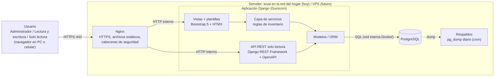
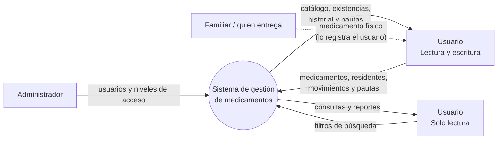
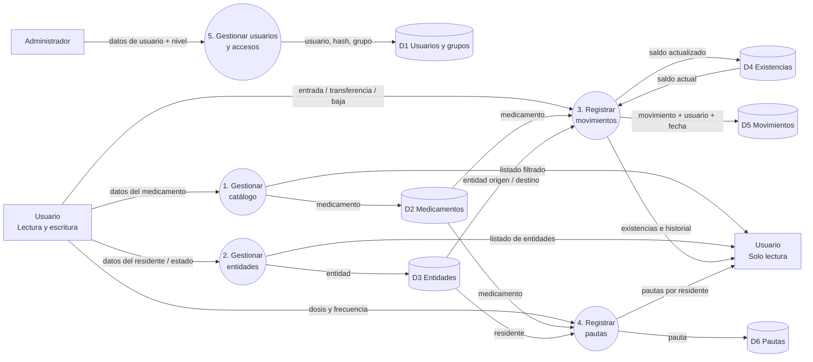
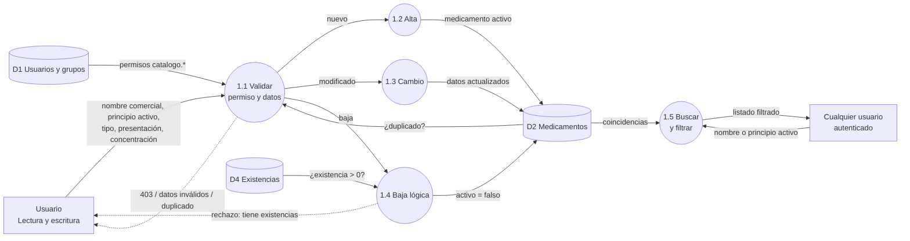
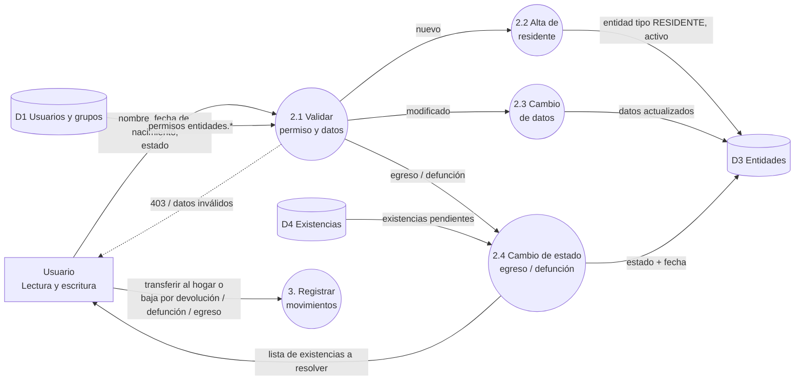
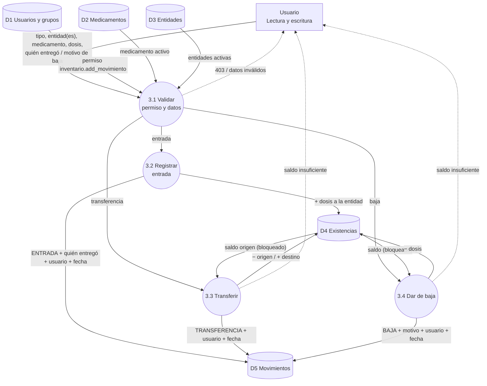
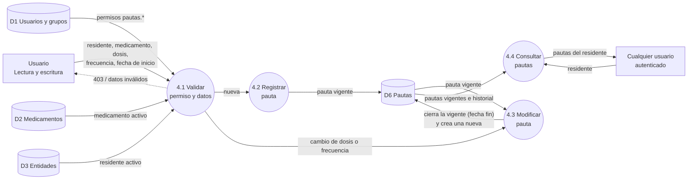
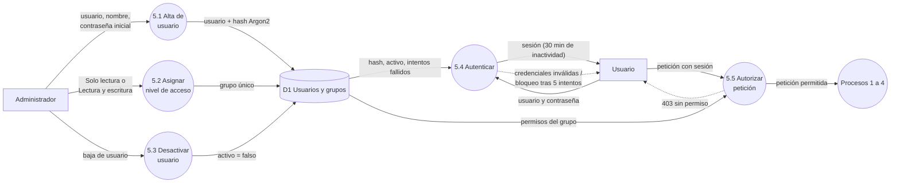
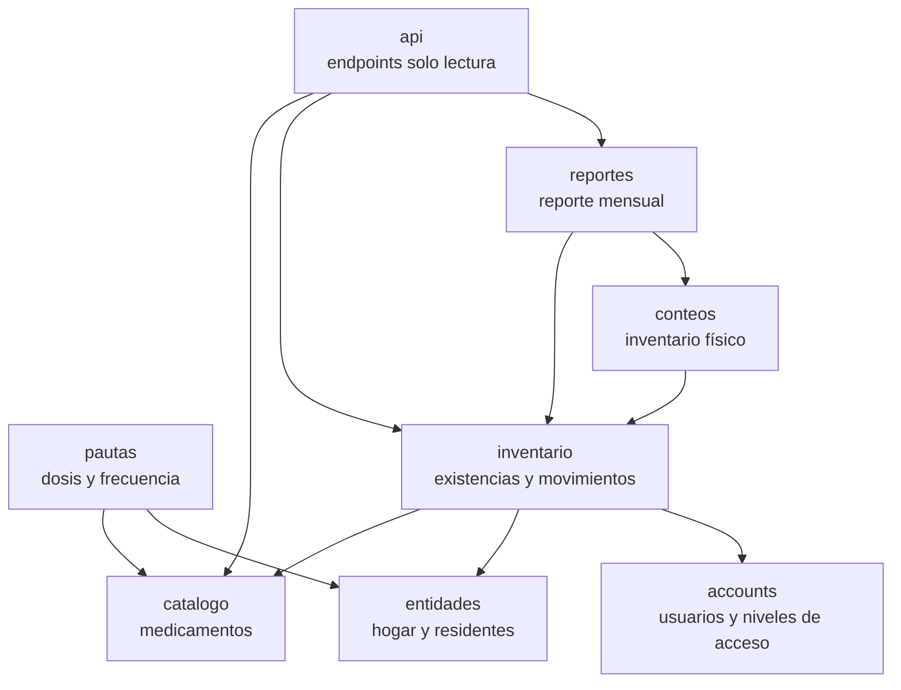
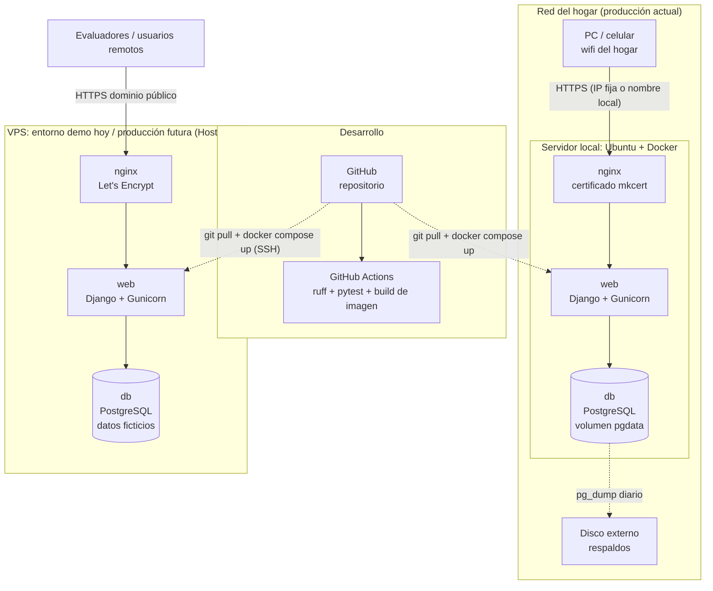

# 02 - Arquitectura del sistema (sesión con Claude)

> Transcripción de la sesión de diseño de la arquitectura con Claude, que actúa como arquitecto de software experto en aplicaciones web.

---

## Prompt 1 — Usuario

Vamos al punto 2 referente a Arquitectura. Como arquitecto de software experto en aplicaciones web, propón la arquitectura de este proyecto, preferentemente simple y escalable.

Antes de comenzar pregunta qué necesitas saber y qué vas a considerar para diseñar esta arquitectura. Explícame paso por paso qué vas a seguir.

Con estas preguntas analiza y explica qué vas a hacer para diseñar este diagrama y la arquitectura del proyecto.

---

## Respuesta 1 — Claude

Antes de proponer nada te explico qué voy a tener en cuenta, qué datos me faltan y en qué orden voy a trabajar.

### 1. Qué ya sé (lo que guía la arquitectura)

| Tipo | Requisito | Qué implica para la arquitectura |
|---|---|---|
| **Escala** | 1 sede, unos 20 residentes, de 1 a 3 usuarios | La carga es muy baja. Microservicios, colas o caché distribuida no tienen sentido aquí. |
| **Acceso** | Web responsive, desde celular y computadora | Un solo cliente web adaptable, sin app nativa. |
| **Despliegue** | Servidor local, con opción de pasar a hosting | Todo debe ser **portable**: el mismo paquete tiene que correr en local y en la nube sin cambiar código. |
| **Seguridad** | Datos personales y de salud, LFPDPPP | HTTPS, contraseñas cifradas, permisos por nivel validados en el servidor, respaldos. |
| **Datos** | Existencias por entidad, movimientos, conteos físicos | Los datos son muy relacionales y deben cuadrar siempre, así que conviene una **base de datos relacional con transacciones**. |
| **Integraciones** | Ninguna | Sin dependencias externas. |
| **Mantenimiento** | Empresa pequeña | Pocas piezas, fácil de instalar, respaldar y actualizar. |

**Mi hipótesis de partida (la confirmo con tus respuestas):** un **monolito modular** con frontend web, una API REST con módulos bien separados y una base de datos relacional, todo empaquetado en **contenedores Docker**. Es la opción más simple de operar y escala bien para este caso: los módulos se pueden separar más adelante si algún día hace falta.

### 2. Preguntas

**Tecnología y equipo**
1. ⭐ **¿Qué lenguaje o stack prefieres o dominas?** Vi que el proyecto en IntelliJ está configurado con **JDK 24**. ¿Lo hago con **Java + Spring Boot**, o prefieres otra opción como Node/TypeScript, Python o .NET?
2. ⭐ **Para el frontend, ¿prefieres una SPA** (React, Angular o Vue) **o páginas generadas en el servidor** (por ejemplo Thymeleaf)? La SPA es más moderna y mejor en celular. Las páginas en servidor son más simples de desarrollar y desplegar.
3. ¿Tienes preferencia de base de datos (PostgreSQL, MySQL o SQL Server)? Si no la tienes, propongo **PostgreSQL**.
4. ¿Quién va a mantener el sistema después de la entrega? ¿Tú, o alguien del hogar sin perfil técnico?

**Servidor local**

5. ⭐ **¿Con qué sistema operativo y recursos cuenta el servidor** (Windows o Linux, RAM aproximada)? **¿Se puede instalar Docker?**
6. ⭐ **Por ahora, ¿el acceso es solo dentro de la red del hogar (wifi), o también desde internet?** Si es desde internet hay que resolver dominio, certificado HTTPS y apertura de puertos (o un túnel), y eso cambia el diagrama de despliegue.
7. ¿Se cae el internet o la luz con frecuencia en el hogar? ¿Hace falta que el sistema funcione sin conexión?

**Operación y continuidad**

8. ¿Cuántos datos se pueden perder como máximo si falla el servidor (un día, una semana)? ¿Dónde guardamos los respaldos (disco externo, nube)?
9. ¿Basta con usuario y contraseña, o quieres doble factor (2FA) para el Administrador?

**Requisitos de la entrega del curso**

10. ⭐ **La plantilla pide una "URL del proyecto" (0.4).** ¿Los evaluadores necesitan entrar al sistema? Si es así, propongo además un **despliegue de demostración** en un hosting gratuito o barato, con datos ficticios, sin tocar el servidor local.
11. ¿La entrega del 22 de octubre es solo documentación, o también tiene que haber código funcionando? ¿Quieres integración continua (por ejemplo GitHub Actions con tests)?
12. ¿Te parece bien hacer los diagramas en **Mermaid** (se ven directo en GitHub y son coherentes con el modelo de datos) siguiendo el modelo **C4** (contexto, contenedores, componentes)?

### 3. Pasos que voy a seguir

1. **Consolidar los requisitos que guían la arquitectura**: la tabla de arriba más tus respuestas, priorizando simplicidad, seguridad y portabilidad.
2. **Elegir el estilo de arquitectura**: comparar en pocas líneas monolito modular, microservicios y serverless, y justificar la elección con sus beneficios y sacrificios, como pide la sección 2.1.
3. **Definir los componentes principales (2.2)**:
   - Frontend web responsive.
   - Backend con API REST dividido en módulos: autenticación y usuarios, catálogo de medicamentos, entidades (residentes y hogar), movimientos (entradas, transferencias y bajas), pautas, inventario físico y reportes.
   - Base de datos relacional.
   - Proxy inverso (Nginx o Caddy) para HTTPS.
4. **Elegir el stack concreto** según tus respuestas 1 a 3, justificando cada pieza.
5. **Diseñar la estructura del repositorio (2.3)**: carpetas `frontend/`, `backend/` (organizado por módulo o dominio), `docker/` y `docs/`, y explicar el patrón interno del backend (capas controlador → servicio → repositorio).
6. **Diseñar infraestructura y despliegue (2.4)**:
   - Un archivo Docker Compose con proxy, aplicación y base de datos.
   - Diagrama del despliegue en el servidor local y del camino para pasar a hosting.
   - Respaldos programados de la base de datos.
   - Opcional: despliegue de demostración y CI.
7. **Definir la seguridad (2.5)**, relacionada con la LFPDPPP:
   - HTTPS y contraseñas con hash (bcrypt o Argon2).
   - Sesión o token con expiración y permisos por rol en el backend.
   - Validación de entradas, protección contra inyección SQL, XSS y CSRF.
   - Secretos fuera del código, respaldos y aviso de privacidad.
8. **Definir la estrategia de tests (2.6)**: unitarios para las reglas de existencias (por ejemplo, que no haya saldo negativo y que las transferencias sean atómicas), de integración para la API y uno de extremo a extremo para el flujo principal.
9. **Hacer los diagramas en Mermaid**: contexto (C4 nivel 1), contenedores (C4 nivel 2) y despliegue.
10. **Escribir las secciones 2.1 a 2.6 en el `readme.md`** y pedirte revisión.

Con las preguntas marcadas con ⭐ (1, 2, 5, 6 y 10) ya puedo arrancar. Las demás las resuelvo con valores razonables y las dejo anotadas como supuestos.

---

## Prompt 2 — Usuario

Puedes pasar todo el contenido de este chat justo antes de la pregunta del punto 2 de ingeniería, formateado con markdown, a un archivo `01-descripcion-general-producto-claude.md`.

## Respuesta 2 — Claude

Ya guardé la conversación de definición del producto en `01-descripcion-general-producto-claude.md`: los prompts, las preguntas de Product Owner, tus respuestas y el texto final de las secciones 0.3, 1.1 y 1.2.

---

## Prompt 3 — Usuario (respuestas 1 a 4)

1. **Stack:** Prefiero un stack con todo incluido como Django, si es viable. Necesito que sea sencillo de montar en un hosting y que sea soportado por HostGator o Hostinger con VPS.
2. **Frontend:** Soy ingeniero de infraestructura y backend. No quiero SPA porque son lentas para cargar; queda cubierto con la respuesta 1.
3. **Base de datos:** PostgreSQL.
4. **Mantenimiento:** Yo.

---

## Respuesta 3 — Claude

Con estas respuestas el stack queda definido. Te explico cómo lo voy a plantear y qué me falta para escribir la sección 2.

### Decisiones tomadas

| Pieza | Elección | Por qué encaja |
|---|---|---|
| **Framework** | **Django** (monolito modular, una *app* de Django por módulo) | Trae casi todo lo que necesitamos: ORM, migraciones, login, sesiones, permisos, protección CSRF, formularios con validación y panel de administración. Hay menos piezas que montar y mantener, y eso te conviene si lo mantienes tú solo. |
| **Frontend** | **Plantillas de Django generadas en el servidor + Bootstrap 5**, y opcionalmente **HTMX** para los filtros | Carga rápido y funciona bien en celular, sin compilar JavaScript. HTMX permite filtrar y paginar sin recargar la página entera, sin convertirlo en una SPA. |
| **Base de datos** | **PostgreSQL** | Transacciones fiables para los movimientos de existencias (una transferencia descuenta y suma en un solo paso). Bloqueo de filas para evitar saldos negativos. Buena búsqueda de texto por nombre y principio activo. |
| **Servidor de aplicación** | **Gunicorn** detrás de **Nginx** (HTTPS y archivos estáticos) | Es la forma estándar y probada de desplegar Django. |
| **Empaquetado** | **Docker Compose** (`nginx` + `web` + `db`) | El mismo `docker-compose.yml` corre en el servidor local y en un VPS. Hostinger VPS y HostGator VPS dan acceso root con Ubuntu, así que se puede instalar Docker. |

**Ojo con el hosting:** Django **necesita un VPS**. El *hosting compartido* de HostGator o Hostinger no lo soporta bien, porque no deja tener procesos permanentes como Gunicorn ni instalar PostgreSQL. Con VPS no hay problema.

**Permisos:** los dos niveles de acceso se resuelven con los **grupos de Django**: "Solo lectura" y "Lectura y escritura", y el superusuario es el Administrador. El panel de administración de Django queda solo para gestionar usuarios. La operación diaria se hace en pantallas propias.

### Lo que me falta (le puse una opción por defecto a cada pregunta)

1. **Servidor local (pregunta 5):** ¿qué sistema operativo tiene y se puede instalar Docker?
   *Por defecto: Linux (Ubuntu) con Docker. Si es Windows, uso Docker Desktop o WSL2.*
2. **Acceso (pregunta 6):** por ahora, ¿solo desde la red del hogar o también desde internet?
   *Por defecto: solo desde la red del hogar, con un certificado HTTPS autofirmado o hecho con `mkcert`. Al pasar al VPS se activa un certificado de Let's Encrypt con un dominio.*
3. **URL para los evaluadores (pregunta 10):** ¿armamos un despliegue de demostración en un VPS con datos ficticios para llenar la sección 0.4?
   *Por defecto: sí, documentado como "entorno demo".*
4. **Sección 4 (API):** la plantilla pide documentar hasta 3 endpoints en formato OpenAPI "si tu backend se comunica a través de API". Al generar las páginas en el servidor, no hace falta una API. Hay dos opciones:
   - **a)** Exponer 2 o 3 endpoints JSON de solo lectura (existencias por entidad, búsqueda de medicamentos, reporte mensual) con Django REST Framework, documentados con OpenAPI. Sirven para la entrega y quedan para integraciones futuras.
   - **b)** Indicar que la sección no aplica y explicar por qué.

   *Mi recomendación es la **a**: es poco esfuerzo y cubre la rúbrica.*

¿Confirmas estas opciones por defecto o cambias alguna? Con tu respuesta escribo las secciones 2.1 a 2.6 en el `readme.md`, con los diagramas en Mermaid.

---

## Prompt 4 — Usuario (respuestas)

- **Servidor local:** Por defecto (Linux Ubuntu con Docker).
- **Acceso:** Por ahora la máquina solo es accesible desde la red del hogar; el despliegue futuro será en HostGator/VPS una vez que se fondee.
- **URL para evaluadores:** Sí.
- **Sección 4 (API):** Tomemos la opción **a)**.

Revisa las respuestas, casi todo son tus valores por defecto.

---

## Respuesta 4 — Claude

Ya escribí las secciones 2.1 a 2.6 en el `readme.md`, con tres diagramas en Mermaid que GitHub muestra directamente.

- **2.1 Diagrama de arquitectura:** monolito modular con Django: Nginx → Gunicorn/Django → PostgreSQL, más respaldos. Incluye la justificación, los beneficios y los sacrificios que pide la plantilla.
- **2.2 Componentes:** tabla de tecnologías (Django 5.2 LTS, Bootstrap 5 + HTMX, DRF + OpenAPI, PostgreSQL 17) y un diagrama de los 8 módulos y sus dependencias.
- **2.3 Estructura de ficheros:** el árbol del repositorio organizado por dominio, con `services.py` para las reglas de inventario y la configuración separada por entorno.
- **2.4 Infraestructura y despliegue:** diagrama con la red del hogar, el VPS y GitHub; tabla de entornos (desarrollo, producción local, demo y producción futura); pipeline de CI; comandos de despliegue; respaldos y pasos para migrar a hosting.
- **2.5 Seguridad:** 12 prácticas concretas (HTTPS, Argon2, expiración de sesión, `django-axes`, permisos validados en el backend, CSRF/XSS/SQLi, aislamiento de la base de datos, LFPDPPP, respaldos cifrados…).
- **2.6 Tests:** herramientas y 9 casos concretos de servicios, concurrencia, permisos, API y un flujo completo.

**Tres puntos a revisar:**
1. **El entorno demo cuesta dinero.** El VPS se contrataría "una vez que se fondee", pero también se aceptó la demo para los evaluadores. Los VPS de Hostinger o HostGator son de pago. Si no quieres pagar todavía, puedo cambiar la demo a una opción gratuita, como Oracle Cloud Free Tier, que también corre Docker.
2. **La sección 2.6 describe tests que aún no existen.** La plantilla pide "tests realizados", pero todavía no hay código. Cuando los implementemos, habrá que ajustar la redacción.
3. **Agregué una decisión de diseño: los movimientos no se editan ni se borran.** Los errores se corrigen con un movimiento inverso. Es una buena práctica para que el inventario cuadre y apoya la trazabilidad mínima, pero no lo habías pedido explícitamente.

---

## Prompt 5 — Usuario

1. Sin preocupaciones, quédate con HostGator; si no se fondea siempre puedo grabar el demo en mi máquina de desarrollo.
2. De acuerdo.
3. De acuerdo.

¿Podrías meter la conversación a partir de la sección 2 de Arquitectura, hasta este prompt, en el archivo `02-arquitectura.md`, dándole formato con markdown? Gracias.

---

## Respuesta 5 — Claude

- Actualicé el `readme.md` para dejar **HostGator** como único proveedor de VPS. Agregué como alternativa para la demo un **video grabado en el equipo de desarrollo** si todavía no hay VPS.
- Se mantienen la sección 2.6 (se ajustará al implementar los tests) y la regla de **movimientos inmutables**.
- Esta transcripción quedó en `02-arquitectura.md`.

---

## Prompt 6 — Usuario

**Diagrama de Flujo de Datos**

Crea un diagrama de flujo de datos. Crea un diagrama que muestre los principales flujos de información en esta aplicación.

Modela los flujos principales de los requisitos funcionales:
1. Flujo de datos del catálogo de medicamentos: alta, baja y cambios (ABC).
2. Cómo fluye la información en la gestión de entidades (ABC).
3. Proceso de definir existencias por entidad: entradas, transferencias y bajas.
4. Registro de la pauta de medicamentos del residente (registro de dosis y frecuencia).
5. Proceso de alta de usuarios y nivel de acceso global: asignación de solo lectura o lectura y escritura.

---

## Respuesta 6 — Claude

Agregué el subapartado **2.1.1. Diagrama de flujo de datos (DFD)** al `readme.md`, después del diagrama de arquitectura. Usa notación clásica de DFD en Mermaid: entidades externas, procesos numerados y almacenes de datos D1 a D6.

- **Tabla de almacenes de datos:** D1 Usuarios y grupos, D2 Medicamentos, D3 Entidades, D4 Existencias, D5 Movimientos y D6 Pautas.
- **Nivel 0 (contexto):** el sistema y sus actores (Administrador, Lectura y escritura, Solo lectura, y el familiar como fuente física del medicamento).
- **Nivel 1:** los 5 procesos principales y cómo leen y escriben en los almacenes.
- **Un diagrama de detalle por cada flujo pedido**, con validaciones, respuestas de error y reglas de negocio:
  1. Catálogo: alta, cambio, baja lógica y búsqueda.
  2. Entidades: alta de residente, cambio de datos y cambio de estado (egreso o defunción).
  3. Existencias: entrada, transferencia y baja, en una transacción y con bloqueo de saldo.
  4. Pautas: registro, modificación con historial y consulta.
  5. Usuarios: alta, asignación de nivel, desactivación, autenticación y autorización de cada petición.

**Reglas que agregué al modelar los flujos (a validar):**
1. **La baja de un medicamento es lógica** y se rechaza si todavía tiene existencias en alguna entidad.
2. **No se permiten medicamentos duplicados** (misma combinación de nombre comercial, presentación y concentración).
3. **La entidad Hogar se crea al instalar** y no se puede dar de baja.
4. **El egreso o la defunción no bloquean el cambio de estado**, pero el sistema muestra las existencias pendientes del residente para resolverlas con transferencia o baja.
5. **Cambiar una pauta** cierra la vigente y crea una nueva, para conservar el historial.
6. **Cada usuario tiene un solo grupo**, y los usuarios se desactivan en lugar de borrarse.

---

## Prompt 7 — Usuario

1. Correcto. 2. Correcto. 3. Correcto. 4. Correcto. 5. Correcto. 6. Correcto. Los diagramas están revisados y están correctos.

---

## Respuesta 7 — Claude

Quedan confirmadas las 6 reglas del diagrama de flujo de datos, y los diagramas fueron revisados en la vista previa. El texto del `readme.md` (apartado 2.1.1) no cambia, porque ya presentaba esas reglas como definitivas. Estas reglas pasan a ser restricciones del modelo de datos (sección 3).

---

## Anexo — Texto final escrito en `readme.md` (sección 2)

### 2.1. Diagrama de arquitectura



**Patrón:** **monolito modular** sobre el patrón **MVT (Modelo–Vista–Template) de Django**, con páginas **renderizadas en el servidor**. Cada módulo de negocio es una *app* de Django independiente. Las reglas de inventario (entradas, transferencias y bajas) viven en una **capa de servicios** (`services.py`), separada de las vistas, para que la web y la API compartan la misma lógica y se pueda probar de forma aislada.

**Por qué esta arquitectura:**
- **Escala del problema:** 1 sede, ~20 residentes y 1 a 3 usuarios. La carga es mínima, y microservicios, una SPA o colas de mensajes solo añadirían complejidad.
- **Un solo mantenedor (perfil infra/backend):** Django trae ORM, migraciones, autenticación, sesiones, permisos por grupos, CSRF, formularios con validación y panel de administración. Hay menos piezas que integrar y mantener.
- **Rendimiento en celular:** el HTML llega listo desde el servidor, sin descargar ni compilar un *bundle* de JavaScript. HTMX permite filtrar y paginar sin recargar la página completa.
- **Portabilidad:** todo se empaqueta con **Docker Compose**, de modo que el mismo despliegue corre en el servidor local y en un VPS de HostGator sin cambiar código.
- **Integridad de datos:** PostgreSQL ofrece transacciones y bloqueo de filas, necesarios para que una transferencia descuente y abone en un solo paso y para que nunca haya existencias negativas.

**Beneficios:**
- Desarrollo rápido.
- Pocas dependencias.
- Despliegue sencillo, de 3 contenedores.
- Seguridad sólida por defecto.
- Facilidad para probar las reglas de negocio.
- Los módulos bien delimitados permiten extraer servicios en el futuro si fuera necesario.

**Sacrificios / déficits:**
- **Escalado solo vertical** (servidor más grande), suficiente para este volumen.
- **Acoplamiento a Django**: cambiar de framework implicaría reescribir.
- **Interactividad limitada** frente a una SPA: no hay edición en tiempo real ni funcionamiento sin conexión.
- **El servidor local es un punto único de falla**, que se mitiga con respaldos diarios y un procedimiento de restauración documentado.
- **Sin acceso desde fuera del hogar** mientras se despliegue solo en la red local.

#### 2.1.1. Diagrama de flujo de datos (DFD)

**Notación:** rectángulo = entidad externa · círculo = proceso · cilindro = almacén de datos · flecha continua = flujo de datos · flecha punteada = respuesta de error o flujo físico (fuera del sistema).

**Almacenes de datos** (el detalle de cada uno está en la sección 3 del readme):

| Id | Almacén | Contenido |
|---|---|---|
| D1 | Usuarios y grupos | Usuarios, contraseña (hash), estado activo y grupo (`Solo lectura` / `Lectura y escritura`) |
| D2 | Medicamentos | Catálogo: nombre comercial, principio activo, genérico/original, presentación, concentración, activo |
| D3 | Entidades | El hogar y los residentes (nombre, fecha de nacimiento, estado) |
| D4 | Existencias | Saldo en dosis por entidad y medicamento |
| D5 | Movimientos | Entradas, transferencias y bajas, con usuario y fecha/hora (inmutables) |
| D6 | Pautas | Dosis y frecuencia por residente y medicamento, con vigencia |

##### Nivel 0 — Contexto



##### Nivel 1 — Procesos principales



> Todos los procesos validan la sesión y los permisos contra **D1** antes de leer o escribir (proceso 5.4 y 5.5). Un usuario `Solo lectura` solo recibe flujos de salida (consultas); cualquier escritura que intente devuelve `403`.

##### Flujo 1 — Catálogo de medicamentos (alta / baja / cambio)



- La **baja es lógica** (`activo = falso`) para conservar el historial de movimientos. Se rechaza si alguna entidad todavía tiene existencias de ese medicamento.
- No se permite duplicar la combinación nombre comercial + presentación + concentración.

##### Flujo 2 — Gestión de entidades (alta / baja / cambio)



- La entidad **Hogar** se crea en la instalación (semilla) y no se puede dar de baja.
- Los residentes **no se borran**: el egreso o la defunción cambian su estado. El sistema muestra las existencias pendientes del residente para que el usuario las resuelva con el flujo 3.

##### Flujo 3 — Existencias por entidad (entradas, transferencias y bajas)



- Cada operación corre en una sola transacción (`transaction.atomic()`): se escribe el movimiento en **D5** y se actualiza el saldo en **D4**, o no se hace nada.
- Transferencias y bajas **bloquean el saldo** (`select_for_update()`) y lo validan antes de descontar, para que nunca quede negativo.
- Motivos de baja: consumo / administración, caducidad, merma, rotura, devolución a la familia, defunción y egreso.
- Los movimientos no se editan ni se borran: un error se corrige con el movimiento inverso.

##### Flujo 4 — Pauta del residente (dosis y frecuencia)



- La pauta es **informativa**: no mueve existencias ni registra la administración.
- Un cambio de dosis o frecuencia cierra la pauta vigente y crea una nueva, así queda el historial.

##### Flujo 5 — Alta de usuarios y nivel de acceso global



- Solo el **Administrador** (superusuario) da de alta usuarios, desde el panel de administración de Django.
- Cada usuario pertenece a **un solo grupo**, que define su nivel global: `Solo lectura` (consulta y reportes) o `Lectura y escritura` (todas las operaciones de los flujos 1 a 4).
- Los usuarios **se desactivan en lugar de borrarse**, porque sus movimientos deben seguir mostrando quién los registró.

### 2.2. Descripción de componentes principales

| Componente | Tecnología | Responsabilidad |
|---|---|---|
| **Proxy inverso** | Nginx | Termina HTTPS (certificado `mkcert` en la red local, Let's Encrypt en el VPS), sirve `static/`, aplica cabeceras de seguridad y reenvía el resto a Gunicorn. |
| **Servidor de aplicación** | Gunicorn | Ejecuta la aplicación Django (WSGI) con varios *workers*. |
| **Backend / web** | Python 3.12 + Django 5.2 LTS | Vistas, formularios, autenticación, autorización por grupos y lógica de negocio. |
| **Frontend** | Plantillas Django + Bootstrap 5 + HTMX | Interfaz responsive renderizada en el servidor. HTMX actualiza fragmentos de página (filtros, búsquedas) sin una SPA. |
| **API REST** | Django REST Framework + drf-spectacular | 3 endpoints JSON **de solo lectura** (existencias por entidad, búsqueda de medicamentos, reporte mensual) documentados en OpenAPI. |
| **Base de datos** | PostgreSQL 17 | Persistencia relacional, transacciones y búsqueda por nombre / principio activo. |
| **Respaldos** | `pg_dump` + cron | Respaldo diario comprimido, con retención de 14 días y copia a disco externo. |

**Módulos (apps de Django) y sus dependencias:**



- **accounts:** inicio y cierre de sesión. Grupos `Solo lectura` y `Lectura y escritura`. El Administrador (superusuario) gestiona los usuarios desde el panel de administración de Django.
- **catalogo:** alta, baja y cambio de medicamentos (nombre comercial, principio activo, genérico u original, presentación, concentración) y búsqueda.
- **entidades:** el hogar y los residentes (nombre, fecha de nacimiento, estado). Cada uno es una *entidad* dueña de existencias.
- **pautas:** dosis y frecuencia de cada medicamento por residente (informativo).
- **inventario:** existencias por entidad y medicamento (en dosis) y registro de **movimientos** (entrada, transferencia, baja con motivo). Incluye `services.py` con las reglas de negocio.
- **conteos:** conteo físico a demanda por entidad y rango de fechas, y comparación contra lo registrado.
- **reportes:** reporte mensual en pantalla de existencias y movimientos.
- **api:** *serializers* y vistas de solo lectura de DRF, además del esquema OpenAPI.

### 2.3. Descripción de alto nivel del proyecto y estructura de ficheros

```
AI4Devs-finalproject-vmrr/
├── readme.md                  # documentación del proyecto
├── prompts.md                 # prompts utilizados con IA
├── docs/                      # documentación de apoyo y diagramas
├── docker-compose.yml         # servicios: nginx, web, db
├── .env.example               # variables de entorno de ejemplo (el .env real no se versiona)
├── .github/workflows/ci.yml   # integración continua: lint + tests
├── nginx/
│   ├── default.conf           # proxy inverso, HTTPS, cabeceras de seguridad
│   └── certs/                 # certificados locales (no versionados)
├── scripts/
│   ├── backup_db.sh           # respaldo con pg_dump
│   └── restore_db.sh          # restauración de un respaldo
└── app/                       # proyecto Django
    ├── Dockerfile
    ├── requirements.txt
    ├── manage.py
    ├── config/                # configuración global
    │   ├── settings/          # base.py, local.py, prod.py
    │   ├── urls.py
    │   └── wsgi.py
    ├── apps/                  # un módulo de negocio por app
    │   ├── accounts/
    │   ├── catalogo/
    │   ├── entidades/
    │   ├── pautas/
    │   ├── inventario/
    │   │   ├── models.py      # Existencia, Movimiento
    │   │   ├── services.py    # reglas: registrar_entrada, transferir, dar_de_baja
    │   │   ├── forms.py
    │   │   ├── views.py
    │   │   ├── urls.py
    │   │   ├── templates/inventario/
    │   │   └── tests/
    │   ├── conteos/
    │   ├── reportes/
    │   └── api/               # serializers.py, views.py, urls.py
    ├── templates/             # base.html y layout común (Bootstrap)
    ├── static/                # css, js (htmx), imágenes
    └── fixtures/              # datos de ejemplo y grupos de permisos
```

**Patrón:** estructura estándar de Django organizada **por dominio**: cada app contiene sus modelos, servicios, vistas, plantillas y tests. La configuración está separada por entorno (`local` / `prod`) y se controla con variables de entorno, siguiendo la metodología *12-factor*. La infraestructura (`nginx/`, `scripts/`, `docker-compose.yml`) queda fuera del código de la aplicación.

### 2.4. Infraestructura y despliegue



**Entornos:**

| Entorno | Ubicación | Acceso | Certificado | Datos |
|---|---|---|---|---|
| **Desarrollo** | Equipo del desarrollador | `localhost` | — | Semillas de ejemplo |
| **Producción local** | Servidor Ubuntu con Docker en el hogar | Solo red del hogar | `mkcert` (CA local instalada en los dispositivos) | Reales |
| **Demo** | VPS HostGator (alternativa: video grabado en el equipo de desarrollo si aún no hay VPS) | Internet | Let's Encrypt | Ficticios |
| **Producción futura** | VPS, cuando haya presupuesto | Internet | Let's Encrypt | Reales (migrados con `pg_dump` / `pg_restore`) |

**Contenedores (`docker-compose.yml`):**
- `nginx`: único servicio con puertos expuestos (80 → redirección a 443).
- `web`: Django + Gunicorn, accesible solo dentro de la red interna de Docker.
- `db`: PostgreSQL con un volumen persistente `pgdata`. No expone puertos al exterior.

**Proceso de despliegue:**
1. **Integración continua:** en cada *push* o *pull request* a `main`, GitHub Actions ejecuta `ruff` (lint), `pytest` contra un servicio PostgreSQL y el *build* de la imagen. Solo se integra a `main` con el pipeline en verde.
2. **Despliegue (local o VPS):** se hace manualmente por SSH, lo cual es suficiente para un solo mantenedor:
   ```bash
   git pull origin main
   docker compose up -d --build
   docker compose exec web python manage.py migrate
   docker compose exec web python manage.py collectstatic --noinput
   ```
3. **Primera instalación:** se copia `.env.example` a `.env` y se configuran los secretos, se generan los certificados (`mkcert` en local, `certbot` en el VPS), se crea el superusuario con `createsuperuser` y se cargan los grupos de permisos con `loaddata grupos`.
4. **Respaldos:** un cron diario ejecuta `scripts/backup_db.sh`, que genera un `pg_dump` comprimido y cifrado, con retención de 14 días y copia a un disco externo. Una vez al mes se prueba la restauración con `scripts/restore_db.sh`.
5. **Migración a hosting:** se aprovisiona el VPS con Ubuntu y Docker, se clona el repositorio, se restaura el último respaldo y se apunta el dominio. No hay cambios de código, solo variables de entorno.

### 2.5. Seguridad

| Práctica | Implementación |
|---|---|
| **Cifrado en tránsito** | HTTPS en todos los entornos. En producción: `SECURE_SSL_REDIRECT=True`, HSTS, `SESSION_COOKIE_SECURE` y `CSRF_COOKIE_SECURE`. |
| **Contraseñas** | Hash **Argon2** (`django[argon2]`) y validadores de longitud y complejidad de Django. |
| **Sesiones** | Expiran tras 30 min de inactividad (`SESSION_COOKIE_AGE=1800`, `SESSION_SAVE_EVERY_REQUEST=True`) y al cerrar el navegador. Cookies `HttpOnly` y `SameSite=Lax`. |
| **Fuerza bruta** | `django-axes`: bloquea temporalmente la cuenta tras 5 intentos fallidos. |
| **Autorización** | Grupos `Solo lectura` / `Lectura y escritura` con permisos de Django, validados **en el backend** (`PermissionRequiredMixin` en vistas y `DjangoModelPermissions` en la API). La interfaz oculta botones según el nivel, pero la autorización real ocurre en el servidor. Ejemplo: un usuario de solo lectura que envía un `POST` a `/inventario/bajas/` recibe `403`. |
| **API** | Solo lectura (`GET`), requiere sesión autenticada y no expone métodos de escritura. |
| **Vulnerabilidades web** | CSRF por defecto en formularios y peticiones HTMX. Protección contra XSS por el *autoescape* de plantillas. Protección contra inyección SQL al usar el ORM con consultas parametrizadas. `X-Frame-Options: DENY` y `Content-Security-Policy` en Nginx. |
| **Secretos y configuración** | `SECRET_KEY` y credenciales de base de datos en `.env` (no versionado). `DEBUG=False` y `ALLOWED_HOSTS` restringido en producción. |
| **Aislamiento de red** | PostgreSQL sin puertos expuestos, accesible solo desde el contenedor `web`. El usuario de base de datos de la aplicación tiene privilegios mínimos. |
| **Integridad y trazabilidad** | Cada movimiento guarda usuario y fecha/hora. Los movimientos **no se editan ni se borran**: los errores se corrigen con un movimiento inverso. Las operaciones de inventario corren en `transaction.atomic()` con `select_for_update()` para evitar saldos negativos. |
| **Privacidad (LFPDPPP)** | Minimización de datos (solo nombre y fecha de nacimiento del residente), aviso de privacidad visible y residentes egresados o fallecidos marcados como inactivos en lugar de borrados, para conservar el historial. |
| **Respaldos** | Diarios y cifrados (GPG), con retención limitada y prueba de restauración mensual. |
| **Dependencias** | Versiones fijadas en `requirements.txt` y revisión periódica con `pip-audit`. |

### 2.6. Tests

**Herramientas:** `pytest` + `pytest-django` + `factory_boy`, ejecutados en CI contra PostgreSQL real. Playwright (Python) para el flujo de extremo a extremo.

| Tipo | Caso | Resultado esperado |
|---|---|---|
| **Unitario (servicios)** | Registrar una entrada de 30 dosis para un residente | La existencia del residente aumenta en 30 y se crea un movimiento con usuario, fecha y quién entregó. |
| **Unitario (servicios)** | Dar de baja más dosis de las disponibles | Se lanza `ExistenciaInsuficiente` y el saldo no cambia. |
| **Unitario (servicios)** | Transferir del hogar a un residente cuando falla el abono al destino | La transacción se revierte y el saldo del hogar queda igual (atomicidad). |
| **Concurrencia** | Dos bajas simultáneas que juntas superan la existencia (`TransactionTestCase`) | Solo una se aplica y el saldo nunca es negativo. |
| **Unitario (conteos)** | Conteo físico de 18 dosis cuando el sistema registra 20 | La diferencia reportada es −2. |
| **Permisos** | Usuario `Solo lectura` envía un `POST` para registrar una baja | Responde `403` y no se crea el movimiento. |
| **Permisos** | Usuario sin sesión accede a cualquier pantalla | Redirige al login. |
| **API** | `GET /api/existencias/?entidad=<id>` sin autenticación / autenticado | `403` / `200` con solo las existencias de esa entidad. |
| **Extremo a extremo** | Login → alta de medicamento → entrada a residente → consulta filtrada por principio activo | El medicamento aparece con la existencia correcta. |

**Criterio:** cobertura ≥ 80 % en las capas de servicios y permisos, que concentran las reglas críticas del negocio.
