# 03 - Modelo de datos (sesión con Claude)

> Transcripción de la sesión de diseño del modelo de datos con Claude, que actúa como arquitecto de diseño.

---

## Prompt 1 — Usuario

Como arquitecto de diseño, diseña un modelo de datos completo para este sistema de Gestión de Medicamentos del Hogar Gerontológico, que cubra los requisitos funcionales ya detallados en la sección 1.2 del `readme.md`:

- Base de datos normalizada (3FN).
- Pon atención especial a los antipatrones en el diseño de bases de datos.
- Soporte para los almacenes de datos definidos en la sección 2.1.1 del `readme.md`, a partir de las 6 tablas de datos del diagrama de flujo (usuarios y grupos, medicamentos, entidades, existencias, movimientos y pautas):

| Id | Almacén | Contenido |
|---|---|---|
| D1 | Usuarios y grupos | Usuarios, contraseña (hash), estado activo y grupo (Solo lectura / Lectura y escritura) |
| D2 | Medicamentos | Catálogo: nombre comercial, principio activo, genérico/original, presentación, concentración, activo |
| D3 | Entidades | El hogar y los residentes (nombre, fecha de nacimiento, estado) |
| D4 | Existencias | Saldo en dosis por entidad y medicamento |
| D5 | Movimientos | Entradas, transferencias y bajas, con usuario y fecha/hora (inmutables) |
| D6 | Pautas | Dosis y frecuencia por residente y medicamento, con vigencia |

- Considera las reglas confirmadas:
  - La baja de un medicamento es lógica.
  - No se repite la combinación de nombre comercial, presentación y concentración.
  - El Hogar es una entidad fija.
  - Cada usuario tiene un solo grupo.
  - Las pautas guardan vigencia.
  - Los movimientos no se modifican y son la trazabilidad mínima.
  - Los conteos físicos, que hacen falta para comparar existencia contra registrado.

Crea los diagramas entidad-relación usando Mermaid e incluye todos sus detalles: claves primarias, claves foráneas, tipos de datos y restricciones.

---

## Respuesta 1 — Claude

Escribí la sección 3 completa en el `readme.md`.

**3.1. Diagrama del modelo de datos**
- **Diagrama ER** en Mermaid con **17 tablas**. Cada columna tiene tipo, PK, FK, UK y restricciones, y cada relación su cardinalidad.
- **Tabla de correspondencia** entre los almacenes D1 a D6 del diagrama de flujo de datos y las tablas.
- **DDL de PostgreSQL** con las restricciones avanzadas:
  - Un solo grupo por usuario y un solo Hogar.
  - Medicamentos sin duplicados (sin distinguir mayúsculas).
  - Columnas obligatorias según el tipo de movimiento.
  - Movimientos inmutables (privilegios + *trigger*).
  - Pautas sin vigencias traslapadas (`EXCLUDE USING gist`).
  - Diferencia del conteo calculada por la base de datos.
- **Datos semilla**: el Hogar, los 2 grupos, los motivos de baja y las presentaciones.

**3.2. Descripción de entidades**
- Una tabla por entidad con atributo, tipo, restricciones y descripción, más sus relaciones.
- Justificación de la **3FN** y de las excepciones controladas.
- Tabla de **12 antipatrones evitados**.

**Decisiones de diseño nuevas (a validar):**
1. **Principio activo como tabla propia** con relación N:M a medicamento, para soportar combinaciones (ej. losartán + hidroclorotiazida) y filtrar sin listas separadas por comas.
2. **Presentación como catálogo** (`presentacion`) en lugar de texto libre.
3. **Supertipo `entidad` con subtipo `residente`**, para evitar la asociación polimórfica en existencias, movimientos y conteos.
4. **Cantidades decimales** (`numeric(10,2)`), para admitir media tableta.
5. **Nuevo motivo de baja `CORRECCION`**, para revertir una entrada registrada por error.
6. **Pauta con `frecuencia_horas`** (cada N horas) y bandera `si_necesario` (PRN).
7. **Conteo físico con estado** `EN_PROCESO` / `CERRADO`, y sin ajuste automático de existencias.
8. **`origen_entrada`** (`FAMILIAR`, `HOGAR`, `OTRO`) además del nombre de quien entregó.

---

## Prompt 2 — Usuario

Confirmo 1, 2, 3, 4, 5, 6, 7 y 8. En la tabla `residente`, agregar el nombre; es necesario partirlo en campos:
- `primer_nombre` (NOT NULL)
- `segundo_nombre` (NULL)
- `primer_apellido` (NOT NULL)
- `segundo_apellido` (NULL)

En la tabla `entidad` se puede dejar como está para poder capturar el HOGAR.

---

## Respuesta 2 — Claude

Quedan confirmadas las 8 decisiones de diseño. Cambios aplicados en la sección 3 del `readme.md`:

1. **`residente`:** agregué `primer_nombre` (varchar(60), NOT NULL), `segundo_nombre` (varchar(60), NULL), `primer_apellido` (varchar(60), NOT NULL) y `segundo_apellido` (varchar(60), NULL). Están en el diagrama ER y en la tabla de atributos.
2. **`entidad.nombre`:** se conserva para capturar el nombre del Hogar. Para no duplicar el nombre del residente en dos tablas (lo que rompería la 3FN), ahora es **obligatorio solo cuando `tipo = 'HOGAR'`** y queda nulo en los residentes. Lo garantiza el CHECK `ck_entidad_nombre`.
3. **Nombre para mostrar del residente:** se compone al vuelo con los 4 campos, omitiendo los nulos, y no se guarda.
4. **Nuevo índice `ix_residente_apellido_nombre`** sobre apellidos y primer nombre, para acelerar el filtro por paciente.
5. Agregué el desglose del nombre a la justificación de la 3FN.

---

## Anexo — Texto final escrito en `readme.md` (sección 3)

### **3.1. Diagrama del modelo de datos:**

> Recomendamos usar mermaid para el modelo de datos, y utilizar todos los parámetros que permite la sintaxis para dar el máximo detalle, por ejemplo las claves primarias y foráneas.

**Motor:** PostgreSQL 17. **Convenciones:**
- Claves primarias sustitutas `bigint GENERATED BY DEFAULT AS IDENTITY` (las tablas de catálogo pequeñas usan `smallint`).
- Las claves naturales se protegen con `UNIQUE`.
- Las fechas con hora son `timestamptz`.
- Las cantidades son `numeric(10,2)`, para admitir media tableta sin errores de redondeo.
- **Todas las claves foráneas son `ON DELETE RESTRICT`** (`PROTECT` en Django): no se puede borrar físicamente ningún registro con historial.

```mermaid
erDiagram
    usuario {
        bigint id PK "IDENTITY"
        varchar username UK "150, NOT NULL"
        varchar password "128, NOT NULL, hash Argon2"
        varchar first_name "150, NOT NULL, DEFAULT vacio"
        varchar last_name "150, NOT NULL, DEFAULT vacio"
        varchar email "254, NOT NULL, DEFAULT vacio"
        boolean is_active "NOT NULL, DEFAULT true, baja logica"
        boolean is_superuser "NOT NULL, DEFAULT false, Administrador"
        boolean is_staff "NOT NULL, DEFAULT false, acceso a /admin"
        timestamptz last_login "NULL"
        timestamptz date_joined "NOT NULL, DEFAULT now()"
    }
    auth_group {
        int id PK "IDENTITY"
        varchar name UK "150, NOT NULL: Solo lectura / Lectura y escritura"
    }
    usuario_groups {
        bigint id PK "IDENTITY"
        bigint usuario_id FK, UK "NOT NULL, UNIQUE: un solo grupo por usuario"
        int group_id FK "NOT NULL"
    }
    auth_permission {
        int id PK "IDENTITY"
        varchar codename "100, NOT NULL, ej. add_movimiento"
        varchar name "255, NOT NULL"
        int content_type_id "FK a django_content_type (no mostrado)"
    }
    auth_group_permissions {
        bigint id PK "IDENTITY"
        int group_id FK "NOT NULL, UK compuesto con permission_id"
        int permission_id FK "NOT NULL"
    }
    presentacion {
        smallint id PK "IDENTITY"
        varchar nombre UK "60, NOT NULL: tableta, capsula, jarabe..."
        boolean activo "NOT NULL, DEFAULT true"
    }
    principio_activo {
        bigint id PK "IDENTITY"
        varchar nombre UK "150, NOT NULL, unico sin distinguir mayusculas"
        timestamptz creado_en "NOT NULL, DEFAULT now()"
    }
    medicamento {
        bigint id PK "IDENTITY"
        varchar nombre_comercial "150, NOT NULL"
        varchar tipo "10, NOT NULL, CHECK GENERICO u ORIGINAL"
        smallint presentacion_id FK "NOT NULL"
        varchar concentracion "60, NOT NULL, ej. 500 mg"
        boolean activo "NOT NULL, DEFAULT true, baja logica"
        timestamptz creado_en "NOT NULL, DEFAULT now()"
        timestamptz actualizado_en "NOT NULL, DEFAULT now()"
    }
    medicamento_principio_activo {
        bigint id PK "IDENTITY"
        bigint medicamento_id FK "NOT NULL, UK compuesto con principio_activo_id"
        bigint principio_activo_id FK "NOT NULL"
    }
    entidad {
        bigint id PK "IDENTITY, UK compuesto (id, tipo)"
        varchar tipo "10, NOT NULL, CHECK HOGAR o RESIDENTE"
        varchar nombre "150, obligatorio solo si HOGAR; NULL si RESIDENTE"
        timestamptz creado_en "NOT NULL, DEFAULT now()"
        timestamptz actualizado_en "NOT NULL, DEFAULT now()"
    }
    residente {
        bigint entidad_id PK, FK "FK compuesta (entidad_id, tipo) a entidad"
        varchar tipo "10, NOT NULL, CHECK = RESIDENTE"
        varchar primer_nombre "60, NOT NULL"
        varchar segundo_nombre "60, NULL"
        varchar primer_apellido "60, NOT NULL"
        varchar segundo_apellido "60, NULL"
        date fecha_nacimiento "NOT NULL"
        date fecha_ingreso "NOT NULL"
        varchar estado "10, NOT NULL, DEFAULT ACTIVO, CHECK ACTIVO, EGRESADO, FALLECIDO"
        date fecha_baja "NULL si ACTIVO, obligatoria en otro caso"
    }
    existencia {
        bigint id PK "IDENTITY"
        bigint entidad_id FK "NOT NULL, UK compuesto con medicamento_id"
        bigint medicamento_id FK "NOT NULL"
        numeric saldo "10,2, NOT NULL, DEFAULT 0, CHECK mayor o igual a 0"
        timestamptz actualizado_en "NOT NULL, DEFAULT now()"
    }
    motivo_baja {
        smallint id PK "IDENTITY"
        varchar clave UK "30, NOT NULL, ej. CADUCIDAD"
        varchar descripcion "100, NOT NULL"
        boolean activo "NOT NULL, DEFAULT true"
    }
    movimiento {
        bigint id PK "IDENTITY"
        varchar tipo "15, NOT NULL, CHECK ENTRADA, TRANSFERENCIA, BAJA"
        bigint medicamento_id FK "NOT NULL"
        numeric cantidad "10,2, NOT NULL, CHECK mayor a 0, en dosis"
        bigint entidad_origen_id FK "NULL en ENTRADA"
        bigint entidad_destino_id FK "NULL en BAJA"
        smallint motivo_baja_id FK "obligatorio solo en BAJA"
        varchar origen_entrada "10, CHECK FAMILIAR, HOGAR, OTRO; solo ENTRADA"
        varchar entregado_por "150, quien entrego; solo ENTRADA"
        bigint corrige_a_id FK, UK "NULL, movimiento que corrige"
        text nota "NULL"
        bigint usuario_id FK "NOT NULL, quien registro"
        timestamptz fecha_hora "NOT NULL, DEFAULT now()"
    }
    pauta {
        bigint id PK "IDENTITY"
        bigint residente_id FK "NOT NULL, a residente.entidad_id"
        bigint medicamento_id FK "NOT NULL"
        numeric dosis "6,2, NOT NULL, CHECK mayor a 0, dosis por toma"
        smallint frecuencia_horas "NOT NULL, CHECK 1 a 168, cada N horas"
        boolean si_necesario "NOT NULL, DEFAULT false, PRN"
        text indicaciones "NULL"
        date fecha_inicio "NOT NULL"
        date fecha_fin "NULL = vigente, CHECK mayor o igual a fecha_inicio"
        bigint registrado_por_id FK "NOT NULL, a usuario"
        timestamptz creado_en "NOT NULL, DEFAULT now()"
    }
    conteo_fisico {
        bigint id PK "IDENTITY"
        bigint entidad_id FK "NOT NULL"
        date periodo_inicio "NOT NULL"
        date periodo_fin "NOT NULL, CHECK mayor o igual a periodo_inicio"
        varchar estado "10, NOT NULL, DEFAULT EN_PROCESO, CHECK EN_PROCESO o CERRADO"
        bigint usuario_id FK "NOT NULL, quien realiza el conteo"
        timestamptz creado_en "NOT NULL, DEFAULT now()"
        timestamptz cerrado_en "NULL, obligatoria si CERRADO"
        text nota "NULL"
    }
    detalle_conteo {
        bigint id PK "IDENTITY"
        bigint conteo_id FK "NOT NULL, UK compuesto con medicamento_id"
        bigint medicamento_id FK "NOT NULL"
        numeric cantidad_fisica "10,2, NOT NULL, CHECK mayor o igual a 0"
        numeric cantidad_sistema "10,2, NOT NULL, foto del saldo al contar"
        numeric diferencia "10,2, GENERATED: fisica menos sistema, STORED"
    }

    usuario ||--o| usuario_groups : "tiene a lo sumo uno"
    auth_group ||--o{ usuario_groups : "agrupa"
    auth_group ||--o{ auth_group_permissions : "otorga"
    auth_permission ||--o{ auth_group_permissions : "incluido en"
    presentacion ||--o{ medicamento : "clasifica"
    medicamento ||--|{ medicamento_principio_activo : "contiene"
    principio_activo ||--o{ medicamento_principio_activo : "forma parte de"
    entidad ||--o| residente : "subtipo"
    entidad ||--o{ existencia : "posee"
    medicamento ||--o{ existencia : "se almacena como"
    medicamento ||--o{ movimiento : "se mueve en"
    entidad |o--o{ movimiento : "origen"
    entidad |o--o{ movimiento : "destino"
    motivo_baja |o--o{ movimiento : "justifica"
    usuario ||--o{ movimiento : "registra"
    movimiento |o--o| movimiento : "corrige a"
    residente ||--o{ pauta : "tiene"
    medicamento ||--o{ pauta : "se prescribe en"
    usuario ||--o{ pauta : "registra"
    entidad ||--o{ conteo_fisico : "se cuenta en"
    usuario ||--o{ conteo_fisico : "realiza"
    conteo_fisico ||--|{ detalle_conteo : "incluye"
    medicamento ||--o{ detalle_conteo : "se cuenta en"
```



**Correspondencia con los almacenes del DFD (sección 2.1.1):**

| Almacén | Tablas |
|---|---|
| D1 Usuarios y grupos | `usuario`, `auth_group`, `usuario_groups`, `auth_permission`, `auth_group_permissions` |
| D2 Medicamentos | `medicamento`, `presentacion`, `principio_activo`, `medicamento_principio_activo` |
| D3 Entidades | `entidad` (supertipo), `residente` (subtipo) |
| D4 Existencias | `existencia` |
| D5 Movimientos | `movimiento`, `motivo_baja` |
| D6 Pautas | `pauta` |
| Conteos físicos | `conteo_fisico`, `detalle_conteo` |

**Restricciones avanzadas (DDL PostgreSQL).** Django genera la mayoría con `UniqueConstraint`, `CheckConstraint`, `ExclusionConstraint` y `GeneratedField`. Las demás se agregan en migraciones con `RunSQL`.

```sql
CREATE EXTENSION IF NOT EXISTS btree_gist;  -- para la restricción de exclusión de pautas
CREATE EXTENSION IF NOT EXISTS pg_trgm;     -- búsqueda por nombre / principio activo

-- D1: cada usuario pertenece a un solo grupo
ALTER TABLE usuario_groups ADD CONSTRAINT uq_usuario_un_grupo UNIQUE (usuario_id);

-- D2: sin duplicados de nombre comercial + presentación + concentración (sin distinguir mayúsculas)
CREATE UNIQUE INDEX uq_medicamento_nombre_pres_conc
    ON medicamento (lower(nombre_comercial), presentacion_id, lower(concentracion));
CREATE UNIQUE INDEX uq_principio_activo_nombre ON principio_activo (lower(nombre));
CREATE INDEX ix_medicamento_nombre_trgm ON medicamento USING gin (nombre_comercial gin_trgm_ops);
CREATE INDEX ix_principio_activo_nombre_trgm ON principio_activo USING gin (nombre gin_trgm_ops);

-- D3: un solo Hogar y subtipo coherente con el supertipo
CREATE UNIQUE INDEX uq_entidad_un_hogar ON entidad (tipo) WHERE tipo = 'HOGAR';
ALTER TABLE entidad
    ADD CONSTRAINT uq_entidad_id_tipo UNIQUE (id, tipo),
    ADD CONSTRAINT ck_entidad_nombre  CHECK ((tipo = 'HOGAR') = (nombre IS NOT NULL));
CREATE INDEX ix_residente_apellido_nombre
    ON residente (lower(primer_apellido), lower(segundo_apellido), lower(primer_nombre));
ALTER TABLE residente
    ADD CONSTRAINT ck_residente_tipo  CHECK (tipo = 'RESIDENTE'),
    ADD CONSTRAINT fk_residente_entidad FOREIGN KEY (entidad_id, tipo)
        REFERENCES entidad (id, tipo) ON DELETE RESTRICT,
    ADD CONSTRAINT ck_residente_baja  CHECK ((estado = 'ACTIVO') = (fecha_baja IS NULL)),
    ADD CONSTRAINT ck_residente_fechas CHECK (fecha_baja IS NULL OR fecha_baja >= fecha_ingreso);

-- D4: un saldo por entidad y medicamento, nunca negativo
ALTER TABLE existencia
    ADD CONSTRAINT uq_existencia UNIQUE (entidad_id, medicamento_id),
    ADD CONSTRAINT ck_existencia_saldo CHECK (saldo >= 0);

-- D5: columnas obligatorias y prohibidas según el tipo de movimiento
ALTER TABLE movimiento ADD CONSTRAINT ck_movimiento_por_tipo CHECK (
    (tipo = 'ENTRADA'
        AND entidad_origen_id IS NULL AND entidad_destino_id IS NOT NULL
        AND motivo_baja_id IS NULL
        AND (corrige_a_id IS NOT NULL OR (origen_entrada IS NOT NULL AND entregado_por IS NOT NULL)))
 OR (tipo = 'TRANSFERENCIA'
        AND entidad_origen_id IS NOT NULL AND entidad_destino_id IS NOT NULL
        AND entidad_origen_id <> entidad_destino_id
        AND motivo_baja_id IS NULL AND origen_entrada IS NULL AND entregado_por IS NULL)
 OR (tipo = 'BAJA'
        AND entidad_origen_id IS NOT NULL AND entidad_destino_id IS NULL
        AND motivo_baja_id IS NOT NULL AND origen_entrada IS NULL AND entregado_por IS NULL)
);
ALTER TABLE movimiento
    ADD CONSTRAINT ck_movimiento_cantidad CHECK (cantidad > 0),
    ADD CONSTRAINT uq_movimiento_corrige UNIQUE (corrige_a_id),
    ADD CONSTRAINT ck_movimiento_no_autocorrige CHECK (corrige_a_id <> id);
CREATE INDEX ix_movimiento_medicamento_fecha ON movimiento (medicamento_id, fecha_hora);
CREATE INDEX ix_movimiento_origen_fecha  ON movimiento (entidad_origen_id, fecha_hora);
CREATE INDEX ix_movimiento_destino_fecha ON movimiento (entidad_destino_id, fecha_hora);

-- D5: inmutabilidad (doble barrera: privilegios + trigger)
REVOKE UPDATE, DELETE ON movimiento FROM app_user;
CREATE FUNCTION fn_movimiento_inmutable() RETURNS trigger LANGUAGE plpgsql AS $$
BEGIN
    RAISE EXCEPTION 'Los movimientos son inmutables: registre un movimiento de corrección';
END $$;
CREATE TRIGGER tg_movimiento_inmutable BEFORE UPDATE OR DELETE ON movimiento
    FOR EACH ROW EXECUTE FUNCTION fn_movimiento_inmutable();

-- D6: sin pautas con vigencias traslapadas para el mismo residente y medicamento
ALTER TABLE pauta
    ADD CONSTRAINT ck_pauta_dosis      CHECK (dosis > 0),
    ADD CONSTRAINT ck_pauta_frecuencia CHECK (frecuencia_horas BETWEEN 1 AND 168),
    ADD CONSTRAINT ck_pauta_fechas     CHECK (fecha_fin IS NULL OR fecha_fin >= fecha_inicio),
    ADD CONSTRAINT ex_pauta_sin_traslape EXCLUDE USING gist (
        residente_id WITH =, medicamento_id WITH =,
        daterange(fecha_inicio, fecha_fin, '[]') WITH &&);

-- Conteos: un renglón por medicamento y diferencia calculada por la base de datos
ALTER TABLE conteo_fisico
    ADD CONSTRAINT ck_conteo_periodo CHECK (periodo_fin >= periodo_inicio),
    ADD CONSTRAINT ck_conteo_cierre  CHECK ((estado = 'CERRADO') = (cerrado_en IS NOT NULL));
ALTER TABLE detalle_conteo
    ADD CONSTRAINT uq_detalle_conteo UNIQUE (conteo_id, medicamento_id),
    ADD CONSTRAINT ck_detalle_fisica CHECK (cantidad_fisica >= 0);
-- diferencia: numeric(10,2) GENERATED ALWAYS AS (cantidad_fisica - cantidad_sistema) STORED
```

**Datos semilla (migración de datos):**
- La entidad `HOGAR`.
- Los grupos `Solo lectura` y `Lectura y escritura` con sus permisos.
- Los motivos de baja: `CONSUMO`, `CADUCIDAD`, `MERMA`, `ROTURA`, `DEVOLUCION_FAMILIA`, `DEFUNCION`, `EGRESO` y `CORRECCION`.
- Las presentaciones más comunes: tableta, cápsula, jarabe, gotas, ampolleta, parche, crema, inhalador.

### **3.2. Descripción de entidades principales:**

> Recuerda incluir el máximo detalle de cada entidad, como el nombre y tipo de cada atributo, descripción breve si procede, claves primarias y foráneas, relaciones y tipo de relación, restricciones (unique, not null…), etc.

#### D1 — Usuarios y grupos

**`usuario`**: modelo de usuario propio de Django (`AbstractUser`), definido desde el inicio del proyecto como recomienda Django. Representa a quienes usan el sistema.

| Atributo | Tipo | Restricciones | Descripción |
|---|---|---|---|
| `id` | bigint | PK, identity | Identificador |
| `username` | varchar(150) | NOT NULL, UNIQUE | Nombre de inicio de sesión |
| `password` | varchar(128) | NOT NULL | Hash Argon2; nunca la contraseña en claro |
| `first_name` / `last_name` | varchar(150) | NOT NULL, DEFAULT `''` | Nombre para mostrar |
| `email` | varchar(254) | NOT NULL, DEFAULT `''` | Opcional |
| `is_active` | boolean | NOT NULL, DEFAULT true | `false` = usuario dado de baja (no se borra) |
| `is_superuser` | boolean | NOT NULL, DEFAULT false | `true` = **Administrador** |
| `is_staff` | boolean | NOT NULL, DEFAULT false | Acceso al panel `/admin/` (solo el Administrador) |
| `last_login` | timestamptz | NULL | Último inicio de sesión |
| `date_joined` | timestamptz | NOT NULL, DEFAULT now() | Fecha de alta |

**Relaciones:**
- `usuario` 1 — 0..1 `usuario_groups` (**un solo grupo**, por el `UNIQUE (usuario_id)`).
- 1 — N con `movimiento`, `pauta` y `conteo_fisico` (quién registró).

**`auth_group` / `usuario_groups` / `auth_permission` / `auth_group_permissions`**: tablas del sistema de permisos de Django.
- `auth_group` contiene exactamente 2 filas: **Solo lectura** (permisos `view_*`) y **Lectura y escritura** (permisos `view_*`, `add_*` y `change_*` de los módulos de negocio).
- `usuario_groups` es la tabla puente usuario ↔ grupo. Django la define como N:M; el `UNIQUE (usuario_id)` la reduce a **N:1**.
- Un usuario que no es superusuario debe tener exactamente un grupo. El "a lo sumo uno" lo garantiza la base de datos y el "al menos uno" lo valida el formulario del panel de administración.

#### D2 — Medicamentos

**`presentacion`**: catálogo de formas farmacéuticas.

| Atributo | Tipo | Restricciones | Descripción |
|---|---|---|---|
| `id` | smallint | PK, identity | Identificador |
| `nombre` | varchar(60) | NOT NULL, UNIQUE | Tableta, cápsula, jarabe, gotas… |
| `activo` | boolean | NOT NULL, DEFAULT true | Permite retirar opciones sin borrarlas |

**`principio_activo`**: sustancia activa (ej. *paracetamol*, *losartán*).

| Atributo | Tipo | Restricciones | Descripción |
|---|---|---|---|
| `id` | bigint | PK, identity | Identificador |
| `nombre` | varchar(150) | NOT NULL, UNIQUE sobre `lower(nombre)` | Nombre de la sustancia; índice trigram para búsqueda |
| `creado_en` | timestamptz | NOT NULL, DEFAULT now() | Fecha de alta |

**`medicamento`**: producto del catálogo.

| Atributo | Tipo | Restricciones | Descripción |
|---|---|---|---|
| `id` | bigint | PK, identity | Identificador |
| `nombre_comercial` | varchar(150) | NOT NULL | Nombre del producto; índice trigram para búsqueda |
| `tipo` | varchar(10) | NOT NULL, CHECK (`GENERICO`, `ORIGINAL`) | Genérico u original |
| `presentacion_id` | smallint | FK → `presentacion.id`, NOT NULL | Forma farmacéutica |
| `concentracion` | varchar(60) | NOT NULL | Texto libre normalizado, ej. `500 mg`, `50 mg / 12.5 mg` |
| `activo` | boolean | NOT NULL, DEFAULT true | **Baja lógica**; se rechaza si existe saldo > 0 en alguna entidad |
| `creado_en` / `actualizado_en` | timestamptz | NOT NULL, DEFAULT now() | Control de cambios |

- **UNIQUE** (`lower(nombre_comercial)`, `presentacion_id`, `lower(concentracion)`). La unicidad aplica también a los inactivos: en lugar de duplicar, se reactiva.
- **Relaciones:**
  - N:1 con `presentacion`.
  - N:M con `principio_activo`, a través de `medicamento_principio_activo`.
  - 1:N con `existencia`, `movimiento`, `pauta` y `detalle_conteo`.

**`medicamento_principio_activo`**: tabla puente. Un medicamento tiene **uno o más** principios activos (por ejemplo, una combinación) y un principio activo aparece en muchos medicamentos.

| Atributo | Tipo | Restricciones | Descripción |
|---|---|---|---|
| `id` | bigint | PK, identity | Identificador |
| `medicamento_id` | bigint | FK → `medicamento.id`, NOT NULL | Medicamento |
| `principio_activo_id` | bigint | FK → `principio_activo.id`, NOT NULL | Principio activo |

- UNIQUE (`medicamento_id`, `principio_activo_id`). El "al menos uno" se valida en el formulario.

#### D3 — Entidades

**`entidad`**: **supertipo** de todo lo que puede poseer existencias: el Hogar y cada residente. Gracias a él, `existencia`, `movimiento` y `conteo_fisico` tienen una sola FK real hacia "la entidad".

| Atributo | Tipo | Restricciones | Descripción |
|---|---|---|---|
| `id` | bigint | PK, identity; UNIQUE (`id`, `tipo`) | Identificador |
| `tipo` | varchar(10) | NOT NULL, CHECK (`HOGAR`, `RESIDENTE`) | Discriminador del subtipo |
| `nombre` | varchar(150) | NULL; CHECK: obligatorio si y solo si `tipo = 'HOGAR'` | Nombre del Hogar. En los residentes queda nulo, porque su nombre vive desglosado en `residente` (sin duplicarlo) |
| `creado_en` / `actualizado_en` | timestamptz | NOT NULL, DEFAULT now() | Control de cambios |

- **Un solo Hogar:** índice único parcial `(tipo) WHERE tipo = 'HOGAR'`. Se crea con la semilla y la aplicación no permite modificar su tipo ni darlo de baja.

**`residente`**: **subtipo** de `entidad`, con los datos propios del residente (relación 1:0..1).

| Atributo | Tipo | Restricciones | Descripción |
|---|---|---|---|
| `entidad_id` | bigint | PK; FK compuesta (`entidad_id`, `tipo`) → `entidad (id, tipo)` | Misma clave que su entidad |
| `tipo` | varchar(10) | NOT NULL, CHECK = `RESIDENTE` | Garantiza que solo una entidad `RESIDENTE` tenga fila aquí |
| `primer_nombre` | varchar(60) | NOT NULL | Primer nombre (dato personal, LFPDPPP) |
| `segundo_nombre` | varchar(60) | NULL | Segundo nombre, si lo tiene |
| `primer_apellido` | varchar(60) | NOT NULL | Primer apellido |
| `segundo_apellido` | varchar(60) | NULL | Segundo apellido, si lo tiene |
| `fecha_nacimiento` | date | NOT NULL | Dato personal (LFPDPPP) |
| `fecha_ingreso` | date | NOT NULL | Ingreso al hogar |
| `estado` | varchar(10) | NOT NULL, DEFAULT `ACTIVO`, CHECK (`ACTIVO`, `EGRESADO`, `FALLECIDO`) | La baja es **lógica** |
| `fecha_baja` | date | NULL; CHECK: nula si y solo si `ACTIVO`, y ≥ `fecha_ingreso` | Fecha de egreso o defunción |

- **Nombre para mostrar:** se compone al vuelo (`primer_nombre segundo_nombre primer_apellido segundo_apellido`, omitiendo los nulos) y no se guarda. El índice `ix_residente_apellido_nombre` acelera el filtro por paciente.
- **Relaciones:** 1:N con `pauta`. Las existencias, movimientos y conteos del residente cuelgan de su `entidad`.

#### D4 — Existencias

**`existencia`**: saldo actual, en dosis, de un medicamento en una entidad.

| Atributo | Tipo | Restricciones | Descripción |
|---|---|---|---|
| `id` | bigint | PK, identity | Identificador |
| `entidad_id` | bigint | FK → `entidad.id`, NOT NULL | Dueño del saldo |
| `medicamento_id` | bigint | FK → `medicamento.id`, NOT NULL | Medicamento |
| `saldo` | numeric(10,2) | NOT NULL, DEFAULT 0, CHECK ≥ 0 | Dosis disponibles (admite 0.5) |
| `actualizado_en` | timestamptz | NOT NULL, DEFAULT now() | Último movimiento aplicado |

- UNIQUE (`entidad_id`, `medicamento_id`).
- **Dato derivado controlado:** el saldo es la suma de los movimientos de esa entidad y ese medicamento. Se guarda materializado porque el DFD lo exige como almacén (D4) y para no sumar todo el historial en cada consulta. Solo lo modifica `inventario/services.py`, dentro de la **misma transacción** que inserta el movimiento y con `SELECT ... FOR UPDATE`. Una consulta de conciliación verifica que `saldo` coincida con la suma de los movimientos; se ejecuta en los tests y como verificación periódica.

#### D5 — Movimientos

**`motivo_baja`**: catálogo de motivos de baja.

| Atributo | Tipo | Restricciones | Descripción |
|---|---|---|---|
| `id` | smallint | PK, identity | Identificador |
| `clave` | varchar(30) | NOT NULL, UNIQUE | `CONSUMO`, `CADUCIDAD`, `MERMA`, `ROTURA`, `DEVOLUCION_FAMILIA`, `DEFUNCION`, `EGRESO`, `CORRECCION` |
| `descripcion` | varchar(100) | NOT NULL | Texto para mostrar |
| `activo` | boolean | NOT NULL, DEFAULT true | Permite retirar motivos sin borrarlos |

**`movimiento`**: registro **inmutable** de cada entrada, transferencia o baja. Es la trazabilidad mínima del sistema.

| Atributo | Tipo | Restricciones | Descripción |
|---|---|---|---|
| `id` | bigint | PK, identity | Identificador |
| `tipo` | varchar(15) | NOT NULL, CHECK (`ENTRADA`, `TRANSFERENCIA`, `BAJA`) | Tipo de operación |
| `medicamento_id` | bigint | FK → `medicamento.id`, NOT NULL | Medicamento movido |
| `cantidad` | numeric(10,2) | NOT NULL, CHECK > 0 | Dosis; siempre positiva (el sentido lo dan origen y destino) |
| `entidad_origen_id` | bigint | FK → `entidad.id`, NULL | De dónde sale (transferencia y baja) |
| `entidad_destino_id` | bigint | FK → `entidad.id`, NULL | A dónde entra (entrada y transferencia) |
| `motivo_baja_id` | smallint | FK → `motivo_baja.id`, NULL | Obligatorio solo en `BAJA` |
| `origen_entrada` | varchar(10) | NULL, CHECK (`FAMILIAR`, `HOGAR`, `OTRO`) | Quién aporta, solo en `ENTRADA` |
| `entregado_por` | varchar(150) | NULL | Nombre de quien entregó, solo en `ENTRADA` |
| `corrige_a_id` | bigint | FK → `movimiento.id`, NULL, UNIQUE | Movimiento que este corrige (cada movimiento se corrige una sola vez) |
| `nota` | text | NULL | Observaciones |
| `usuario_id` | bigint | FK → `usuario.id`, NOT NULL | Quién registró |
| `fecha_hora` | timestamptz | NOT NULL, DEFAULT now() | Cuándo se registró |

**Reglas por tipo** (CHECK `ck_movimiento_por_tipo`):

| Tipo | Origen | Destino | Motivo | Origen de entrada / entregado por | Efecto en `existencia` |
|---|---|---|---|---|---|
| `ENTRADA` | NULL | obligatorio | NULL | obligatorios (salvo en una corrección) | + destino |
| `TRANSFERENCIA` | obligatorio | obligatorio, ≠ origen | NULL | NULL | − origen / + destino |
| `BAJA` | obligatorio | NULL | obligatorio | NULL | − origen |

- **Inmutabilidad:** el usuario de base de datos de la aplicación no tiene privilegios `UPDATE` ni `DELETE` sobre la tabla, y un *trigger* rechaza cualquier intento de modificación.
- **Corrección de errores:** se registra el movimiento inverso con `corrige_a_id`:
  - Una entrada se corrige con una baja de motivo `CORRECCION`.
  - Una baja se corrige con una entrada.
  - Una transferencia se corrige con la transferencia en sentido contrario.
- **Relaciones:**
  - N:1 con `medicamento`, `usuario` y `motivo_baja` (opcional).
  - N:0..1 con `entidad`, dos veces (origen y destino).
  - 0..1:0..1 consigo misma (corrección).

#### D6 — Pautas

**`pauta`**: dosis y frecuencia de un medicamento para un residente, con vigencia. Es informativa: no mueve existencias.

| Atributo | Tipo | Restricciones | Descripción |
|---|---|---|---|
| `id` | bigint | PK, identity | Identificador |
| `residente_id` | bigint | FK → `residente.entidad_id`, NOT NULL | Solo residentes, nunca el Hogar |
| `medicamento_id` | bigint | FK → `medicamento.id`, NOT NULL | Medicamento pautado |
| `dosis` | numeric(6,2) | NOT NULL, CHECK > 0 | Dosis por toma (ej. 0.5, 1, 2) |
| `frecuencia_horas` | smallint | NOT NULL, CHECK 1–168 | Cada cuántas horas (8, 12, 24; semanal = 168) |
| `si_necesario` | boolean | NOT NULL, DEFAULT false | Pauta "en caso necesario" (PRN); la frecuencia es el intervalo mínimo |
| `indicaciones` | text | NULL | Ej. "en ayunas", "con alimentos" |
| `fecha_inicio` | date | NOT NULL | Inicio de vigencia |
| `fecha_fin` | date | NULL, CHECK ≥ `fecha_inicio` | NULL = vigente |
| `registrado_por_id` | bigint | FK → `usuario.id`, NOT NULL | Quién registró |
| `creado_en` | timestamptz | NOT NULL, DEFAULT now() | Fecha de registro |

- **Vigencia sin traslapes:** una restricción de exclusión (`EXCLUDE USING gist`) impide dos pautas con vigencias superpuestas para el mismo residente y medicamento.
- **Cambio de pauta:** se cierra la vigente (`fecha_fin`) y se crea una nueva, así se conserva el historial.

#### Conteos físicos

**`conteo_fisico`**: encabezado de un inventario físico de una entidad para un período.

| Atributo | Tipo | Restricciones | Descripción |
|---|---|---|---|
| `id` | bigint | PK, identity | Identificador |
| `entidad_id` | bigint | FK → `entidad.id`, NOT NULL | Entidad inventariada (residente u Hogar) |
| `periodo_inicio` / `periodo_fin` | date | NOT NULL, CHECK fin ≥ inicio | Rango de fechas a demanda |
| `estado` | varchar(10) | NOT NULL, DEFAULT `EN_PROCESO`, CHECK (`EN_PROCESO`, `CERRADO`) | Permite contar en varias sesiones |
| `usuario_id` | bigint | FK → `usuario.id`, NOT NULL | Quién realiza el conteo |
| `creado_en` | timestamptz | NOT NULL, DEFAULT now() | Inicio del conteo |
| `cerrado_en` | timestamptz | NULL; CHECK: obligatoria si y solo si `CERRADO` | Cierre del conteo |
| `nota` | text | NULL | Observaciones |

**`detalle_conteo`**: un renglón por medicamento contado.

| Atributo | Tipo | Restricciones | Descripción |
|---|---|---|---|
| `id` | bigint | PK, identity | Identificador |
| `conteo_id` | bigint | FK → `conteo_fisico.id`, NOT NULL | Conteo al que pertenece |
| `medicamento_id` | bigint | FK → `medicamento.id`, NOT NULL | Medicamento contado |
| `cantidad_fisica` | numeric(10,2) | NOT NULL, CHECK ≥ 0 | Dosis contadas físicamente |
| `cantidad_sistema` | numeric(10,2) | NOT NULL | **Foto** del saldo registrado al momento de contar |
| `diferencia` | numeric(10,2) | GENERATED ALWAYS AS (`cantidad_fisica − cantidad_sistema`) STORED | Calculada por la base de datos; nunca se escribe a mano |

- UNIQUE (`conteo_id`, `medicamento_id`).
- `cantidad_sistema` no es redundante: es un hecho histórico (el saldo de ese momento), que cambia después con nuevos movimientos.
- El conteo **no ajusta existencias automáticamente**. Si hay diferencias, el usuario registra los movimientos que correspondan (por ejemplo, una baja por merma).

#### Normalización (3FN)

- **1FN:** todos los atributos son atómicos. No hay listas ni grupos repetidos: los principios activos de un medicamento van en una tabla puente, no en una columna separada por comas.
- **2FN:** todas las tablas usan una clave primaria sustituta de una sola columna, así que no hay dependencias parciales. En las tablas puente y de detalle, los atributos dependen de la combinación completa.
- **3FN:** ningún atributo no clave depende de otro atributo no clave:
  - La forma farmacéutica vive en `presentacion` y el motivo de baja en `motivo_baja`, en lugar de repetirse como texto.
  - Los datos del residente están en `residente` y no se repiten en `movimiento` ni en `pauta`.
  - El nombre del residente se guarda una sola vez, desglosado en 4 campos atómicos. `entidad.nombre` solo se usa para el Hogar, así el nombre completo no se repite en dos tablas.
  - El estado activo de una entidad no se duplica: se deriva de `residente.estado` (el Hogar siempre está activo).
- **Excepciones documentadas y controladas:**
  - `existencia.saldo`: dato derivado materializado, mantenido en la misma transacción que el movimiento y conciliable.
  - `detalle_conteo.cantidad_sistema`: foto histórica, no redundancia.
  - `detalle_conteo.diferencia`: columna generada por la base de datos.
  - El **reporte mensual no tiene tabla**: se calcula con consultas sobre `movimiento` y `existencia`.

#### Antipatrones evitados

| Antipatrón | Riesgo | Cómo se evita en este modelo |
|---|---|---|
| **Asociación polimórfica** (`entidad_tipo` + `entidad_id` sin FK) | Referencias huérfanas: la base de datos no puede validar la FK | Supertipo `entidad` con subtipo `residente`. Todas las FK son reales y la FK compuesta (`entidad_id`, `tipo`) impide subtipos incoherentes |
| **Listas separadas por comas** (*jaywalking*) en principio activo | No se puede filtrar ni indexar bien, y hay duplicados ocultos | Tabla puente `medicamento_principio_activo` |
| **EAV** (entidad-atributo-valor) | Sin tipos ni restricciones; consultas complejas | Columnas explícitas y tipadas en cada tabla |
| **ENUM/CHECK para listas que cambian** | Requiere migraciones para agregar valores | `presentacion` y `motivo_baja` son tablas de catálogo. CHECK solo para dominios fijos ligados a la lógica (`tipo` de movimiento, `estado`) |
| **Restricciones solo en la aplicación** | Un error o un acceso directo a la base de datos rompe las reglas | `UNIQUE`, `CHECK`, `EXCLUDE` y FK en PostgreSQL. La aplicación valida primero para dar mensajes claros |
| **Borrado físico de historial** | Se pierde la trazabilidad y quedan FK rotas | Baja lógica (`activo`, `estado`, `is_active`), `ON DELETE RESTRICT` y movimientos inmutables |
| **`FLOAT` para cantidades** | Errores de redondeo en saldos | `numeric(10,2)` |
| **Claves naturales mutables como PK** | Cambiar un nombre rompe las referencias | PK sustitutas e índices `UNIQUE` sobre las claves naturales |
| **Datos derivados sin control** | Saldos que no cuadran | Saldo actualizado solo en la transacción del movimiento, con `CHECK ≥ 0`, conciliación y diferencia generada por la base de datos |
| **Fechas sin zona horaria** | Horas ambiguas al migrar a un VPS | `timestamptz` para fecha y hora; `date` para fechas de calendario |
| **Columnas repetidas** (`dosis1`, `dosis2`…) | Esquema rígido | Una fila por pauta, con vigencia |
| **Contraseñas legibles** | Exposición de credenciales | Solo el hash Argon2 en `usuario.password` |
