# 03 - Modelo de datos (sesión con Claude)

> Transcripción de la sesión de diseño del modelo de datos con Claude, que actúa como arquitecto de diseño.

---

## Prompt 1 — Usuario

Como arquitecto de diseño, diseña un modelo de datos completo para este sistema de Gestión de Medicamentos del Hogar Gerontológico, que cubra los requisitos funcionales ya detallados en la sección 1.2 del `readme.md`:

- Base de datos normalizada (3FN).
- Pon atención especial a los antipatrones en el diseño de bases de datos.
- Soporte para los almacenes de datos definidos en la sección 2.1.1 del `readme.md`, a partir de las 6 tablas de datos del diagrama de flujo (usuarios y grupos, medicamentos, entidades, existencias, movimientos y pautas):

| Id | Almacén | Contenido |
|---|---|---|
| D1 | Usuarios y grupos | Usuarios, contraseña (hash), estado activo y grupo (Solo lectura / Lectura y escritura) |
| D2 | Medicamentos | Catálogo: nombre comercial, principio activo, genérico/original, presentación, concentración, activo |
| D3 | Entidades | El hogar y los residentes (nombre, fecha de nacimiento, estado) |
| D4 | Existencias | Saldo en dosis por entidad y medicamento |
| D5 | Movimientos | Entradas, transferencias y bajas, con usuario y fecha/hora (inmutables) |
| D6 | Pautas | Dosis y frecuencia por residente y medicamento, con vigencia |

- Considera las reglas confirmadas:
  - La baja de un medicamento es lógica.
  - No se repite la combinación de nombre comercial, presentación y concentración.
  - El Hogar es una entidad fija.
  - Cada usuario tiene un solo grupo.
  - Las pautas guardan vigencia.
  - Los movimientos no se modifican y son la trazabilidad mínima.
  - Los conteos físicos, que hacen falta para comparar existencia contra registrado.

Crea los diagramas entidad-relación usando Mermaid e incluye todos sus detalles: claves primarias, claves foráneas, tipos de datos y restricciones.

---

## Respuesta 1 — Claude

Escribí la sección 3 completa en el `readme.md`.

**3.1. Diagrama del modelo de datos**
- **Diagrama ER** en Mermaid con **17 tablas**. Cada columna tiene tipo, PK, FK, UK y restricciones, y cada relación su cardinalidad.
- **Tabla de correspondencia** entre los almacenes D1 a D6 del diagrama de flujo de datos y las tablas.
- **DDL de PostgreSQL** con las restricciones avanzadas:
  - Un solo grupo por usuario y un solo Hogar.
  - Medicamentos sin duplicados (sin distinguir mayúsculas).
  - Columnas obligatorias según el tipo de movimiento.
  - Movimientos inmutables (privilegios + *trigger*).
  - Pautas sin vigencias traslapadas (`EXCLUDE USING gist`).
  - Diferencia del conteo calculada por la base de datos.
- **Datos semilla**: el Hogar, los 2 grupos, los motivos de baja y las presentaciones.

**3.2. Descripción de entidades**
- Una tabla por entidad con atributo, tipo, restricciones y descripción, más sus relaciones.
- Justificación de la **3FN** y de las excepciones controladas.
- Tabla de **12 antipatrones evitados**.

**Decisiones de diseño nuevas (a validar):**
1. **Principio activo como tabla propia** con relación N:M a medicamento, para soportar combinaciones (ej. losartán + hidroclorotiazida) y filtrar sin listas separadas por comas.
2. **Presentación como catálogo** (`presentacion`) en lugar de texto libre.
3. **Supertipo `entidad` con subtipo `residente`**, para evitar la asociación polimórfica en existencias, movimientos y conteos.
4. **Cantidades decimales** (`numeric(10,2)`), para admitir media tableta.
5. **Nuevo motivo de baja `CORRECCION`**, para revertir una entrada registrada por error.
6. **Pauta con `frecuencia_horas`** (cada N horas) y bandera `si_necesario` (PRN).
7. **Conteo físico con estado** `EN_PROCESO` / `CERRADO`, y sin ajuste automático de existencias.
8. **`origen_entrada`** (`FAMILIAR`, `HOGAR`, `OTRO`) además del nombre de quien entregó.

---

## Prompt 2 — Usuario

Confirmo 1, 2, 3, 4, 5, 6, 7 y 8. En la tabla `residente`, agregar el nombre; es necesario partirlo en campos:
- `primer_nombre` (NOT NULL)
- `segundo_nombre` (NULL)
- `primer_apellido` (NOT NULL)
- `segundo_apellido` (NULL)

En la tabla `entidad` se puede dejar como está para poder capturar el HOGAR.

---

## Respuesta 2 — Claude

Quedan confirmadas las 8 decisiones de diseño. Cambios aplicados en la sección 3 del `readme.md`:

1. **`residente`:** agregué `primer_nombre` (varchar(60), NOT NULL), `segundo_nombre` (varchar(60), NULL), `primer_apellido` (varchar(60), NOT NULL) y `segundo_apellido` (varchar(60), NULL). Están en el diagrama ER y en la tabla de atributos.
2. **`entidad.nombre`:** se conserva para capturar el nombre del Hogar. Para no duplicar el nombre del residente en dos tablas (lo que rompería la 3FN), ahora es **obligatorio solo cuando `tipo = 'HOGAR'`** y queda nulo en los residentes. Lo garantiza el CHECK `ck_entidad_nombre`.
3. **Nombre para mostrar del residente:** se compone al vuelo con los 4 campos, omitiendo los nulos, y no se guarda.
4. **Nuevo índice `ix_residente_apellido_nombre`** sobre apellidos y primer nombre, para acelerar el filtro por paciente.
5. Agregué el desglose del nombre a la justificación de la 3FN.

---

## Prompt 3 — Usuario

Ahora optimízalo para rendimiento:
- Índices para búsquedas frecuentes.
- Restricciones (constraints) para la integridad de datos.

Las consultas frecuentes son:
- Búsqueda por medicamento y/o principio activo, y existencias.
- Búsqueda por medicamento y detalles en el conteo físico.
- Búsqueda de pautas por residente.

---

## Respuesta 3 — Claude

Agregué la sección **3.3. Optimización para rendimiento: índices y restricciones de integridad** al `readme.md`, y ajusté la 3.1 para no duplicar definiciones.

**Enfoque:**
- **Volumen estimado:** la tabla que crece es `movimiento` (60,000 a 175,000 filas al año). El catálogo y las entidades son pequeños.
- **Cada índice atiende una consulta concreta.** Se eliminan los índices de FK que Django crearía de forma redundante (`db_index=False`). Primero va la columna de igualdad y luego la de rango. Se usan índices parciales e `INCLUDE` donde ayudan.

**Por consulta (con el SQL de ejemplo y una tabla de índices):**
1. **Medicamento o principio activo, y existencias:**
   - Índices GIN trigram sin acentos (`f_unaccent(lower(...))`). El de medicamento es parcial, solo para los activos.
   - Índice inverso principio activo → medicamento.
   - Índice `existencia (medicamento_id, entidad_id)`.
   - `UNION` en lugar de `OR`, para que cada rama use su índice.
   - `existencia.saldo` queda fuera de los índices y la tabla usa `fillfactor = 90`, para permitir actualizaciones *HOT*.
2. **Medicamento y detalle del conteo:**
   - Índice `(medicamento_id, conteo_id) INCLUDE (...)` para *index-only scans*.
   - Índice parcial para los renglones con diferencia.
   - Índice de conteos por entidad y período.
   - Índices compuestos parciales de `movimiento` por entidad (origen y destino), medicamento y fecha, para "existencia vs registrados".
   - Kárdex por medicamento y **BRIN** por fecha para el reporte mensual: la tabla solo recibe inserciones en orden cronológico.
3. **Pautas por residente:**
   - Índice parcial de pautas abiertas (`WHERE fecha_fin IS NULL`).
   - Historial `(residente_id, fecha_inicio DESC)`.
   - Índice de nombre del residente sin acentos.

**Integridad adicional:**
- **Unicidad sin acentos** en medicamento y principio activo: "Losartán" = "losartan".
- **CHECK** de textos no vacíos y de fechas coherentes del residente.
- **5 *triggers*:**
  - No se da de baja un medicamento con existencias.
  - No se registran entradas a medicamentos inactivos ni a residentes egresados o fallecidos (salvo correcciones).
  - Solo hay pautas para residentes y medicamentos activos.
  - Los conteos cerrados no se modifican: ni el encabezado ni los renglones.

**Implementación y verificación:**
- `Meta.indexes` en Django (`GinIndex`, `Index` con `condition`/`include`, `BrinIndex`) y `RunSQL` con `reverse_sql` para extensiones y *triggers*.
- Verificación con `EXPLAIN (ANALYZE, BUFFERS)` sobre datos sintéticos de un año.
- Monitoreo con `pg_stat_statements` y `pg_stat_user_indexes`.

---

## Prompt 4 — Usuario

Excelente. Ahora, creación de un dataset mock completo para demo y desarrollo.

Necesitamos datos mock completos de esta aplicación para las demos:
- 2 usuarios: uno de solo lectura y otro de lectura y escritura.
- 3 residentes.
- 1 pauta por residente.
- 15 medicamentos con principios activos, presentación y existencias.
- 1 o 2 conteos físicos.
- Movimientos.
- Datos en JSON para inyectarlos en la base de datos, para demo y mocks de desarrollo (PostgreSQL soporta inyección de datos con JSON).

Lo suficientemente realista para hacer la demo y que sea sencillo de entender.

---

## Respuesta 4 — Claude

Creé el dataset y su script de carga, y agregué la sección **3.4. Datos de prueba (mock) para demo y desarrollo** al `readme.md`.

**Archivos:**
- `app/fixtures/mock/demo.json`: el dataset completo.
- `app/fixtures/mock/cargar_mock.sql`: lo inserta con `jsonb_to_recordset` / `jsonb_array_elements_text`, en una sola transacción.

**Contenido (escenario: septiembre y la primera quincena de octubre de 2026):**
- **2 usuarios:** `consulta.demo` (Solo lectura) y `operador.demo` (Lectura y escritura). Sus contraseñas vienen como hash PBKDF2 en formato Django, que Django rehace con Argon2 en el primer inicio de sesión.
- **3 residentes** (uno sin segundo nombre), cada uno con **1 pauta**. Una de ellas es "en caso necesario" (PRN).
- **15 medicamentos** con **13 principios activos**. Incluyen genéricos y originales, 7 presentaciones, una combinación (Hyzaar: losartán + hidroclorotiazida) y medicamentos sin existencias.
- **28 movimientos:** 15 entradas, 2 transferencias (una es un préstamo del Hogar) y 11 bajas. Las bajas cubren consumo, merma, caducidad, rotura y una **corrección** de un error de captura.
- **13 existencias**, calculadas desde los movimientos.
- **2 conteos físicos:** uno cerrado y otro en proceso, cada uno con una diferencia de −1.

**Validaciones del script:**
- Exige una base recién migrada y no permite cargar el mock dos veces.
- Las referencias inexistentes abortan la carga.
- Las existencias calculadas deben coincidir con `existencias_esperadas`.
- Ningún saldo puede quedar negativo en la historia.
- Las fotos de saldo de los conteos deben coincidir con el saldo real a esa hora.
- Reajusta las secuencias de identidad.

**Verificación realizada:**
- Validé la aritmética del JSON con un script de Python.
- Lo cargué en un contenedor `postgres:17` temporal, con tablas equivalentes a las migraciones y con el DDL de las secciones 3.1 y 3.3 **extraído tal cual del readme**.
- La carga, las consultas frecuentes y los planes con índices funcionaron. Las reglas de integridad rechazaron cada caso inválido probado.
- La prueba mostró que la consulta de movimientos por entidad puede usar el índice del kárdex en lugar de combinar los índices parciales. Ajusté esa frase en la sección 3.3.
- El contenedor y los archivos temporales se eliminaron al terminar.

**Guion de demo:** 8 pasos en la sección 3.4, entre ellos la búsqueda sin acentos, el intento de escritura con solo lectura, la corrección inmutable, el conteo en proceso y la baja lógica permitida o rechazada.

---

## Anexo — Texto final escrito en `readme.md` (sección 3)

### **3.1. Diagrama del modelo de datos:**

> Recomendamos usar mermaid para el modelo de datos, y utilizar todos los parámetros que permite la sintaxis para dar el máximo detalle, por ejemplo las claves primarias y foráneas.

**Motor:** PostgreSQL 17. **Convenciones:**
- Claves primarias sustitutas `bigint GENERATED BY DEFAULT AS IDENTITY` (las tablas de catálogo pequeñas usan `smallint`).
- Las claves naturales se protegen con `UNIQUE`.
- Las fechas con hora son `timestamptz`.
- Las cantidades son `numeric(10,2)`, para admitir media tableta sin errores de redondeo.
- **Todas las claves foráneas son `ON DELETE RESTRICT`** (`PROTECT` en Django): no se puede borrar físicamente ningún registro con historial.

```mermaid
erDiagram
    usuario {
        bigint id PK "IDENTITY"
        varchar username UK "150, NOT NULL"
        varchar password "128, NOT NULL, hash Argon2"
        varchar first_name "150, NOT NULL, DEFAULT vacio"
        varchar last_name "150, NOT NULL, DEFAULT vacio"
        varchar email "254, NOT NULL, DEFAULT vacio"
        boolean is_active "NOT NULL, DEFAULT true, baja logica"
        boolean is_superuser "NOT NULL, DEFAULT false, Administrador"
        boolean is_staff "NOT NULL, DEFAULT false, acceso a /admin"
        timestamptz last_login "NULL"
        timestamptz date_joined "NOT NULL, DEFAULT now()"
    }
    auth_group {
        int id PK "IDENTITY"
        varchar name UK "150, NOT NULL: Solo lectura / Lectura y escritura"
    }
    usuario_groups {
        bigint id PK "IDENTITY"
        bigint usuario_id FK, UK "NOT NULL, UNIQUE: un solo grupo por usuario"
        int group_id FK "NOT NULL"
    }
    auth_permission {
        int id PK "IDENTITY"
        varchar codename "100, NOT NULL, ej. add_movimiento"
        varchar name "255, NOT NULL"
        int content_type_id "FK a django_content_type (no mostrado)"
    }
    auth_group_permissions {
        bigint id PK "IDENTITY"
        int group_id FK "NOT NULL, UK compuesto con permission_id"
        int permission_id FK "NOT NULL"
    }
    presentacion {
        smallint id PK "IDENTITY"
        varchar nombre UK "60, NOT NULL: tableta, capsula, jarabe..."
        boolean activo "NOT NULL, DEFAULT true"
    }
    principio_activo {
        bigint id PK "IDENTITY"
        varchar nombre UK "150, NOT NULL, unico sin distinguir mayusculas"
        timestamptz creado_en "NOT NULL, DEFAULT now()"
    }
    medicamento {
        bigint id PK "IDENTITY"
        varchar nombre_comercial "150, NOT NULL"
        varchar tipo "10, NOT NULL, CHECK GENERICO u ORIGINAL"
        smallint presentacion_id FK "NOT NULL"
        varchar concentracion "60, NOT NULL, ej. 500 mg"
        boolean activo "NOT NULL, DEFAULT true, baja logica"
        timestamptz creado_en "NOT NULL, DEFAULT now()"
        timestamptz actualizado_en "NOT NULL, DEFAULT now()"
    }
    medicamento_principio_activo {
        bigint id PK "IDENTITY"
        bigint medicamento_id FK "NOT NULL, UK compuesto con principio_activo_id"
        bigint principio_activo_id FK "NOT NULL"
    }
    entidad {
        bigint id PK "IDENTITY, UK compuesto (id, tipo)"
        varchar tipo "10, NOT NULL, CHECK HOGAR o RESIDENTE"
        varchar nombre "150, obligatorio solo si HOGAR; NULL si RESIDENTE"
        timestamptz creado_en "NOT NULL, DEFAULT now()"
        timestamptz actualizado_en "NOT NULL, DEFAULT now()"
    }
    residente {
        bigint entidad_id PK, FK "FK compuesta (entidad_id, tipo) a entidad"
        varchar tipo "10, NOT NULL, CHECK = RESIDENTE"
        varchar primer_nombre "60, NOT NULL"
        varchar segundo_nombre "60, NULL"
        varchar primer_apellido "60, NOT NULL"
        varchar segundo_apellido "60, NULL"
        date fecha_nacimiento "NOT NULL"
        date fecha_ingreso "NOT NULL"
        varchar estado "10, NOT NULL, DEFAULT ACTIVO, CHECK ACTIVO, EGRESADO, FALLECIDO"
        date fecha_baja "NULL si ACTIVO, obligatoria en otro caso"
    }
    existencia {
        bigint id PK "IDENTITY"
        bigint entidad_id FK "NOT NULL, UK compuesto con medicamento_id"
        bigint medicamento_id FK "NOT NULL"
        numeric saldo "10,2, NOT NULL, DEFAULT 0, CHECK mayor o igual a 0"
        timestamptz actualizado_en "NOT NULL, DEFAULT now()"
    }
    motivo_baja {
        smallint id PK "IDENTITY"
        varchar clave UK "30, NOT NULL, ej. CADUCIDAD"
        varchar descripcion "100, NOT NULL"
        boolean activo "NOT NULL, DEFAULT true"
    }
    movimiento {
        bigint id PK "IDENTITY"
        varchar tipo "15, NOT NULL, CHECK ENTRADA, TRANSFERENCIA, BAJA"
        bigint medicamento_id FK "NOT NULL"
        numeric cantidad "10,2, NOT NULL, CHECK mayor a 0, en dosis"
        bigint entidad_origen_id FK "NULL en ENTRADA"
        bigint entidad_destino_id FK "NULL en BAJA"
        smallint motivo_baja_id FK "obligatorio solo en BAJA"
        varchar origen_entrada "10, CHECK FAMILIAR, HOGAR, OTRO; solo ENTRADA"
        varchar entregado_por "150, quien entrego; solo ENTRADA"
        bigint corrige_a_id FK, UK "NULL, movimiento que corrige"
        text nota "NULL"
        bigint usuario_id FK "NOT NULL, quien registro"
        timestamptz fecha_hora "NOT NULL, DEFAULT now()"
    }
    pauta {
        bigint id PK "IDENTITY"
        bigint residente_id FK "NOT NULL, a residente.entidad_id"
        bigint medicamento_id FK "NOT NULL"
        numeric dosis "6,2, NOT NULL, CHECK mayor a 0, dosis por toma"
        smallint frecuencia_horas "NOT NULL, CHECK 1 a 168, cada N horas"
        boolean si_necesario "NOT NULL, DEFAULT false, PRN"
        text indicaciones "NULL"
        date fecha_inicio "NOT NULL"
        date fecha_fin "NULL = vigente, CHECK mayor o igual a fecha_inicio"
        bigint registrado_por_id FK "NOT NULL, a usuario"
        timestamptz creado_en "NOT NULL, DEFAULT now()"
    }
    conteo_fisico {
        bigint id PK "IDENTITY"
        bigint entidad_id FK "NOT NULL"
        date periodo_inicio "NOT NULL"
        date periodo_fin "NOT NULL, CHECK mayor o igual a periodo_inicio"
        varchar estado "10, NOT NULL, DEFAULT EN_PROCESO, CHECK EN_PROCESO o CERRADO"
        bigint usuario_id FK "NOT NULL, quien realiza el conteo"
        timestamptz creado_en "NOT NULL, DEFAULT now()"
        timestamptz cerrado_en "NULL, obligatoria si CERRADO"
        text nota "NULL"
    }
    detalle_conteo {
        bigint id PK "IDENTITY"
        bigint conteo_id FK "NOT NULL, UK compuesto con medicamento_id"
        bigint medicamento_id FK "NOT NULL"
        numeric cantidad_fisica "10,2, NOT NULL, CHECK mayor o igual a 0"
        numeric cantidad_sistema "10,2, NOT NULL, foto del saldo al contar"
        numeric diferencia "10,2, GENERATED: fisica menos sistema, STORED"
    }

    usuario ||--o| usuario_groups : "tiene a lo sumo uno"
    auth_group ||--o{ usuario_groups : "agrupa"
    auth_group ||--o{ auth_group_permissions : "otorga"
    auth_permission ||--o{ auth_group_permissions : "incluido en"
    presentacion ||--o{ medicamento : "clasifica"
    medicamento ||--|{ medicamento_principio_activo : "contiene"
    principio_activo ||--o{ medicamento_principio_activo : "forma parte de"
    entidad ||--o| residente : "subtipo"
    entidad ||--o{ existencia : "posee"
    medicamento ||--o{ existencia : "se almacena como"
    medicamento ||--o{ movimiento : "se mueve en"
    entidad |o--o{ movimiento : "origen"
    entidad |o--o{ movimiento : "destino"
    motivo_baja |o--o{ movimiento : "justifica"
    usuario ||--o{ movimiento : "registra"
    movimiento |o--o| movimiento : "corrige a"
    residente ||--o{ pauta : "tiene"
    medicamento ||--o{ pauta : "se prescribe en"
    usuario ||--o{ pauta : "registra"
    entidad ||--o{ conteo_fisico : "se cuenta en"
    usuario ||--o{ conteo_fisico : "realiza"
    conteo_fisico ||--|{ detalle_conteo : "incluye"
    medicamento ||--o{ detalle_conteo : "se cuenta en"
```



**Correspondencia con los almacenes del DFD (sección 2.1.1):**

| Almacén | Tablas |
|---|---|
| D1 Usuarios y grupos | `usuario`, `auth_group`, `usuario_groups`, `auth_permission`, `auth_group_permissions` |
| D2 Medicamentos | `medicamento`, `presentacion`, `principio_activo`, `medicamento_principio_activo` |
| D3 Entidades | `entidad` (supertipo), `residente` (subtipo) |
| D4 Existencias | `existencia` |
| D5 Movimientos | `movimiento`, `motivo_baja` |
| D6 Pautas | `pauta` |
| Conteos físicos | `conteo_fisico`, `detalle_conteo` |

**Restricciones avanzadas (DDL PostgreSQL).** Django genera la mayoría con `UniqueConstraint`, `CheckConstraint`, `ExclusionConstraint` y `GeneratedField`. Las demás se agregan en migraciones con `RunSQL`. Los índices únicos por expresión (`uq_medicamento_nombre_pres_conc` y `uq_principio_activo_nombre`) se declaran como `UniqueConstraint` con expresiones en `Meta.constraints`, no con `RunSQL`: así los formularios de Django (incluido `/admin/`) los validan y muestran el error junto al campo, en lugar de un error `500`.

```sql
CREATE EXTENSION IF NOT EXISTS btree_gist;  -- para la restricción de exclusión de pautas
CREATE EXTENSION IF NOT EXISTS pg_trgm;     -- búsqueda por nombre / principio activo (ver 3.3)
CREATE EXTENSION IF NOT EXISTS unaccent;    -- comparar sin acentos: "Losartán" = "losartan"

-- Envoltura IMMUTABLE de unaccent, necesaria para usarla en índices
CREATE FUNCTION f_unaccent(text) RETURNS text
    LANGUAGE sql IMMUTABLE PARALLEL SAFE STRICT
    RETURN public.unaccent('public.unaccent'::regdictionary, $1);

-- D1: cada usuario pertenece a un solo grupo
ALTER TABLE usuario_groups ADD CONSTRAINT uq_usuario_un_grupo UNIQUE (usuario_id);

-- D2: sin duplicados de nombre comercial + presentación + concentración
--     (sin distinguir mayúsculas ni acentos)
CREATE UNIQUE INDEX uq_medicamento_nombre_pres_conc
    ON medicamento (f_unaccent(lower(nombre_comercial)), presentacion_id, f_unaccent(lower(concentracion)));
CREATE UNIQUE INDEX uq_principio_activo_nombre ON principio_activo (f_unaccent(lower(nombre)));
ALTER TABLE medicamento ADD CONSTRAINT ck_medicamento_tipo CHECK (tipo IN ('GENERICO', 'ORIGINAL'));
ALTER TABLE medicamento_principio_activo
    ADD CONSTRAINT uq_mpa_medicamento_principio UNIQUE (medicamento_id, principio_activo_id);

-- D3: un solo Hogar y subtipo coherente con el supertipo
CREATE UNIQUE INDEX uq_entidad_un_hogar ON entidad (tipo) WHERE tipo = 'HOGAR';
ALTER TABLE entidad
    ADD CONSTRAINT uq_entidad_id_tipo UNIQUE (id, tipo),
    ADD CONSTRAINT ck_entidad_tipo    CHECK (tipo IN ('HOGAR', 'RESIDENTE')),
    ADD CONSTRAINT ck_entidad_nombre  CHECK ((tipo = 'HOGAR') = (nombre IS NOT NULL));
ALTER TABLE residente
    ADD CONSTRAINT ck_residente_tipo  CHECK (tipo = 'RESIDENTE'),
    ADD CONSTRAINT ck_residente_estado CHECK (estado IN ('ACTIVO', 'EGRESADO', 'FALLECIDO')),
    ADD CONSTRAINT fk_residente_entidad FOREIGN KEY (entidad_id, tipo)
        REFERENCES entidad (id, tipo) ON DELETE RESTRICT,
    ADD CONSTRAINT ck_residente_baja  CHECK ((estado = 'ACTIVO') = (fecha_baja IS NULL)),
    ADD CONSTRAINT ck_residente_fechas CHECK (fecha_baja IS NULL OR fecha_baja >= fecha_ingreso);

-- D4: un saldo por entidad y medicamento, nunca negativo
ALTER TABLE existencia
    ADD CONSTRAINT uq_existencia UNIQUE (entidad_id, medicamento_id),
    ADD CONSTRAINT ck_existencia_saldo CHECK (saldo >= 0);

-- D5: columnas obligatorias y prohibidas según el tipo de movimiento
ALTER TABLE movimiento ADD CONSTRAINT ck_movimiento_por_tipo CHECK (
    (tipo = 'ENTRADA'
        AND entidad_origen_id IS NULL AND entidad_destino_id IS NOT NULL
        AND motivo_baja_id IS NULL
        AND (corrige_a_id IS NOT NULL OR (origen_entrada IS NOT NULL AND entregado_por IS NOT NULL)))
 OR (tipo = 'TRANSFERENCIA'
        AND entidad_origen_id IS NOT NULL AND entidad_destino_id IS NOT NULL
        AND entidad_origen_id <> entidad_destino_id
        AND motivo_baja_id IS NULL AND origen_entrada IS NULL AND entregado_por IS NULL)
 OR (tipo = 'BAJA'
        AND entidad_origen_id IS NOT NULL AND entidad_destino_id IS NULL
        AND motivo_baja_id IS NOT NULL AND origen_entrada IS NULL AND entregado_por IS NULL)
);
ALTER TABLE movimiento
    ADD CONSTRAINT ck_movimiento_cantidad CHECK (cantidad > 0),
    ADD CONSTRAINT uq_movimiento_corrige UNIQUE (corrige_a_id),
    ADD CONSTRAINT ck_movimiento_no_autocorrige CHECK (corrige_a_id <> id);

-- D5: inmutabilidad (doble barrera: privilegios + trigger)
REVOKE UPDATE, DELETE ON movimiento FROM app_user;
CREATE FUNCTION fn_movimiento_inmutable() RETURNS trigger LANGUAGE plpgsql AS $$
BEGIN
    RAISE EXCEPTION 'Los movimientos son inmutables: registre un movimiento de corrección';
END $$;
CREATE TRIGGER tg_movimiento_inmutable BEFORE UPDATE OR DELETE ON movimiento
    FOR EACH ROW EXECUTE FUNCTION fn_movimiento_inmutable();

-- D6: sin pautas con vigencias traslapadas para el mismo residente y medicamento
ALTER TABLE pauta
    ADD CONSTRAINT ck_pauta_dosis      CHECK (dosis > 0),
    ADD CONSTRAINT ck_pauta_frecuencia CHECK (frecuencia_horas BETWEEN 1 AND 168),
    ADD CONSTRAINT ck_pauta_fechas     CHECK (fecha_fin IS NULL OR fecha_fin >= fecha_inicio),
    ADD CONSTRAINT ex_pauta_sin_traslape EXCLUDE USING gist (
        residente_id WITH =, medicamento_id WITH =,
        daterange(fecha_inicio, fecha_fin, '[]') WITH &&);

-- Conteos: un renglón por medicamento y diferencia calculada por la base de datos
ALTER TABLE conteo_fisico
    ADD CONSTRAINT ck_conteo_periodo CHECK (periodo_fin >= periodo_inicio),
    ADD CONSTRAINT ck_conteo_cierre  CHECK ((estado = 'CERRADO') = (cerrado_en IS NOT NULL));
ALTER TABLE detalle_conteo
    ADD CONSTRAINT uq_detalle_conteo UNIQUE (conteo_id, medicamento_id),
    ADD CONSTRAINT ck_detalle_fisica CHECK (cantidad_fisica >= 0);
-- diferencia: numeric(10,2) GENERATED ALWAYS AS (cantidad_fisica - cantidad_sistema) STORED

-- Índices de rendimiento y restricciones de integridad adicionales: ver sección 3.3
```

**Datos semilla (migración de datos):**
- La entidad `HOGAR`.
- Los grupos `Solo lectura` y `Lectura y escritura` con sus permisos.
- Los motivos de baja: `CONSUMO`, `CADUCIDAD`, `MERMA`, `ROTURA`, `DEVOLUCION_FAMILIA`, `DEFUNCION`, `EGRESO` y `CORRECCION`.
- Las presentaciones más comunes: tableta, cápsula, jarabe, gotas, ampolleta, parche, crema, inhalador.

### **3.2. Descripción de entidades principales:**

> Recuerda incluir el máximo detalle de cada entidad, como el nombre y tipo de cada atributo, descripción breve si procede, claves primarias y foráneas, relaciones y tipo de relación, restricciones (unique, not null…), etc.

#### D1 — Usuarios y grupos

**`usuario`**: modelo de usuario propio de Django (`AbstractUser`), definido desde el inicio del proyecto como recomienda Django. Representa a quienes usan el sistema.

| Atributo | Tipo | Restricciones | Descripción |
|---|---|---|---|
| `id` | bigint | PK, identity | Identificador |
| `username` | varchar(150) | NOT NULL, UNIQUE | Nombre de inicio de sesión |
| `password` | varchar(128) | NOT NULL | Hash Argon2; nunca la contraseña en claro |
| `first_name` / `last_name` | varchar(150) | NOT NULL, DEFAULT `''` | Nombre para mostrar |
| `email` | varchar(254) | NOT NULL, DEFAULT `''` | Opcional |
| `is_active` | boolean | NOT NULL, DEFAULT true | `false` = usuario dado de baja (no se borra) |
| `is_superuser` | boolean | NOT NULL, DEFAULT false | `true` = **Administrador** |
| `is_staff` | boolean | NOT NULL, DEFAULT false | Acceso al panel `/admin/`: el Administrador y los usuarios de los 2 grupos (habilitadores, sección 5). Solo el Administrador gestiona usuarios y grupos |
| `last_login` | timestamptz | NULL | Último inicio de sesión |
| `date_joined` | timestamptz | NOT NULL, DEFAULT now() | Fecha de alta |

**Relaciones:**
- `usuario` 1 — 0..1 `usuario_groups` (**un solo grupo**, por el `UNIQUE (usuario_id)`).
- 1 — N con `movimiento`, `pauta` y `conteo_fisico` (quién registró).

**`auth_group` / `usuario_groups` / `auth_permission` / `auth_group_permissions`**: tablas del sistema de permisos de Django.
- `auth_group` contiene exactamente 2 filas: **Solo lectura** (permisos `view_*`) y **Lectura y escritura** (permisos `view_*`, `add_*` y `change_*` de los módulos de negocio).
- `usuario_groups` es la tabla puente usuario ↔ grupo. Django la define como N:M; el `UNIQUE (usuario_id)` la reduce a **N:1**.
- Un usuario que no es superusuario debe tener exactamente un grupo. El "a lo sumo uno" lo garantiza la base de datos y el "al menos uno" lo valida el formulario del panel de administración.

#### D2 — Medicamentos

**`presentacion`**: catálogo de formas farmacéuticas.

| Atributo | Tipo | Restricciones | Descripción |
|---|---|---|---|
| `id` | smallint | PK, identity | Identificador |
| `nombre` | varchar(60) | NOT NULL, UNIQUE | Tableta, cápsula, jarabe, gotas… |
| `activo` | boolean | NOT NULL, DEFAULT true | Permite retirar opciones sin borrarlas |

**`principio_activo`**: sustancia activa (ej. *paracetamol*, *losartán*).

| Atributo | Tipo | Restricciones | Descripción |
|---|---|---|---|
| `id` | bigint | PK, identity | Identificador |
| `nombre` | varchar(150) | NOT NULL, UNIQUE sin distinguir mayúsculas ni acentos | Nombre de la sustancia; índice trigram para búsqueda (3.3) |
| `creado_en` | timestamptz | NOT NULL, DEFAULT now() | Fecha de alta |

**`medicamento`**: producto del catálogo.

| Atributo | Tipo | Restricciones | Descripción |
|---|---|---|---|
| `id` | bigint | PK, identity | Identificador |
| `nombre_comercial` | varchar(150) | NOT NULL | Nombre del producto; índice trigram para búsqueda (3.3) |
| `tipo` | varchar(10) | NOT NULL, CHECK (`GENERICO`, `ORIGINAL`) | Genérico u original |
| `presentacion_id` | smallint | FK → `presentacion.id`, NOT NULL | Forma farmacéutica |
| `concentracion` | varchar(60) | NOT NULL | Texto libre normalizado, ej. `500 mg`, `50 mg / 12.5 mg` |
| `activo` | boolean | NOT NULL, DEFAULT true | **Baja lógica**; se rechaza si existe saldo > 0 en alguna entidad |
| `creado_en` / `actualizado_en` | timestamptz | NOT NULL, DEFAULT now() | Control de cambios |

- **UNIQUE** (nombre comercial, `presentacion_id`, concentración), sin distinguir mayúsculas ni acentos (`f_unaccent(lower(...))`). La unicidad aplica también a los inactivos: en lugar de duplicar, se reactiva.
- **Relaciones:**
  - N:1 con `presentacion`.
  - N:M con `principio_activo`, a través de `medicamento_principio_activo`.
  - 1:N con `existencia`, `movimiento`, `pauta` y `detalle_conteo`.

**`medicamento_principio_activo`**: tabla puente. Un medicamento tiene **uno o más** principios activos (por ejemplo, una combinación) y un principio activo aparece en muchos medicamentos.

| Atributo | Tipo | Restricciones | Descripción |
|---|---|---|---|
| `id` | bigint | PK, identity | Identificador |
| `medicamento_id` | bigint | FK → `medicamento.id`, NOT NULL | Medicamento |
| `principio_activo_id` | bigint | FK → `principio_activo.id`, NOT NULL | Principio activo |

- UNIQUE (`medicamento_id`, `principio_activo_id`). El "al menos uno" se valida en el formulario.

#### D3 — Entidades

**`entidad`**: **supertipo** de todo lo que puede poseer existencias: el Hogar y cada residente. Gracias a él, `existencia`, `movimiento` y `conteo_fisico` tienen una sola FK real hacia "la entidad".

| Atributo | Tipo | Restricciones | Descripción |
|---|---|---|---|
| `id` | bigint | PK, identity; UNIQUE (`id`, `tipo`) | Identificador |
| `tipo` | varchar(10) | NOT NULL, CHECK (`HOGAR`, `RESIDENTE`) | Discriminador del subtipo |
| `nombre` | varchar(150) | NULL; CHECK: obligatorio si y solo si `tipo = 'HOGAR'` | Nombre del Hogar. En los residentes queda nulo, porque su nombre vive desglosado en `residente` (sin duplicarlo) |
| `creado_en` / `actualizado_en` | timestamptz | NOT NULL, DEFAULT now() | Control de cambios |

- **Un solo Hogar:** índice único parcial `(tipo) WHERE tipo = 'HOGAR'`. Se crea con la semilla y la aplicación no permite modificar su tipo ni darlo de baja.

**`residente`**: **subtipo** de `entidad`, con los datos propios del residente (relación 1:0..1).

| Atributo | Tipo | Restricciones | Descripción |
|---|---|---|---|
| `entidad_id` | bigint | PK; FK compuesta (`entidad_id`, `tipo`) → `entidad (id, tipo)` | Misma clave que su entidad |
| `tipo` | varchar(10) | NOT NULL, CHECK = `RESIDENTE` | Garantiza que solo una entidad `RESIDENTE` tenga fila aquí |
| `primer_nombre` | varchar(60) | NOT NULL | Primer nombre (dato personal, LFPDPPP) |
| `segundo_nombre` | varchar(60) | NULL | Segundo nombre, si lo tiene |
| `primer_apellido` | varchar(60) | NOT NULL | Primer apellido |
| `segundo_apellido` | varchar(60) | NULL | Segundo apellido, si lo tiene |
| `fecha_nacimiento` | date | NOT NULL | Dato personal (LFPDPPP) |
| `fecha_ingreso` | date | NOT NULL | Ingreso al hogar |
| `estado` | varchar(10) | NOT NULL, DEFAULT `ACTIVO`, CHECK (`ACTIVO`, `EGRESADO`, `FALLECIDO`) | La baja es **lógica** |
| `fecha_baja` | date | NULL; CHECK: nula si y solo si `ACTIVO`, y ≥ `fecha_ingreso` | Fecha de egreso o defunción |

- **Nombre para mostrar:** se compone al vuelo (`primer_nombre segundo_nombre primer_apellido segundo_apellido`, omitiendo los nulos) y no se guarda. El índice `ix_residente_nombre` (3.3) acelera la búsqueda y el orden por residente.
- **Relaciones:** 1:N con `pauta`. Las existencias, movimientos y conteos del residente cuelgan de su `entidad`.

#### D4 — Existencias

**`existencia`**: saldo actual, en dosis, de un medicamento en una entidad.

| Atributo | Tipo | Restricciones | Descripción |
|---|---|---|---|
| `id` | bigint | PK, identity | Identificador |
| `entidad_id` | bigint | FK → `entidad.id`, NOT NULL | Dueño del saldo |
| `medicamento_id` | bigint | FK → `medicamento.id`, NOT NULL | Medicamento |
| `saldo` | numeric(10,2) | NOT NULL, DEFAULT 0, CHECK ≥ 0 | Dosis disponibles (admite 0.5) |
| `actualizado_en` | timestamptz | NOT NULL, DEFAULT now() | Último movimiento aplicado |

- UNIQUE (`entidad_id`, `medicamento_id`).
- **Dato derivado controlado:** el saldo es la suma de los movimientos de esa entidad y ese medicamento. Se guarda materializado porque el DFD lo exige como almacén (D4) y para no sumar todo el historial en cada consulta. Solo lo modifica `inventario/services.py`, dentro de la **misma transacción** que inserta el movimiento y con `SELECT ... FOR UPDATE`. Una consulta de conciliación verifica que `saldo` coincida con la suma de los movimientos; se ejecuta en los tests y como verificación periódica.

#### D5 — Movimientos

**`motivo_baja`**: catálogo de motivos de baja.

| Atributo | Tipo | Restricciones | Descripción |
|---|---|---|---|
| `id` | smallint | PK, identity | Identificador |
| `clave` | varchar(30) | NOT NULL, UNIQUE | `CONSUMO`, `CADUCIDAD`, `MERMA`, `ROTURA`, `DEVOLUCION_FAMILIA`, `DEFUNCION`, `EGRESO`, `CORRECCION` |
| `descripcion` | varchar(100) | NOT NULL | Texto para mostrar |
| `activo` | boolean | NOT NULL, DEFAULT true | Permite retirar motivos sin borrarlos |

**`movimiento`**: registro **inmutable** de cada entrada, transferencia o baja. Es la trazabilidad mínima del sistema.

| Atributo | Tipo | Restricciones | Descripción |
|---|---|---|---|
| `id` | bigint | PK, identity | Identificador |
| `tipo` | varchar(15) | NOT NULL, CHECK (`ENTRADA`, `TRANSFERENCIA`, `BAJA`) | Tipo de operación |
| `medicamento_id` | bigint | FK → `medicamento.id`, NOT NULL | Medicamento movido |
| `cantidad` | numeric(10,2) | NOT NULL, CHECK > 0 | Dosis; siempre positiva (el sentido lo dan origen y destino) |
| `entidad_origen_id` | bigint | FK → `entidad.id`, NULL | De dónde sale (transferencia y baja) |
| `entidad_destino_id` | bigint | FK → `entidad.id`, NULL | A dónde entra (entrada y transferencia) |
| `motivo_baja_id` | smallint | FK → `motivo_baja.id`, NULL | Obligatorio solo en `BAJA` |
| `origen_entrada` | varchar(10) | NULL, CHECK (`FAMILIAR`, `HOGAR`, `OTRO`) | Quién aporta, solo en `ENTRADA` |
| `entregado_por` | varchar(150) | NULL | Nombre de quien entregó, solo en `ENTRADA` |
| `corrige_a_id` | bigint | FK → `movimiento.id`, NULL, UNIQUE | Movimiento que este corrige (cada movimiento se corrige una sola vez) |
| `nota` | text | NULL | Observaciones |
| `usuario_id` | bigint | FK → `usuario.id`, NOT NULL | Quién registró |
| `fecha_hora` | timestamptz | NOT NULL, DEFAULT now() | Cuándo se registró |

**Reglas por tipo** (CHECK `ck_movimiento_por_tipo`):

| Tipo | Origen | Destino | Motivo | Origen de entrada / entregado por | Efecto en `existencia` |
|---|---|---|---|---|---|
| `ENTRADA` | NULL | obligatorio | NULL | obligatorios (salvo en una corrección) | + destino |
| `TRANSFERENCIA` | obligatorio | obligatorio, ≠ origen | NULL | NULL | − origen / + destino |
| `BAJA` | obligatorio | NULL | obligatorio | NULL | − origen |

- **Inmutabilidad:** el usuario de base de datos de la aplicación no tiene privilegios `UPDATE` ni `DELETE` sobre la tabla, y un *trigger* rechaza cualquier intento de modificación.
- **Corrección de errores:** se registra el movimiento inverso con `corrige_a_id`:
  - Una entrada se corrige con una baja de motivo `CORRECCION`.
  - Una baja se corrige con una entrada.
  - Una transferencia se corrige con la transferencia en sentido contrario.
- **Relaciones:**
  - N:1 con `medicamento`, `usuario` y `motivo_baja` (opcional).
  - N:0..1 con `entidad`, dos veces (origen y destino).
  - 0..1:0..1 consigo misma (corrección).

#### D6 — Pautas

**`pauta`**: dosis y frecuencia de un medicamento para un residente, con vigencia. Es informativa: no mueve existencias.

| Atributo | Tipo | Restricciones | Descripción |
|---|---|---|---|
| `id` | bigint | PK, identity | Identificador |
| `residente_id` | bigint | FK → `residente.entidad_id`, NOT NULL | Solo residentes, nunca el Hogar |
| `medicamento_id` | bigint | FK → `medicamento.id`, NOT NULL | Medicamento pautado |
| `dosis` | numeric(6,2) | NOT NULL, CHECK > 0 | Dosis por toma (ej. 0.5, 1, 2) |
| `frecuencia_horas` | smallint | NOT NULL, CHECK 1–168 | Cada cuántas horas (8, 12, 24; semanal = 168) |
| `si_necesario` | boolean | NOT NULL, DEFAULT false | Pauta "en caso necesario" (PRN); la frecuencia es el intervalo mínimo |
| `indicaciones` | text | NULL | Ej. "en ayunas", "con alimentos" |
| `fecha_inicio` | date | NOT NULL | Inicio de vigencia |
| `fecha_fin` | date | NULL, CHECK ≥ `fecha_inicio` | NULL = vigente |
| `registrado_por_id` | bigint | FK → `usuario.id`, NOT NULL | Quién registró |
| `creado_en` | timestamptz | NOT NULL, DEFAULT now() | Fecha de registro |

- **Vigencia sin traslapes:** una restricción de exclusión (`EXCLUDE USING gist`) impide dos pautas con vigencias superpuestas para el mismo residente y medicamento.
- **Cambio de pauta:** se cierra la vigente (`fecha_fin`) y se crea una nueva, así se conserva el historial.

#### Conteos físicos

**`conteo_fisico`**: encabezado de un inventario físico de una entidad para un período.

| Atributo | Tipo | Restricciones | Descripción |
|---|---|---|---|
| `id` | bigint | PK, identity | Identificador |
| `entidad_id` | bigint | FK → `entidad.id`, NOT NULL | Entidad inventariada (residente u Hogar) |
| `periodo_inicio` / `periodo_fin` | date | NOT NULL, CHECK fin ≥ inicio | Rango de fechas a demanda |
| `estado` | varchar(10) | NOT NULL, DEFAULT `EN_PROCESO`, CHECK (`EN_PROCESO`, `CERRADO`) | Permite contar en varias sesiones |
| `usuario_id` | bigint | FK → `usuario.id`, NOT NULL | Quién realiza el conteo |
| `creado_en` | timestamptz | NOT NULL, DEFAULT now() | Inicio del conteo |
| `cerrado_en` | timestamptz | NULL; CHECK: obligatoria si y solo si `CERRADO` | Cierre del conteo |
| `nota` | text | NULL | Observaciones |

**`detalle_conteo`**: un renglón por medicamento contado.

| Atributo | Tipo | Restricciones | Descripción |
|---|---|---|---|
| `id` | bigint | PK, identity | Identificador |
| `conteo_id` | bigint | FK → `conteo_fisico.id`, NOT NULL | Conteo al que pertenece |
| `medicamento_id` | bigint | FK → `medicamento.id`, NOT NULL | Medicamento contado |
| `cantidad_fisica` | numeric(10,2) | NOT NULL, CHECK ≥ 0 | Dosis contadas físicamente |
| `cantidad_sistema` | numeric(10,2) | NOT NULL | **Foto** del saldo registrado al momento de contar |
| `diferencia` | numeric(10,2) | GENERATED ALWAYS AS (`cantidad_fisica − cantidad_sistema`) STORED | Calculada por la base de datos; nunca se escribe a mano |

- UNIQUE (`conteo_id`, `medicamento_id`).
- `cantidad_sistema` no es redundante: es un hecho histórico (el saldo de ese momento), que cambia después con nuevos movimientos.
- El conteo **no ajusta existencias automáticamente**. Si hay diferencias, el usuario registra los movimientos que correspondan (por ejemplo, una baja por merma).

#### Normalización (3FN)

- **1FN:** todos los atributos son atómicos. No hay listas ni grupos repetidos: los principios activos de un medicamento van en una tabla puente, no en una columna separada por comas.
- **2FN:** todas las tablas usan una clave primaria sustituta de una sola columna, así que no hay dependencias parciales. En las tablas puente y de detalle, los atributos dependen de la combinación completa.
- **3FN:** ningún atributo no clave depende de otro atributo no clave:
  - La forma farmacéutica vive en `presentacion` y el motivo de baja en `motivo_baja`, en lugar de repetirse como texto.
  - Los datos del residente están en `residente` y no se repiten en `movimiento` ni en `pauta`.
  - El nombre del residente se guarda una sola vez, desglosado en 4 campos atómicos. `entidad.nombre` solo se usa para el Hogar, así el nombre completo no se repite en dos tablas.
  - El estado activo de una entidad no se duplica: se deriva de `residente.estado` (el Hogar siempre está activo).
- **Excepciones documentadas y controladas:**
  - `existencia.saldo`: dato derivado materializado, mantenido en la misma transacción que el movimiento y conciliable.
  - `detalle_conteo.cantidad_sistema`: foto histórica, no redundancia.
  - `detalle_conteo.diferencia`: columna generada por la base de datos.
  - El **reporte mensual no tiene tabla**: se calcula con consultas sobre `movimiento` y `existencia`.

#### Antipatrones evitados

| Antipatrón | Riesgo | Cómo se evita en este modelo |
|---|---|---|
| **Asociación polimórfica** (`entidad_tipo` + `entidad_id` sin FK) | Referencias huérfanas: la base de datos no puede validar la FK | Supertipo `entidad` con subtipo `residente`. Todas las FK son reales y la FK compuesta (`entidad_id`, `tipo`) impide subtipos incoherentes |
| **Listas separadas por comas** (*jaywalking*) en principio activo | No se puede filtrar ni indexar bien, y hay duplicados ocultos | Tabla puente `medicamento_principio_activo` |
| **EAV** (entidad-atributo-valor) | Sin tipos ni restricciones; consultas complejas | Columnas explícitas y tipadas en cada tabla |
| **ENUM/CHECK para listas que cambian** | Requiere migraciones para agregar valores | `presentacion` y `motivo_baja` son tablas de catálogo. CHECK solo para dominios fijos ligados a la lógica (`tipo` de movimiento, `estado`) |
| **Restricciones solo en la aplicación** | Un error o un acceso directo a la base de datos rompe las reglas | `UNIQUE`, `CHECK`, `EXCLUDE` y FK en PostgreSQL. La aplicación valida primero para dar mensajes claros |
| **Borrado físico de historial** | Se pierde la trazabilidad y quedan FK rotas | Baja lógica (`activo`, `estado`, `is_active`), `ON DELETE RESTRICT` y movimientos inmutables |
| **`FLOAT` para cantidades** | Errores de redondeo en saldos | `numeric(10,2)` |
| **Claves naturales mutables como PK** | Cambiar un nombre rompe las referencias | PK sustitutas e índices `UNIQUE` sobre las claves naturales |
| **Datos derivados sin control** | Saldos que no cuadran | Saldo actualizado solo en la transacción del movimiento, con `CHECK ≥ 0`, conciliación y diferencia generada por la base de datos |
| **Fechas sin zona horaria** | Horas ambiguas al migrar a un VPS | `timestamptz` para fecha y hora; `date` para fechas de calendario |
| **Columnas repetidas** (`dosis1`, `dosis2`…) | Esquema rígido | Una fila por pauta, con vigencia |
| **Contraseñas legibles** | Exposición de credenciales | Solo el hash Argon2 en `usuario.password` |

### **3.3. Optimización para rendimiento: índices y restricciones de integridad**

**Volumen esperado.** El catálogo y las entidades son pequeños: unos 300 medicamentos y 21 entidades (20 residentes y el Hogar). La tabla que crece es **`movimiento`**: si se registran las bajas por consumo, son unas 20 personas × 8 medicamentos × 1 a 3 registros al día, es decir, **60,000 a 175,000 filas por año**. Le siguen `detalle_conteo` y `pauta`. Por eso los índices se concentran en las 3 consultas frecuentes y en `movimiento`. En las tablas de catálogo el beneficio principal es la **búsqueda parcial sin acentos**, que sin índice no escala.

**Principios aplicados:**
- Cada índice atiende una consulta concreta. No se indexa "por si acaso", porque cada índice encarece las escrituras.
- **Sin índices redundantes:** Django crea un índice por cada `ForeignKey`. Cuando un índice compuesto ya empieza por esa columna, se declara `db_index=False` para no duplicarlo. Las FK siguen protegidas por `RESTRICT`, porque el índice compuesto también sirve para esas comprobaciones.
- **Orden de columnas:** primero la de igualdad (`=`), luego la de rango u orden (`fecha`).
- **Índices parciales e `INCLUDE`** donde reducen tamaño o permiten *index-only scans*, sin indexar columnas que se actualizan en cada movimiento (`existencia.saldo`).

#### Consulta 1 — Búsqueda por medicamento y/o principio activo, con existencias

```sql
-- Búsqueda parcial, sin acentos ni mayúsculas (mínimo 3 caracteres, como exige trigram).
-- UNION en lugar de OR, para que cada rama use su propio índice.
WITH coincidencias AS (
    SELECT m.id
    FROM medicamento m
    WHERE m.activo
      AND f_unaccent(lower(m.nombre_comercial)) LIKE '%' || f_unaccent(lower(:q)) || '%'
    UNION
    SELECT mpa.medicamento_id
    FROM principio_activo pa
    JOIN medicamento_principio_activo mpa ON mpa.principio_activo_id = pa.id
    WHERE f_unaccent(lower(pa.nombre)) LIKE '%' || f_unaccent(lower(:q)) || '%'
)
SELECT m.id, m.nombre_comercial, p.nombre AS presentacion, m.concentracion,
       e.entidad_id, e.saldo
FROM coincidencias c
JOIN medicamento m       ON m.id = c.id AND m.activo
JOIN presentacion p      ON p.id = m.presentacion_id
LEFT JOIN existencia e   ON e.medicamento_id = m.id AND e.saldo > 0
                        AND (:entidad_id IS NULL OR e.entidad_id = :entidad_id)
ORDER BY m.nombre_comercial;
```

| Índice | Tabla | Definición | Para qué |
|---|---|---|---|
| `ix_medicamento_nombre_trgm` | `medicamento` | `GIN (f_unaccent(lower(nombre_comercial)) gin_trgm_ops) WHERE activo` | Búsqueda parcial por nombre, solo en el catálogo vigente |
| `ix_principio_activo_trgm` | `principio_activo` | `GIN (f_unaccent(lower(nombre)) gin_trgm_ops)` | Búsqueda parcial por principio activo |
| `ix_mpa_principio_medicamento` | `medicamento_principio_activo` | `(principio_activo_id, medicamento_id)` | Principio activo → medicamentos (el `UNIQUE (medicamento_id, principio_activo_id)` cubre el sentido inverso) |
| `ix_existencia_med_entidad` | `existencia` | `(medicamento_id, entidad_id)` | Medicamento → existencias en todas las entidades. El `UNIQUE (entidad_id, medicamento_id)` cubre entidad → medicamentos |

> **Por qué `existencia.saldo` no va en el índice:** el saldo cambia en cada movimiento. Si estuviera indexado (incluso en `INCLUDE`), PostgreSQL no podría hacer actualizaciones *HOT* y tendría que reescribir los índices cada vez. Además, la tabla se declara con `fillfactor = 90` para dejar espacio a esas actualizaciones en la misma página.

#### Consulta 2 — Búsqueda por medicamento y detalles del conteo físico

```sql
-- a) Detalle de un conteo (pantalla del conteo)
SELECT d.medicamento_id, m.nombre_comercial, d.cantidad_fisica, d.cantidad_sistema, d.diferencia
FROM detalle_conteo d JOIN medicamento m ON m.id = d.medicamento_id
WHERE d.conteo_id = :conteo_id;

-- b) Historial de conteos de un medicamento (¿en qué conteos hubo diferencias?)
SELECT c.id, c.entidad_id, c.periodo_inicio, c.periodo_fin, d.cantidad_fisica, d.cantidad_sistema, d.diferencia
FROM detalle_conteo d JOIN conteo_fisico c ON c.id = d.conteo_id
WHERE d.medicamento_id = :medicamento_id AND d.diferencia <> 0
ORDER BY c.periodo_fin DESC;

-- c) Existencia vs registrados: movimientos de una entidad y un medicamento en el período del conteo
SELECT tipo, cantidad, fecha_hora
FROM movimiento
WHERE (entidad_origen_id = :entidad_id OR entidad_destino_id = :entidad_id)
  AND medicamento_id = :medicamento_id
  AND fecha_hora >= :periodo_inicio AND fecha_hora < :periodo_fin + 1;
```

| Índice | Tabla | Definición | Para qué |
|---|---|---|---|
| `uq_detalle_conteo` (ya existente) | `detalle_conteo` | `UNIQUE (conteo_id, medicamento_id)` | Consulta a: renglones de un conteo |
| `ix_detalle_medicamento_conteo` | `detalle_conteo` | `(medicamento_id, conteo_id) INCLUDE (cantidad_fisica, cantidad_sistema, diferencia)` | Consulta b: historial por medicamento con *index-only scan* (el detalle casi no se actualiza) |
| `ix_detalle_con_diferencia` | `detalle_conteo` | `(medicamento_id) WHERE diferencia <> 0` | Consulta b: solo los renglones con diferencias; índice muy pequeño |
| `ix_conteo_entidad_periodo` | `conteo_fisico` | `(entidad_id, periodo_fin DESC)` | Conteos de un residente o del Hogar, del más reciente al más antiguo |
| `ix_movimiento_origen_med_fecha` | `movimiento` | `(entidad_origen_id, medicamento_id, fecha_hora) WHERE entidad_origen_id IS NOT NULL` | Consulta c (salidas). Parcial: excluye las entradas, que no tienen origen |
| `ix_movimiento_dest_med_fecha` | `movimiento` | `(entidad_destino_id, medicamento_id, fecha_hora) WHERE entidad_destino_id IS NOT NULL` | Consulta c (entradas). El planificador puede combinar ambos índices con un *BitmapOr*, o usar `ix_movimiento_med_fecha` y filtrar por entidad, según las estadísticas de la tabla |
| `ix_movimiento_med_fecha` | `movimiento` | `(medicamento_id, fecha_hora)` | Historial (kárdex) de un medicamento en todas las entidades |
| `brin_movimiento_fecha` | `movimiento` | `BRIN (fecha_hora)` | Reporte mensual por rango de fechas. `movimiento` solo recibe inserciones en orden cronológico, el caso ideal para BRIN: el índice ocupa unos KB |

#### Consulta 3 — Pautas por residente

```sql
-- a) Pautas vigentes de un residente (la consulta más frecuente)
SELECT p.*, m.nombre_comercial
FROM pauta p JOIN medicamento m ON m.id = p.medicamento_id
WHERE p.residente_id = :residente_id
  AND p.fecha_inicio <= current_date
  AND (p.fecha_fin IS NULL OR p.fecha_fin >= current_date);

-- b) Historial de pautas del residente
SELECT * FROM pauta WHERE residente_id = :residente_id ORDER BY fecha_inicio DESC;
```

| Índice | Tabla | Definición | Para qué |
|---|---|---|---|
| `ix_pauta_vigente` | `pauta` | `(residente_id, medicamento_id) WHERE fecha_fin IS NULL` | Consulta a: las pautas abiertas, que son casi todas las vigentes. Índice parcial y pequeño |
| `ix_pauta_residente_inicio` | `pauta` | `(residente_id, fecha_inicio DESC)` | Consulta b, y las pautas vigentes con fecha de fin futura |
| `ex_pauta_sin_traslape` (ya existente) | `pauta` | `GiST (residente_id, medicamento_id, daterange)` | Integridad de la vigencia; también sirve para buscar la pauta vigente de un medicamento específico |
| `ix_residente_nombre` | `residente` | `(f_unaccent(lower(primer_apellido)), f_unaccent(lower(primer_nombre)))` | Buscar y ordenar residentes por apellido y nombre, sin acentos |

#### DDL de índices

```sql
-- Consulta 1
CREATE INDEX ix_medicamento_nombre_trgm ON medicamento
    USING gin (f_unaccent(lower(nombre_comercial)) gin_trgm_ops) WHERE activo;
CREATE INDEX ix_principio_activo_trgm ON principio_activo
    USING gin (f_unaccent(lower(nombre)) gin_trgm_ops);
CREATE INDEX ix_mpa_principio_medicamento ON medicamento_principio_activo (principio_activo_id, medicamento_id);
CREATE INDEX ix_existencia_med_entidad ON existencia (medicamento_id, entidad_id);
ALTER TABLE existencia SET (fillfactor = 90);

-- Consulta 2
CREATE INDEX ix_detalle_medicamento_conteo ON detalle_conteo (medicamento_id, conteo_id)
    INCLUDE (cantidad_fisica, cantidad_sistema, diferencia);
CREATE INDEX ix_detalle_con_diferencia ON detalle_conteo (medicamento_id) WHERE diferencia <> 0;
CREATE INDEX ix_conteo_entidad_periodo ON conteo_fisico (entidad_id, periodo_fin DESC);
CREATE INDEX ix_movimiento_origen_med_fecha ON movimiento (entidad_origen_id, medicamento_id, fecha_hora)
    WHERE entidad_origen_id IS NOT NULL;
CREATE INDEX ix_movimiento_dest_med_fecha ON movimiento (entidad_destino_id, medicamento_id, fecha_hora)
    WHERE entidad_destino_id IS NOT NULL;
CREATE INDEX ix_movimiento_med_fecha ON movimiento (medicamento_id, fecha_hora);
CREATE INDEX brin_movimiento_fecha ON movimiento USING brin (fecha_hora);

-- Consulta 3
CREATE INDEX ix_pauta_vigente ON pauta (residente_id, medicamento_id) WHERE fecha_fin IS NULL;
CREATE INDEX ix_pauta_residente_inicio ON pauta (residente_id, fecha_inicio DESC);
CREATE INDEX ix_residente_nombre ON residente (f_unaccent(lower(primer_apellido)), f_unaccent(lower(primer_nombre)));
```

**Índices de FK que Django no debe crear** (`db_index=False`), porque ya los cubre un índice compuesto:

| FK | Cubierta por |
|---|---|
| `medicamento_principio_activo.medicamento_id` | `UNIQUE (medicamento_id, principio_activo_id)` |
| `medicamento_principio_activo.principio_activo_id` | `ix_mpa_principio_medicamento` |
| `existencia.entidad_id` | `uq_existencia (entidad_id, medicamento_id)` |
| `existencia.medicamento_id` | `ix_existencia_med_entidad` |
| `movimiento.entidad_origen_id` / `entidad_destino_id` | `ix_movimiento_origen_med_fecha` / `ix_movimiento_dest_med_fecha` |
| `movimiento.medicamento_id` | `ix_movimiento_med_fecha` |
| `detalle_conteo.conteo_id` / `medicamento_id` | `uq_detalle_conteo` / `ix_detalle_medicamento_conteo` |
| `conteo_fisico.entidad_id` | `ix_conteo_entidad_periodo` |
| `pauta.residente_id` | `ix_pauta_residente_inicio` |

#### Restricciones de integridad adicionales

Complementan las de la sección 3.1. Llevan a la base de datos las reglas de negocio que antes solo validaba la aplicación, para que ni un error de código ni un acceso directo puedan romperlas.

| Regla | Mecanismo | Tabla |
|---|---|---|
| No se da de baja un medicamento con existencias | *Trigger* `BEFORE UPDATE OF activo` | `medicamento` |
| No entran existencias a un medicamento inactivo ni a un residente egresado o fallecido (salvo correcciones) | *Trigger* `BEFORE INSERT` | `movimiento` |
| Solo se registran pautas para residentes activos y medicamentos activos | *Trigger* `BEFORE INSERT` | `pauta` |
| Un conteo cerrado no se modifica, ni su encabezado ni sus renglones | *Triggers* `BEFORE UPDATE OR DELETE` / `INSERT OR UPDATE OR DELETE` | `conteo_fisico`, `detalle_conteo` |
| Los textos obligatorios no pueden ser solo espacios | `CHECK (btrim(col) <> '')` | `medicamento`, `principio_activo`, `presentacion`, `entidad`, `residente`, `movimiento` |
| Fechas del residente coherentes | `CHECK` | `residente` |
| La foto del saldo en el conteo no es negativa | `CHECK` | `detalle_conteo` |

```sql
-- Textos obligatorios no vacíos y fechas coherentes
ALTER TABLE medicamento      ADD CONSTRAINT ck_medicamento_textos
    CHECK (btrim(nombre_comercial) <> '' AND btrim(concentracion) <> '');
ALTER TABLE principio_activo ADD CONSTRAINT ck_principio_activo_nombre CHECK (btrim(nombre) <> '');
ALTER TABLE presentacion     ADD CONSTRAINT ck_presentacion_nombre     CHECK (btrim(nombre) <> '');
ALTER TABLE entidad          ADD CONSTRAINT ck_entidad_nombre_no_vacio CHECK (nombre IS NULL OR btrim(nombre) <> '');
ALTER TABLE residente
    ADD CONSTRAINT ck_residente_nombres
        CHECK (btrim(primer_nombre) <> '' AND btrim(primer_apellido) <> ''),
    ADD CONSTRAINT ck_residente_nacimiento
        CHECK (fecha_nacimiento >= DATE '1900-01-01' AND fecha_ingreso >= fecha_nacimiento);
ALTER TABLE movimiento       ADD CONSTRAINT ck_movimiento_entregado
    CHECK (entregado_por IS NULL OR btrim(entregado_por) <> '');
ALTER TABLE detalle_conteo   ADD CONSTRAINT ck_detalle_sistema CHECK (cantidad_sistema >= 0);

-- Medicamento: la baja lógica se rechaza si hay existencias
CREATE FUNCTION fn_medicamento_baja_sin_existencias() RETURNS trigger LANGUAGE plpgsql AS $$
BEGIN
    IF OLD.activo AND NOT NEW.activo AND EXISTS (
        SELECT 1 FROM existencia WHERE medicamento_id = NEW.id AND saldo > 0) THEN
        RAISE EXCEPTION 'No se puede dar de baja el medicamento %: tiene existencias', NEW.id;
    END IF;
    RETURN NEW;
END $$;
CREATE TRIGGER tg_medicamento_baja BEFORE UPDATE OF activo ON medicamento
    FOR EACH ROW EXECUTE FUNCTION fn_medicamento_baja_sin_existencias();

-- Movimiento: el destino debe estar activo (las correcciones quedan exentas)
CREATE FUNCTION fn_movimiento_validar_destino() RETURNS trigger LANGUAGE plpgsql AS $$
BEGIN
    IF NEW.entidad_destino_id IS NOT NULL AND NEW.corrige_a_id IS NULL THEN
        IF NOT (SELECT activo FROM medicamento WHERE id = NEW.medicamento_id) THEN
            RAISE EXCEPTION 'El medicamento % está dado de baja', NEW.medicamento_id;
        END IF;
        IF EXISTS (SELECT 1 FROM residente
                   WHERE entidad_id = NEW.entidad_destino_id AND estado <> 'ACTIVO') THEN
            RAISE EXCEPTION 'La entidad destino % no está activa', NEW.entidad_destino_id;
        END IF;
    END IF;
    RETURN NEW;
END $$;
CREATE TRIGGER tg_movimiento_validar_destino BEFORE INSERT ON movimiento
    FOR EACH ROW EXECUTE FUNCTION fn_movimiento_validar_destino();

-- Pauta: solo residentes y medicamentos activos
CREATE FUNCTION fn_pauta_validar() RETURNS trigger LANGUAGE plpgsql AS $$
BEGIN
    IF NOT EXISTS (SELECT 1 FROM residente
                   WHERE entidad_id = NEW.residente_id AND estado = 'ACTIVO') THEN
        RAISE EXCEPTION 'El residente % no está activo', NEW.residente_id;
    END IF;
    IF NOT (SELECT activo FROM medicamento WHERE id = NEW.medicamento_id) THEN
        RAISE EXCEPTION 'El medicamento % está dado de baja', NEW.medicamento_id;
    END IF;
    RETURN NEW;
END $$;
CREATE TRIGGER tg_pauta_validar BEFORE INSERT ON pauta
    FOR EACH ROW EXECUTE FUNCTION fn_pauta_validar();

-- Conteo cerrado: inmutable
CREATE FUNCTION fn_conteo_cerrado() RETURNS trigger LANGUAGE plpgsql AS $$
BEGIN
    IF OLD.estado = 'CERRADO' THEN
        RAISE EXCEPTION 'El conteo % está cerrado y no se puede modificar', OLD.id;
    END IF;
    IF TG_OP = 'DELETE' THEN RETURN OLD; END IF;
    RETURN NEW;
END $$;
CREATE TRIGGER tg_conteo_cerrado BEFORE UPDATE OR DELETE ON conteo_fisico
    FOR EACH ROW EXECUTE FUNCTION fn_conteo_cerrado();

CREATE FUNCTION fn_detalle_conteo_cerrado() RETURNS trigger LANGUAGE plpgsql AS $$
DECLARE
    v_conteo bigint;
BEGIN
    IF TG_OP = 'DELETE' THEN v_conteo := OLD.conteo_id; ELSE v_conteo := NEW.conteo_id; END IF;
    IF (SELECT estado FROM conteo_fisico WHERE id = v_conteo) = 'CERRADO' THEN
        RAISE EXCEPTION 'El conteo % está cerrado', v_conteo;
    END IF;
    IF TG_OP = 'DELETE' THEN RETURN OLD; END IF;
    RETURN NEW;
END $$;
CREATE TRIGGER tg_detalle_conteo_cerrado BEFORE INSERT OR UPDATE OR DELETE ON detalle_conteo
    FOR EACH ROW EXECUTE FUNCTION fn_detalle_conteo_cerrado();
```

> Las reglas siguen validándose también en la aplicación (formularios y `services.py`), para dar mensajes claros al usuario. La base de datos es la **última barrera**, no la única.

#### Implementación en Django y verificación

- **Índices:** se declaran en `Meta.indexes` de cada modelo.
  - Índices por expresión, con `GinIndex(OpClass(Func(Lower('nombre_comercial'), function='f_unaccent'), name='gin_trgm_ops'), condition=Q(activo=True))`.
  - Índices compuestos y parciales, con `Index(fields=[...], condition=Q(...), include=[...])`.
  - El índice de fechas de movimiento, con `BrinIndex(fields=['fecha_hora'])`.
  - Django no acepta nombres de índice de más de 30 caracteres (error `models.E034`), por eso los nombres usan abreviaturas como `med` y `dest`.
- **Extensiones, función, *triggers* y `fillfactor`:** se agregan en migraciones con `RunSQL`, cada una con su `reverse_sql` para poder revertirla.
- **Búsquedas desde el ORM:** se usa una expresión anotada, `annotate(n=Func(Lower('nombre_comercial'), function='f_unaccent')).filter(n__contains=...)`. Así coincide exactamente con la expresión del índice.
- **Verificación:**
  - Se cargan datos sintéticos de un año (unos 175,000 movimientos) y se revisa con `EXPLAIN (ANALYZE, BUFFERS)` que cada consulta frecuente use su índice.
  - Un test de integración lo comprueba con `django_assert_num_queries` y el plan de ejecución de las consultas clave.
  - En producción, `pg_stat_statements` identifica consultas lentas, y `pg_stat_user_indexes` detecta índices que no se usan para eliminarlos.

### **3.4. Datos de prueba (mock) para demo y desarrollo**

| Archivo | Contenido |
|---|---|
| [`app/fixtures/mock/demo.json`](app/fixtures/mock/demo.json) | Dataset completo en JSON |
| [`app/fixtures/mock/cargar_mock.sql`](app/fixtures/mock/cargar_mock.sql) | Script que lo inserta con las funciones JSON de PostgreSQL (`jsonb_to_recordset`, `jsonb_array_elements_text`) en una sola transacción |

> ⚠️ **Datos 100 % ficticios y contraseñas públicas.** Solo para los entornos de desarrollo y demo; nunca en producción.

**Escenario:** septiembre y la primera quincena de octubre de 2026 en un hogar con 3 residentes. El consumo se registra al corte de cada mes. Las horas están en `America/Mexico_City` (UTC−06:00).

**Usuarios** (el Administrador se crea aparte con `createsuperuser`):

| Usuario | Nombre | Grupo | Contraseña demo |
|---|---|---|---|
| `consulta.demo` | Laura Méndez Castro | Solo lectura | `DemoLectura2026!` |
| `operador.demo` | Jorge Salinas Pérez | Lectura y escritura | `DemoEscritura2026!` |

Las contraseñas vienen como hash **PBKDF2** con el formato de Django (`pbkdf2_sha256$1000000$...`), porque PostgreSQL no puede calcular Argon2. Django las acepta mientras `PBKDF2PasswordHasher` siga en `PASSWORD_HASHERS` después de Argon2, y en el primer inicio de sesión **las rehace automáticamente con Argon2**.

**Residentes:**

| Id | Nombre | Nacimiento | Ingreso | Pauta |
|---|---|---|---|---|
| 101 | María Guadalupe Hernández López | 1938-04-12 | 2023-02-01 | Metformina 850 mg: 1 dosis cada 12 h, con el desayuno y la cena |
| 102 | José Luis Ramírez Ortega | 1941-11-03 | 2024-06-15 | Cozaar 50 mg: 1 dosis cada 24 h, por la mañana |
| 103 | Carmen Torres Vega (sin segundo nombre) | 1935-07-22 | 2025-01-10 | Paracetamol 500 mg: 1 dosis cada 8 h **en caso necesario** (PRN) |

**Medicamentos (15) y existencias finales** (13 principios activos):

| Id | Nombre comercial | Tipo | Presentación | Concentración | Principio(s) activo(s) | Existencias |
|---|---|---|---|---|---|---|
| 1 | Metformina | Genérico | tableta | 850 mg | Metformina | María 62 |
| 2 | Losartán | Genérico | tableta | 50 mg | Losartán | Hogar 20 · José Luis 10 |
| 3 | Cozaar | Original | tableta | 50 mg | Losartán | José Luis 32 |
| 4 | Hyzaar | Original | tableta | 50 mg / 12.5 mg | Losartán + Hidroclorotiazida | — |
| 5 | Omeprazol | Genérico | cápsula | 20 mg | Omeprazol | Hogar 59 |
| 6 | Paracetamol | Genérico | tableta | 500 mg | Paracetamol | Hogar 80 · Carmen 14 |
| 7 | Tempra | Original | jarabe | 160 mg / 5 ml | Paracetamol | Hogar 0 (caducado) |
| 8 | Eutirox | Original | tableta | 100 mcg | Levotiroxina | Carmen 33 |
| 9 | Atorvastatina | Genérico | tableta | 20 mg | Atorvastatina | María 1 |
| 10 | Aspirina Protect | Original | tableta | 100 mg | Ácido acetilsalicílico | Hogar 58 |
| 11 | Donepezilo | Genérico | tableta | 10 mg | Donepezilo | José Luis 2 |
| 12 | Quetiapina | Genérico | tableta | 25 mg | Quetiapina | — |
| 13 | Ventolin | Original | inhalador | 100 mcg / dosis | Salbutamol | — |
| 14 | Exelon | Original | parche | 4.6 mg / 24 h | Rivastigmina | Carmen 3 |
| 15 | Hipromelosa | Genérico | gotas | 0.5 % | Hipromelosa | — |

**Movimientos (28):**
- **15 entradas.** Incluyen compras del hogar, entregas de familiares y una donación (`OTRO`).
- **2 transferencias:**
  - Del Hogar a Carmen, paracetamol para su pauta PRN.
  - **Préstamo** de losartán genérico del Hogar a José Luis mientras su familia trae Cozaar.
- **11 bajas:**
  - Consumo mensual.
  - Merma (blíster húmedo), caducidad (frasco de Tempra) y rotura (cápsula).
  - Una **corrección**: el 1 de octubre se capturó una entrada de 600 en lugar de 60. Se corrigió con una baja `CORRECCION` que la referencia (`corrige_a_id`) y se registró la entrada correcta. El historial conserva los tres movimientos.

**Conteos físicos (2):**

| Id | Entidad | Período | Estado | Resultado |
|---|---|---|---|---|
| 1 | María | 2026-09-01 a 2026-09-30 | `CERRADO` | Metformina cuadra (2 = 2). **Falta 1 tableta de atorvastatina** (0 contra 1) |
| 2 | Hogar | 2026-10-01 a 2026-10-15 | `EN_PROCESO` | Paracetamol y aspirina cuadran. **Falta 1 cápsula de omeprazol** (58 contra 59). Quedan por contar Losartán y Tempra |

**Cómo cargarlo** (en una base recién migrada, con los datos semilla):

```bash
docker compose cp app/fixtures/mock/. db:/tmp/mock/
docker compose exec db psql -U app_owner -d <base> -v ON_ERROR_STOP=1 -f /tmp/mock/cargar_mock.sql
```

Se carga con `app_owner` (sección 6, TK-01): el script crea una vista temporal y reajusta las secuencias, y `app_user` no tiene permiso para ninguna de las 2 cosas.

Para volver a empezar: `docker compose down -v`, `docker compose up -d`, `migrate` y cargar de nuevo.

**Validaciones del script** (si algo falla, la transacción completa se revierte):
- Exige que existan el Hogar y las semillas, y **rechaza la carga si la base ya tiene datos** de negocio.
- Las referencias del JSON (grupo, presentación, motivo, usuario, entidad) se resuelven con `LEFT JOIN`. Una referencia inexistente aborta la carga por `NOT NULL` o `CHECK`, en lugar de omitir la fila en silencio.
- **Las existencias no se escriben a mano:** se calculan sumando los movimientos y se comparan contra `existencias_esperadas` del JSON.
- Verifica que **ningún saldo sea negativo en ningún momento** de la historia (suma acumulada con función de ventana).
- Verifica que la foto `cantidad_sistema` de cada conteo sea el saldo real a la hora del conteo.
- Los conteos se insertan `EN_PROCESO` y después se cierran, porque el *trigger* impide agregar renglones a un conteo cerrado.
- Reajusta las secuencias de identidad tras insertar ids explícitos.
- Todos los `CHECK` y *triggers* de las secciones 3.1 y 3.3 siguen activos durante la carga.

**Guion sugerido para la demo:**

| # | Acción | Qué demuestra |
|---|---|---|
| 1 | Buscar "losartan" (sin acento) | Encuentra Losartán y Cozaar por nombre y principio activo, y Hyzaar por su combinación. Muestra existencias por entidad |
| 2 | Buscar "paracetamol" | Aparece Tempra (jarabe) por su principio activo, aunque el nombre no coincida |
| 3 | Entrar como `consulta.demo` e intentar registrar una baja | Solo lectura: responde `403` |
| 4 | Ver el historial de María | La entrada errónea de 600, su corrección y la entrada correcta: los movimientos son inmutables |
| 5 | Ver las existencias de José Luis | El préstamo de losartán genérico del Hogar |
| 6 | Abrir el conteo 2 del Hogar y terminarlo | Conteo en proceso, diferencia calculada y cierre |
| 7 | Dar de baja Tempra (saldo 0) y luego Paracetamol (saldo > 0) en `/admin/` | La primera se permite (baja lógica); la segunda se rechaza con un mensaje en el formulario |
| 8 | Ver las pautas de Carmen | Pauta "en caso necesario" (PRN) |

**Verificación realizada:** el dataset se cargó en un contenedor `postgres:17` sobre las tablas y el DDL de las secciones 3.1 y 3.3, tal como están documentados. Resultado:
- La carga terminó sin errores: 2 usuarios, 13 principios activos, 15 medicamentos, 3 residentes, 3 pautas, 28 movimientos, 13 existencias, 2 conteos y 5 renglones de conteo.
- Las consultas de la sección 3.3 devuelven lo esperado, y los planes de ejecución usan los índices de búsqueda, de pautas, de conteos y de movimientos.
- Las reglas de integridad rechazaron:
  - Modificar un movimiento.
  - Dar de baja un medicamento con existencias.
  - Agregar un renglón a un conteo cerrado.
  - Duplicar "LOSARTAN 50 MG".
  - Una pauta traslapada.
  - Una baja sin motivo.
  - Una segunda carga del mock.
