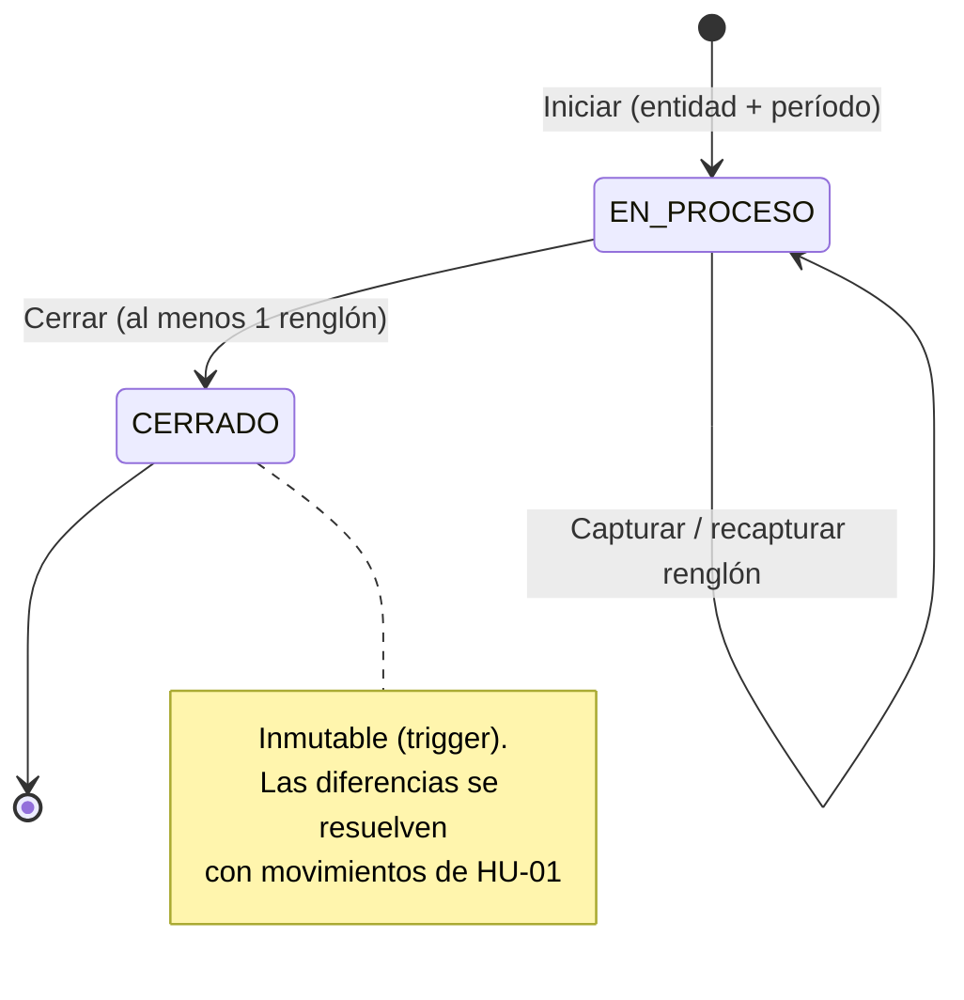

# 05 - Historias de usuario (sesión con Claude)

> Transcripción de la sesión de definición de las historias de usuario con Claude, que actúa como Product Owner experimentado.

---

## Prompt 1 — Usuario

Trabajemos con las historias de usuario. Como Product Owner experimentado, crea historias de usuario, limitándote a las 3 más críticas o importantes para lograr el MVP y el máximo impacto en el proyecto. Toma en cuenta lo que hemos documentado, con especial foco en los requisitos funcionales:

- Creación de valor inmediata.
- Viabilidad técnica para el MVP en 6 semanas.
- ROI desde el primer día.

Enfócate en las funcionalidades más importantes para lograr un MVP efectivo.

---

## Respuesta 1 — Claude

Escribí la sección 5 del `readme.md` con las 3 historias que resuelven el problema central del hogar: **cuánto medicamento hay, de quién es y si coincide con el anaquel**.

| # | Historia | Prioridad | Puntos |
|---|---|---|---|
| HU-01 | Registrar entradas, transferencias y bajas por entidad | Must | 8 |
| HU-02 | Consultar existencias por residente, medicamento o principio activo | Must | 5 |
| HU-03 | Conteo físico comparado contra lo registrado | Must | 8 |

**Cómo las elegí:**
- **Valor inmediato:** HU-01 y HU-02 sirven desde el primer día. El hogar carga sus existencias actuales como entradas y ya puede consultarlas.
- **ROI:** HU-03 detecta faltantes y mermas en el primer corte, contra un registro confiable en lugar de una libreta.
- **Viabilidad en 6 semanas:** las 3 historias suman 21 puntos y se apoyan en el modelo de datos y en los 3 endpoints ya diseñados. Incluí un plan semana por semana.
- **Fuera de las 3:** login, catálogo y residentes quedan como **habilitadores** (necesarios, pero sin valor por sí solos). El reporte mensual queda como el siguiente del backlog (*Should*) y las pautas como *Could*.

**Cada historia incluye:**
- El enunciado *Como / quiero / para*, prioridad, estimación, dependencias y módulo de Django.
- Reglas de negocio tomadas de las secciones 1.2 y 3.
- Criterios de aceptación en Gherkin con datos reales del dataset mock (sección 3.4), así los escenarios sirven directamente como tests.
- Requisitos no funcionales y una definición de terminado ligada a los tests de la sección 2.6 y a los casos de la sección 4.6.

**Decisiones a validar:**
1. **El reporte mensual no está entre las 3.** Es lo que pide la dirección, pero se calcula sobre los movimientos de HU-01 y ya tiene su endpoint diseñado. Lo planeé para la semana 6.
2. **El conteo no ajusta existencias.** Cada diferencia se resuelve con un movimiento de HU-01 desde el mismo renglón, para que quede la razón en el historial (como define la sección 3).
3. **Los habilitadores se operan desde `/admin/` en la semana 1.** Si prefieres pantallas propias para el catálogo y los residentes, hay que sumar unos 5 puntos al plan.

---

## Prompt 2 — Usuario

Contestando a las preguntas que hiciste:

1. **El reporte mensual:** de acuerdo. En una iteración posterior vamos a definir la historia de los reportes.
2. **Login, catálogo de medicamentos y residentes son "habilitadores":** me parece bien. Documenta qué es el `/admin/` de Django, por qué lo estamos usando en lugar de crear nuestras propias pantallas (por el momento) y cuáles son las ventajas para un desarrollo rápido.
3. **El conteo no ajusta existencias, tal como define la sección 3:** de acuerdo. Documenta la mecánica de esta función, si no lo está ya.

---

## Respuesta 2 — Claude

Hice los 3 cambios en la sección 5 del `readme.md`:

1. **Reporte mensual:** quedó como el siguiente del backlog. Su historia se definirá en una iteración posterior, y el endpoint `GET /reportes/mensual` ya está diseñado.
2. **Nueva subsección "Habilitadores en el panel `/admin/` de Django":**
   - Qué es el panel (`django.contrib.admin`) y que ya se usaba para los usuarios.
   - Por qué se usa por ahora: el catálogo y los residentes cambian poco, y la semana que costarían las pantallas propias rinde más en HU-01 a HU-03. Las pantallas propias quedan para la V2.
   - Tabla de qué se hace en el panel y quién lo hace.
   - Ventajas para un desarrollo rápido: poco código, validaciones y permisos ya resueltos, búsqueda y filtros incluidos, historial de cambios, mantenido por Django y desechable sin costo.
   - Controles para que el panel respete las reglas: sin borrado (solo baja lógica), y movimientos, existencias y conteos fuera del panel.
   - Limitaciones aceptadas: interfaz genérica y menos cómoda en el celular.
3. **Mecánica del conteo en HU-03.** La sección 3 solo decía en una línea que el conteo no ajusta existencias, y no explicaba para qué sirve el período. Agregué:
   - Un diagrama de estados (`EN_PROCESO` → `CERRADO`).
   - Los 5 pasos: iniciar, capturar (foto del saldo y diferencia), revisar las diferencias con los movimientos del período, resolver con un movimiento de HU-01 desde el renglón y cerrar.
   - Por qué no ajusta solo.
   - Un ejemplo con el omeprazol del mock.
   - 2 escenarios más en los criterios de aceptación.

   En la sección 3.2 agregué una referencia a esta mecánica.

**Decisiones a validar:**
1. **Para entrar al panel**, los usuarios de los 2 grupos necesitan `is_staff = True`. Solo el Administrador ve usuarios y grupos.
2. **Una diferencia se resuelve desde el renglón** con el formulario de HU-01 ya llenado. La nota del movimiento indica el conteo de origen, así que no hace falta una columna nueva en el modelo de datos.
3. **Cerrar el conteo no exige que todas las diferencias estén resueltas:** el conteo es la evidencia de lo que se encontró y los movimientos, de cómo se resolvió.

---

## Prompt 3 — Usuario

Creemos las épicas bajo la sección 5 del `readme.md`, para que guíen y aglutinen el trabajo y las historias de usuario con sus tickets. Esta es mi propuesta:

- **Épica 1: Gestión de catálogos, entidades y usuarios (configuración base).** Agrupa la configuración inicial y el mantenimiento de los elementos estructurales que dan soporte al sistema (medicamentos, residentes, el Hogar y el control de accesos). Elementos y habilitadores agrupados:
  - Catálogo de medicamentos (alta, baja lógica y modificación de nombre comercial, principio activo, tipo, presentación y concentración).
  - Gestión de entidades (alta, cambio y control de estado de los residentes —activo, egresado, fallecido— y la entidad propia del Hogar).
  - Gestión de usuarios y niveles de acceso globales (asignación de roles de *Solo lectura* o *Lectura y escritura*, administrados desde el panel de Django).
- **Épica 2: Control y registro de movimientos de inventario.** Engloba las operaciones transaccionales diarias que modifican las existencias físicas y garantizan la trazabilidad por entidad. Historias agrupadas: HU-01, registrar entradas (indicando quién entregó y el origen), transferencias entre entidades y bajas por motivo (consumo, caducidad, merma, rotura, devolución, defunción o egreso).
- **Épica 3: Consulta y filtrado de existencias.** Se enfoca en la visibilidad rápida y eficiente del inventario disponible para la toma de decisiones operativa. Historias agrupadas: HU-02, consultar existencias combinando filtros por residente, nombre comercial o principio activo (con búsqueda optimizada sin acentos).
- **Épica 4: Auditoría, conteos físicos y reportes gerenciales.** Agrupa los procesos de control periódico, conciliación entre lo físico y el sistema, y la generación de reportes para la dirección. Historias agrupadas: HU-03, conteo físico a demanda por entidad y rango de fechas, comparando existencias físicas contra el registro y resaltando diferencias; y el reporte mensual de movimientos y existencias para la dirección.
- **Épica 5: Gestión de pautas y prescripciones médicas.** Comprende el registro de la medicación prescrita a los residentes desde un enfoque informativo. Elementos agrupados: pauta del residente (registro de dosis, frecuencia, indicaciones y vigencia de cada medicamento por residente, clasificado en el MVP como alcance *Could*).

---

## Respuesta 3 — Claude

Agregué el apartado **Épicas** a la sección 5, después de la tabla de historias y antes de los habilitadores. Tiene una tabla resumen y una ficha por épica con su objetivo, qué incluye, sus tickets y cuándo se da por terminada.

| Épica | Historias y habilitadores | Tickets | Puntos |
|---|---|---|---|
| EP-01 · Configuración base: catálogo, entidades y usuarios | Habilitadores en `/admin/` | HB-01 a HB-06, HB-08 y HB-09 | 21 |
| EP-02 · Registro de movimientos de inventario | HU-01 | TK-01, TK-02 y TK-04 | 13 |
| EP-03 · Consulta y filtrado de existencias | HU-02 | TK-03 y TK-05 | 5 |
| EP-04 · Conteos físicos y reportes para la dirección | HU-03 y reporte mensual (por definir) | TK-06 y TK-07 | 8 + reporte |
| EP-05 · Pautas de los residentes | Pantallas de pautas (por definir) | HB-07 (esquema) | 2 + pantallas |

Los 49 puntos de la sección 6 quedan repartidos entre las 5 épicas, sin sobrantes.

**Cambios respecto de tu propuesta:**
1. **EP-05 se llama "Pautas de los residentes":** el vocabulario del proyecto prohíbe "receta" y "prescripción"; el término es "pauta".
2. **EP-04 no lleva "Auditoría":** la "bitácora de auditoría completa" está fuera de alcance (sección 1.2), y el nombre podía prometerla. Lo que hace la épica es conteo y conciliación.
3. **"Roles" se dice "grupos"**, como en el resto del diseño.
4. **La base técnica (HB-01 a HB-04) quedó en EP-01**, como parte de la configuración base. HB-07 quedó en EP-05.
5. **TK-01 quedó en EP-02**, aunque también es la base de EP-03 y EP-04, porque HU-01 es su primer consumidor.

**Otros cambios:**
- Cada historia tiene una fila nueva **Épica** en su tabla de campos.
- Corregí 2 números de funcionalidad que no coincidían con la sección 1.2: el reporte mensual es la funcionalidad 6 (no la 7), y la búsqueda en el catálogo de HU-02 es la 1 (no la 2).

---

## Anexo — Texto final escrito en `readme.md` (sección 5)

## 5. Historias de Usuario

> Documenta 3 de las historias de usuario principales utilizadas durante el desarrollo, teniendo en cuenta las buenas prácticas de producto al respecto.

**Criterio de selección.** De las 8 funcionalidades de la sección 1.2 se eligieron las 3 que resuelven el problema central del hogar: no saber con certeza **cuánto medicamento hay, de quién es y si coincide con lo que hay en el anaquel**. Cada historia entrega valor por sí sola y en este orden:

| # | Historia | Valor inmediato | Prioridad | Puntos |
|---|---|---|---|---|
| HU-01 | Registrar movimientos de inventario | Desde el primer día queda registrado quién trajo cada medicamento, a quién pertenece y en qué se usó | Must | 8 |
| HU-02 | Consultar existencias | Responder en segundos "¿cuánto le queda a este residente?" desde la computadora o el celular | Must | 5 |
| HU-03 | Conteo físico contra lo registrado | Detectar faltantes y mermas en cada corte, con evidencia por medicamento | Must | 8 |

**Habilitadores** (necesarios, pero sin valor por sí solos, así que no se cuentan como historias principales): inicio de sesión con los 2 niveles de acceso, catálogo de medicamentos y alta de residentes. En el MVP se operan desde el panel `/admin/` de Django (ver más abajo).

**Siguiente en el backlog:** el reporte mensual (funcionalidad 6, *Should*), que se calcula sobre los movimientos de HU-01. Su historia se definirá en una iteración posterior; el endpoint `GET /reportes/mensual` ya está diseñado (sección 4.5). Las pautas (funcionalidad 4) son informativas y no bloquean el inventario (*Could*).

#### Épicas

Las épicas agrupan el trabajo por objetivo de negocio. Cada una reúne funcionalidades de la sección 1.2, sus historias o habilitadores y los tickets que las implementan (sección 6). Así se ve qué avance de valor representa cada ticket y cuándo está completo un frente de trabajo.

| Épica | Funcionalidades (1.2) | Historias y habilitadores | Tickets | Puntos | Prioridad | Semanas |
|---|---|---|---|---|---|---|
| **EP-01** · Configuración base: catálogo, entidades y usuarios | 1, 2 y 7 | Habilitadores en `/admin/` | HB-01 a HB-06 y HB-08 a HB-10 | 26 | Must (habilitadora) | 1–2 (HB-10: 6) |
| **EP-02** · Registro de movimientos de inventario | 3 y 8 | HU-01 | TK-01, TK-02 y TK-04 | 13 | Must | 3–4 |
| **EP-03** · Consulta y filtrado de existencias | 5 (y 3) | HU-02 | TK-03 y TK-05 | 5 | Must | 4–5 |
| **EP-04** · Conteos físicos y reportes para la dirección | 6 | HU-03 y reporte mensual (historia por definir) | TK-06 y TK-07 | 8, más el reporte sin estimar | Must (HU-03), *Should* (reporte) | 5–6 |
| **EP-05** · Pautas de los residentes | 4 | Pantallas de pautas (historia por definir) | HB-07 (solo el esquema) | 2, más las pantallas sin estimar | *Could* (el esquema es Must: lo usa el mock) | 2 |
| **Total** | | | | **54** | | |

**EP-01 · Configuración base: catálogo, entidades y usuarios**
- **Objetivo:** dejar listos y mantenibles los elementos estructurales del sistema: medicamentos, residentes, el Hogar y el control de acceso. No entrega valor por sí sola, pero todas las demás épicas dependen de ella.
- **Incluye:**
  - **Catálogo de medicamentos:** alta, cambio y baja lógica de nombre comercial, principio activo, tipo (genérico u original), presentación y concentración.
  - **Entidades:** alta y cambio de residentes y de su estado (activo, egresado o fallecido). El Hogar es una entidad fija que crean las migraciones.
  - **Usuarios y niveles de acceso globales:** el Administrador da de alta a los usuarios y les asigna el grupo *Solo lectura* o *Lectura y escritura* desde el panel `/admin/`.
  - **Base técnica** que lo hace posible: contenedores, conexión con los 2 usuarios de base de datos y HTTPS (HB-01 a HB-04).
  - **Puesta en producción:** el despliegue en el servidor del hogar, los respaldos cifrados con su prueba de restauración y la demo en una máquina local (HB-10, semana 6).
- **Tickets:** HB-01 a HB-04 (base técnica, 10 puntos), HB-05 y HB-06 (modelos de catálogo y entidades, 6), HB-08 y HB-09 (login, grupos y panel, 5) y HB-10 (despliegue, 5).
- **Se da por terminada cuando** el Administrador crea un usuario de cada grupo por HTTPS, y uno de *Lectura y escritura* da de alta medicamentos y residentes en `/admin/` sin poder borrar nada. Su última parte, HB-10, termina cuando el sistema corre en el servidor del hogar y el ensayo de restauración del respaldo cuadra.

**EP-02 · Registro de movimientos de inventario**
- **Objetivo:** registrar las operaciones diarias que cambian las existencias de cada entidad, con trazabilidad de quién, cuándo y por qué.
- **Incluye:** HU-01, con las entradas (quién entregó y el origen), las transferencias entre entidades, las bajas por motivo (consumo, caducidad, merma, rotura, devolución a la familia, defunción o egreso) y la corrección de un movimiento con su movimiento inverso.
- **Tickets:** TK-01 (esquema de existencias, movimientos y conteos; también es la base de EP-03 y EP-04), TK-02 (servicio de movimientos) y TK-04 (formularios e historial).
- **Se da por terminada cuando** se cumplen los criterios de aceptación de HU-01 y la vista de conciliación queda vacía después de cualquier secuencia de movimientos.

**EP-03 · Consulta y filtrado de existencias**
- **Objetivo:** responder en segundos cuánto medicamento le queda a cada residente y al Hogar, desde la computadora o el celular.
- **Incluye:** HU-02, con los filtros combinados por residente, nombre comercial o principio activo y la búsqueda sin mayúsculas ni acentos que usa los índices trigram, en pantalla y en `GET /api/v1/existencias`.
- **Tickets:** TK-03 (pantalla con HTMX) y TK-05 (endpoint de la API).
- **Se da por terminada cuando** se cumplen los criterios de aceptación de HU-02 y la prueba de integración de la sección 6 pasa en CI.

**EP-04 · Conteos físicos y reportes para la dirección**
- **Objetivo:** controlar periódicamente que lo registrado coincida con lo que hay en el anaquel, y entregar a la dirección un corte confiable.
- **Incluye:**
  - **HU-03:** conteo físico a demanda por entidad y período, que compara lo físico contra lo registrado y resalta las diferencias. Cada diferencia se resuelve con un movimiento de EP-02.
  - **Reporte mensual** de movimientos y existencias: su historia se definirá en una iteración posterior; el endpoint `GET /reportes/mensual` ya está diseñado (sección 4.5).
- **Tickets:** TK-06 (servicio de conteos) y TK-07 (pantallas del conteo). El reporte mensual tendrá los suyos cuando se defina su historia.
- **Se da por terminada cuando** se cumplen los criterios de aceptación de HU-03 y los de la historia del reporte mensual. Si el reporte no entra en el MVP, la épica cierra sin él y el reporte pasa a la siguiente iteración (sección 5, "Riesgo del plan").

**EP-05 · Pautas de los residentes**
- **Objetivo:** registrar, de forma informativa, la dosis, la frecuencia, las indicaciones y la vigencia de cada medicamento por residente. No mueve existencias ni registra la administración por turno.
- **Incluye:** el esquema de la tabla `pauta` con sus reglas (sin vigencias traslapadas, solo residentes y medicamentos activos) y, más adelante, sus pantallas.
- **Tickets:** HB-07 (esquema). Las pantallas son *Could*: su historia y sus tickets se definirán si hay tiempo después de EP-04.
- **Pendientes de HB-07 para la historia de pautas.** Las 2 revisiones adversariales de HB-07 dejaron ajustes que no afectan al mock ni a TK-01 y se resuelven junto con las pantallas. El detalle, con su origen, está en la [guía de HB-07](docs/tickets/HB-07-pautas.md) (final de la sección 5):
  - decidir si se quedan los índices que Django crea sobre `medicamento_id` y `registrado_por_id`, que no usa ninguna consulta de la sección 3.3;
  - decidir si `tg_pauta_validar` cubre también `UPDATE`, para que no se reabra la pauta de un residente egresado, o si lo impide el servicio de pautas;
  - `Pauta.__str__` sin consultas extra en los listados y con "(en caso necesario)" en las pautas PRN;
  - `Pauta.clean()` sin `TypeError` ante fechas sin convertir, y un formulario que incluya las 2 fechas;
  - acotar el requisito de mensajes de la spec de pautas a `full_clean()` y los formularios, y agrupar los escenarios de privilegios de `app_user`;
  - tests del formulario y del borde `fecha_fin = fecha_inicio`, que es válido (rango de un día).
- **Se da por terminada cuando** existan la historia y las pantallas de pautas. En el MVP solo se entrega el esquema.

#### Habilitadores en el panel `/admin/` de Django

**Qué es.** Django incluye un panel de administración (`django.contrib.admin`) que se publica en la ruta `/admin/`. Al registrar un modelo en el `admin.py` de su app, Django genera las pantallas para listar, buscar, filtrar, dar de alta y editar ese modelo, sin programar vistas, formularios ni plantillas. El panel usa la misma autenticación, los mismos grupos y los mismos permisos que el resto de la aplicación. En este proyecto ya se usaba para la gestión de usuarios (secciones 2.2 y 4.2).

**Por qué se usa por ahora en lugar de pantallas propias.** El catálogo de medicamentos y los residentes se capturan al arrancar y después cambian poco. Hacerles pantallas propias costaría cerca de una semana de las 6, y ese tiempo rinde más en HU-01, HU-02 y HU-03, que son las que dan valor diario. Las pantallas propias, con Bootstrap y HTMX como el resto de la aplicación, quedan para la V2.

| Habilitador | Qué se hace en `/admin/` | Quién |
|---|---|---|
| Usuarios y niveles de acceso | Alta de usuarios, asignación del grupo y desactivación | Administrador |
| Catálogo de medicamentos | Alta, cambio y baja lógica de medicamentos, principios activos y presentaciones | *Lectura y escritura* (edita) y *Solo lectura* (consulta) |
| Residentes | Alta, cambio de datos y cambio de estado (activo, egresado, fallecido) | *Lectura y escritura* (edita) y *Solo lectura* (consulta) |

El Hogar es una entidad fija que crean las migraciones, así que no se da de alta.

Se implementan en los tickets de habilitación HB-08 (login, grupos y usuarios) y HB-09 (catálogo y residentes), sobre los modelos de HB-05 a HB-07 (sección 6).

**Ventajas para un desarrollo rápido:**
- **Poco código:** cada modelo se configura en unas 20–30 líneas de `admin.py` (columnas, búsqueda, filtros y campos editables). Toda la configuración del panel (HB-09) cabe en horas, no en días.
- **Validaciones incluidas:** los formularios del panel aplican las validaciones del modelo y las restricciones declaradas en `Meta.constraints` (por ejemplo, rechazan un segundo "Losartán 50 mg tableta") y muestran el error junto al campo.
- **Permisos ya resueltos:** el panel respeta los permisos de Django por grupo (`view`, `add`, `change`), validados en el servidor.
- **Búsqueda, filtros y paginación** incluidos sin código.
- **Historial de cambios:** el panel registra quién creó o modificó cada registro y cuándo (`LogEntry`).
- **Mantenido por Django:** es parte de Django 5.2 LTS, así que recibe correcciones de seguridad sin trabajo extra.
- **Desechable sin costo:** cuando lleguen las pantallas propias, se quitan los modelos del panel y nada más cambia, porque las reglas viven en los modelos, en la base de datos y en `services.py`.

**Controles que se configuran para que el panel respete las reglas del proyecto:**
- **Sin borrado:** se desactiva la acción "Eliminar" (`has_delete_permission = False`). La baja es lógica: se cambia `activo` o `estado`.
- **Movimientos, existencias y conteos no se registran en el panel.** Solo se operan desde las pantallas de HU-01 y HU-03, así nadie puede editar un saldo ni un movimiento a mano.
- **Principios activos en línea:** en el formulario del medicamento se agregan sus principios activos en la misma pantalla (*inline* de la tabla puente).
- **Acceso de los grupos:** los usuarios de los 2 grupos tienen `is_staff = True` para entrar al panel. Solo el Administrador ve las secciones de usuarios y grupos.
- **Reglas que viven en *triggers*:** el formulario las valida antes de guardar, para que el usuario vea un mensaje y no un error `500`. Por ejemplo, el formulario de `MedicamentoAdmin` rechaza desmarcar `activo` si el medicamento tiene existencias ("No se puede dar de baja: hay existencias de este medicamento"); el *trigger* `tg_medicamento_baja` queda como última barrera.

**Limitaciones aceptadas para el MVP:** la interfaz es genérica (no tiene el estilo de la aplicación) y es menos cómoda en el celular. Como estas operaciones se hacen pocas veces y desde la computadora, no afecta el uso diario.

**Plan de 6 semanas** (1 desarrollador, sprints de 1 semana):

| Semana | Entrega | Puntos |
|---|---|---|
| 1 | **HB-01 a HB-04**: contenedores `db`, `web` y `nginx`, conexión con los 2 usuarios de base de datos y modelo de usuario (sección 6) | 10 |
| 2 | **HB-05 a HB-09**: catálogo, residentes y pautas (sección 3: D2, D3 y D6), login, grupos y habilitadores en `/admin/` | 13 |
| 3 | **TK-01**: esquema de existencias, movimientos y conteos (sección 6) | 5 |
| 3–4 | **HU-01** (servicios, pantallas y tests de concurrencia) | 8 |
| 4–5 | **HU-02** (pantalla con filtros HTMX y `GET /existencias`) | 5 |
| 5–6 | **HU-03** (captura, diferencias y cierre) | 8 |
| 6 | **HB-10**: despliegue en el servidor del hogar, respaldos y demo local; pruebas de extremo a extremo y, si alcanza, el reporte mensual | 5 |

**Riesgo del plan:** con la habilitación detallada en tickets, el MVP suma 54 puntos (sección 6), unos 9 por semana, y las semanas 1 y 2 quedan por encima de ese ritmo. El margen está en la semana 6, que también lleva HB-10 (5 puntos): si algo se retrasa, el reporte mensual (*Should*) pasa a la siguiente iteración. Las 3 historias y el despliegue no se recortan. HB-10 queda en la ruta crítica de esa última semana: su parte A (scripts y ensayo) se adelanta en cuanto TK-01 esté en `main`, y la parte B necesita una noche de cron para su último criterio.

**ROI desde el primer día:** el hogar carga sus existencias actuales como entradas (HU-01) y desde ese momento puede consultarlas (HU-02). El primer conteo (HU-03) ya compara el anaquel contra un registro confiable, en lugar de contra una libreta.

---

**Historia de Usuario 1**

**HU-01 · Registrar entradas, transferencias y bajas de medicamentos por entidad**

> **Como** usuario de *Lectura y escritura*,
> **quiero** registrar cada entrada, transferencia y baja de un medicamento indicando a qué entidad (residente u Hogar) pertenece,
> **para** saber en todo momento cuánto medicamento tiene cada residente y el Hogar, quién lo entregó y por qué salió.

| Campo | Valor |
|---|---|
| Épica | EP-02 · Registro de movimientos de inventario |
| Prioridad | Must (1 de 3) |
| Estimación | 8 puntos |
| Funcionalidades | 3 (existencias por entidad) y 8 (trazabilidad mínima) de la sección 1.2 |
| Depende de | Habilitadores de EP-01: login, catálogo de medicamentos, residentes |
| Módulo | `inventario` (`services.py`: `registrar_entrada`, `transferir`, `dar_de_baja`, `corregir`) |

**Reglas de negocio**
- Las cantidades están en **dosis** y admiten 2 decimales (0.5 tableta).
- **Entrada:** destino obligatorio, origen (`FAMILIAR`, `HOGAR`, `OTRO`) y nombre de quien entregó.
- **Transferencia:** origen y destino distintos. Sirve para préstamos y para reasignar sobrantes tras un egreso o defunción.
- **Baja:** motivo obligatorio del catálogo (consumo, caducidad, merma, rotura, devolución a la familia, defunción, egreso).
- Ningún saldo puede quedar negativo. El movimiento y el cambio de saldo se guardan en la misma transacción.
- Los movimientos **no se editan ni se borran**. Un error se corrige una sola vez con el movimiento inverso, que referencia al original.
- Las entradas y transferencias solo pueden ir a entidades activas y con medicamentos activos. Un residente egresado o fallecido sí puede ceder o dar de baja sus sobrantes. Las correcciones quedan exentas.

**Criterios de aceptación** (sobre el dataset mock de la sección 3.4)

```gherkin
Escenario: Entrada entregada por un familiar
  Dado que inicié sesión como "operador.demo"
  Y que Carmen Torres Vega tiene 33 dosis de Eutirox 100 mcg
  Cuando registro una entrada de 30 dosis de Eutirox para Carmen, origen "FAMILIAR", entregado por "Rosa Torres"
  Entonces el saldo de Eutirox de Carmen es 63
  Y el movimiento guarda mi usuario, la fecha y hora, y "Rosa Torres" como quien entregó

Escenario: Transferencia del Hogar a un residente
  Dado que el Hogar tiene 80 dosis de Paracetamol 500 mg y Carmen tiene 14
  Cuando transfiero 10 dosis de Paracetamol del Hogar a Carmen
  Entonces el saldo del Hogar es 70 y el de Carmen es 24
  Y se registra un solo movimiento de tipo TRANSFERENCIA

Escenario: Baja mayor que la existencia
  Dado que María Guadalupe Hernández López tiene 1 dosis de Atorvastatina 20 mg
  Cuando intento dar de baja 5 dosis por consumo
  Entonces veo el mensaje "Existencia insuficiente: hay 1 dosis disponible"
  Y no se crea el movimiento y el saldo sigue en 1

Escenario: Baja sin motivo
  Cuando intento registrar una baja sin seleccionar motivo
  Entonces el formulario marca el campo "Motivo" como obligatorio y no se guarda nada

Escenario: Transferencia a la misma entidad
  Cuando intento transferir del Hogar al Hogar
  Entonces veo el mensaje "El origen y el destino deben ser distintos"

Escenario: Corrección de una captura errónea
  Dado que el 1 de octubre se registró por error una entrada de 600 dosis de Metformina para María
  Cuando elijo "Corregir" sobre ese movimiento
  Entonces se crea una baja de 600 dosis con motivo CORRECCION que referencia la entrada original
  Y el historial de María muestra los dos movimientos
  Y la opción "Corregir" ya no aparece en ninguno de los dos

Escenario: Usuario de solo lectura
  Dado que inicié sesión como "consulta.demo"
  Entonces no veo los botones para registrar movimientos
  Y si envío directamente un POST a /inventario/bajas/ recibo 403 y no se crea el movimiento

Escenario: Doble clic al guardar
  Cuando pulso "Guardar" dos veces seguidas en una entrada
  Entonces solo se registra un movimiento
```

**Requisitos no funcionales:** dos bajas simultáneas que juntas superan la existencia aplican solo una (`select_for_update`). Formularios usables en el celular.

**Definición de terminado:** tests unitarios de `services.py` para cada regla, test de concurrencia, test de permisos (`403`), cobertura ≥ 80 % en servicios, consulta de conciliación saldo = suma de movimientos en verde, y revisión en pantalla de celular.

---

**Historia de Usuario 2**

**HU-02 · Consultar existencias por residente, medicamento o principio activo**

> **Como** usuario del hogar (*Solo lectura* o *Lectura y escritura*),
> **quiero** consultar las existencias filtrando por residente, por nombre comercial o por principio activo, sin preocuparme por mayúsculas ni acentos,
> **para** saber al instante cuánto medicamento le queda a cada residente y al Hogar, y decidir si hay que pedir más a la familia o prestar del Hogar.

| Campo | Valor |
|---|---|
| Épica | EP-03 · Consulta y filtrado de existencias |
| Prioridad | Must (2 de 3) |
| Estimación | 5 puntos |
| Funcionalidades | 3 (existencias), 5 (filtros combinados) y 1 (búsqueda en el catálogo) de la sección 1.2 |
| Depende de | HU-01 (sin movimientos no hay saldos) |
| Módulo | `inventario` (pantalla con filtros HTMX) y `api` (`GET /existencias`, `GET /medicamentos`, sección 4.5) |

**Reglas de negocio**
- Los filtros se combinan: residente u Hogar, medicamento, principio activo y texto libre.
- El texto libre requiere al menos 3 caracteres y busca en el nombre comercial **y** en los principios activos, sin mayúsculas ni acentos.
- Por defecto solo se muestran saldos mayores a 0. La opción "Incluir sin saldo" muestra también los agotados.
- Orden: el Hogar primero, después los residentes, y dentro de cada uno por nombre comercial.
- Cada renglón muestra entidad, medicamento (nombre, presentación y concentración), saldo en dosis y fecha del último movimiento.

**Criterios de aceptación** (sobre el dataset mock de la sección 3.4)

```gherkin
Escenario: Buscar sin acentos encuentra por nombre y por principio activo
  Dado que inicié sesión como "consulta.demo"
  Cuando busco "losartan"
  Entonces veo 3 renglones: Hogar · Losartán 20, José Luis · Cozaar 32 y José Luis · Losartán 10
  Y Hyzaar no aparece porque no tiene existencias

Escenario: Existencias de un residente
  Cuando filtro por la residente Carmen Torres Vega
  Entonces veo Eutirox 33, Exelon 3 y Paracetamol 14

Escenario: Medicamento con otro nombre comercial
  Cuando busco "paracetamol" y marco "Incluir sin saldo"
  Entonces veo Paracetamol del Hogar 80, Paracetamol de Carmen 14 y Tempra del Hogar 0
  Y Tempra aparece aunque su nombre no coincida, porque su principio activo es paracetamol

Escenario: Búsqueda demasiado corta
  Cuando busco "lo"
  Entonces veo el mensaje "Escribe al menos 3 caracteres" y la lista no cambia

Escenario: Sin resultados
  Cuando busco "ibuprofeno"
  Entonces veo "No hay existencias que coincidan con la búsqueda"

Escenario: La API devuelve lo mismo que la pantalla
  Cuando consulto GET /api/v1/existencias?principio_activo_id=2 con una sesión válida
  Entonces recibo 200 con total 3 y los mismos saldos que la pantalla
  Y sin sesión recibo 401
```

**Requisitos no funcionales:** el resultado se actualiza al escribir, sin recargar la página (HTMX), y responde en menos de 1 segundo con los volúmenes de la sección 3.3 gracias a los índices trigram. La tabla se lee en el celular sin desplazamiento horizontal.

**Definición de terminado:** tests de las consultas con el mock (casos 1 a 6 de la sección 4.6; los casos 7 a 11 son de `GET /medicamentos`, que se hará con la historia de reportes), test de contrato de `GET /existencias` contra `openapi.yaml`, plan de ejecución que usa los índices de la sección 3.3, y revisión en pantalla de celular.

---

**Historia de Usuario 3**

**HU-03 · Conteo físico de una entidad comparado contra lo registrado**

> **Como** usuario de *Lectura y escritura* responsable del corte,
> **quiero** capturar lo que hay físicamente de cada medicamento de un residente o del Hogar y ver la diferencia contra lo registrado,
> **para** detectar faltantes o sobrantes a tiempo, aclarar su causa y entregar a la dirección un corte confiable.

| Campo | Valor |
|---|---|
| Épica | EP-04 · Conteos físicos y reportes para la dirección |
| Prioridad | Must (3 de 3) |
| Estimación | 8 puntos |
| Funcionalidades | 6 (inventario físico a demanda, existencia contra registrado) de la sección 1.2 |
| Depende de | HU-01 y HU-02 |
| Módulo | `conteos` |

**Reglas de negocio**
- Un conteo es de **una entidad** y un **período** (fecha de inicio y fin) elegidos a demanda.
- Al iniciarlo se listan los medicamentos con saldo de esa entidad. También se puede agregar un medicamento que aparezca físicamente sin estar registrado.
- Al capturar cada renglón se guarda la **foto** del saldo registrado en ese momento. La diferencia (físico − registrado) la calcula la base de datos.
- El conteo puede quedar `EN_PROCESO` y continuarse en otra sesión. Al cerrarlo queda `CERRADO`, con fecha, y ya no se modifica.
- No se puede cerrar un conteo sin renglones.
- El conteo **no ajusta existencias automáticamente**. Cada diferencia se resuelve con un movimiento de HU-01 (por ejemplo, una baja por merma), así queda la razón en el historial.

**Mecánica del conteo**



1. **Iniciar.** El usuario elige la entidad (un residente o el Hogar) y el período, por ejemplo del 1 al 30 de septiembre. Se crea el conteo `EN_PROCESO` y la pantalla lista los medicamentos con saldo de esa entidad como renglones pendientes.
2. **Capturar.** Frente al anaquel, el usuario escribe cuántas dosis hay de cada medicamento. Al guardar el renglón:
   - Se toma la **foto** del saldo registrado en ese instante (`cantidad_sistema`).
   - La base de datos calcula la `diferencia` (físico − registrado).
   - La pantalla la resalta: negativa = **faltante**, positiva = **sobrante**, 0 = cuadra.
   
   Si después se corrige el número contado, se recaptura el renglón y la foto se vuelve a tomar en ese momento. Un medicamento que aparece en el anaquel sin estar registrado se agrega como renglón con registrado 0.
3. **Revisar las diferencias.** El período sirve para investigar la causa: para un renglón con diferencia, la pantalla muestra los movimientos de esa entidad y ese medicamento dentro del período (consulta c de la sección 3.3). Así se ve, por ejemplo, si faltó registrar el consumo de unos días.
4. **Resolver.** Cada diferencia se aclara con un movimiento de HU-01. El renglón tiene el botón "Registrar baja" (faltante) o "Registrar entrada" (sobrante), que abre el formulario con entidad, medicamento y cantidad ya llenados. En una baja, el usuario elige el motivo real (merma, rotura, consumo no registrado…). En una entrada por sobrante, el origen se llena como `OTRO` y "entregado por" como "Conteo físico #2". En los dos casos, la nota del movimiento indica el conteo de origen ("Diferencia del conteo #2"). Si la diferencia fue un error de captura, basta con recapturar el renglón.
5. **Cerrar.** El usuario cierra el conteo cuando terminó de contar. Queda `CERRADO` con la fecha y hora de cierre, y los *triggers* de la sección 3.3 impiden modificarlo. Cerrar no exige que todas las diferencias estén resueltas: el conteo es la evidencia de lo que se encontró, y los movimientos son la evidencia de cómo se resolvió.

**Por qué no ajusta solo:** un ajuste automático escondería la causa de la diferencia y movería saldos sin un responsable ni un motivo. Al resolverla con un movimiento:
- Queda quién lo registró, cuándo y por qué.
- El saldo sigue siendo la suma de los movimientos, de modo que la conciliación de la sección 3.2 se mantiene.
- El reporte mensual muestra las mermas con su motivo.

**Ejemplo con el mock:** en el conteo 2 del Hogar se contaron 58 cápsulas de Omeprazol contra 59 registradas (diferencia −1). El operador revisa los movimientos de octubre, no encuentra una baja que la explique y registra desde el renglón una baja de 1 dosis con motivo `MERMA`. El saldo pasa a 58. El renglón del conteo conserva su foto (59 registradas, diferencia −1) como evidencia de lo que se encontró.

**Criterios de aceptación** (sobre el dataset mock de la sección 3.4)

```gherkin
Escenario: Continuar un conteo en proceso y ver diferencias
  Dado que inicié sesión como "operador.demo"
  Y que el conteo 2 del Hogar (1 al 15 de octubre de 2026) está EN_PROCESO
  Cuando lo abro
  Entonces veo Paracetamol y Aspirina Protect con diferencia 0
  Y Omeprazol con 58 contadas contra 59 registradas, diferencia −1, resaltada en rojo
  Y Losartán y Tempra aparecen como pendientes de contar

Escenario: Capturar un renglón que cuadra
  Cuando capturo 20 dosis de Losartán
  Entonces el renglón muestra 20 registradas y diferencia 0

Escenario: Cerrar el conteo
  Dado que ya capturé todos los renglones del conteo 2
  Cuando lo cierro
  Entonces el conteo queda CERRADO con la fecha y hora de cierre
  Y ya no puedo capturar ni modificar renglones
  Y las existencias del Hogar no cambian

Escenario: Resolver una diferencia
  Dado un conteo con Omeprazol −1
  Cuando elijo "Registrar baja" en ese renglón
  Entonces se abre el formulario de baja de HU-01 con el Hogar, Omeprazol y 1 dosis ya llenados
  Y al guardarlo con motivo MERMA el saldo de Omeprazol del Hogar queda en 58
  Y la nota del movimiento dice "Diferencia del conteo #2"
  Y el renglón del conteo conserva 59 registradas y diferencia −1

Escenario: Revisar los movimientos del período
  Dado un conteo con Omeprazol −1
  Cuando abro el detalle del renglón
  Entonces veo los movimientos de Omeprazol del Hogar entre el 1 y el 15 de octubre de 2026

Escenario: Consultar un conteo cerrado
  Cuando abro el conteo 1 de María (septiembre de 2026)
  Entonces veo Metformina con diferencia 0 y Atorvastatina con 0 contadas contra 1 registrada, diferencia −1
  Y no hay opciones para editarlo

Escenario: Cerrar sin renglones
  Dado un conteo nuevo sin renglones capturados
  Cuando intento cerrarlo
  Entonces veo el mensaje "Captura al menos un medicamento antes de cerrar el conteo"

Escenario: Usuario de solo lectura
  Dado que inicié sesión como "consulta.demo"
  Entonces puedo ver los conteos y sus diferencias, pero no iniciar, capturar ni cerrar
```

**Requisitos no funcionales:** la captura funciona en el celular, frente al anaquel: un campo numérico por renglón que se guarda al salir del campo (HTMX), sin perder lo capturado si se interrumpe.

**Definición de terminado:** tests de la diferencia calculada (18 contra 20 = −2, sección 2.6), test del *trigger* que impide modificar un conteo cerrado, test de permisos, y el paso 6 del guion de demo (sección 3.4) ejecutado de extremo a extremo con Playwright.

**Documentación proceso para esta seccion:** [05-historias-usuario.md](05-historias-usuario.md)
