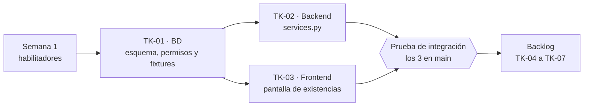

# 06 - Tickets de trabajo (sesión con Claude)

> Transcripción de la sesión de definición de los tickets de trabajo con Claude, que actúa como Tech Lead experimentado.

---

## Prompt 1 — Usuario

Excelente especificación de historias de usuario. Ahora trabajemos en la sección 6 de tickets de trabajo.

Como Tech Lead experimentado, a partir de las historias de usuario que acabas de crear, crea 3 tickets de trabajo principales para el desarrollo: uno de backend, uno de frontend y uno de bases de datos.

Da todo el detalle requerido para desarrollar la tarea de inicio a fin, teniendo en cuenta las buenas prácticas al respecto.

Incluye en cada ticket:
- Descripción técnica.
- Criterios de aceptación.
- Definición de hecho (*definition of done*).
- Estimación en *story points*.

---

## Respuesta 1 — Claude

Escribí la sección 6 del `readme.md` con los 3 tickets del camino crítico del MVP: el esquema que guarda los saldos, la lógica que los mueve y la pantalla que los muestra.

| Ticket | Tipo | Historia | Puntos |
|---|---|---|---|
| TK-01 | Base de datos: esquema de existencias, movimientos y conteos, con restricciones, *triggers* e índices | HU-01, HU-02, HU-03 | 5 |
| TK-02 | Backend: servicio de movimientos (entradas, transferencias, bajas y correcciones) | HU-01 | 5 |
| TK-03 | Frontend: pantalla de consulta de existencias con filtros en vivo y diseño para celular | HU-02 | 3 |

**Cada ticket incluye:**
- Encabezado con tipo, historia, prioridad, estimación, rama y dependencias.
- Contexto: por qué existe el ticket.
- Descripción técnica con archivos, modelos, firmas de funciones y fragmentos de código.
- Lo que queda fuera de alcance.
- Criterios de aceptación verificables, con los datos del mock.
- Pruebas, definición de hecho y riesgos.

Además, al inicio de la sección hay una tabla de dependencias entre tickets y una **definición de hecho común** (lint, CI, cobertura, PR revisado, sin secretos ni datos personales en logs, documentación actualizada).

**Puntos técnicos que vale la pena revisar:**
- **TK-01:** las restricciones usan los mismos nombres del DDL de la sección 3, y cada una tiene un test que provoca su violación. Agregué la vista `v_conciliacion_existencia`, que lista los saldos que no cuadran con la suma de los movimientos.
- **TK-02:** el bloqueo de saldos crea la fila que falte sin carreras (`INSERT ... ON CONFLICT DO NOTHING`) y bloquea siempre en el mismo orden, para que dos transferencias cruzadas no provoquen un *deadlock*. Las excepciones usan los mismos `code` del contrato de la API.
- **TK-03:** la búsqueda se lanza 300 ms después de dejar de escribir, los filtros quedan en la URL, y en el celular los resultados son tarjetas en lugar de tabla. La consulta queda en un selector que reutilizará `GET /existencias`.

**Decisiones a validar:**
1. **Los 3 tickets suman 13 de los 21 puntos de las historias.** Lo que falta (pantallas de movimientos, endpoint de existencias y módulo de conteos) queda como tickets del backlog sin documentar aquí.
2. **El `REVOKE` sobre `movimiento` va en un script del despliegue** (`scripts/db_privilegios.sql`), no en una migración, porque el nombre del rol de la aplicación cambia por entorno. El *trigger* protege aunque el script no se haya ejecutado.
3. **La consulta de existencias será la página de inicio** después del login.

---

## Prompt 2 — Usuario

Para que un desarrollador junior pueda hacer el ticket sin bloqueos, detalla cada ticket con:
- Tareas específicas paso a paso.
- Archivos y estructura de código a crear.
- Tests requeridos con ejemplos.
- Criterios de calidad.
- Comandos y pasos específicos para la verificación.

---

## Respuesta 2 — Claude

Creé una guía paso a paso por ticket en `docs/tickets/` y la enlacé desde cada ticket de la sección 6. Las puse en archivos aparte porque cada una tiene entre 800 y 1,100 líneas, y así el readme sigue siendo legible.

| Guía | Contenido principal |
|---|---|
| [`TK-01-esquema-inventario.md`](docs/tickets/TK-01-esquema-inventario.md) | Usuarios `app_owner`/`app_user`, modelos completos, 5 migraciones, fixture que carga el mock en pytest, tests de cada restricción y de privilegios |
| [`TK-02-servicio-movimientos.md`](docs/tickets/TK-02-servicio-movimientos.md) | Excepciones y `services.py` completos, conceptos de bloqueo explicados, tests de reglas y de concurrencia con hilos |
| [`TK-03-pantalla-existencias.md`](docs/tickets/TK-03-pantalla-existencias.md) | Selector, formulario, vista, plantillas HTMX y *responsive*, filtro `dosis`, tests de vista y Playwright |

**Cada guía tiene la misma estructura:**
0. Antes de empezar: qué leer, requisitos previos con comandos para comprobarlos, rama y atajos de terminal.
1. Archivos a crear o modificar, en árbol.
2. Tareas paso a paso, con tiempo estimado y código de referencia.
3. Tests requeridos, con el código de los casos principales.
4. Criterios de calidad y cómo se comprueba cada uno.
5. Comandos de verificación con su resultado esperado.
6. Lista para el *pull request*.
7. "Si te bloqueas": síntomas frecuentes, causa y solución.

**Al bajar al detalle encontré 6 problemas que habrían bloqueado a un junior, y los corregí:**
1. **4 nombres de índice pasaban de 30 caracteres**, el límite de Django (error `models.E034`). Los renombré en las secciones 3.3 y 6 (por ejemplo, `ix_existencia_med_entidad`) y agregué la nota en 3.3.
2. **`SELECT ... FOR UPDATE` exige permiso de `UPDATE`**, y `app_user` no lo tiene sobre `movimiento`. La corrección se protege con `uq_movimiento_corrige`, y los tests de TK-02 corren como `app_user` para detectar este tipo de error.
3. **Los grupos no tenían permisos sobre los modelos nuevos**, porque se crearon en la semana 1. Sin una migración que los asigne, la pantalla de TK-03 respondería `403` a todos. La agregué a TK-01.
4. **El mock cargaba a los usuarios demo sin `is_staff`**, pero la sección 5 dice que entran a `/admin/`. Corregí `cargar_mock.sql`.
5. **La regla de HU-01 "solo entidades activas"** contradecía el *trigger* y el caso de uso de sobrantes: un egresado debe poder ceder o dar de baja lo que le quedó. La precisé: el **destino** debe estar activo.
6. **`floatformat` muestra `0.50`**, no `0.5`. TK-03 usa un filtro propio, `dosis`.

**Decisiones a validar:**
1. **Las guías están en `docs/tickets/`**, enlazadas desde el readme, en lugar de dentro del readme.
2. **Los tests cargan el mock real** (`cargar_mock.sql` adaptado desde Python) en lugar de *factories*: los criterios de aceptación ya están escritos con esos datos.
3. **`corrige_a` es `ForeignKey` con `UniqueConstraint`**, y no `OneToOneField`, para conservar el nombre `uq_movimiento_corrige` del DDL.
4. **El código de las guías no se ejecutó**, porque el proyecto Django todavía no existe. Revisé los nombres, los datos del mock y las versiones de Django y PostgreSQL contra la documentación del proyecto. El primer PR de cada ticket confirmará los detalles.

---

## Prompt 3 — Usuario

Ahora define (si no lo está ya):
- Tecnologías y librerías a utilizar, en el apartado de Descripción técnica.
- Dependencias entre tickets y orden de ejecución.
- Puntos de integración entre frontend, backend y base de datos.
- Criterios de revisión de código.

Asegúrate de que los 3 tickets se integren perfectamente al final.

---

## Respuesta 3 — Claude

Ya estaban la tabla de dependencias y la definición de hecho común. Agregué lo que faltaba en la sección 6 del `readme.md`:

1. **Tecnologías y librerías:** una tabla al inicio de la descripción técnica de cada ticket, con versión y uso, y qué dependencias nuevas agrega. TK-01 no agrega ninguna; TK-02 agrega `pytest-cov` (desarrollo); TK-03 agrega `django-htmx` y `pytest-playwright` (desarrollo).
2. **Orden de ejecución:** diagrama y reglas. TK-01 va primero y sin paralelo. TK-02 y TK-03 pueden ir en paralelo; con un solo desarrollador, TK-02 primero. Se integran en el orden TK-01 → TK-02 → TK-03. Incluye una tabla de los archivos que tocan varios tickets, con la regla para evitar conflictos en cada uno.
3. **Puntos de integración:** 11 contratos entre capas, con quién los provee, quién los consume, el contrato y cómo se verifica. Cada guía indica al inicio qué puntos provee y cuáles consume.
4. **Criterios de revisión de código:** tabla por ámbito (alcance, tests, integración, seguridad, datos, BD, backend, frontend, legibilidad y documentación) con su severidad, y la convención [bloqueante] / [sugerencia] / [nit].
5. **Prueba de integración final:** 5 escenarios que registran movimientos con el servicio y comprueban la pantalla, todos como `app_user` y con la conciliación vacía al terminar. El código y la verificación completa desde una instalación limpia están en `docs/tickets/integracion.md`.

**Problema de integración que encontré y corregí:** el *fixture* `demo` lo creaba TK-02, pero los tests de TK-03 lo usan. Así TK-03 no podía avanzar en paralelo con TK-02, y al integrar los 2 habrían chocado en `conftest.py`. Moví `demo`, `como_app_user` y `saldo` a TK-01, que ya creaba `datos_demo`. TK-02 ahora solo los usa.

**Decisiones a validar:**
1. **La prueba de integración la escribe quien integra el último ticket** (normalmente TK-03), y desde ahí corre en CI en cada PR.
2. **La revisión con un solo desarrollador** es una autorrevisión al día siguiente con la lista, más una revisión asistida por IA registrada en el PR.
3. **Las versiones de las dependencias nuevas** no están fijadas en el readme: cada guía indica cómo elegir la última estable y anotarla en el PR.

---

## Prompt 4 — Usuario

Confirmo las 3 decisiones.

---

## Respuesta 4 — Claude

Quedan confirmadas, y el `readme.md` ya las refleja tal cual, así que no hizo falta cambiarlo:
1. La prueba de integración la escribe quien integra el último ticket (normalmente TK-03) y desde ahí corre en CI en cada PR.
2. Con un solo desarrollador, la revisión es una autorrevisión al día siguiente con la lista de criterios, más una revisión asistida por IA registrada en el PR.
3. Las versiones de las dependencias nuevas se eligen al hacer cada ticket (la última estable) y se anotan en su PR.

---

## Anexo — Texto final escrito en `readme.md` (sección 6)

## 6. Tickets de Trabajo

> Documenta 3 de los tickets de trabajo principales del desarrollo, uno de backend, uno de frontend, y uno de bases de datos. Da todo el detalle requerido para desarrollar la tarea de inicio a fin teniendo en cuenta las buenas prácticas al respecto. 

Los 3 tickets forman el camino crítico del MVP: el esquema que guarda los saldos, la lógica que los mueve y la pantalla que los muestra. Cada uno se desarrolla en su propia rama y se integra con un *pull request* (sección 7).

Cada ticket tiene además una **guía paso a paso** en [`docs/tickets/`](docs/tickets/), pensada para que un desarrollador junior lo implemente sin bloqueos: tareas en orden, archivos a crear, código de referencia, tests con ejemplos, criterios de calidad, comandos de verificación con su resultado esperado y una tabla de problemas frecuentes.

| Ticket | Tipo | Historia | Puntos | Depende de | Bloquea a |
|---|---|---|---|---|---|
| TK-01 | Base de datos | Base de HU-01, HU-02 y HU-03 | 5 | Habilitadores de la semana 1 (`catalogo`, `entidades`, `accounts`) | TK-02, TK-03, TK-06 |
| TK-02 | Backend | HU-01 | 5 | TK-01 | TK-04, TK-06 |
| TK-03 | Frontend | HU-02 | 3 | TK-01 (y TK-02 para tener saldos reales) | TK-05 |

**Estimación:** escala Fibonacci (1, 2, 3, 5, 8), relativa a la complejidad, al riesgo y al esfuerzo. TK-01 es trabajo de base que las estimaciones de las historias no incluían, así que el MVP suma **26 puntos**: 21 de las historias y 5 de la base.

**Backlog del MVP** (tickets restantes, se detallan al planear su sprint):

| Ticket | Tipo | Historia | Puntos | Depende de | Alcance |
|---|---|---|---|---|---|
| TK-04 | Frontend + vistas | HU-01 | 3 | TK-02 | Formularios de entrada, transferencia y baja; historial de movimientos por entidad con el botón "Corregir"; patrón *Post/Redirect/Get* y botón deshabilitado contra el doble envío |
| TK-05 | Backend (API) | HU-02 | 2 | TK-03 | `GET /api/v1/existencias` con DRF sobre el selector de TK-03, manejador de errores Problem Details y tests de contrato contra `openapi.yaml` |
| TK-06 | Backend | HU-03 | 3 | TK-01, TK-02 | Servicio de conteos: iniciar, capturar con foto del saldo, recapturar y cerrar, con sus excepciones (`CONTEO_CERRADO`, `CONTEO_SIN_RENGLONES`) |
| TK-07 | Frontend | HU-03 | 5 | TK-04, TK-06 | Pantallas del conteo: captura en el celular que guarda al salir del campo, diferencias resaltadas, movimientos del período y "Registrar baja/entrada" desde el renglón |

| Historia | Puntos | Tickets |
|---|---|---|
| HU-01 | 8 | TK-02 (5) + TK-04 (3) |
| HU-02 | 5 | TK-03 (3) + TK-05 (2) |
| HU-03 | 8 | TK-06 (3) + TK-07 (5) |
| Base | 5 | TK-01 (5) |
| **Total** | **26** | 13 documentados abajo + 13 en el backlog |

Quedan fuera de esta cuenta los habilitadores de la semana 1 (en `/admin/`) y los endpoints `GET /medicamentos` y `GET /reportes/mensual`, que se estimarán con la historia de reportes.

**Definición de hecho común** (aplica a los 3 tickets, además de la propia de cada uno):
- El código pasa `ruff check` y `ruff format --check`, y no hay `print` ni código comentado.
- CI en verde: lint, `python manage.py makemigrations --check` y `pytest` contra PostgreSQL 17.
- Cobertura ≥ 80 % en servicios y permisos (sección 2.6).
- *Pull request* revisado y aprobado, con la descripción, cómo probarlo y el enlace al ticket. Se integra a `main` con *squash merge*.
- No hay secretos en el código ni datos personales en los logs (LFPDPPP).
- La documentación afectada del `readme.md` está actualizada.

#### Orden de ejecución



1. **TK-01 primero y sin paralelo.** Crea las tablas, los permisos de los grupos y los *fixtures* de prueba que usan los otros 2. Se integra a `main` antes de empezar TK-02 o TK-03.
2. **TK-02 y TK-03 pueden avanzar en paralelo.** TK-03 se desarrolla con los saldos del mock y no necesita el servicio. Con un solo desarrollador, va primero TK-02, porque está en el camino crítico de TK-04 y TK-06.
3. **Orden de integración: TK-01 → TK-02 → TK-03.** El último en integrar hace `git rebase main`, ejecuta la **prueba de integración** (más abajo) en su rama y la deja en el repositorio. Desde ahí corre en CI en cada PR.

**Archivos que tocan varios tickets** (reglas para evitar conflictos):

| Archivo | TK-01 | TK-02 | TK-03 | Regla |
|---|---|---|---|---|
| `app/conftest.py`, `app/pruebas.py` | Los crea | Solo los usa | Solo los usa | Solo TK-01 los modifica. Un *fixture* nuevo se pide en el PR de TK-01 o en uno propio |
| `apps/inventario/migrations/` | `0001` a `0004` | — | — | TK-02 y TK-03 no crean migraciones. Si alguno la necesita, se renumera después del *rebase* |
| `config/settings/base.py` | `DATABASES` | — | `django_htmx`, `LOGIN_REDIRECT_URL` | Cambios en bloques distintos |
| `requirements.txt` / `requirements-dev.txt` | — | `pytest-cov` | `django-htmx` / `pytest-playwright` | Una dependencia por línea, en orden alfabético |
| `docker-compose.yml`, `.env.example` | Usuarios de BD | — | — | Solo TK-01 |

#### Puntos de integración

Son los contratos entre las capas. Si un ticket cambia uno, avisa en su PR a los tickets que lo consumen.

| # | Punto de integración | Lo provee | Lo consume | Contrato | Cómo se verifica |
|---|---|---|---|---|---|
| 1 | Modelos `Existencia`, `Movimiento`, `MotivoBaja` | TK-01 | TK-02, TK-03 | Nombres de campos de la sección 3.2; `Movimiento.Tipo` y `Movimiento.OrigenEntrada`; relaciones `existencias` y `correcciones` | Los tests de TK-02 y TK-03 importan los modelos |
| 2 | Escritura de saldos | TK-02 | TK-03 | Solo `services.py` escribe `existencia.saldo` (≥ 0, 2 decimales) y `actualizado_en` en cada movimiento; TK-03 solo lee | `git grep` de TK-02 y prueba de integración |
| 3 | Restricciones de la base ↔ excepciones de dominio | TK-01 | TK-02 | El servicio valida antes de escribir; la base es la última barrera. `uq_movimiento_corrige` se traduce a `MovimientoYaCorregido` | Tests de esquema (TK-01) y de servicios (TK-02) |
| 4 | Privilegios de `app_user` | TK-01 | TK-02, TK-03 | La aplicación solo hace `SELECT`/`INSERT` en `movimiento`, sin `FOR UPDATE` sobre esa tabla | Los tests de TK-02 y la prueba de integración corren como `app_user` |
| 5 | Permisos de los grupos | TK-01 (migración `0003`) | TK-03 (y TK-04) | Los 2 grupos tienen `view_existencia`; *Lectura y escritura* además `add_movimiento` | Tests de vista de TK-03 con `consulta.demo` |
| 6 | Búsqueda sin acentos | Semana 1 (`f_unaccent`, índices trigram) | TK-03 | El ORM usa exactamente `f_unaccent(lower(campo))` | Plan de ejecución (TK-03, verificación 4) |
| 7 | *Fixtures* de prueba | TK-01 | TK-02, TK-03 | `datos_demo`, `demo`, `como_app_user`, `ejecutar_sql`, `saldo` | Los 3 tickets los usan sin modificarlos |
| 8 | Vista de conciliación | TK-01 | TK-02, prueba de integración | `v_conciliacion_existencia` vacía = todo cuadra | *Fixture* `autouse` de TK-02 |
| 9 | Selector `buscar_existencias` | TK-03 | TK-05 (API) | Argumentos por nombre, igual que los campos de `FiltroExistenciasForm`; devuelve un `QuerySet[Existencia]` ordenado | Tests de selector de TK-03 |
| 10 | Excepciones con `code` y `campo` | TK-02 | TK-04 (formularios), TK-05/V2 (API) | `code` igual a la sección 4.4; `DatoInvalido.campo` indica qué campo del formulario marcar | Tests de servicios de TK-02 |
| 11 | `Entidad.activa` y `Entidad.__str__` | Semana 1 | TK-02, TK-03 | `activa`: el Hogar siempre, un residente solo si su estado es `ACTIVO`. `__str__`: nombre del Hogar o nombre completo del residente | Requisitos previos de cada guía |

#### Prueba de integración final

Comprueba que los 3 tickets funcionan juntos: lo que registra el servicio (TK-02), guardado con las reglas de la base (TK-01), aparece en la pantalla (TK-03). La escribe quien integra el último ticket, en `apps/inventario/tests/test_integracion.py`, y desde entonces corre en CI en cada PR. Código, pasos y resultado esperado: [`docs/tickets/integracion.md`](docs/tickets/integracion.md).

| # | Escenario (como `app_user`, con el mock) | Resultado esperado |
|---|---|---|
| 1 | Entrada de 30 Eutirox a Carmen y transferencia de 0.5 Omeprazol del Hogar a Carmen; se consulta la pantalla filtrada por Carmen | Eutirox 63, Exelon 3, Omeprazol "0.5 dosis" y Paracetamol 14 |
| 2 | Baja de 5 Atorvastatina de María (saldo 1) | `ExistenciaInsuficiente`; la pantalla sigue mostrando 1 |
| 3 | Baja de la última Atorvastatina de María | Desaparece de la búsqueda y reaparece como "Agotado" con "Incluir sin saldo" |
| 4 | Corrección de la entrada de Eutirox | La pantalla vuelve a mostrar 33 |
| 5 | Al final de cada escenario | `v_conciliacion_existencia` vacía |

Además, sobre una instalación desde cero (`docker compose down -v`, `migrate.sh` y el mock), se ejecutan la suite completa, los e2e de Playwright y una prueba de humo con curl (ver la guía).

#### Criterios de revisión de código

Quién revisa: el Tech Lead, o, si el autor es el único desarrollador, el propio autor al día siguiente con esta lista más una revisión asistida por IA, registrada en el PR. Se aprueba solo si no queda ningún comentario **bloqueante**.

| Ámbito | El revisor comprueba que… | Severidad si falla |
|---|---|---|
| Alcance | El PR hace solo lo del ticket y cumple todos sus criterios de aceptación | Bloqueante |
| Tamaño | Menos de ~400 líneas sin contar migraciones generadas ni plantillas; si no, se divide | Sugerencia |
| Tests | Cada criterio de aceptación tiene un test; los tests fallan si se quita el código que prueban | Bloqueante |
| Integración | No cambia un punto de integración sin avisar; la prueba de integración pasa | Bloqueante |
| Seguridad | Sin secretos, sin datos personales en logs, permisos validados en el servidor, sin el filtro `safe` ni SQL armado con texto del usuario | Bloqueante |
| Datos | Cantidades en `Decimal`; escrituras de inventario solo por `services.py`, dentro de una transacción | Bloqueante |
| **BD** (TK-01) | Nombres idénticos a las secciones 3.1 y 3.3; toda migración reversible; `sqlmigrate` revisado; sin índices duplicados; privilegios de `app_user` intactos | Bloqueante |
| **Backend** (TK-02) | Bloqueo en orden fijo; sin `FOR UPDATE` sobre `movimiento`; cada excepción con su `code`; *docstrings* con ejemplo | Bloqueante |
| **Frontend** (TK-03) | Sin JavaScript en línea (CSP); `<label>` en cada campo; *responsive* a 390 px; la vista sin lógica de búsqueda; sin N+1 | Bloqueante |
| Legibilidad | Nombres y comentarios en español, como el resto del código; funciones cortas; sin código muerto | Sugerencia |
| Documentación | El readme refleja cualquier cambio de diseño | Bloqueante si cambia un contrato |

Los comentarios se marcan como **[bloqueante]**, **[sugerencia]** o **[nit]** (detalle menor). El autor responde cada uno: lo corrige o explica por qué no.

---

**Ticket 1**

**TK-01 · [BD] Esquema de existencias, movimientos y conteos, con restricciones, *triggers* e índices**

| Campo | Valor |
|---|---|
| Tipo | Base de datos |
| Historias | HU-01 (movimientos), HU-02 (consulta de existencias), HU-03 (conteos) |
| Prioridad | Must, camino crítico |
| Estimación | **5 puntos** |
| Rama | `feature/TK-01-esquema-inventario` |
| Depende de | Modelos `Medicamento`, `Entidad`, `Residente` y `Usuario` (semana 1), y extensiones `pg_trgm`, `unaccent`, `btree_gist` y función `f_unaccent` (sección 3.1) |

**Guía paso a paso:** [`docs/tickets/TK-01-esquema-inventario.md`](docs/tickets/TK-01-esquema-inventario.md). Incluye tareas, archivos, código, tests con ejemplos, criterios de calidad y comandos de verificación.

**Contexto.** Las 3 historias dependen de que el saldo sea confiable. Este ticket lleva a migraciones de Django las tablas D4, D5 y de conteos de la sección 3, para que la base de datos sea la **última barrera**: aunque un error de código intente dejar un saldo negativo o editar un movimiento, PostgreSQL lo rechaza.

**Descripción técnica**

**Tecnologías y librerías**

| Tecnología | Versión | Uso en este ticket |
|---|---|---|
| PostgreSQL | 17 (`postgres:17-alpine`) | Tablas, `CHECK`, `UNIQUE`, columna generada, índices parciales, `INCLUDE` y BRIN, *triggers* en PL/pgSQL, vista de conciliación |
| Extensiones `pg_trgm`, `unaccent`, `btree_gist` | Las de PostgreSQL 17 | Ya instaladas en la semana 1; este ticket las usa en índices y restricciones |
| Django ORM y migraciones | Django 5.2 LTS | `CheckConstraint(condition=...)`, `UniqueConstraint`, `GeneratedField`, `db_default`, `Index(include=..., condition=...)`, `RunSQL` y `RunPython` |
| `django.contrib.postgres` | Incluido en Django | `BrinIndex` |
| psycopg | 3.x (`psycopg[binary]`) | Controlador de PostgreSQL de Django |
| Docker Compose + `docker-entrypoint-initdb.d` | El del proyecto | Crear `app_owner` y `app_user` al inicializar el volumen |
| pytest + pytest-django | Las del proyecto (sección 2.6) | Tests de esquema y de privilegios |

No agrega dependencias nuevas.

1. **Modelos** (`apps/inventario/models.py` y `apps/conteos/models.py`), con los tipos y nombres de la sección 3.2:

   | Modelo | Tabla | Puntos clave |
   |---|---|---|
   | `MotivoBaja` | `motivo_baja` | `clave` única; `activo` |
   | `Existencia` | `existencia` | `saldo` `DecimalField(10, 2)`, `db_default=0`; `actualizado_en` `db_default=Now()` |
   | `Movimiento` | `movimiento` | `tipo` con `TextChoices`; `cantidad` `DecimalField(10, 2)`; `corrige_a` `ForeignKey('self', null=True, on_delete=PROTECT)` con la restricción `uq_movimiento_corrige` (así conserva el nombre del DDL); `fecha_hora` `db_default=Now()` |
   | `ConteoFisico` | `conteo_fisico` | `estado` con `TextChoices`, `db_default='EN_PROCESO'`; `cerrado_en` nullable |
   | `DetalleConteo` | `detalle_conteo` | `diferencia = GeneratedField(expression=F('cantidad_fisica') - F('cantidad_sistema'), output_field=DecimalField(10, 2), db_persist=True)` |

   - Todas las FK con `on_delete=PROTECT` (`ON DELETE RESTRICT`).
   - `db_index=False` en las FK cubiertas por un índice compuesto (tabla "Índices de FK que Django no debe crear", sección 3.3).
   - `Meta.db_table` con el nombre en español de la sección 3. Los modelos no tienen `save()` ni `delete()` personalizados: la lógica vive en `services.py` (TK-02).

2. **Restricciones declarativas** en `Meta.constraints`, con los mismos nombres del DDL para que los errores sean reconocibles:
   - `uq_existencia` y `ck_existencia_saldo`.
   - `ck_movimiento_por_tipo` (con `Q` por tipo, idéntico al DDL de la sección 3.1), `ck_movimiento_cantidad`, `ck_movimiento_entregado` y `ck_movimiento_no_autocorrige`.
   - `ck_conteo_periodo`, `ck_conteo_cierre`, `uq_detalle_conteo`, `ck_detalle_fisica` y `ck_detalle_sistema`.

3. **Índices** en `Meta.indexes`: los de `existencia`, `movimiento`, `conteo_fisico` y `detalle_conteo` de la sección 3.3, incluidos los parciales, el `INCLUDE` y `BrinIndex(fields=['fecha_hora'], name='brin_movimiento_fecha')`.

4. **Migraciones `RunSQL`** (`inventario/migrations/0004_sql.py` y `conteos/migrations/0002_triggers.py`), cada sentencia con su `reverse_sql`:
   - `fn_movimiento_inmutable` + `tg_movimiento_inmutable`.
   - `fn_movimiento_validar_destino` + `tg_movimiento_validar_destino`.
   - `fn_conteo_cerrado` + `tg_conteo_cerrado`, y `fn_detalle_conteo_cerrado` + `tg_detalle_conteo_cerrado`.
   - `ALTER TABLE existencia SET (fillfactor = 90)`.
   - Vista de conciliación: devuelve las existencias cuyo saldo no coincide con la suma de sus movimientos. Vacía = todo cuadra.

     ```sql
     CREATE VIEW v_conciliacion_existencia AS
     WITH suma AS (
         SELECT entidad_destino_id AS entidad_id, medicamento_id, cantidad FROM movimiento
          WHERE entidad_destino_id IS NOT NULL
         UNION ALL
         SELECT entidad_origen_id, medicamento_id, -cantidad FROM movimiento
          WHERE entidad_origen_id IS NOT NULL
     )
     SELECT coalesce(e.entidad_id, s.entidad_id)         AS entidad_id,
            coalesce(e.medicamento_id, s.medicamento_id) AS medicamento_id,
            coalesce(e.saldo, 0)                         AS saldo,
            coalesce(s.total, 0)                         AS suma_movimientos
     FROM existencia e
     FULL JOIN (SELECT entidad_id, medicamento_id, sum(cantidad) AS total
                FROM suma GROUP BY 1, 2) s
       ON s.entidad_id = e.entidad_id AND s.medicamento_id = e.medicamento_id
     WHERE coalesce(e.saldo, 0) <> coalesce(s.total, 0);
     ```

5. **Dos usuarios de base de datos y privilegios mínimos.** La inmutabilidad solo es real si la aplicación **no** se conecta con el dueño de las tablas: el dueño puede volver a darse permisos (`GRANT`) o desactivar el *trigger* (`ALTER TABLE ... DISABLE TRIGGER`). Por eso hay 2 usuarios, con el **mismo nombre en todos los entornos** (solo cambian las contraseñas). Así las migraciones son deterministas:

   | Usuario | Lo usa | Puede | No puede |
   |---|---|---|---|
   | `app_owner` | `migrate`, la carga del mock y los tests | Crear y modificar tablas; es dueño de la base y del esquema `public` | — |
   | `app_user` | La aplicación (`web`) en tiempo de ejecución | `SELECT`, `INSERT`, `UPDATE` y `DELETE` en las tablas | `UPDATE`, `DELETE` ni `TRUNCATE` en `movimiento`; crear o alterar tablas; desactivar *triggers* |

   - **`db/init/01_roles.sh`**: script de inicio del contenedor de PostgreSQL, montado en `/docker-entrypoint-initdb.d/`. Crea los 2 usuarios con las contraseñas de `.env` (`DB_OWNER_PASSWORD`, `DB_APP_PASSWORD`), deja a `app_owner` como dueño de la base y le da a `app_user` solo `CONNECT` y `USAGE` en el esquema. Con `GRANT app_user TO app_owner`, los tests pueden actuar como `app_user` (`SET ROLE`); esto no le da a `app_user` ningún permiso del dueño. Es idempotente (`IF NOT EXISTS`). PostgreSQL lo ejecuta solo al crear el volumen `pgdata`; en una base existente se ejecuta a mano.
   - **Migración `accounts/migrations/0002_privilegios.py`** (`RunSQL`, la primera del proyecto que toca permisos), ejecutada por `app_owner`:

     ```sql
     GRANT SELECT, INSERT, UPDATE, DELETE ON ALL TABLES IN SCHEMA public TO app_user;
     GRANT USAGE, SELECT ON ALL SEQUENCES IN SCHEMA public TO app_user;
     -- Las tablas que creen las migraciones siguientes nacen con estos permisos
     ALTER DEFAULT PRIVILEGES IN SCHEMA public GRANT SELECT, INSERT, UPDATE, DELETE ON TABLES TO app_user;
     ALTER DEFAULT PRIVILEGES IN SCHEMA public GRANT USAGE, SELECT ON SEQUENCES TO app_user;
     ```

     Va en una migración, y no en el script de inicio, porque los permisos por defecto son de cada base: así también aplican en la base de tests que crea `pytest`.
   - **En la migración de `movimiento`**, después de crear la tabla: `REVOKE UPDATE, DELETE, TRUNCATE ON movimiento FROM app_user;` (con su `reverse_sql`, que vuelve a dar esos permisos).
   - **`scripts/migrate.sh`**: ejecuta `migrate` con las credenciales de `app_owner` (`docker compose run --rm -e DB_USER=app_owner -e DB_PASSWORD=... web python manage.py migrate`). El contenedor `web` arranca con `DB_USER=app_user`.
   - En desarrollo y CI, `app_owner` tiene además `CREATEDB` para que `pytest` cree la base de tests; en producción no lo tiene.

6. **Migración de datos** (`inventario/migrations/0002_motivos_baja.py`) de los 8 motivos de baja (`CONSUMO` … `CORRECCION`), idempotente con `update_or_create` por `clave` y con su función inversa.

7. **Permisos de los grupos** (`inventario/migrations/0003_permisos_grupos.py`): los grupos se crearon en la semana 1, antes que estos modelos. La migración les asigna `view_existencia`, `view_movimiento` y `view_motivobaja`, y a *Lectura y escritura* además `add_movimiento`. Nadie recibe `change_movimiento` ni `delete_movimiento`.

8. **Admin:** ninguno de estos modelos se registra en `/admin/` (sección 5, "Controles"). Se agrega un test que lo verifica.

9. **Fixtures de prueba compartidos** (punto de integración 7): `datos_demo` (carga el mock con `cargar_mock.sql` adaptado), `demo` (accesos a entidades, medicamentos, motivos y usuario), `como_app_user` (el test corre con los permisos de la aplicación) y los helpers `ejecutar_sql` y `saldo`. TK-02 y TK-03 los usan sin modificarlos.

**Fuera de alcance:** la lógica de negocio (TK-02), las pantallas y la API, y las tablas de catálogo, entidades y pautas (semana 1).

**Criterios de aceptación**
- [ ] `python manage.py migrate` crea el esquema en una base vacía, y `migrate inventario zero` y `migrate conteos zero` lo revierten sin errores.
- [ ] `makemigrations --check` no detecta cambios pendientes.
- [ ] `\d movimiento` en `psql` muestra todas las restricciones e índices de las secciones 3.1 y 3.3 con sus nombres exactos.
- [ ] Sin índices duplicados: ninguna FK de la tabla de la sección 3.3 tiene un índice propio además del compuesto.
- [ ] El mock de la sección 3.4 se carga con `cargar_mock.sql` sin errores, y `SELECT count(*) FROM v_conciliacion_existencia` devuelve 0.
- [ ] Cada regla de la base de datos rechaza su caso inválido:

  | Caso | Resultado esperado |
  |---|---|
  | `UPDATE movimiento SET cantidad = 1 WHERE id = 1` | Error del *trigger*: "Los movimientos son inmutables…" |
  | `DELETE FROM movimiento WHERE id = 1` | Error del *trigger* |
  | Entrada sin `entidad_destino_id` | Viola `ck_movimiento_por_tipo` |
  | Baja sin `motivo_baja_id` | Viola `ck_movimiento_por_tipo` |
  | Transferencia con origen = destino | Viola `ck_movimiento_por_tipo` |
  | `cantidad = 0` | Viola `ck_movimiento_cantidad` |
  | Segunda corrección del mismo movimiento | Viola `uq_movimiento_corrige` |
  | `UPDATE existencia SET saldo = -1` | Viola `ck_existencia_saldo` |
  | Entrada a un residente egresado | Error de `tg_movimiento_validar_destino` |
  | Insertar un renglón en el conteo 1 (cerrado) | Error de `tg_detalle_conteo_cerrado` |
  | `UPDATE detalle_conteo SET diferencia = 0` | Error: columna generada |
  | Como `app_user`: `UPDATE`, `DELETE` o `TRUNCATE` sobre `movimiento` | `permission denied for table movimiento` |
  | Como `app_user`: `ALTER TABLE movimiento DISABLE TRIGGER ALL` | `must be owner of table movimiento` |

- [ ] El dueño de todas las tablas es `app_owner`, y `app_user` conserva `SELECT` e `INSERT` sobre `movimiento` y los 4 permisos sobre las demás tablas.
- [ ] En una instalación nueva (`docker compose down -v` y `up`), los 2 usuarios se crean solos, y `scripts/migrate.sh` deja la base lista para que `web` arranque como `app_user`.

- [ ] Con datos sintéticos de un año (175,000 movimientos), `EXPLAIN (ANALYZE, BUFFERS)` de las consultas 1c y 2 de la sección 3.3 usa sus índices, sin *Seq Scan* sobre `movimiento`.

**Pruebas**
- `apps/inventario/tests/test_esquema.py` y `apps/conteos/tests/test_esquema.py`: un test por fila de la tabla anterior, con `pytest.raises(IntegrityError)` o `InternalError` y verificación del nombre de la restricción en el mensaje.
- Test de migraciones: aplicar y revertir hasta `zero` en CI.
- Test que comprueba que `admin.site` no tiene registrados `Movimiento`, `Existencia`, `ConteoFisico` ni `DetalleConteo`.
- `apps/accounts/tests/test_privilegios.py`: consulta `has_table_privilege('app_user', 'movimiento', 'UPDATE' | 'DELETE' | 'TRUNCATE')` (falso) y `'INSERT'` (verdadero), recorre todas las tablas para verificar que el dueño sea `app_owner`, y ejecuta las 2 últimas filas de la tabla anterior con una conexión como `app_user` (`SET ROLE app_user` dentro de la transacción del test).
- CI: el servicio de PostgreSQL ejecuta `db/init/01_roles.sh` antes de los tests, igual que en desarrollo.
- Test de plan de ejecución: `connection.cursor().execute('EXPLAIN …')` y verificación del nombre del índice en el plan (marcado `@pytest.mark.lento`, corre en CI nocturno).

**Definición de hecho**
- [ ] Criterios de aceptación cumplidos y definición de hecho común.
- [ ] Migraciones revisadas línea por línea en el PR: el SQL generado (`sqlmigrate`) coincide con el DDL de las secciones 3.1 y 3.3.
- [ ] `db/init/01_roles.sh`, `scripts/migrate.sh` y las variables nuevas de `.env.example` documentados en la sección 2.4.
- [ ] El diagrama ER de la sección 3.1 sigue siendo fiel al esquema; si algo cambió, se actualizó.

**Riesgos**
- `GeneratedField` y `db_default` requieren Django ≥ 5.0: ya cubierto con Django 5.2 LTS.
- Los *triggers* no se ven desde el ORM: se mitigan con los tests de esquema y con la vista de conciliación.

---

**Ticket 2**

**TK-02 · [Backend] Servicio de movimientos de inventario: entradas, transferencias, bajas y correcciones**

| Campo | Valor |
|---|---|
| Tipo | Backend |
| Historia | HU-01 |
| Prioridad | Must, camino crítico |
| Estimación | **5 puntos** |
| Rama | `feature/TK-02-servicio-movimientos` |
| Depende de | TK-01 |

**Guía paso a paso:** [`docs/tickets/TK-02-servicio-movimientos.md`](docs/tickets/TK-02-servicio-movimientos.md).

**Contexto.** HU-01 exige que cada movimiento actualice el saldo de forma atómica, que ningún saldo quede negativo ni con usuarios concurrentes, y que los errores se corrijan con el movimiento inverso. Este ticket construye la capa `services.py`, que es **el único punto del sistema que escribe en `movimiento` y `existencia`**. Las pantallas de HU-01, el conteo de HU-03 y la API V2 la reutilizan.

**Descripción técnica**

**Tecnologías y librerías**

| Tecnología | Versión | Uso en este ticket |
|---|---|---|
| Python | 3.12 | `decimal.Decimal` para cantidades, `logging`, *type hints* |
| Django | 5.2 LTS | `transaction.atomic`, `select_for_update`, `bulk_create(ignore_conflicts=True)`, expresión `Now()` |
| PostgreSQL | 17 | Bloqueo de filas (`SELECT ... FOR UPDATE`), `INSERT ... ON CONFLICT DO NOTHING`, nivel de aislamiento *read committed* |
| pytest + pytest-django | Las del proyecto | `django_db(transaction=True, serialized_rollback=True)` para los tests con hilos |
| `threading` y `concurrent.futures` | Biblioteca estándar | Tests de concurrencia y de *deadlocks* |
| pytest-cov | Última estable, fijada en `requirements-dev.txt` | Cobertura de `services.py` y `exceptions.py` (**dependencia nueva de desarrollo**, si no estaba) |

1. **Excepciones de dominio** (`apps/inventario/exceptions.py`). Cada una lleva un `code` igual al del contrato de la API (sección 4.4) y un mensaje para el usuario:

   | Excepción | `code` | Cuándo |
   |---|---|---|
   | `ErrorInventario` | — | Base de todas |
   | `DatoInvalido` | `VALIDACION` | Falta un dato obligatorio (origen de la entrada, quién entregó) o tiene un valor no permitido (motivo inactivo) |
   | `CantidadInvalida` | `VALIDACION` | Subclase de `DatoInvalido`: cantidad ≤ 0, con más de 2 decimales o fuera de rango |
   | `ExistenciaInsuficiente` | `EXISTENCIA_INSUFICIENTE` | El origen no tiene saldo suficiente. Incluye el disponible |
   | `MismaEntidad` | `MISMA_ENTIDAD` | Transferencia con origen = destino |
   | `EntidadInactiva` | `ENTIDAD_INACTIVA` | Destino egresado o fallecido (salvo correcciones) |
   | `MedicamentoInactivo` | `MEDICAMENTO_INACTIVO` | Medicamento dado de baja (salvo correcciones) |
   | `MotivoReservado` | `MOTIVO_RESERVADO` | Baja manual con el motivo `CORRECCION` |
   | `MovimientoYaCorregido` | `MOVIMIENTO_YA_CORREGIDO` | El movimiento ya tiene corrección |
   | `MovimientoEsCorreccion` | `MOVIMIENTO_ES_CORRECCION` | Se intenta corregir una corrección |

2. **Servicios** (`apps/inventario/services.py`). Funciones con argumentos solo por nombre. Cada una corre en `transaction.atomic()` y devuelve el `Movimiento` creado:

   ```python
   def registrar_entrada(*, usuario, destino, medicamento, cantidad,
                         origen_entrada, entregado_por, nota="") -> Movimiento: ...
   def transferir(*, usuario, origen, destino, medicamento, cantidad, nota="") -> Movimiento: ...
   def dar_de_baja(*, usuario, origen, medicamento, cantidad, motivo, nota="") -> Movimiento: ...
   def corregir(*, usuario, movimiento, nota="") -> Movimiento: ...
   ```

3. **Bloqueo de saldos sin carreras ni *deadlocks*.** Una función privada asegura que la fila de `existencia` exista y la bloquea:

   ```python
   def _bloquear_saldos(medicamento, *entidades) -> dict[int, Existencia]:
       # 1) Crea las filas que falten sin carrera: INSERT ... ON CONFLICT DO NOTHING
       Existencia.objects.bulk_create(
           [Existencia(entidad=e, medicamento=medicamento) for e in entidades],
           ignore_conflicts=True)
       # 2) SELECT ... FOR UPDATE en orden fijo (entidad_id): dos transferencias
       #    cruzadas (Hogar→Carmen y Carmen→Hogar) no se bloquean mutuamente
       filas = (Existencia.objects.select_for_update()
                .filter(medicamento=medicamento, entidad__in=entidades)
                .order_by("entidad_id"))
       return {f.entidad_id: f for f in filas}
   ```

   Después se valida el saldo con la fila ya bloqueada (`ExistenciaInsuficiente` si no alcanza), se actualizan `saldo` y `actualizado_en` con `save(update_fields=[...])` y se inserta el movimiento, todo en la misma transacción.

4. **Reglas por operación:**
   - **Validaciones previas** (antes de tocar la base, para dar mensajes claros): cantidad `Decimal` > 0 con máximo 2 decimales, entidades y medicamento activos, motivo distinto de `CORRECCION`, origen ≠ destino.
   - **Corrección:**

     | Movimiento original | Corrección generada |
     |---|---|
     | `ENTRADA` a X | `BAJA` desde X, motivo `CORRECCION` |
     | `BAJA` desde X | `ENTRADA` a X, sin origen de entrada ni entregado por |
     | `TRANSFERENCIA` X → Y | `TRANSFERENCIA` Y → X |

     La corrección lleva `corrige_a` al original y la misma cantidad y medicamento. Si el saldo ya no alcanza (por ejemplo, la entrada errónea ya se consumió), se lanza `ExistenciaInsuficiente`. Las correcciones quedan exentas de la regla de entidad o medicamento activo.
   - **Carrera en la corrección:** si dos usuarios corrigen el mismo movimiento a la vez, el `IntegrityError` de `uq_movimiento_corrige` se traduce a `MovimientoYaCorregido`. No se usa `select_for_update` sobre `movimiento`: PostgreSQL exige permiso de `UPDATE` para `FOR UPDATE`, y `app_user` no lo tiene.
   - **Los tests corren como `app_user`** (`SET LOCAL ROLE app_user`), igual que en producción, para detectar cualquier operación que necesite un permiso que la aplicación no tiene.

5. **Autorización.** El servicio no decide permisos: las vistas usan `PermissionRequiredMixin` con `inventario.add_movimiento` (sección 2.5). El servicio recibe `usuario` solo para registrar quién hizo el movimiento.

6. **Registro de eventos:** `logger.info("movimiento_registrado", extra={"movimiento_id", "tipo", "usuario_id"})`, sin nombres de residentes (LFPDPPP).

**Fuera de alcance:** formularios, vistas y plantillas de HU-01 (TK-04), la API V2 y la idempotencia por `Idempotency-Key`. En el MVP el doble envío se resuelve en la pantalla (sección 4.1).

**Criterios de aceptación** (con el mock de la sección 3.4)
- [ ] `registrar_entrada` de 30 dosis de Eutirox a Carmen, origen `FAMILIAR`, entregado por "Rosa Torres": el saldo pasa de 33 a 63 y el movimiento guarda usuario, fecha y hora, origen y quien entregó.
- [ ] `transferir` 10 de Paracetamol del Hogar a Carmen: Hogar 80 → 70, Carmen 14 → 24, y se crea 1 solo movimiento.
- [ ] `transferir` a una entidad sin fila previa de `existencia` la crea con el saldo transferido.
- [ ] `dar_de_baja` de 5 Atorvastatina de María (saldo 1) lanza `ExistenciaInsuficiente` con `disponible = 1`, y no se crea nada.
- [ ] `dar_de_baja` con motivo `CORRECCION` lanza `MotivoReservado`.
- [ ] `transferir` del Hogar al Hogar lanza `MismaEntidad`.
- [ ] `corregir` la entrada errónea de 600 de Metformina de María crea una baja `CORRECCION` de 600 que la referencia. Si se intenta de nuevo, lanza `MovimientoYaCorregido`, y corregir esa baja lanza `MovimientoEsCorreccion`.
- [ ] Una cantidad de `0.5` se acepta; `0.555` lanza `CantidadInvalida`.
- [ ] **Concurrencia:** 2 bajas simultáneas de 1 Atorvastatina (saldo 1), en hilos con conexiones separadas: una se aplica, la otra lanza `ExistenciaInsuficiente`, y el saldo final es 0.
- [ ] **Sin *deadlocks*:** 20 transferencias cruzadas simultáneas Hogar ↔ Carmen terminan todas, y los saldos finales cuadran.
- [ ] **Atomicidad:** si falla la inserción del movimiento, después de descontar el origen, el saldo del origen no cambia.
- [ ] Después de cada test, `v_conciliacion_existencia` está vacía.

**Pruebas**
- `apps/inventario/tests/test_services.py`: un test por criterio, sobre el mock con los *fixtures* `demo` y `como_app_user` de TK-01.
- `apps/inventario/tests/test_concurrencia.py`: `TransactionTestCase` (o `@pytest.mark.django_db(transaction=True)`) con `threading` y `connection.close()` en cada hilo.
- Un *fixture* `autouse` que verifica la vista de conciliación al terminar cada test del módulo.

**Definición de hecho**
- [ ] Criterios de aceptación cumplidos y definición de hecho común.
- [ ] Cobertura ≥ 90 % en `services.py` y 100 % de las ramas de `exceptions.py`.
- [ ] Ningún otro módulo escribe en `Movimiento` ni en `Existencia`: verificado con `grep` en el PR (solo `services.py`, los tests y las migraciones).
- [ ] *Docstring* de cada función pública con reglas, excepciones y un ejemplo.
- [ ] Los tests de concurrencia corren en CI contra PostgreSQL real, no contra SQLite.

**Riesgos**
- Los tests de concurrencia pueden ser intermitentes: se usan barreras (`threading.Barrier`) para que los hilos arranquen juntos y un tiempo límite por test.
- `select_for_update` exige estar dentro de una transacción: lo garantiza `transaction.atomic()`, y lo verifica un test que llama al helper fuera de una transacción y espera un error.

---

**Ticket 3**

**TK-03 · [Frontend] Pantalla de consulta de existencias con filtros en vivo y diseño para celular**

| Campo | Valor |
|---|---|
| Tipo | Frontend (plantillas Django + Bootstrap 5 + HTMX) |
| Historia | HU-02 |
| Prioridad | Must |
| Estimación | **3 puntos** |
| Rama | `feature/TK-03-pantalla-existencias` |
| Depende de | TK-01. TK-02 para probar con saldos reales; para desarrollar basta con el mock |

**Guía paso a paso:** [`docs/tickets/TK-03-pantalla-existencias.md`](docs/tickets/TK-03-pantalla-existencias.md).

**Contexto.** Es la pantalla que más se usará: responde "¿cuánto le queda a este residente?". Se consulta desde la computadora de la dirección y desde el celular, a pie de anaquel. Será la **página de inicio** después del login.

**Descripción técnica**

**Tecnologías y librerías**

| Tecnología | Versión | Uso en este ticket |
|---|---|---|
| Django | 5.2 LTS | `ListView`, `LoginRequiredMixin`, `PermissionRequiredMixin`, formularios, filtro de plantilla propio y la etiqueta `` (Django 5.1+) |
| Bootstrap | 5.3 (de `base.html`, semana 1) | Rejilla *responsive*, tabla en escritorio y `list-group` en el celular, `d-md-none` / `d-md-table` |
| HTMX | 2.0.x, servido desde `static/` | `hx-get`, `hx-trigger` con espera, `hx-target`, `hx-push-url`, `hx-swap-oob`, `hx-indicator` |
| django-htmx | Última estable, fijada en `requirements.txt` | `request.htmx` y `HttpResponseClientRedirect` (**dependencia nueva**) |
| pytest-django | La del proyecto | Tests de selector y de vista (`client`, `CaptureQueriesContext`) |
| pytest-playwright + Chromium | Última estable, fijada en `requirements-dev.txt` | Pruebas de extremo a extremo: búsqueda en vivo, celular y teclado (**dependencia nueva de desarrollo**) |
| Lighthouse (Chrome DevTools) | El del navegador | Accesibilidad ≥ 90 |

1. **Consulta reutilizable** (`apps/inventario/selectors.py`): `buscar_existencias(*, entidad=None, medicamento=None, principio_activo=None, q=None, incluir_sin_saldo=False) -> QuerySet[Existencia]`.
   - `select_related("entidad", "entidad__residente", "medicamento", "medicamento__presentacion")`, para evitar N+1.
   - `q` busca en el nombre comercial y en los principios activos, con la expresión `f_unaccent(lower(...))` de la sección 3.3, para que se usen los índices trigram. El endpoint `GET /existencias` reutilizará esta función.
   - Orden: el Hogar primero (`entidad__tipo`: `HOGAR` < `RESIDENTE`), después el residente por apellido y nombre, y después el nombre comercial.

2. **Formulario de filtros** (`apps/inventario/forms.py`, `FiltroExistenciasForm`, por `GET`):

   | Campo | Control | Validación |
   |---|---|---|
   | `entidad` | `select`: "Todos", el Hogar y los residentes. Los egresados o fallecidos aparecen marcados, porque pueden tener sobrantes | Debe existir |
   | `principio_activo` | `select` | Debe existir |
   | `q` | `input type="search"`, `minlength=3`, `maxlength=100` | De 3 a 100 caracteres, recortado |
   | `incluir_sin_saldo` | `checkbox` "Incluir sin saldo" | Booleano |
   | `medicamento` | Oculto. Se llena al tocar el nombre de un medicamento en los resultados | Debe existir |

3. **Vista** (`apps/inventario/views.py`, `ExistenciasView`, `ListView`):
   - `LoginRequiredMixin` + `PermissionRequiredMixin("inventario.view_existencia")`: los 2 grupos pueden consultar.
   - Paginación de 20.
   - Si la petición viene de HTMX (`request.htmx`, de `django-htmx`), responde solo el fragmento `inventario/_resultados.html`. Si no, la página completa `inventario/existencias.html`, así la URL funciona sola, con el botón "Atrás" y al recargar.
   - Si `q` tiene 1 o 2 caracteres, responde la cabecera `HX-Reswap: none`, para que la lista no cambie, y muestra el aviso "Escribe al menos 3 caracteres" con `hx-swap-oob`.

4. **Interacción HTMX** en el formulario:

   ```html
   <form hx-get="" hx-target="#resultados"
         hx-trigger="input changed delay:300ms from:#id_q, change"
         hx-push-url="true" hx-indicator="#cargando">
   ```

   - La búsqueda se lanza 300 ms después de dejar de escribir, y al cambiar un `select` o el *checkbox*.
   - `hx-push-url` mantiene los filtros en la URL, así se puede compartir o guardar.
   - El contenedor `#resultados` tiene `aria-live="polite"`, para que un lector de pantalla anuncie el cambio.
   - Sin JavaScript propio en línea: HTMX se sirve desde `static/`, compatible con la `Content-Security-Policy` de Nginx (sección 2.5).

5. **Diseño *responsive*** (Bootstrap 5):
   - **≥ 768 px:** tabla con Entidad · Medicamento (nombre, presentación y concentración) · Saldo · Último movimiento.
   - **< 768 px:** cada existencia es una tarjeta (`list-group`) con el medicamento en negritas, la entidad debajo y el saldo alineado a la derecha. No hay desplazamiento horizontal.
   - **Formato:** saldo con el filtro propio `dosis` (`10`, `0.5`, `62`, sin ceros sobrantes) y la palabra "dosis"; saldo 0 en gris con la etiqueta "Agotado". Fecha en formato `d/m/Y H:i`, hora de `America/Mexico_City`.
   - **Estado vacío:** "No hay existencias que coincidan con la búsqueda", con el botón "Limpiar filtros".
   - Controles táctiles de al menos 44 × 44 px y etiquetas `<label>` visibles en todos los campos.

6. **Navegación:** la entrada "Existencias" en el menú de `base.html`, y `LOGIN_REDIRECT_URL` apuntando a esta pantalla.

**Fuera de alcance:** el endpoint `GET /api/v1/existencias` (TK-05, que reutiliza el selector), la exportación y los botones de registrar movimientos en cada renglón (llegan con TK-04).

**Criterios de aceptación** (con el mock de la sección 3.4)
- [ ] Como `consulta.demo`, al buscar "losartan" aparecen 3 renglones en este orden: Hogar · Losartán 20, José Luis · Cozaar 32, José Luis · Losartán 10. Hyzaar no aparece.
- [ ] Al filtrar por Carmen Torres Vega aparecen Eutirox 33, Exelon 3 y Paracetamol 14.
- [ ] "paracetamol" con "Incluir sin saldo" muestra Hogar · Paracetamol 80, Hogar · Tempra 0 ("Agotado") y Carmen · Paracetamol 14.
- [ ] "ACIDO" encuentra Aspirina Protect (Hogar 58), sin importar mayúsculas ni acentos.
- [ ] Al escribir "lo" aparece el aviso y la lista anterior no cambia; no se hace la consulta a la base de datos.
- [ ] "ibuprofeno" muestra el estado vacío con "Limpiar filtros".
- [ ] Los resultados se actualizan sin recargar la página, y la URL refleja los filtros. Al abrir esa URL en otra pestaña se ve el mismo resultado.
- [ ] Sin sesión, la pantalla redirige al login y, después de iniciar sesión, vuelve a la consulta.
- [ ] En un viewport de 390 × 844 (celular) no hay desplazamiento horizontal y se ven las tarjetas en lugar de la tabla.
- [ ] Sin N+1: la página hace el mismo número de consultas a la base de datos con 1 resultado que con todas las existencias del mock (13).
- [ ] Con el mock, la respuesta del fragmento tarda menos de 300 ms en el servidor local.

**Pruebas**
- `apps/inventario/tests/test_selectors.py`: los casos de búsqueda anteriores directamente contra `buscar_existencias`.
- `apps/inventario/tests/test_views_existencias.py`:
  - Página completa contra fragmento (cabecera `HX-Request`).
  - `q` corto con `HX-Reswap: none`.
  - Redirección sin sesión.
  - Mismo número de consultas con 1 y con 20 resultados (`django_assert_num_queries`).
- `app/e2e/test_existencias.py` (Playwright):
  - Escribir "losartan" y esperar 3 renglones.
  - Viewport de celular: `document.documentElement.scrollWidth <= window.innerWidth`.
  - Navegación solo con teclado por los filtros.

**Definición de hecho**
- [ ] Criterios de aceptación cumplidos y definición de hecho común.
- [ ] Revisado en Chrome y Firefox de escritorio, y en Chrome de Android (o su emulación) a 390 px.
- [ ] Sin errores en la consola del navegador ni violaciones de la CSP.
- [ ] Lighthouse: Accesibilidad ≥ 90 en la pantalla.
- [ ] Capturas de escritorio y de celular agregadas al PR y a la sección 1.3 del `readme.md`.

**Riesgos**
- Que la búsqueda no use el índice si la expresión del ORM no coincide exactamente con la del índice: se cubre con el test de plan de ejecución de TK-01 aplicado al selector.
- Tablas con nombres largos en el celular: se resuelve con las tarjetas y con `text-break`.
