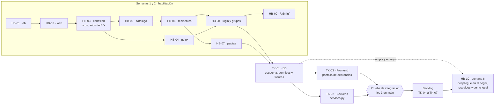

# 06 - Tickets de trabajo (sesión con Claude)

> Transcripción de la sesión de definición de los tickets de trabajo con Claude, que actúa como Tech Lead experimentado.

---

## Prompt 1 — Usuario

Excelente especificación de historias de usuario. Ahora trabajemos en la sección 6 de tickets de trabajo.

Como Tech Lead experimentado, a partir de las historias de usuario que acabas de crear, crea 3 tickets de trabajo principales para el desarrollo: uno de backend, uno de frontend y uno de bases de datos.

Da todo el detalle requerido para desarrollar la tarea de inicio a fin, teniendo en cuenta las buenas prácticas al respecto.

Incluye en cada ticket:
- Descripción técnica.
- Criterios de aceptación.
- Definición de hecho (*definition of done*).
- Estimación en *story points*.

---

## Respuesta 1 — Claude

Escribí la sección 6 del `readme.md` con los 3 tickets del camino crítico del MVP: el esquema que guarda los saldos, la lógica que los mueve y la pantalla que los muestra.

| Ticket | Tipo | Historia | Puntos |
|---|---|---|---|
| TK-01 | Base de datos: esquema de existencias, movimientos y conteos, con restricciones, *triggers* e índices | HU-01, HU-02, HU-03 | 5 |
| TK-02 | Backend: servicio de movimientos (entradas, transferencias, bajas y correcciones) | HU-01 | 5 |
| TK-03 | Frontend: pantalla de consulta de existencias con filtros en vivo y diseño para celular | HU-02 | 3 |

**Cada ticket incluye:**
- Encabezado con tipo, historia, prioridad, estimación, rama y dependencias.
- Contexto: por qué existe el ticket.
- Descripción técnica con archivos, modelos, firmas de funciones y fragmentos de código.
- Lo que queda fuera de alcance.
- Criterios de aceptación verificables, con los datos del mock.
- Pruebas, definición de hecho y riesgos.

Además, al inicio de la sección hay una tabla de dependencias entre tickets y una **definición de hecho común** (lint, CI, cobertura, PR revisado, sin secretos ni datos personales en logs, documentación actualizada).

**Puntos técnicos que vale la pena revisar:**
- **TK-01:** las restricciones usan los mismos nombres del DDL de la sección 3, y cada una tiene un test que provoca su violación. Agregué la vista `v_conciliacion_existencia`, que lista los saldos que no cuadran con la suma de los movimientos.
- **TK-02:** el bloqueo de saldos crea la fila que falte sin carreras (`INSERT ... ON CONFLICT DO NOTHING`) y bloquea siempre en el mismo orden, para que dos transferencias cruzadas no provoquen un *deadlock*. Las excepciones usan los mismos `code` del contrato de la API.
- **TK-03:** la búsqueda se lanza 300 ms después de dejar de escribir, los filtros quedan en la URL, y en el celular los resultados son tarjetas en lugar de tabla. La consulta queda en un selector que reutilizará `GET /existencias`.

**Decisiones a validar:**
1. **Los 3 tickets suman 13 de los 21 puntos de las historias.** Lo que falta (pantallas de movimientos, endpoint de existencias y módulo de conteos) queda como tickets del backlog sin documentar aquí.
2. **El `REVOKE` sobre `movimiento` va en un script del despliegue** (`scripts/db_privilegios.sql`), no en una migración, porque el nombre del rol de la aplicación cambia por entorno. El *trigger* protege aunque el script no se haya ejecutado.
3. **La consulta de existencias será la página de inicio** después del login.

---

## Prompt 2 — Usuario

Para que un desarrollador junior pueda hacer el ticket sin bloqueos, detalla cada ticket con:
- Tareas específicas paso a paso.
- Archivos y estructura de código a crear.
- Tests requeridos con ejemplos.
- Criterios de calidad.
- Comandos y pasos específicos para la verificación.

---

## Respuesta 2 — Claude

Creé una guía paso a paso por ticket en `docs/tickets/` y la enlacé desde cada ticket de la sección 6. Las puse en archivos aparte porque cada una tiene entre 800 y 1,100 líneas, y así el readme sigue siendo legible.

| Guía | Contenido principal |
|---|---|
| [`TK-01-esquema-inventario.md`](docs/tickets/TK-01-esquema-inventario.md) | Usuarios `app_owner`/`app_user`, modelos completos, 5 migraciones, fixture que carga el mock en pytest, tests de cada restricción y de privilegios |
| [`TK-02-servicio-movimientos.md`](docs/tickets/TK-02-servicio-movimientos.md) | Excepciones y `services.py` completos, conceptos de bloqueo explicados, tests de reglas y de concurrencia con hilos |
| [`TK-03-pantalla-existencias.md`](docs/tickets/TK-03-pantalla-existencias.md) | Selector, formulario, vista, plantillas HTMX y *responsive*, filtro `dosis`, tests de vista y Playwright |

**Cada guía tiene la misma estructura:**
0. Antes de empezar: qué leer, requisitos previos con comandos para comprobarlos, rama y atajos de terminal.
1. Archivos a crear o modificar, en árbol.
2. Tareas paso a paso, con tiempo estimado y código de referencia.
3. Tests requeridos, con el código de los casos principales.
4. Criterios de calidad y cómo se comprueba cada uno.
5. Comandos de verificación con su resultado esperado.
6. Lista para el *pull request*.
7. "Si te bloqueas": síntomas frecuentes, causa y solución.

**Al bajar al detalle encontré 6 problemas que habrían bloqueado a un junior, y los corregí:**
1. **4 nombres de índice pasaban de 30 caracteres**, el límite de Django (error `models.E034`). Los renombré en las secciones 3.3 y 6 (por ejemplo, `ix_existencia_med_entidad`) y agregué la nota en 3.3.
2. **`SELECT ... FOR UPDATE` exige permiso de `UPDATE`**, y `app_user` no lo tiene sobre `movimiento`. La corrección se protege con `uq_movimiento_corrige`, y los tests de TK-02 corren como `app_user` para detectar este tipo de error.
3. **Los grupos no tenían permisos sobre los modelos nuevos**, porque se crearon en la semana 1. Sin una migración que los asigne, la pantalla de TK-03 respondería `403` a todos. La agregué a TK-01.
4. **El mock cargaba a los usuarios demo sin `is_staff`**, pero la sección 5 dice que entran a `/admin/`. Corregí `cargar_mock.sql`.
5. **La regla de HU-01 "solo entidades activas"** contradecía el *trigger* y el caso de uso de sobrantes: un egresado debe poder ceder o dar de baja lo que le quedó. La precisé: el **destino** debe estar activo.
6. **`floatformat` muestra `0.50`**, no `0.5`. TK-03 usa un filtro propio, `dosis`.

**Decisiones a validar:**
1. **Las guías están en `docs/tickets/`**, enlazadas desde el readme, en lugar de dentro del readme.
2. **Los tests cargan el mock real** (`cargar_mock.sql` adaptado desde Python) en lugar de *factories*: los criterios de aceptación ya están escritos con esos datos.
3. **`corrige_a` es `ForeignKey` con `UniqueConstraint`**, y no `OneToOneField`, para conservar el nombre `uq_movimiento_corrige` del DDL.
4. **El código de las guías no se ejecutó**, porque el proyecto Django todavía no existe. Revisé los nombres, los datos del mock y las versiones de Django y PostgreSQL contra la documentación del proyecto. El primer PR de cada ticket confirmará los detalles.

---

## Prompt 3 — Usuario

Ahora define (si no lo está ya):
- Tecnologías y librerías a utilizar, en el apartado de Descripción técnica.
- Dependencias entre tickets y orden de ejecución.
- Puntos de integración entre frontend, backend y base de datos.
- Criterios de revisión de código.

Asegúrate de que los 3 tickets se integren perfectamente al final.

---

## Respuesta 3 — Claude

Ya estaban la tabla de dependencias y la definición de hecho común. Agregué lo que faltaba en la sección 6 del `readme.md`:

1. **Tecnologías y librerías:** una tabla al inicio de la descripción técnica de cada ticket, con versión y uso, y qué dependencias nuevas agrega. TK-01 no agrega ninguna; TK-02 agrega `pytest-cov` (desarrollo); TK-03 agrega `django-htmx` y `pytest-playwright` (desarrollo).
2. **Orden de ejecución:** diagrama y reglas. TK-01 va primero y sin paralelo. TK-02 y TK-03 pueden ir en paralelo; con un solo desarrollador, TK-02 primero. Se integran en el orden TK-01 → TK-02 → TK-03. Incluye una tabla de los archivos que tocan varios tickets, con la regla para evitar conflictos en cada uno.
3. **Puntos de integración:** 11 contratos entre capas, con quién los provee, quién los consume, el contrato y cómo se verifica. Cada guía indica al inicio qué puntos provee y cuáles consume.
4. **Criterios de revisión de código:** tabla por ámbito (alcance, tests, integración, seguridad, datos, BD, backend, frontend, legibilidad y documentación) con su severidad, y la convención [bloqueante] / [sugerencia] / [nit].
5. **Prueba de integración final:** 5 escenarios que registran movimientos con el servicio y comprueban la pantalla, todos como `app_user` y con la conciliación vacía al terminar. El código y la verificación completa desde una instalación limpia están en `docs/tickets/integracion.md`.

**Problema de integración que encontré y corregí:** el *fixture* `demo` lo creaba TK-02, pero los tests de TK-03 lo usan. Así TK-03 no podía avanzar en paralelo con TK-02, y al integrar los 2 habrían chocado en `conftest.py`. Moví `demo`, `como_app_user` y `saldo` a TK-01, que ya creaba `datos_demo`. TK-02 ahora solo los usa.

**Decisiones a validar:**
1. **La prueba de integración la escribe quien integra el último ticket** (normalmente TK-03), y desde ahí corre en CI en cada PR.
2. **La revisión con un solo desarrollador** es una autorrevisión al día siguiente con la lista, más una revisión asistida por IA registrada en el PR.
3. **Las versiones de las dependencias nuevas** no están fijadas en el readme: cada guía indica cómo elegir la última estable y anotarla en el PR.

---

## Prompt 4 — Usuario

Confirmo las 3 decisiones.

---

## Respuesta 4 — Claude

Quedan confirmadas, y el `readme.md` ya las refleja tal cual, así que no hizo falta cambiarlo:
1. La prueba de integración la escribe quien integra el último ticket (normalmente TK-03) y desde ahí corre en CI en cada PR.
2. Con un solo desarrollador, la revisión es una autorrevisión al día siguiente con la lista de criterios, más una revisión asistida por IA registrada en el PR.
3. Las versiones de las dependencias nuevas se eligen al hacer cada ticket (la última estable) y se anotan en su PR.

---

## Prompt 5 — Usuario

Para el problema del Makefile, quiero contemplarlo porque es más legible para las personas. ¿Cómo se podría contemplar? No toques nada, solo propón los cambios.

(Después de ver la propuesta:) Sí, por favor, aplícalo. Me parece bien.

---

## Respuesta 5 — Claude

Propuse un `Makefile` en la raíz como **atajo** sobre los comandos ya documentados, no como reemplazo, y lo apliqué así:

- **Se crea en TK-01** (paso 1.8 de su guía), junto con `docker-compose.yml` y `scripts/migrate.sh`, porque envuelve esos archivos. Hoy solo funcionarían `make help` y `make openapi`.
- **17 *targets*:** `help`, `up`, `down`, `reset`, `migrate`, `superuser`, `static`, `mock`, `test` (con `T=ruta::test` para uno solo), `test-ci`, `e2e`, `lint`, `format`, `check-migrations`, `shell`, `psql` y `openapi`. `make help` los lista leyendo los comentarios `##`.
- **Solo para desarrollo local:** el CI sigue con los comandos directos, porque en GitHub Actions no hay `docker compose exec`.
- **Los comandos directos se conservan** en la documentación como "lo que ejecuta cada *target*".

**Documentación actualizada:**
- Sección 1.4: `make` en los requisitos (en Windows hay que instalarlo; Git Bash no lo trae), los pasos de instalación y de pruebas con `make` y el comando equivalente al lado, y `make reset` para volver a empezar.
- Sección 2.3: el `Makefile` en la estructura de archivos.
- TK-01: punto 10 en la descripción técnica y un criterio de aceptación (`make help` lista los 17 comandos, y `make migrate`, `make test` y `make mock` hacen lo mismo que sus comandos directos).
- `CLAUDE.md`: tabla `make` ↔ comando directo y las reglas del `Makefile`.

**Lo probé** con el `make` instalado en el equipo (GNU Make 3.81): `make help` lista los 17 comandos y `make -n test T=...` arma el comando esperado. La prueba encontró un error que corregí: la expresión regular de `help` no aceptaba dígitos, así que `e2e` no aparecía en la lista.

**Reglas que quedan documentadas:** las recetas se indentan con tabulador; el `Makefile` lee `.env` con `-include`, así que las contraseñas de desarrollo no deben llevar `$`, `#` ni comillas.

---

## Prompt 6 — Usuario

Sí, crea el (los) ticket(s) de la semana 1 con el mismo nivel de detalle. Si un ticket abarca demasiadas tareas o detalles, pártelo en más tickets, y actualiza también la planificación. Esta sería mi propuesta de tickets en ese caso:

- **Ticket 1 (Setup base):** basado en la sección de infraestructura, crea el archivo `docker-compose.yml` configurando únicamente el servicio de PostgreSQL y sus volúmenes. No toques nada más.
- **Ticket 2 (App container):** crea el `Dockerfile` para Django y agrégalo como servicio al `docker-compose.yml`, vinculándolo a la red de PostgreSQL.
- **Ticket 3 (Integración):** configura las variables de entorno en el `settings.py` de Django para que consuman el `DATABASE_URL` definido en la infraestructura.
- **Ticket 4 (Habilitación):** sección 5, habilitadores en el panel `/admin/` de Django.

Recuerda que los tickets deben llevar, para desarrollar la tarea: descripción técnica, criterios de aceptación, definición de hecho (*definition of done*) y estimación en *story points*. Para que un desarrollador junior pueda hacer el ticket sin bloqueos, detalla cada ticket con (donde aplique): tareas específicas paso a paso, archivos y estructura de código a crear, tests requeridos con ejemplos, criterios de calidad y comandos o pasos específicos para la verificación.

(Respuestas a mis 2 preguntas:) Adelantar los 2 usuarios de base de datos a la semana 1, y usar las variables `DB_*` en lugar de `DATABASE_URL`.

---

## Respuesta 6 — Claude

Antes de escribir, te pregunté por 2 choques con el diseño:
- **Usuarios de base de datos:** en cuanto existiera `app/manage.py`, el CI correría con `app_owner` y `db/init/01_roles.sh`, que solo creaba TK-01. Elegiste adelantarlos a la semana 1.
- **`DATABASE_URL`:** el CI, los atajos `dtest` y `migrate.sh` cambian solo `DB_USER` y `DB_PASSWORD` para usar `app_owner`. Elegiste mantener las variables `DB_*`.

Con esas respuestas, tu propuesta quedó en **9 tickets de habilitación (HB-01 a HB-09, 23 puntos)**. Usan el prefijo HB para no renumerar TK-01 a TK-07, que ya se citan en todo el diseño:

| Ticket | Alcance | Puntos | De tu propuesta |
|---|---|---|---|
| HB-01 | Servicio `db`, volumen `pgdata` y los 2 usuarios de BD | 2 | Ticket 1 |
| HB-02 | Proyecto Django, `Dockerfile` y servicio `web` | 3 | Ticket 2 |
| HB-03 | Conexión con `DB_*`, `web` como `app_user`, `migrate.sh`, modelo `Usuario` y privilegios | 3 | Ticket 3 |
| HB-04 | Nginx con HTTPS local | 2 | Nuevo |
| HB-05 | Catálogo (D2), extensiones, `f_unaccent` e índices trigram | 3 | Ticket 4, partido |
| HB-06 | Entidades: Hogar y residentes (D3) | 3 | Ticket 4, partido |
| HB-07 | Esquema de pautas (D6) | 2 | Nuevo |
| HB-08 | Login, `base.html`, grupos, usuarios y `django-axes` | 3 | Ticket 4, partido |
| HB-09 | Catálogo y residentes en `/admin/` | 2 | Ticket 4, partido |

**Por qué cambió tu propuesta:**
- **El Ticket 4 era demasiado grande:** los habilitadores necesitan antes los modelos de D1 a D3, las extensiones, la función `f_unaccent`, los grupos y el login. Lo partí en 5 tickets.
- **El modelo `Usuario` va en HB-03:** Django exige `AUTH_USER_MODEL` antes del primer `migrate`, y ese ticket ejecuta el primero.
- **2 tickets nuevos, porque había huecos:** ningún ticket creaba Nginx (TK-03 y la prueba de integración usan `https://localhost`), ni la tabla `pauta`, que el mock inserta y TK-01 carga en sus tests.
- **HB-02 no se conecta a la base:** Django arranca sin `DATABASES` (backend `dummy`), para respetar tu división entre contenedor (Ticket 2) e integración (Ticket 3).

**Cada ticket** tiene en la sección 6 su descripción técnica, criterios de aceptación, definición de hecho y estimación, y en `docs/tickets/HB-*.md` una guía con tareas paso a paso, archivos, código de referencia, tests con ejemplos, criterios de calidad, comandos de verificación y problemas frecuentes.

**Otros cambios para que todo cuadre:**
- **CI:** cada *job* se activa cuando existe lo que necesita: `lint` e `imagen` con `app/manage.py`, `tests` con `app/conftest.py` y `e2e` con `app/e2e/`. Así los primeros tickets no fallan por tests o pruebas de Playwright que todavía no existen.
- **TK-01** ya no crea los usuarios de BD ni los privilegios generales. Recibe el *trigger* `tg_medicamento_baja` y la validación de esa baja en el panel, que ningún ticket creaba porque necesitan la tabla `existencia`.
- **Sección 3.1:** nombres para 4 restricciones que el DDL no nombraba: `ck_medicamento_tipo`, `uq_mpa_medicamento_principio`, `ck_entidad_tipo` y `ck_residente_estado`.
- **Sección 2.5:** `django-axes` y la expiración de sesión quedan en HB-08; no estaban en ningún ticket.
- **Planificación (sección 5):** semana 1, HB-01 a HB-04; semana 2, HB-05 a HB-09; semana 3, TK-01; las historias se recorren media semana. El MVP pasa de 26 a 49 puntos, y el reporte mensual queda como margen de la semana 6.

---

## Prompt 7 — Usuario

¿Qué formateadores para el código de Python, las plantillas de Django y los archivos de CSS y JS tenemos incluidos?

---

## Respuesta 7 — Claude

Solo hay formateador para Python. Las plantillas de Django, el CSS y el JS no tienen ninguno en el diseño.

| Tipo de archivo | Formateador | Dónde está previsto |
|---|---|---|
| Python | **ruff** (`ruff format` y `ruff check`) | Configurado en HB-02 (`pyproject.toml`); lo exigen el *job* `lint` del CI, la plantilla del PR y la definición de hecho de cada ticket |
| Plantillas de Django | Ninguno | — |
| CSS y JS | Ninguno | — |

Tampoco hay `.editorconfig` ni `pre-commit`. Todo el CSS y JS previsto es de terceros y ya viene minificado (Bootstrap 5.3.3 en HB-08 y HTMX 2.0.4 en TK-03, en `static/*/vendor/`), y la CSP de nginx impide el JS en línea.

**Recomendación:** djLint para las plantillas (es un paquete de Python, así que entra en `requirements-dev.txt` y en `pyproject.toml` sin agregar Node), y nada para CSS y JS mientras no haya archivos propios: reformatear los minificados de terceros los rompería y llenaría los diffs.

---

## Prompt 8 — Usuario

Agrégalos, por favor.

---

## Respuesta 8 — Claude

Agregué **djLint** (perfil `django`) para las plantillas. CSS y JS siguen sin formateador, y la definición de hecho común explica por qué.

**Antes de documentarlo, lo probé:** instalé djLint en un entorno temporal y lo corrí sobre las plantillas de las guías de HB-08 y TK-03. El lint pasó (salvo un `<button>` sin `type`, que corregí), pero el formato no, así que reemplacé esas plantillas por la versión que deja `djlint --reformat`: 2 espacios de sangría y un atributo por línea cuando la etiqueta no cabe en 120 caracteres. Los tests de esas guías siguen siendo válidos, porque solo buscan textos y atributos que no cambiaron.

**Dónde quedó:**
- **HB-02:** `djlint` en `requirements-dev.txt` y `[tool.djlint]` en `pyproject.toml`. Ignora H030 y H031 (piden `<meta>` de descripción, que no aplica a una app interna) y excluye `staticfiles/`, `static/vendor/`, `htmlcov/` y `test-results/`. Su regla H021, que rechaza los `style="..."`, coincide con la CSP.
- **CI (*job* `lint`):** instala ruff y djLint con la versión de `requirements-dev.txt` y corre `djlint . --check` y `djlint . --lint`. Sin plantillas, djLint termina con código 2, así que ese paso se salta mientras no exista ningún `.html` (hasta HB-08).
- **`Makefile` (TK-01):** `make lint` y `make format` incluyen djLint. `djlint --reformat` termina con 1 cuando cambia un archivo, y en `make format` eso no cuenta como error.
- **HB-08 y TK-03:** plantillas formateadas, nota de cómo reformatear, criterio de calidad, comando de verificación y una fila en "Si te bloqueas".
- **readme:** sección 1.4 (`make lint` y `make format`), 2.3 (estructura), 2.4 (CI), definición de hecho común, ficha de HB-02 y HB-08, archivos compartidos y criterio de *merge* "Calidad estática" de la sección 7.3. También la plantilla del PR y `CLAUDE.md`.

El diagrama de infraestructura de la sección 2.4 sigue diciendo "ruff + pytest": no lo cambié para no dejar desactualizado el PNG de `diagramas/`.

---

## Prompt 9 — Usuario

1. Cámbialo: los diagramas se renderizan en GitHub.
2. Usemos la última versión estable y congelémosla ahí, con la 1.49.9 de djLint.

---

## Respuesta 9 — Claude

1. **Diagrama de infraestructura (sección 2.4):** el nodo del CI dice ahora "ruff + djLint + pytest + build de imagen". Apliqué el mismo cambio en el anexo de `02-arquitectura.md`.
2. **djLint congelado en 1.49.9:** HB-02 lo fija en `requirements-dev.txt` y lo saca de la consulta de versiones de su paso 1. La nota del paso aclara que, a diferencia de las demás, esa versión no se actualiza al hacer el ticket: subirla cambia el formato esperado y va en un PR propio que reformatee todas las plantillas. También lo indican la ficha de HB-02 (sección 6) y `CLAUDE.md`.

Repetí la prueba con djLint 1.49.9: las plantillas de las guías de HB-08 y TK-03 pasan `--check` y `--lint`, la regla H021 sigue rechazando los estilos en línea y, sin plantillas, el código de salida sigue siendo 2 (el CI salta ese paso).

---

## Prompt 10 — Usuario

Ya inicialicé OpenSpec. Quiero configurarlo para que tome lo siguiente:
1. La fuente de las historias de usuario y de los tickets, de las secciones correspondientes del `readme.md`.
2. La arquitectura, el stack tecnológico, los ADR y las convenciones de la BD (`CLAUDE.md`).
3. Reglas:
   - Todo `proposal.md` debe incluir el ID exacto de la historia de usuario y del ticket en su encabezado.
   - Todo criterio de aceptación debe convertirse en escenarios GIVEN/WHEN/THEN en `specs/`.
   - Cada tarea de `tasks.md` debe respetar la arquitectura mock-first / TDD definida en `CLAUDE.md`.

---

## Respuesta 10 — Claude

Configuré `openspec/config.yaml` (OpenSpec 2.1, esquema `spec-driven`), que inyecta su contexto y sus reglas en las instrucciones de cada artefacto:

- **`context`:** apunta a las fuentes de verdad sin copiarlas, para que no se desincronicen. Historias en la sección 5 del readme; tickets en la sección 6 y en `docs/tickets/`; modelo de datos en la 3 y API en la 4 con `openapi.yaml`; arquitectura y stack en la 2 y en `CLAUDE.md`; ADR en `docs/adr/`; convenciones de BD, TDD y pruebas en `CLAUDE.md`. También fija las 8 capabilities (una por app de Django), el vocabulario de dominio y que todo se escribe en español.
- **`rules.proposal`:** bajo el título va `**Historia:** HU-NN · **Ticket:** TK-NN · **Épica:** EP-NN`, con los IDs exactos de la tabla de tickets. Un cambio implementa un solo ticket y su nombre empieza por el ID. Los tickets HB no tienen historia: `— (habilitador de EP-NN)`.
- **`rules.specs`:** cada escenario Gherkin de la historia ("Dado/Cuando/Entonces/Y" → GIVEN/WHEN/THEN/AND) y cada casilla de "Criterios de aceptación" del ticket se convierte en un `#### Scenario:`, con el origen en su nombre, sin inventar comportamiento.
- **`rules.design`:** cita y respeta los ADR aceptados, y usa los nombres exactos de la sección 3 y las convenciones de BD.
- **`rules.tasks`:** mock-first y TDD. Por grupo, primero los tests en rojo con `datos_demo`, después la implementación; PostgreSQL real, `app_user`, concurrencia, `EXPLAIN` y contrato de la API; cada tarea con su comando de verificación de la guía del ticket; el último grupo comprueba la definición de hecho.
- **`operations`:** `apply` trabaja tarea por tarea, de rojo a verde, y corre `scripts/verificar.py`; `archive` comprueba la definición de hecho y el readme. Commit y push solo por petición.

**Lo probé** con un cambio temporal, que borré después. GIVEN/WHEN/THEN/AND en viñetas pasan `openspec validate --strict`. Pero un requisito escrito solo con "DEBE" falla en modo estricto, porque el validador exige SHALL o MUST. Por eso la regla pide "DEBE (MUST)", y los encabezados que lee el validador quedan en inglés. `openspec instructions` muestra el contexto y las reglas en proposal, tasks y apply.

**Para que todo coincida:**
- `CLAUDE.md` tiene un apartado "OpenSpec" con estas reglas, y el estado del repositorio menciona `openspec/`. El recordatorio de capabilities ya no dice que OpenSpec no existe.
- `adversarial-reviewer` y la skill `/push` contrastan también contra los escenarios del cambio del ticket. Ahora la condición es "mientras `openspec/specs/` no tenga specs", porque la carpeta ya existe.
- Agregué `openspec/` a la estructura de ficheros del readme (apartado 2.3).

---

## Prompt 11 — Usuario

¿Con qué framework vamos a escribir las pruebas? ¿Exclusivamente con pytest?

(Tras la respuesta:) Arregla la inconsistencia en el `CLAUDE.md` y el `readme.md`: usemos la implementación de `@pytest.mark.django_db(transaction=True)`, igual que en las guías, y `django_assert_num_queries`. Usemos pytest, que es claramente mejor para el mantenimiento y la extensibilidad.

---

## Respuesta 11 — Claude

Sí: el diseño usa solo pytest como framework y ejecutor, con pytest-django (base de pruebas, `client`, `transaction=True`, `django_assert_num_queries`), pytest-cov (cobertura), pytest-playwright (extremo a extremo) y jsonschema (contratos de la API, una biblioteca, no un framework). Ninguna guía escribe clases `TestCase`. La inconsistencia estaba en 2 APIs de estilo `unittest` de Django que aún se mencionaban: `TransactionTestCase` y `assertNumQueries`.

**Corregido:**
- **`CLAUDE.md`:** la regla "Concurrencia obligatoria" pide `@pytest.mark.django_db(transaction=True)` con `threading`, y una regla nueva, "Framework", fija que todo se escribe con pytest: funciones, *fixtures* y marcadores, sin clases `TestCase`.
- **readme 2.6:** "Herramientas" dice que se usa solo pytest y nombra las 2 formas de pytest-django; la fila de concurrencia de la tabla usa `transaction=True` con hilos.
- **readme 3.3:** la verificación de índices usa `django_assert_num_queries`.
- **readme 6 (TK-02):** el test de concurrencia queda solo con `@pytest.mark.django_db(transaction=True)`.
- **ADR-0018:** decía `assertNumQueries`. Lo corregí como error de documentación: la decisión (verificar los índices con el plan y el número de consultas) no cambia, así que no hace falta un ADR nuevo.

Los anexos de `02`, `03` y `06` quedaron sincronizados.

---

## Prompt 12 — Usuario

¿En nuestro arnés de pruebas y en las convenciones tenemos huecos?

(Tras la respuesta, con 8 huecos y 3 menores:) Sí, arréglalos.

---

## Respuesta 12 — Claude

Encontré 8 huecos, y 3 hacían que un test pasara sin comprobar lo que decía. Los arreglé todos, más 2 de los menores:

| # | Hueco | Arreglo |
|---|---|---|
| 1 | El chequeo de CSP de los e2e no podía fallar: la CSP solo la ponía nginx, y `live_server` no pasa por nginx | La política vive en `CONTENT_SECURITY_POLICY` y la envía un *middleware* de Django (HB-04); nginx oculta la de Django y deja una sola cabecera; un test del CI compara las 2 |
| 2 | `como_app_user` hacía `SET LOCAL` aunque no hubiera transacción, y PostgreSQL lo ignoraba: el test corría como `app_owner` sin aviso | El *fixture* falla si no hay transacción envolvente y comprueba `current_user` (TK-01) |
| 3 | Los e2e corrían como `app_owner` | `app/e2e/conftest.py` hace `SET ROLE app_user` en las conexiones del servidor de pruebas (TK-03) |
| 4 | `CLAUDE.md` pedía `transaction=True` sin `serialized_rollback=True`, y el vaciado final borraría los datos semilla | Forma completa en `CLAUDE.md` y en el readme (2.6 y TK-02) |
| 5 y 6 | La cobertura contaba migraciones y tests, y el CI medía ramas pero los comandos locales no | `[tool.coverage]` en `pyproject.toml` (HB-03): solo `apps/`, con ramas, sin migraciones ni tests; el CI ya no pasa `--cov-branch` |
| 7 | Sin arnés de contrato: `jsonschema` no estaba en ninguna lista y el CI no hacía el lint de `openapi.yaml` | TK-05 agrega `jsonschema` y un *helper* en `pruebas.py`; nuevo *job* `contrato` con Redocly CLI 2.79.0, que probé: 0 errores |
| 8 | Los hooks y scripts no tenían lint ni tests | `ruff.toml` en la raíz, `verificar.py --herramientas`, 46 tests en `tests/` y nuevo *job* `herramientas`; el hook de commits también los revisa si hay ruff en el equipo |

**Menores arreglados:** `--strict-markers` y `testpaths`, con `e2e` registrado desde HB-03, y `timeout-minutes` en todos los *jobs* del CI. Queda pendiente, por decisión anterior, automatizar la reversibilidad de las migraciones y los umbrales propios de cada ticket.

**Comprobaciones:** los 46 tests de las herramientas pasan, el lint nuevo detectó (y corregí) un error de sintaxis que yo mismo había introducido en el hook, y el hook de commits niega una herramienta mal formateada con ruff disponible y la deja pasar sin él. Para que el lint pase, corregí el hook de secretos (una variable `l` y el formato de sus expresiones regulares, sin cambiar su comportamiento: el escaneo del repositorio sigue en 0 hallazgos).

`contrato` y `herramientas` no son *checks* obligatorios (readme 7.3, regla 7). Actualicé `CLAUDE.md`, el readme (2.3, 2.4, 2.5, 2.6, 4.7, 6 y 7.3), las guías HB-02, HB-03, HB-04, HB-08, TK-01 y TK-03, el CI y `.gitignore`.

---

## Prompt 13 — Usuario

En las desviaciones en HB-06-entidades.md, ¿en qué ticket se revisará "poner el nombre real" y cómo lo recordaremos?

(Tras la respuesta, que proponía asignarlo a TK-01:) Hazlo con la opción TK-01, es decir 1, 2 y 3.

---

## Respuesta 13 — Claude

No estaba asignado a ningún ticket: la nota de HB-06 decía "en otro ticket" sin nombrarlo. El despliegue en el servidor del hogar no tiene ficha, y HB-09 no registra `Entidad` en `/admin/`, así que el nombre del Hogar tampoco se corrige desde el panel. Lo asigné a **TK-01**, que crea el `Makefile` y fija cómo se lee `.env`:

1. **Ficha de TK-01 (readme, sección 6):** un criterio de aceptación nuevo, que exige que un valor con espacios y sin comillas en `.env` funcione con `make`, con `scripts/migrate.sh` y los atajos, y con `docker compose`, con `HOGAR_NOMBRE` sin comentar en `.env.example`. También lo agregué a la descripción técnica (punto 10). La tabla "Archivos que tocan varios tickets" decía que los TK no modifican `.env.example`; ahora permite a TK-01 descomentar esa línea.
2. **Guía de TK-01, paso 1:** la tarea "Valores con espacios en `.env`", con la lectura línea por línea que sustituye a `. ./.env`. La probé con `bash --posix` y con el `sh` de BusyBox; `. ./.env` falla con el código 127 y `make` lee bien el valor. Agregué también la comprobación del nombre del Hogar en la sección 5.
3. **Nota de HB-06:** ahora apunta a TK-01. Cuando se cree el cambio de OpenSpec de TK-01, el criterio nuevo se convierte en un Scenario por la regla de `openspec/config.yaml`, así que no se podrá archivar sin cumplirlo.

---

## Prompt 14 — Usuario

(Tras la revisión adversarial de HB-06 en el PR #2, sin bloqueantes y con 5 sugerencias y 6 *nits*:) Atiéndelas.

(Tras el plan, con 3 decisiones:) Sí, apruebo.

---

## Respuesta 14 — Claude

Lo hice como un cambio de OpenSpec propio, `hb-06-ajustes-revision`, con `implementar-ticket`: tests congelados por su huella, rojo comprobado y verde con `implementer`. Atendí las 5 sugerencias y los *nits* 6, 7, 9, 10 y 11; el 8 ya lo cubre TK-01.

| Hallazgo | Cambio |
|---|---|
| 1. `activa` y `__str__` fallaban sin el subtipo | Una Entidad `RESIDENTE` sin su fila no está activa y se muestra como `Entidad <id>`. Con `select_related("residente")`, una sola consulta. Actualicé el punto de integración 11 del readme |
| 2. Un alta fallida dejaba el objeto con un `pk` falso | `_state.adding`; si el alta falla, el Residente recibido queda como estaba y se puede reintentar. Un solo test inyecta la falla con `monkeypatch`, contra PostgreSQL real |
| 3. Mensaje técnico para nombres vacíos | El servicio quita los espacios (error de campo obligatorio) y `ck_residente_nombres` tiene mensaje propio (migración `0004`, que no cambia la base) |
| 4. Un servidor sin `HOGAR_NOMBRE` crearía un Hogar "Demo" definitivo | `config.settings.prod` no arranca sin la variable, y `docker-compose.yml` ya no inventa un valor. No se rechaza el nombre de la demo, porque la demo lo usa. Lo agregué a la primera instalación (readme 2.4) y al `check --deploy` de la guía de HB-04 |
| 5. La guía de HB-06 aconsejaba poner en `.env` un valor con espacios | Corregí la sección 7 y anoté los ajustes en la guía |
| *Nits* 6, 7, 9, 10 y 11 | Nombres normalizados (opcionales vacíos a `NULL`), `nombre_completo` sin espacios de más, comentario sobre el `id = 1`, patrón `ejecutar_sql` y `TODO(TK-01)` para `como_app_user` |

**Comprobaciones:** 75 tests pasan y 1 se omite, con cobertura del 97.38 %. Además, `makemigrations --check` no detecta cambios y la `0004` se revierte y se vuelve a aplicar. Por último, `docker compose config` deja `HOGAR_NOMBRE` vacía y `check --deploy` con la variable no da advertencias. Los anexos de `02` y `06` quedaron sincronizados.

---

## Prompt 15 — Usuario

(Tras una segunda revisión adversarial, sin bloqueantes y con 5 sugerencias y 3 *nits*:) ¿Cuáles son las sugerencias y los *nits*?

(Tras la explicación, con una opinión sobre cada uno:) Ok, atiéndelos.

(Tras el plan, con 3 decisiones:) Apruebo.

---

## Respuesta 15 — Claude

Lo hice como el cambio de OpenSpec `hb-06-ajustes-revision-2`, con `implementar-ticket`. Atendí las 5 sugerencias y los *nits* 6 y 7; el 8 quedó fuera, como recomendé, porque el test de control ya delata esa causa.

| Hallazgo | Cambio |
|---|---|
| 1. El test del reintento usaba `monkeypatch` (ADR-0023) | Ahora provoca una falla real: una restricción temporal `CHECK ... NOT VALID` que PostgreSQL aplica al `INSERT` del Residente. No queda ningún `monkeypatch` |
| 2. Restauración parcial y comprobación de "ya registrado" más débil | `registrar_residente()` rechaza también un Residente con Entidad asignada, y restaura todos los campos, incluidas las fechas que `full_clean` convierte |
| 3. Nada sostenía la restauración de `_state` | Un test con `transaction=True` hace fallar el `COMMIT` con un `UNIQUE ... DEFERRABLE` después de un `save` correcto. Lo comprobé por mutación: sin esa restauración, el test queda en rojo |
| 4. El readme no avisaba de los espacios hasta TK-01 | Readme 2.4 y su anexo |
| 5. El paso 2 de la guía de HB-06 estaba desactualizado | Ahora muestra el código actual de `base.py`, `prod.py` y `docker-compose.yml` |
| *Nit* 6. Largo de `HOGAR_NOMBRE` | Máximo 150 caracteres en todos los entornos, con `ImproperlyConfigured` |
| *Nit* 7. TK-01 borraría el aviso de "obligatoria en producción" | Su paso 1 pide conservarlo |

**Comprobaciones:** 80 tests pasan y 1 se omite, con cobertura del 97.35 %. Además, `makemigrations --check` no detecta cambios y `check --deploy` con la variable no da advertencias. El anexo de `02` quedó sincronizado; la sección 6 del readme no cambió.

---

## Prompt 16 — Usuario

Implementa HB-07.

(Tras el plan:) Apruebo.

(Tras una disputa sobre un test congelado:) Opción recomendada: `"ON public.pauta USING btree"`.

(Tras la revisión adversarial de HB-07 en el PR #2:) ¿Hay hallazgos que arreglar debido a la revisión adversarial? (Tras la respuesta:) Prosigue. (Tras el plan:) Apruebo.

---

## Respuesta 16 — Claude

Hice HB-07 como el cambio de OpenSpec `hb-07-pautas`, con `implementar-ticket`. La app `pautas` tiene `Pauta` con `ck_pauta_dosis`, `ck_pauta_frecuencia`, `ck_pauta_fechas`, `ex_pauta_sin_traslape` (`daterange(fecha_inicio, fecha_fin, '[]')` sobre `btree_gist`), `ix_pauta_vigente`, `ix_pauta_residente_inicio` y `tg_pauta_validar`, sin pantallas ni `/admin/`. Además de los tests de la guía, agregué los de los nombres y definiciones exactos, los tipos, la ausencia de índice propio sobre `residente_id` y una pauta registrada como `app_user`.

Hubo una disputa: un test buscaba `" pauta USING btree"`, pero `pg_get_indexdef` de PostgreSQL 17 devuelve `ON public.pauta USING btree`. Se corrigió solo ese fragmento y se volvió a congelar el archivo.

La revisión adversarial no tuvo bloqueantes, pero sí un hallazgo importante, que comprobé: `full_clean()` de una pauta con fin anterior al inicio lanzaba `DataError`, porque `ExclusionConstraint.validate()` evalúa el `daterange` inválido. En el futuro formulario sería un `500`. Lo atendí en `hb-07-ajustes-revision`:

| Hallazgo | Cambio |
|---|---|
| 1. `DataError` al validar fin anterior al inicio | `Pauta.clean()` avisa en `fecha_fin` y Django ya no evalúa la exclusión. La base no cambia. Comprobado también con un `ModelForm` |
| 2. Los `CHECK` sin mensaje | Mensajes en español, en la migración `0003_mensajes` (`AlterConstraint`, sin SQL) |
| 4. `RangoDeFechas` la importa la migración `0001` | Comentario para que no se renombre ni se mueva |
| 7. Huecos en los tests | La exclusión no rechaza pautas de otro medicamento ni de otro residente, y `app_user` cierra una pauta |

**Comprobaciones:** 107 tests pasan y 1 se omite, con cobertura del 97.37 %. `\d pauta` no cambió, y `migrate pautas zero` y la vuelta funcionan. Los hallazgos 3, 5 y 6 quedaron para la historia de pautas.

---

## Prompt 17 — Usuario

(Tras una segunda revisión adversarial, sin bloqueantes ni importantes y con 6 menores:) ¿Corriste la comprobación? ¿Quedan pendientes para cerrar el HB-07?

(Tras la respuesta, que recomendaba cerrarlo:) No, si quedan documentados como pendientes para después en la historia de las pautas.

(Tras documentarlos en la guía:) Sí, mejor documéntalo en el readme también.

---

## Respuesta 17 — Claude

Sí: reproduje el menor 1 antes de publicarlo en el PR, y `full_clean()` con una fecha de inicio escrita como texto lanza `TypeError` en `Pauta.clean()`. Con un `ModelForm` no ocurre. HB-07 no tenía pendientes obligatorios: los 5 criterios de aceptación se cumplen, `\d pauta` está en el PR y el CI pasa.

Los pendientes quedaron documentados en 2 lugares:

- **Guía de HB-07**, al final de la sección 5: una tabla "Pendientes para la historia de Pautas" con los hallazgos 3, 5 y 6 de la primera revisión y los menores 1 a 5 de la segunda, cada uno con su origen y qué hacer. El menor 6, la huella de los tests fuera del repositorio, es así por diseño de `implementar-ticket`.
- **Readme, sección 5, EP-05:** un punto nuevo, "Pendientes de HB-07 para la historia de pautas", con la lista resumida y un enlace a la guía. El anexo de `05` quedó sincronizado.

---

## Prompt 18 — Usuario

Implementar HB-08.

(Tras el plan, con 4 decisiones:) Apruebo y actualicemos los ADR con las nuevas versiones de Bootstrap y django-axes. Si tienes problemas para verificar con navegador, para y tratemos de resolverlo.

(Tras una disputa sobre un test congelado y el aviso `axes.W006`:) Las 2 opciones recomendadas.

(Durante la verificación:) ¿Cómo puedo conectar a un navegador? ¿Hay que reflejar las versiones fijas en los contenedores? Anótalo en la guía de TK-01. Instalé Claude in Chrome; en la consola de Firefox se ve un error de CSP… en Firefox incógnito no aparece, y con Brave tampoco. Agrégalo a la guía.

---

## Respuesta 18 — Claude

Hice HB-08 como el cambio de OpenSpec `hb-08-login-grupos`, con `implementar-ticket`:

- **Login y plantilla común:** login propio en `/accounts/login/`, cierre de sesión por `POST` y `base.html` con Bootstrap servido desde `static/`.
- **Grupos:** los 2 grupos en una migración de datos (5 y 15 permisos) y `uq_usuario_un_grupo`.
- **Panel:** `UsuarioAdmin` exige un solo grupo, activa `is_staff` y no borra; `GrupoAdmin` no permite crear ni borrar grupos.
- **Fuerza bruta y sesión:** `django-axes` bloquea 15 minutos tras 5 intentos, y la sesión expira a los 30 minutos.

| Decisión | Resultado |
|---|---|
| Versiones | Bootstrap **5.3.9** (la guía decía 5.3.3), copiado de `npm pack`, que comprueba la integridad; `django-axes` **9.1.0**. Quedaron fijadas en ADR-0002, ADR-0022 y el readme |
| Disputa | `groups.add()` inserta con `ON CONFLICT DO NOTHING`, así que la base impide el segundo grupo sin lanzar error. El test inserta directo en la tabla puente |
| `axes.W006` | Silenciado: el bloqueo es por usuario. Detrás de nginx, sin `ipware`, todos llegarían con la IP del proxy y 5 fallos de cualquiera bloquearían a todos |
| Navegador | Sin herramientas de navegador en la sesión, lo revisé con Chrome *headless* por el protocolo DevTools, con emulación de dispositivo. A 390 px no hay desplazamiento horizontal, ni violaciones de CSP en el login ni en `/admin/login/`. Las capturas quedaron en `docs/capturas/HB-08/` y en el PR |
| CSP en Firefox | La causaba una extensión (`sandbox eval code`): no aparece en Chrome, en Brave ni en la ventana privada. Lo anoté en la sección 7 de la guía, para no agregar ese hash a la CSP |
| Contenedores | El `Dockerfile` y `docker-compose.yml` no repiten versiones. En cada equipo hay que reconstruir `web`, migrar y ejecutar `collectstatic`. Lo anoté en el paso 1 de TK-01, con un *target* `make actualizar` |

**Comprobaciones:** 134 tests pasan y 1 se omite, con cobertura del 96.91 %; djLint revisa las 3 plantillas. `accounts` se revierte a `0002` y vuelve. Por nginx, el 5.º intento fallido responde `429` con la CSP.

---

## Prompt 19 — Usuario

(Tras la revisión adversarial de HB-08, sin bloqueantes y con 4 hallazgos importantes y 7 menores:) ¿Queda algún pendiente del HB-08? (Tras la respuesta:) Sí, por favor. (Tras el plan:) Apruebo.

---

## Respuesta 19 — Claude

Lo hice como el cambio de OpenSpec `hb-08-ajustes-revision`. El hallazgo 8, la CSP del panel con sesión, ya es criterio de HB-09.

| Hallazgo | Cambio |
|---|---|
| 1, 2, 3, 7, 10 y 11. Tests que comprobaban la configuración y no el comportamiento | 9 tests de regresión: la barra de `base.html` con sesión, el bloqueo de un usuario que no afecta a otro y termina a los 15 minutos, el 5.º fallo con `429`, la sesión de 1800 segundos, el Administrador sin grupo, `is_staff` al asignar grupo, el `403` para *Solo lectura* y `app_user` en las tablas de `axes` |
| 5. `GrupoAdmin` dejaba cambiar nombre y permisos | Grupos de solo consulta (`has_change_permission = False`) |
| 10. Doble aviso con un grupo inválido | Un solo aviso |
| 6. El Administrador también puede quedar bloqueado | `bloqueado.html` pide esperar 15 minutos. ADR-0022 documenta el bloqueo malicioso y los datos que guarda `axes` |
| 4 y 11. Proceso y guía | Este registro, el paso 2 de la guía con `npm pack` y el *glob* de djLint |

**Comprobaciones:** 147 tests pasan y 1 se omite, con cobertura del 97.27 %. Los 3 tests nuevos en rojo fallaron por el motivo esperado antes de implementar.

---

## Prompt 20 — Usuario

(Tras una segunda revisión adversarial de HB-08, sin bloqueantes y con 1 hallazgo importante y 6 menores:) ¿Hay pendientes para este HB-08? (Tras la respuesta:) Hazlo. (Tras el plan:) Apruebo.

---

## Respuesta 20 — Claude

Antes de responder comprobé por nginx el hallazgo que la revisión dejó sin verificar: **cada intento durante el bloqueo lo reinicia**, porque `axes` renueva la hora del último intento. Lo atendí en el cambio de OpenSpec `hb-08-ajustes-revision-2`:

| Hallazgo | Cambio |
|---|---|
| 1. El test de la sesión de 30 minutos solo comprobaba `settings` | Comprueba la `expire_date` real en la base, su renovación con cada petición y la cookie sin `max-age` ni `expires` |
| 5. El bloqueo se reinicia con cada intento | Tests de los 14 minutos y del reinicio; `bloqueado.html` pide esperar sin volver a intentarlo |
| 2. `DELETE` de `app_user` en las tablas de `axes` | El test comprueba `INSERT`, `UPDATE` y `DELETE` |
| 3. ADR-0022 omitía `axes_accesslog` | Lo nombra, con `axes_reset_logs` y el reinicio del bloqueo |
| 4. "Gestiona grupos" | ADR-0021, el readme y sus anexos: gestiona usuarios y consulta grupos |
| 6 y 7. Detalles | El Scenario cita el mensaje completo; el *Purpose* de la spec de `accounts`; un control positivo de `_save` |

**Comprobaciones:** 150 tests pasan y 1 se omite, con cobertura del 97.27 %. Solo el test del mensaje nació en rojo; los demás fijan el comportamiento comprobado.

---

## Prompt 21 — Usuario

(Tras una tercera revisión adversarial de HB-08, sin bloqueantes ni importantes y con 5 menores:) ¿Hay pendientes para el HB-08? (Tras la respuesta:) Haz 1 y 2 y cerremos.

---

## Respuesta 21 — Claude

Corregí los 2 menores de documentación y cerré HB-08:

- **1. ADR-0022 se contradecía.** Decía "repitiendo 5 fallos cada 15 minutos", pero cada intento durante el bloqueo lo reinicia. Ahora dice que bastan 5 fallos y después un solo intento cada menos de 15 minutos.
- **2. `axes_reset_logs` no vacía el registro de accesos.** Lo comprobé en el paquete instalado: solo borra lo que tiene más de 30 días (`--age N`; con `--age 0`, todo), y nada lo ejecuta de forma automática. Lo corregí en ADR-0022 y en la guía de HB-08.

Los otros 3 menores quedan anotados en la guía, sin cambio: el título de un requisito de la spec de `accounts`, `AXES_RESET_COOL_OFF_ON_FAILURE_DURING_LOCKOUT` con su valor por defecto (lo protege un test) y la numeración de los hallazgos en los comentarios de los tests.

---

## Prompt 22 — Usuario

Implementar HB-09. (Tras el plan:) Apruebo.

---

## Respuesta 22 — Claude

Implementé HB-09 con la skill `implementar-ticket`, en el cambio de OpenSpec `hb-09-admin-catalogo-residentes`:

| Paso | Archivos |
|---|---|
| Reglas comunes del panel | `apps/panel.py`: `SinBorrarMixin` y `BusquedaSinAcentosMixin` (`f_unaccent(lower(...))`) |
| Catálogo | `apps/catalogo/admin.py`: presentaciones, principios activos y medicamentos con sus principios activos en línea y *autocomplete* |
| Residentes | `apps/entidades/admin.py`: el alta llama a `registrar_residente()` y no pide el estado; `Entidad` no se registra |
| Títulos | `config/urls.py` |

**Decisiones aprobadas:** la búsqueda del panel no exige 3 caracteres ni usa `UNION` (precisión en ADR-0017), y los residentes se ordenan sin acentos.

**Hallazgo de la guía:** en Django 5.2 el panel no pasa `validate_min` al formulario en línea, y un medicamento sin principio activo se guardaba. Lo corrige `get_formset()`.

**Comprobaciones:**
- 36 tests nuevos; la suite da 187 pasan y 1 omitido, con 99,20 % de cobertura.
- Chrome *headless* por CDP, detrás de nginx y con los 2 grupos: el flujo completo funciona y no hay violaciones de CSP.

**Aceptado por el usuario:** las etiquetas sin acento del panel ("Presentacion", "Concentracion"), porque corregirlas requiere migraciones y el panel es provisional.

---

## Prompt 23 — Usuario

(Tras la revisión adversarial de HB-09, sin bloqueantes y con 2 mayores y 8 menores:) ¿Algún pendiente para el HB-09? (Tras la respuesta:) Incluye los ajustes mayores y los menores baratos. Para presentaciones duplicadas: no podemos duplicar 2 veces el mismo medicamento; si toca el modelo de HB-05, ¿qué cambios propones para mantener también la documentación viva? (Tras el plan:) Apruebo.

---

## Respuesta 23 — Claude

Atendí la revisión en el cambio de OpenSpec `hb-09-ajustes-revision`:

| Hallazgo | Cambio |
|---|---|
| 2. Presentaciones duplicadas sin acentos ("Tableta" junto a "tableta"), que permitían duplicar un medicamento | El `UNIQUE` literal de `presentacion.nombre` (HB-05) se reemplaza por `uq_presentacion_nombre` sobre `f_unaccent(lower(nombre))`, con mensaje. Migración `catalogo/0004_presentacion_unica`, reversible |
| 1. La búsqueda no separaba palabras ni recortaba espacios | Cada palabra debe aparecer en algún campo; un `filter()` por palabra, así "losartan hidroclorotiazida" encuentra Hyzaar |
| 3. El alta ofrecía presentaciones dadas de baja | Solo las activas; al cambiar, se conserva la del medicamento |
| 6, 7, 8 y 9 | Altas como `app_user`, CSP sin `<style>` ni `on*=`, *Solo lectura* en presentaciones y principios activos, y el *check* `panel.E001` |

**Documentación viva:** readme 3.1 (Mermaid, DDL y restricciones avanzadas), 3.2 (D2) y la ficha de HB-09 con un criterio nuevo, con los anexos de `03-modelo-datos.md` y de este archivo. También ADR-0017, las guías de HB-05 y HB-09 y `CLAUDE.md`. La ficha de HB-05 no cambia, porque describe lo que entregó ese ticket. El PNG del modelo de datos de `diagramas/` lo regenera el usuario.

**Pendientes anotados en la guía de HB-09:** el mínimo de un principio activo al guardar (4), las transiciones de estado del residente (5) y detalles de documentación (10).

**Comprobaciones:** 10 tests nacieron en rojo y los de regresión, en verde; la suite da 211 pasan y 1 omitido, con 98,54 % de cobertura. `\d presentacion` muestra solo `uq_presentacion_nombre`, y la reversión a `catalogo 0003` devuelve el `UNIQUE` original.

---

## Prompt 24 — Usuario

Revisado. Para el hallazgo 4, metamos la validación a nivel formulario, en la edición de Medicamento y en la API V2 cuando exista `POST /medicamentos`, devolviendo un error legible al usuario antes de guardar (pon una nota en el plan del `readme.md`). En el ticket HB-09, paso 3, y en el `readme.md`, D2, se indica "al menos uno". Para mantener flexibilidad, hagamos la validación en el formulario. Actualiza los criterios de aceptación y las pruebas de HB-09, y anótalo para el futuro `POST /medicamentos`, para que no solo dependamos del *inline* de `/admin`. (Tras el plan:) Apruebo.

---

## Respuesta 24 — Claude

Atendí el hallazgo 4 en el cambio de OpenSpec `hb-09-ajustes-revision-2`:

- **Una sola regla:** `apps/catalogo/validadores.py` define `exigir_principio_activo()` y el mensaje "Un medicamento debe tener al menos un principio activo." (código `sin_principio_activo`). No toca la base, así que la regla sigue siendo flexible.
- **Formulario del panel:** `PrincipiosActivosFormSet` (`apps/catalogo/forms.py`) la aplica en el alta y en el cambio, antes de guardar. Sustituye a `validate_min`, cuyo aviso era el genérico de Django.
- **V2:** `POST` y `PATCH /medicamentos` llamarán a la misma función y responderán `400 VALIDACION` con `CAMPO_VACIO` y el mismo mensaje. Quedó anotado en el readme (sección 4) y en `openapi.yaml` (`principios_activos_ids`).

**Documentación:** readme D2 (dónde y por qué se valida "al menos uno"), la nota de la V2 y el criterio 2 de HB-09, con los anexos de `03`, `04` y este archivo; la guía de HB-09 (paso 3, tests y el hallazgo 4 atendido).

**Comprobaciones:** los 2 archivos de tests nacieron en rojo, porque aún no existían los módulos que importan. La suite da 220 pasan y 1 omitido, con 98,61 % de cobertura, y el contrato pasa el lint de Redocly sin errores nuevos.

---

## Prompt 25 — Usuario

(Tras la segunda revisión adversarial de HB-09, sin bloqueantes y con 2 mayores y 8 menores:) ¿Hay algo pendiente para HB-09? (Tras la respuesta:) Hazlos, por favor. (Tras el plan:) Del punto 9, ajustar el tope de la búsqueda a 32 caracteres, ¿tendría algún impacto negativo? (Tras la respuesta:) No, mejor déjalo en 8 palabras, como estaba originalmente, y apruebo el plan original.

---

## Respuesta 25 — Claude

Atendí la segunda revisión en el cambio de OpenSpec `hb-09-ajustes-revision-3`:

| Hallazgo | Cambio |
|---|---|
| 1. La búsqueda con varios principios activos no tenía test | Tests: "Hyzaar" aparece una vez con "losartan hidroclorotiazida", y `%` y `_` se buscan como texto |
| 2. El paso 3 de la guía no se podía seguir | El *import* y el código de `validadores.py` y `forms.py` en la guía; la sección 5 nombra la migración `0004` |
| 4. `None` y texto en la regla | `None` se rechaza como la lista vacía y un texto lanza `TypeError`; la V2 traduce `sin_principio_activo` a `CAMPO_VACIO` (readme 4 y `openapi.yaml`) |
| 7. Campo de búsqueda mal escrito | `check()` da `panel.E002` |
| 9. Sin tope de palabras | Como mucho 8 palabras (`MAXIMO_PALABRAS`) |
| 3, 5 y 10 | ADR-0005 con 3 índices únicos por expresión, el `<option>` del HTML en el test y `CLAUDE.md` |

**Sobre el tope de 32 caracteres:** no tenía impacto negativo importante. Acotaba las uniones (a lo sumo 16 palabras) y, como la búsqueda es "contiene", cortar no hace perder resultados. El único caso a cuidar era una frase entre comillas cortada en el límite. Se quedó el tope de 8 palabras, por decisión del usuario.

**Notas en la guía, sin código:** el botón **+** puede crear una presentación inactiva que después no se puede elegir (6), y la consulta de duplicados sin acentos que hay que correr antes de aplicar la `0004` en el servidor del hogar (8).

**Comprobaciones:** 9 tests nacieron en rojo y los de regresión, en verde. La suite da 232 pasan y 1 omitido, con 98,72 % de cobertura, y el contrato pasa el lint de Redocly.

---

## Prompt 26 — Usuario

(Tras la tercera revisión adversarial de HB-09, sin bloqueantes y con 2 mayores y 5 menores:) ¿Hay pendientes para el HB-09? (Tras la respuesta:) Sí, por favor, hazlo así. (Tras el plan:) Apruebo.

---

## Respuesta 26 — Claude

Atendí la tercera revisión en el cambio de OpenSpec `hb-09-ajustes-revision-4`:

| Hallazgo | Cambio |
|---|---|
| 1. La guía no se podía seguir completa | La sección 1 lista todos los archivos; los pasos 2, 3 y 4 traen el código vigente, y un paso 3b crea `uq_presentacion_nombre` y la migración `0004`. Lo comprobé: los bloques coinciden con los archivos, y los tests base de la sección 3 pasan con ese código (14 de 14) |
| 2. `null` en la V2, descrito de 2 formas | Una sola, en orden: el esquema rechaza lo que no es *array*, incluido `null` (`TIPO_INVALIDO`), y la lista vacía (`CAMPO_VACIO`); después se aplica la regla, con su código traducido a `CAMPO_VACIO`. En `exigir_principio_activo()`, `None` es un caso defensivo |
| 3, 4, 6 y 7 | La traducción pasa a la descripción del requisito; `bytearray` y `memoryview` lanzan `TypeError`; `panel.E003` para los campos escritos como texto; test de una relación inversa |

**Nota en la guía (5):** `panel.E002` marca `"pk"` como inexistente; se usa `id`.

**Comprobaciones:** 3 tests nacieron en rojo y el de la relación inversa, en verde. La suite da 236 pasan y 1 omitido, con 98,74 % de cobertura, y el contrato pasa el lint de Redocly.

---

## Prompt 27 — Usuario

(Tras la cuarta revisión adversarial de HB-09, sin bloqueantes ni mayores y con 7 menores:) ¿Hay pendientes del HB-09? (Tras la respuesta:) Hazlo, por favor.

---

## Respuesta 27 — Claude

Hice una última pasada, solo de documentación, en el cambio de OpenSpec `hb-09-ajustes-revision-5`:

| Hallazgo | Cambio |
|---|---|
| 1. El paso 1 de la guía no se cumplía | El *import* de `SIN_PRINCIPIO_ACTIVO` va dentro de su test, así el módulo no falla antes del paso 3 |
| 2. El test del Hogar estaba en el archivo equivocado | Pasa a la sección 3.2 (`entidades`), como en el repositorio |
| 3. Una rama de la V2 que nunca se ejecuta | Una sola capa en la nota del readme, `openapi.yaml`, el *docstring* de `validadores.py` y el escenario de la spec: el esquema rechaza la lista vacía con `CAMPO_VACIO` y el mensaje de la regla |
| 5. El paso 3b no tenía test en rojo | Sección 3.3 con los tests de `uq_presentacion_nombre` |
| 7. `CLAUDE.md` | Nombra `panel.E003` |

**Notas en la guía, sin cambio:**
- **4.** El mapeo general de los errores de esquema se decide al implementar la V2.
- **6.** `check()` no cubre `None` ni números en `campos_sin_acentos`.

**Comprobaciones:** los 5 bloques de código de la guía coinciden con los archivos, y sus tests base (3.1, 3.2 y 3.3) pasan con el código actual (16 de 16). La suite da 236 pasan y 1 omitido, y el contrato pasa el lint de Redocly.

---

## Prompt 28 — Usuario

(Tras la quinta revisión adversarial de HB-09, sin bloqueantes ni mayores y con 3 menores de documentación:) Quiero confirmar que no existen pendientes para el HB-09. (Tras la respuesta:) Excelente, hazlas.

---

## Respuesta 28 — Claude

Atendí los 3 menores de la quinta revisión, solo de documentación:

- **1. Frases que decían que la V2 "llama" o "reutiliza" `exigir_principio_activo()`.** Ahora dicen que la V2 comparte su mensaje: el esquema rechaza la lista vacía, y la función protege a quien guarde sin pasar por él. Corregí 8 sitios: `CLAUDE.md`, el readme (D2) con su anexo en `03-modelo-datos.md`, 4 lugares de la guía de HB-09 y el *docstring* de `test_formularios.py`.
- **2.** La tabla "Así avanza el rojo" de la guía tiene la fila del paso 3b.
- **3.** La nota del hallazgo 4 dice que el mapeo general de la V2 parte de lo que ya fija `principios_activos_ids`: `minItems` → `CAMPO_VACIO` y `type` → `TIPO_INVALIDO`.

Con esto, HB-09 no tiene pendientes de código ni de documentación. Las notas que el usuario aceptó quedan anotadas en la guía.

---

## Prompt 29 — Usuario

(Tras la sexta revisión adversarial de HB-09, sin bloqueantes ni mayores y con 3 menores de redacción:) ¿Quedan pendientes para el HB-09? (Tras la respuesta:) Sí, por favor.

---

## Respuesta 29 — Claude

Atendí los 3 menores de la sexta revisión en el cambio de OpenSpec `hb-09-ajustes-revision-6`, solo de documentación:

| Hallazgo | Cambio |
|---|---|
| 1. La nota de la V2 decía que el esquema "aplica la misma regla" | Ahora dice que exige lo mismo (al menos uno) y comparte su mensaje, en el readme y en `04-api.md` |
| 2. La spec mezclaba 2 ideas | La descripción del requisito separa la reutilización de la regla fuera del panel del esquema de la V2, que exige lo mismo por su cuenta |
| 3. La guía no ejecutaba `test_formularios.py` | El paso 1 lo ejecuta aparte, porque falla en la recolección hasta el paso 3; el paso 3 de la tabla del rojo lo incluye, y la sección 3.4 trae su versión base |

**Comprobaciones:** la versión base de la sección 3.4 pasa con el código actual (4 de 4) y ruff no marca nada.

---

## Prompt 30 — Usuario

Trabajemos la guía de despliegue, ¿qué tenemos documentado y relevante para el despliegue? (Tras la respuesta, que listó lo documentado, los avisos repartidos por tickets, lo que faltaba y una contradicción entre el readme 2.5, ADR-0022 y `prod.py`:)

1. Hagamos un HB-10, habilitador, y estimemos. Igual que los demás tickets, necesitamos un paso a paso detallado para que un Dev Jr. pudiera hacerlo. Encájalo en el plan que detalla el orden de ejecución de los tickets.
2. Solo será un servidor en el hogar para el despliegue, y también necesitamos preparar el demo/mock para una máquina local. Queda fuera el VPS por falta de fondeo. Ajustemos el `readme.md` y la doc viva que se requiera (¿posible ADR?).
3. Escribe solo la guía. Los scripts, cuando lleguemos a ello después del TK-01 y tengamos algo más de detalle concretado.

---

## Respuesta 30 — Claude

Creé HB-10, ajusté el diseño para dejar fuera el VPS y escribí la guía, sin código.

**HB-10 · Despliegue en el servidor del hogar, respaldos y demo local (5 puntos, semana 6).** Depende de TK-01, por el `Makefile` y la lectura de `.env` con espacios, y para instalar en el hogar espera al MVP integrado. La guía ([`docs/tickets/HB-10-despliegue-hogar.md`](docs/tickets/HB-10-despliegue-hogar.md)) tiene 3 partes:

| Parte | Qué |
|---|---|
| A. Repositorio | `backup_db.sh` (`pg_dump` cifrado con la llave pública GPG del Administrador, retención de 14 días y disco externo), `restore_db.sh` (solo sobre una base vacía, o `--ensayo` en una base aparte que compara los conteos y la conciliación), `hogar.cron`, `make backup`, `restore` y `restore-ensayo`, el candado de `make mock` y 8 tests en `tests/test_respaldos.py`. Es código de referencia: se escribe y se prueba al ejecutar el ticket |
| B. Servidor del hogar | Ubuntu 24.04 con IP fija, SSH con llave, `ufw`, Docker con rotación de logs, el `.env` de producción variable por variable, `mkcert` con la IP y la CA en Windows, Firefox, Android e iPhone, la primera instalación sin mock, los usuarios reales, los respaldos y el primer ensayo |
| C. Demo local | La misma imagen y `config.settings.prod`, con el Hogar de la demo y el mock; `make reset` y `make mock` antes de cada demo, y un video para quien evalúe a distancia |

La sección 8 es el manual de operación: actualizar, volver atrás, el ensayo mensual, restaurar tras una falla, renovar el certificado y un calendario. La sección 0.4 deja 6 decisiones abiertas con su propuesta, como la custodia de la llave GPG o la rotación del disco externo.

**Documentación viva:**
- **ADR-0026** supersede a ADR-0025: solo el servidor del hogar y una demo local, `mkcert` en todos los entornos, y nginx hace la redirección a HTTPS y HSTS.
- **ADR-0022 y readme 2.5:** decían `SECURE_SSL_REDIRECT=True` en producción. Ahora dicen lo que hace `prod.py`, sin cambiar la decisión.
- **Readme:**
  - secciones 1.4, 2.1, 2.2, 2.3, 2.4 (diagrama, entornos y proceso de despliegue) y 2.5;
  - sección 5: EP-01 suma HB-10 (26 puntos) y el plan pone HB-10 en la semana 6;
  - sección 6: la ficha de HB-10, el orden de ejecución con la regla 4, y el MVP pasa de 49 a 54 puntos.
- **Anexos de `02`, `05` y `06`**, `openapi.yaml` (la descripción del servidor), `openspec/config.yaml`, `CLAUDE.md` (el orden de ejecución y la excepción de TDD de las partes B y C) y las guías con el ancla de la sección.

**Quedan para HB-10:** quitar el VPS de `prod.py`, de `.env.example` y de sus copias en las guías de HB-02 y HB-04, porque es código y configuración.

---

## Prompt 31 — Usuario

Haz las verificaciones pendientes ahora, docker está corriendo.

---

## Respuesta 31 — Claude

Verifiqué con Docker lo que la guía de HB-10 daba con margen, y probé su código de referencia copiándolo a archivos temporales, que después borré. El ticket sigue sin scripts.

| Verificación | Resultado |
|---|---|
| `check --deploy` con `config.settings.prod` | `System check identified no issues (3 silenced).` La guía lo dice exacto |
| Tabla de grupos por usuario | `usuario_groups`, con `usuario_id` |
| `pg_dump` como `app_owner` y `pg_restore` en una base nueva | Mismo dueño de `public` y de las extensiones, los permisos de `app_user` y los privilegios por defecto, y los conteos de las 21 tablas cuadran |
| Tests de la guía sin los scripts (rojo) | 9 failed, todos porque el script no existe |
| Tests con los scripts de referencia (verde) | 8 passed. El del ensayo pasa si se quita la comprobación de `v_conciliacion_existencia`, que crea TK-01 |
| ShellCheck 0.10.0 y ruff | Sin avisos, después de los ajustes de abajo |

**Lo que las pruebas cambiaron en la guía:**
- **Un hueco en la vuelta atrás:** `pg_dump` no respalda los permisos de la base (`REVOKE ALL ... FROM PUBLIC` y `GRANT CONNECT ... TO app_user` de `01_roles.sh`). Una base recreada dejaría conectarse a cualquier rol. `restore_db.sh` ahora los vuelve a poner, con un 9.º test (`test_restaura_en_una_base_vacia_con_sus_permisos`) y su criterio en la ficha de HB-10.
- **Windows:** `bash` a secas ejecuta el de WSL, que no recibe las variables de entorno, y el `gpg` de Git Bash no entiende las rutas `C:/...`. Los tests usan la ruta completa de bash y `posix()`, y leen la salida en UTF-8.
- **`export "${linea?}"`** en `leer_env.sh`, por el aviso SC2163 de ShellCheck, y el test con el formato de ruff.

---

## Prompt 32 — Usuario

Sí, pasa el revisor adversarial.

---

## Respuesta 32 — Claude

La revisión adversarial de HB-10 y ADR-0026 no aprobó el cambio: 1 bloqueante, 8 mayores y 12 menores. Comprobé con Docker el mayor M1, y es un error real.

| # | Hallazgo |
|---|---|
| B1 | El respaldo usa `app_owner` y el ensayo usa el superusuario, en contra de ADR-0006 y ADR-0004, sin un ADR que lo permita |
| M1 | `restore_db.sh -` está roto: `docker compose exec -T` se come la entrada estándar, y `pg_restore` recibe un archivo vacío |
| M2 | ADR-0022 se reescribió en su decisión sin supersedencia |
| M3 | `.gitattributes` solo fuerza LF en `*.sh`; `.gitignore` no ignora `*.asc` ni `*.gpg`; el hook no reconoce una llave privada PGP |
| M4 | La CA de `mkcert` se generaba en el servidor |
| M5 | Sin copia fuera del hogar, y sin aviso de un respaldo fallido |
| M6 | `make reset` no tenía candado en el servidor |
| M7 | El ensayo daba falsos "NO cuadra" por las tablas de sesiones y de `axes` |
| M8 | La skill `implementar-ticket` y `openspec/config.yaml` no reconocían el perfil de HB-10 |

Uno de los menores no era correcto: el 9.º test sí había corrido en verde.

---

## Prompt 33 — Usuario

Aplícalo todo así.

---

## Respuesta 33 — Claude

Apliqué todos los hallazgos y volví a verificar el código de referencia con archivos temporales, que después borré.

**ADR:**
- ADR-0026 declara los usos de `app_owner` (respaldo y restauración) y del superusuario: la base de ensayo, recrear la base en una vuelta atrás y los permisos de base, por el *socket* del contenedor.
- Supersede en parte a ADR-0022, ADR-0004 y ADR-0006, que recuperan su texto original con el estado "supersedido en parte".
- Además, ADR-0026 decide:
  - la CA del hogar en la PC del Administrador;
  - la copia mensual a un disco fuera del hogar;
  - el aviso de respaldo al entrar por SSH;
  - el candado de `make reset`;
  - que no repite la versión de nginx.

**Herramientas, ya aplicadas:**
- `.gitattributes` con LF para `*.cron`, `Makefile` y `.env.example`.
- `.gitignore` con `*.asc`, `*.gpg`, `*.dump*`, `rootCA*.pem` y `.respaldos-ensayo/`.
- El hook reconoce `PRIVATE KEY BLOCK`, con 2 casos de test nuevos: primero en rojo, después 48 passed.
- El perfil **Operación** en la skill `implementar-ticket`, y la excepción de TDD de HB-10 en `openspec/config.yaml`.

**Guía de HB-10, reescrita:**
- `restore_db.sh` lleva `</dev/null`, compara solo las tablas de negocio y resuelve la ruta antes del `cd`.
- Un 10.º test cubre la restauración por la entrada estándar.
- `backup_db.sh` deja la marca `.ultimo-ok`.
- El cron suma `clearsessions`, y hay un candado en el `Makefile` para `reset` y `mock`.
- La CA se crea en la PC del Administrador, con `CAROOT` propio.
- Se agregan el aviso por SSH, `logrotate`, el disco de fuera del hogar y la frase de GPG separada de la memoria USB.
- Los comandos usan `$POSTGRES_USER` y `$POSTGRES_DB`.
- El paso 11 dice dónde cambiar la contraseña.
- Una sección 3.3 nueva resume lo verificado.

**Verificación:**

| Prueba | Resultado |
|---|---|
| Rojo, sin scripts | 10 failed |
| Verde, con los scripts de referencia | 8 passed, más los 2 del ensayo, que esperan la vista de TK-01; sin esa comprobación, 10 passed |
| Sin los `</dev/null` | El test nuevo falla con `input file is too short`, el error del M1 |
| ShellCheck y ruff | Limpios |
| Candado del `Makefile` (GNU Make 3.81) | Correcto con `HOGAR_NOMBRE` en `.env`. En Windows, el nombre de la demo por la línea de comandos se rechaza por la codificación; quedó anotado |

El readme recogió los mismos cambios (secciones 2.3, 2.4, 2.5, 5 y 6), y los anexos de `02`, `05` y `06` están sincronizados.

---

## Prompt 34 — Usuario

(Tras la segunda revisión adversarial de HB-10, con 1 bloqueante, 4 mayores y 17 menores, y 2 decisiones pendientes: un *job* del CI para los tests de los respaldos, y LUKS en el disco del servidor:) Clarificación para 1: elabora un poco más. ¿A cuáles tests te refieres, los del HB-10? ¿Puedes listar brevemente esos tests? Si no es un CI, ¿cómo quedarían o correrían?

---

## Respuesta 34 — Claude

Son los tests de `tests/test_respaldos.py`, que por ahora solo existen como referencia en la guía de HB-10 (sección 3.1):
- el respaldo queda cifrado;
- el ensayo cuadra, con archivo y por la entrada estándar;
- la retención;
- sin llave, con una llave que no está o si `pg_dump` falla, no queda ningún respaldo legible;
- sin disco montado, avisa;
- no restaura sobre una base con tablas;
- restaura en una base vacía con sus permisos.

La revisión sumaba 2 más: el respaldo sin los datos de `axes` ni de sesiones, y la inmutabilidad de `movimiento` tras restaurar.

Los scripts corren en el equipo y usan `docker compose exec db`.

**Sin un *job* nuevo:**
- se corren a mano con `make up` y `python -m pytest tests/test_respaldos.py`;
- en el CI, el *job* `herramientas` los reporta como `skipped`;
- la única protección es pegar la salida local en el PR.

**Con un *job* nuevo:**
- levantaría los contenedores con un `.env` de ejemplo, migraría y correría los tests;
- costaría unos 3 a 5 minutos más por PR y unas 20 líneas de `ci.yml`;
- se agregaría al implementar HB-10.

Recomendé incluirlo como *job* no obligatorio.

---

## Prompt 35 — Usuario

Aplica todo mientras decido 1 y 2.

---

## Respuesta 35 — Claude

Apliqué la segunda revisión. Quedan pendientes las 2 decisiones: el *job* del CI y LUKS.

| Hallazgo | Cambio |
|---|---|
| B-1. Los respaldos sacaban los datos de `axes` y de sesiones | `pg_dump --exclude-table-data` para `axes_*` y `django_session` (su esquema sí va), declarado en ADR-0026, con un test |
| M-1. La llave de la CA quedaba sin cifrar | La carpeta de la CA va a la memoria USB cifrada con `gpg --symmetric` y su propia frase. `rootCA-key.pem` se borra de la PC del Administrador y se recupera del resguardo para renovar |
| M-2. Sin prueba de las invariantes tras restaurar | Test: `app_user` sin `UPDATE`, `DELETE` ni `TRUNCATE` sobre `movimiento`, `tg_movimiento_inmutable` y los privilegios por defecto |
| M-3. Tests no herméticos | Se omiten si `HOGAR_NOMBRE` no es el de la demo, y en Windows si no son el `bash` y el `gpg` de Git Bash |
| M-4. Actualización | `make backup && ... && make actualizar && docker compose restart nginx`, y el respaldo previo anotado en `~/respaldo-anterior` |

**Menores:**
- `WITH (FORCE)` al borrar las bases de prueba, y una copia atómica al disco externo.
- `systemctl restart cron` tras cambiar la zona horaria, y sin el `reload` innecesario.
- `ssh -n` en las tuberías.
- Las 2 variables de `.env` en vez de exportarlo entero, y `grep -c cambia-esto`.
- Usuarios `*.demo` comprobados, y la advertencia sobre `docker compose down -v`.
- El candado también se niega sin nombre con `config.settings.prod`.
- `COMPOSE_PROJECT_NAME` para la demo en el equipo de desarrollo.
- ShellCheck dentro del verificador, como tarea del ticket.
- Las decisiones de contenedores, repetidas en ADR-0026.
- La ficha del readme y el paso 7 de la skill, corregidos.

**Verificado con copias temporales:**
- Sin scripts, 12 failed.
- Con los scripts de referencia, 9 passed. Fallan solo los 3 que necesitan el esquema de TK-01.
- Sin `--exclude-table-data`, o sin `</dev/null`, falla su test.
- ShellCheck y ruff, limpios.
- El candado se comporta bien en los 4 casos.
- `COMPOSE_PROJECT_NAME` en el `.env` da `name: hogar-demo`.

---

## Prompt 36 — Usuario

1. Acepto. 2. También: usemos LUKS, necesitamos proteger los datos.

---

## Respuesta 36 — Claude

Anoté las 2 decisiones.

**1. El *job* `respaldos` del CI**, no obligatorio, como `contrato` y `herramientas`:
- Lo agrega HB-10 (guía, paso 4, con el YAML de referencia).
- Se activa cuando existe `tests/test_respaldos.py`: copia `.env.example`, levanta `db` y `web`, migra como `app_owner` y corre los 12 tests.
- Con `RESPALDOS_EXIGIR=1`, si faltara el contenedor `db`, `gpg` o `bash`, la recolección falla en vez de omitirlos. Lo comprobé con un proyecto de Compose inexistente.
- Lo recogen el readme (2.4, punto 1, y 7.3, regla 7), `CLAUDE.md` y la ficha de HB-10.

**2. LUKS en el disco del servidor**, decidido en ADR-0026:
- **Instalación (paso 7.1):** Ubuntu se instala con el LVM cifrado y una frase. La frase se guarda en el gestor de contraseñas y en un sobre cerrado, aparte del servidor y de la memoria USB. La copia de la cabecera (`cryptsetup luksHeaderBackup`) va a la memoria.
- **Desbloqueo por SSH:** opcional, con `dropbear-initramfs`, y queda a comprobar al ejecutar el ticket.
- **Arranque (sección 8.9 nueva):** tras un corte de luz, alguien escribe la frase. Se recomienda un no-break.
- **Alternativas descartadas en ADR-0026:** el disco sin cifrar y el desbloqueo con TPM, porque quien se lleve el equipo completo lo arrancaría.
- **Dónde se refleja:** el readme suma la fila "Cifrado en reposo" (2.5), la ficha tiene un criterio nuevo y las secciones 4, 5 y 7 de la guía tienen su comprobación.

**Verificación:** con `RESPALDOS_EXIGIR=1` y los scripts de referencia, 9 passed más los 3 que esperan el esquema de TK-01. El YAML del *job* es válido. Los anexos de `02`, `05`, `06` y `07` quedaron sincronizados.

---

## Prompt 37 — Usuario

Haz la revisión adversarial.

---

## Respuesta 37 — Claude

La tercera revisión adversarial de HB-10 no encontró bloqueantes. Encontró 3 mayores y 11 menores, 2 de ellos causados por las correcciones de la ronda anterior. El M1 lo comprobé en el `ci.yml` real.

| # | Hallazgo |
|---|---|
| M1 | El *job* `respaldos` fallaría: el `env:` del *workflow* define `DB_OWNER_PASSWORD: owner-ci`, Compose lo prefiere al `.env`, y `migrate.sh` lee el `.env` copiado (`cambia-esto-owner`) |
| M2 | El candado de `make` y la guarda de los tests confiaban solo en el nombre del Hogar. Si se olvida cambiarlo en el servidor (`.env.example` trae el de la demo), `make reset` borraría la base real |
| M3 | La vuelta atrás "sin migraciones" no veía las migraciones de las dependencias |

**Menores:**
- **LUKS:** faltaba el `chown` de la copia de la cabecera, y `dropbear` sin la red del arranque.
- **nginx:** faltaba reiniciarlo en la vuelta atrás, en el readme y en la ficha.
- **Resguardo:** una sola memoria USB, sin revocación GPG.
- **Copia mensual:** se hacía sin verificar.
- **Redacción:** una frase inexacta sobre lo descifrado.
- **ADR:** el estado "supersedido en parte" no estaba definido, y `CLAUDE.md` estaba desactualizado.
- **Varios:** `*-key.pem`, la *deploy key* y el orden de arranque de `nginx`.

---

## Prompt 38 — Usuario

Sí, por favor.

---

## Respuesta 38 — Claude

Apliqué todo y volví a verificar con copias temporales.

| Hallazgo | Cambio |
|---|---|
| M1 | El paso del *job* copia en el `.env` los valores del entorno del CI (`sed` con `${!v}`). Lo simulé con el mismo `env:`: el `.env` queda con `owner-ci`, `app-ci`, ... La guía anota que el *job* se comprueba en el primer PR |
| M2 | El candado y la guarda de los tests se niegan ante cualquier señal del servidor: otro `HOGAR_NOMBRE`, `RESPALDO_DESTINATARIO` definida (el paso 8 la pone en `pendiente` desde el principio) o `/etc/cron.d/hogar`. Además, el paso 8 comprueba `grep -c "Hogar Gerontológico Demo" .env` = 0, y el paso 10 compara el nombre con el que da la dirección |
| M3 | Antes de actualizar se guarda `showmigrations --plan`, y la vuelta atrás decide comparándolo |

**Menores:**
- **LUKS:** `chown` de la cabecera y rehacer la copia al cambiar la frase. `dropbear` con la red del arranque y la llave limitada a `cryptroot-unlock`.
- **nginx:** `docker compose restart nginx` en la vuelta atrás, en el readme 2.4 y en la ficha.
- **Resguardo:** 2 memorias USB, una fuera del hogar, y el certificado de revocación GPG.
- **Copia mensual:** comprueba la marca de las 26 horas y `sha256sum`.
- **Redacción:** la frase sobre `hogar_ensayo`, corregida.
- **ADR:** el estado "Supersedido en parte por ADR-NNNN" se define en `docs/adr/README.md` y en `CLAUDE.md`, que además nombra los usos nuevos de `app_owner` y del superusuario.
- **Varios:** `*-key.pem` en `.gitignore`, la *deploy key* con su URL SSH y `~/.ssh/config`, y la nota sobre el orden de arranque de `nginx`.

**Verificación:**
- Sin scripts, 12 failed. Con scripts, 9 passed más los 3 que esperan el esquema de TK-01.
- El candado, correcto en 5 casos: con `RESPALDO_DESTINATARIO=pendiente` y el nombre de la demo, se niega.
- El `.env` del *job*, coherente con el entorno del CI.

---

## Prompt 39 — Usuario

Corre adversarial.

---

## Respuesta 39 — Claude

La cuarta revisión adversarial de HB-10 no encontró bloqueantes. Encontró 3 mayores y 8 menores. Comprobé el M1 y el M2, y los 2 son errores reales; el M1 lo provocó la corrección anterior del candado.

| # | Hallazgo |
|---|---|
| M1 | El ensayo del paso 6 exportaba `RESPALDO_DESTINATARIO` y después hacía `make reset`. `make` lee el entorno (comprobado), así que el candado se negaba |
| M2 | `grep -c "Hogar Gerontológico Demo" .env` nunca da 0, porque el comentario de `.env.example` también nombra la demo |
| M3 | La vuelta atrás con migraciones borraba la base antes de comprobar que el respaldo se lee, y sin guardar el estado actual |

**Menores:**
- **Copia mensual:** `sha256sum` sin `sudo`.
- **Desbloqueo por SSH:** se mandaba teclear `cryptroot-unlock`, que la llave ya ejecuta.
- **Segunda memoria USB:** la cabecera de LUKS y la CA no se copiaban a ella.
- **Archivos fuera del repositorio:** el cron no se reinstalaba al actualizar.
- **`axes`:** ADR-0026 exageraba la purga de sus datos.
- **Disco externo:** con `RESPALDO_DISCO` vacía, el respaldo terminaba en verde sin copia.
- **Ensayo:** podía decir "cuadra" con 0 tablas.
- **Varios:** el clon repetido, `APP_UID` ausente de `.env.example` y `--gen-revoke`, que es interactivo.

---

## Prompt 40 — Usuario

Aplica y vuelve a verificar.

---

## Respuesta 40 — Claude

Apliqué los 11 hallazgos y volví a verificar con copias temporales.

| Hallazgo | Cambio |
|---|---|
| M1 | El paso 6 hace `make reset && make mock` antes del `export`. Se agregan el caso "variable en el entorno de la sesión" a la verificación del candado y su fila en la sección 7 |
| M2 | Ahora `grep -c '^HOGAR_NOMBRE=Hogar Gerontológico Demo$' .env`, también en la ficha, más `grep '^HOGAR_NOMBRE=' .env` para compararlo con el nombre real |
| M3 | Antes del `DROP`: `stop web && make backup` del estado actual y `pg_restore -l` del respaldo de destino; si no se lee, se detiene. También dice cómo recuperar lo registrado después |

**Menores:**
- **Copia mensual:** `sudo sha256sum`.
- **Desbloqueo por SSH:** pide la frase al entrar.
- **Segunda memoria USB:** la cabecera y la CA se copian también a ella, y la guía aclara qué va cifrado.
- **Actualización:** `install` del cron en la 8.1.
- **`axes`:** cron semanal con `axes_reset_logs --age 30`, `axes_reset_failure_logs --age 30` y `axes_reset`, y ADR-0026 corregido.
- **Disco externo:** una `RESPALDO_DISCO` vacía usa `/mnt/respaldos`, y solo `RESPALDO_SIN_DISCO=1` salta la copia.
- **Ensayo:** los conteos van a variables y aborta si salen vacíos.
- **Varios:** el clon se hace una sola vez, `APP_UID` se agrega a mano y las respuestas de `--gen-revoke` se explican.

**Verificación:**
- Sin scripts, 12 failed. Con scripts, 9 passed más los 3 que esperan TK-01. Sin la comprobación de la vista, los 2 del ensayo pasan.
- Con un conteo que falla, el ensayo sale con error y no dice "cuadra".
- El candado se niega con la variable exportada y deja pasar tras `unset`.
- La limpieza de `axes` corre en el contenedor.
- ShellCheck y ruff, limpios.

---

## Prompt 41 — Usuario

Pasa la revisión adversarial.

---

## Respuesta 41 — Claude

La quinta revisión adversarial de HB-10 no encontró bloqueantes ni contradicciones con los ADR. Encontró 3 mayores y 4 menores. Comprobé el M1 y el m1, y los 2 son errores reales.

| # | Hallazgo |
|---|---|
| M1 | `cp ... && mv ...` bajo `set -e`: si falla la copia al disco externo, el script sigue y escribe la marca de éxito (comprobado) |
| M2 | La copia en el disco de fuera del hogar queda de `root` con modo 600, y la restauración tras una falla la lee como `hogar` |
| M3 | El candado de `make` no tenía prueba automática, y en el servidor se verificaba ejecutando `make mock` |

**Menores:**
- **Hook de secretos:** bloquearía `git@github.com` (comprobado).
- **Prueba de humo:** dejaba Movimientos de prueba para siempre en la base real.
- **Vuelta atrás:** `pg_restore -l` solo leía el índice, faltaba el comando de `hogar_consulta` y no se pedía la `nota` con la fecha y el usuario originales.
- **Guarda de los tests:** más débil que el candado.
- **`restore_db.sh`:** fallaba de forma confusa con una ruta que no existe.

---

## Prompt 42 — Usuario

Sí.

---

## Respuesta 42 — Claude

Apliqué los 7 hallazgos y volví a verificar con copias temporales.

| Hallazgo | Cambio |
|---|---|
| M1 | `if ! cp ...; then ...; exit 3; fi` y `mv` aparte, con un test nuevo (un `mountpoint` falso que responde "montado" y un `cp` falso que falla). Con el `&&` de antes, el test falla |
| M2 | El disco de fuera se le da a `hogar` (`chown`), y la copia mensual va sin `sudo`. La primera vez se hace un ensayo desde ese disco |
| M3 | *Target* `make candado`, que solo evalúa el candado, más `tests/test_candado.py` con 6 casos, que el *job* `respaldos` corre con GNU Make 4.3. El servidor se verifica con `make candado`, nunca con `make mock` |

**Menores:**
- **Hook de secretos:** `git@github.com` agregado a `secretos-permitidos.txt`. Es un dato público, y el hook sigue bloqueando un correo real.
- **Prueba de humo:** en el servidor, sin Movimientos de prueba.
- **Vuelta atrás:** el ensayo con `restore_db.sh --ensayo -` antes del `DROP`, los comandos de `hogar_consulta` y la `nota` con la fecha y el usuario originales.
- **Guarda de los tests:** lee las señales del entorno y del `.env`, como el candado.
- **`restore_db.sh`:** comprueba que el respaldo exista.

**Verificación:**
- Sin scripts, 13 failed. Con scripts, 10 passed más los 3 que esperan TK-01.
- `test_candado.py`: 6 passed.
- ShellCheck y ruff, limpios.

---

## Prompt 43 — Usuario

Como no hay bloqueantes, ¿qué pasa si anotamos los pendientes y los corremos después de TK-01? (Tras la respuesta:) Sí, y después haz commit.

---

## Respuesta 43 — Claude

Estuve de acuerdo en dejar de revisar el diseño en papel. No queda ningún hallazgo abierto de las 5 rondas, las últimas encontraban sobre todo detalles del código de referencia, y la ejecución de HB-10 lo va a revisar igual: tests en rojo y en verde sobre los scripts reales, el *job* `respaldos` en un *runner* y una revisión adversarial sobre el PR.

Agregué a la guía la sección **0.5, "Pendientes para la ejecución"**, con lo que no se pudo probar y cómo se cierra cada punto:
- los 3 tests que esperan el esquema de TK-01;
- el *job* `respaldos` en un *runner* real, con GNU Make 4.3;
- ShellCheck en `verificar.py --herramientas`;
- la señal `/etc/cron.d/hogar` del candado;
- LUKS y el desbloqueo por SSH en el servidor real;
- las decisiones 4 y 5;
- quitar el VPS del código y la configuración.

Después hice el commit de todo el trabajo de HB-10 y ADR-0026.

---

## Prompt 44 — Usuario

¿Qué pendientes tenemos para el HB-10-despliegue-hogar.md? (Tras la respuesta, que proponía empezar por el hallazgo mayor de la revisión de `af5c714`:) Sí.

---

## Respuesta 44 — Claude

Corregí el hallazgo mayor (M1) de la revisión de `af5c714` y el menor m2, los dos en el hook de secretos.

**M1.** Las 4 entradas que agregué a `secretos-permitidos.txt` durante HB-10 (`git@github.com` en la respuesta 42 y las contraseñas de prueba del CI `owner-ci`, `app-ci` y `postgres-ci`) debilitaban el hook. La lista se compara por subcadena, así que dejaba pasar valores reales como `hogar-app-cifrado1`, un correo en `app-cielo.mx` o cualquier usuario `...git@github.com`. La causa del bloqueo original era otra: en Markdown, la comilla invertida queda pegada al valor (`` `DB_OWNER_PASSWORD: owner-ci` ``) y el marcador `ci` ya no lo reconocía.

| Cambio | Dónde |
|---|---|
| La comilla invertida cierra el valor, como las otras comillas | `RE_ASIGNACION` |
| `git@github.com`, anclado al correo completo | `CORREOS_PERMITIDOS` |
| Las 4 entradas, fuera, con una advertencia sobre la comparación por subcadena | `secretos-permitidos.txt` y `CLAUDE.md` |

**m2.** `RE_ASIGNACION` también reconoce `PASSPHRASE`, por las frases de paso de GPG, LUKS y la CA de HB-10.

**Verificación:**
- Tests primero: 5 casos nuevos que deben bloquear y 3 que deben pasar. En rojo, 4 failed; los que deben pasar solo pasaban por la lista de permitidos.
- Con el cambio, `pytest tests`: 56 passed. `verificar.py --herramientas`, limpio.
- Comparé el hook anterior con el nuevo sobre todas las líneas del repositorio: ninguna cambia de resultado y ninguna queda bloqueada.

Quedan los menores m1, m3 (que esta entrada cubre), m4 y m5.

---

## Prompt 45 — Usuario

Hazlos ahora.

---

## Respuesta 45 — Claude

Apliqué los 3 menores que quedaban de la revisión de `af5c714`. Todos son de documentación.

| Hallazgo | Cambio |
|---|---|
| m1 | La sección 0.5 de la guía ya no dice que no queda ningún hallazgo abierto, y suma 3 pendientes: la rama de `RESPALDOS_EXIGIR=1` que hace fallar la recolección, el paso 6 completo con el `Makefile` real y la vuelta atrás de la sección 8.2. La lista del PR (sección 6) exige cerrar cada fila de la 0.5 con su evidencia, o anotarla como pendiente con su motivo |
| m4 | La fila "Operación" de `implementar-ticket`, `implementer.md` y `openspec/config.yaml` nombran también `tests/test_candado.py` y el caso de ShellCheck de `tests/test_verificar.py`. `implementer` termina HB-10 con `python -m pytest tests -q` y `verificar.py --herramientas` |
| m5 | Nota en el paso 15: la demo no se presenta conectada a una red ajena, porque nginx publica los puertos 80 y 443 en todas las interfaces y las credenciales del mock son públicas |

Para m5 no cambié `docker-compose.yml` para publicar los puertos solo en `127.0.0.1`. Es configuración de la aplicación, así que iría con `implementar-ticket`, y además dejaría al servidor del hogar sin acceso desde la red local. La nota basta, porque la demo no necesita red.

---

## Prompt 46 — Usuario

(Después del push de `c2e88fd` y de su revisión adversarial, que dejó 0 bloqueantes, 0 mayores y 6 menores, comentada en el PR #2.) Ok, resolver los 6 menores en el PR #2.

---

## Respuesta 46 — Claude

Resolví los 6 menores de la revisión de `c2e88fd`. Los del hook, con los tests primero: en rojo, 4 fallaban.

| Menor | Cambio |
|---|---|
| 1 | El hook también reconoce la clave como opción de línea de órdenes: `--passphrase valor` y `"--passphrase", "valor"`, igual con `--password`. No reconoce `--passphrase-fd` ni `--passphrase-file`, que no llevan la frase |
| 2 | Comentario con el límite conocido: un valor que lleva una comilla en medio se corta ahí. Una palabra en minúsculas con acentos o ñ cuenta como texto, así que `` `DB_PASSWORD`: contraseña de app_user `` ya no se bloquea |
| 3 | Los correos de `secretos-permitidos.txt` se comparan completos, sin distinguir mayúsculas. Un correo con más letras delante del @ o con más dominio detrás vuelve a bloquearse |
| 4 | El mensaje de bloqueo, el docstring del hook y `CLAUDE.md` advierten que la lista compara por subcadena y piden el valor completo. `git@github.com` aparece entre los correos permitidos |
| 5 | La nota del paso 15 es más precisa. Por la IP, el navegador recibe un `400` (`ALLOWED_HOSTS`). Con la cabecera `Host` a mano, sí se llega a la aplicación. Y el firewall "puede no bastar". Publicar solo en `127.0.0.1` queda como fila de la sección 0.5, con una propuesta: una variable `NGINX_IP` que solo define la demo |
| 6 | El punto 4 del paso 6 restaura por la entrada estándar, como la 8.2, y termina con `make restore-ensayo` → `ensayo: cuadra.`. La fila de la 0.5 lo refleja y deja para la primera actualización del servidor lo que necesita una actualización real. `CLAUDE.md` nombra `test_candado.py` y el caso de ShellCheck en la excepción de TDD y en el *job* `respaldos` |

**Verificación:**
- `pytest tests`: 65 passed.
- `verificar.py --herramientas`: limpio.
- Comparé el hook anterior con el nuevo en todas las líneas del repositorio. Solo cambia el caso de prueba de la palabra con ñ, que deja de bloquearse, y ninguna línea queda bloqueada.

---

## Prompt 47 — Usuario

(Después del push de `0d1dfba` y de su revisión adversarial: 0 bloqueantes, 1 mayor y 5 menores. Pregunté si hubo hallazgos, y la respuesta propuso arreglar lo que vale la pena, corregir la guía y documentar como límite lo que una revisión línea por línea no puede resolver.) Hazlo así, luego documenta los pendientes en la guía, o donde sea apropiado, pero que quede en el repositorio para poder arreglarlo cuando tengamos más detalles con los TK. Documenta el hecho de que el hook encuentra casos nuevos en cada ronda y la razón.

---

## Respuesta 47 — Claude

**El hook**, con los tests primero (en rojo, 10 fallaban):
- Un valor entre comillas dobles o simples se evalúa completo, con espacios, y aunque sea solo de minúsculas.
- Sin comillas, un valor de minúsculas sigue contando como nombre de variable. Una palabra con mayúscula inicial seguida de más texto cuenta como prosa.
- No son el valor de la clave lo que empieza por `-` (otra opción), una ruta (`/`, `./`, `~/`) ni un argumento con nombre (`required=True`). Así deja de bloquearse `add_argument("--password", required=True)`.
- La opción de línea de órdenes usa las mismas claves que la asignación: `--token`, `--api-key`, `--client-secret`...

**Los límites que no se resuelven** quedan fijados en `LIMITES_ACEPTADOS` del test: el valor sin comillas solo de minúsculas, el valor en la línea siguiente y la comilla en medio de un valor sin comillas. Si un cambio cierra alguno, el test falla.

**La guía de HB-10:**
- La propuesta `NGINX_IP` queda como `"${NGINX_IP:+${NGINX_IP}:}443:443"`, que sin la variable conserva IPv6, y la variable aparece en la tabla del `.env` de la demo.
- El `curl` del paso 6 reintenta mientras arranca Gunicorn.

**Documentación:** `docs/herramientas/hook-secretos.md`, enlazado desde el hook, `CLAUDE.md` y el árbol de carpetas del readme. Explica por qué cada revisión encuentra casos nuevos:
- el hook decide línea por línea y con expresiones regulares;
- fuera de los tokens con forma fija, un secreto no tiene forma propia, y lo que lo distingue de un ejemplo depende del tipo de archivo, de la forma del valor y de las líneas de alrededor;
- cada regla que quita un falso positivo abre un hueco, y no hay un punto en el que los 2 errores lleguen a cero.

El documento también lista los límites aceptados y los pendientes para cuando haya código de los TK y de HB-10. Los pendientes son revisar el hook con el código de cada ticket, las claves con nombre en español y un escáner dedicado en el CI (con un ADR). Además, el cierre de `implementar-ticket` corre `--escanear-repo` y lleva al documento lo que encuentre.

**Verificación:**
- `pytest tests`: 83 passed.
- `verificar.py --herramientas`: limpio.
- `--escanear-repo`: `0 hallazgo(s)`.
- Comparación con el hook anterior: ninguna línea del repositorio queda bloqueada, y solo cambian líneas nuevas de este cambio.

---

## Prompt 48 — Usuario

(Después del push de `bbffef3` y de su revisión adversarial: 0 bloqueantes, 2 mayores y 6 menores.) De los hallazgos de esta revisión adversarial, ¿cuáles son y qué recomiendas arreglar? (Tras la respuesta, que recomendaba arreglar los 2 mayores y 3 menores, documentar los otros 3 y cerrar aquí las revisiones del hook:) Hazlo así.

---

## Respuesta 48 — Claude

Arreglé los 2 mayores con los tests primero: en rojo, fallaban 5.
- **M1, una regresión que había introducido en `bbffef3`:** la regla `nombre=` dejaba pasar un secreto en base64 con relleno (`...=`). Ahora solo aplica a valores sin comillas y exige algo después del `=`.
- **M2:** `--escanear-repo` recorre también los archivos nuevos sin rastrear (no los ignorados) y sale con 1 si encuentra algo. Lo prueba un repositorio temporal en el test. Al correrlo sobre este repositorio encontró de inmediato 3 citas de los falsos positivos en el documento nuevo y 2 casos del propio test, que no veía antes. Los marqué con `secreto-ok`.

**Menores:**

| Menor | Qué hice |
|---|---|
| 1 | `LIMITES_ACEPTADOS` tiene ahora un caso por fila de la tabla (9 filas), y la de la lista por subcadena tiene su propio test |
| 2 | Documentado, sin cambiar la regla: los identificadores entre comillas y los mensajes de error de los formularios de Django quedan como falsos positivos aceptados, con la tabla `FALSOS_POSITIVOS_ACEPTADOS` y un pendiente para TK-02 y TK-03 |
| 3 | Documentado: paréntesis en una frase entre comillas, comillas escapadas y `-p`, `pass:` y `Authorization: Bearer` son filas nuevas de la tabla de límites, con sus casos |
| 4 | El hook no se cambia dentro de un ticket. Ahí se marca la línea con `secreto-ok` y se anota en la sección nueva "Casos encontrados en los tickets"; el hook se cambia después, en un commit aparte. La skill, `CLAUDE.md` y el documento dicen lo mismo |
| 5 | Corregí la tabla de historia: 4 revisiones, qué encontró cada una y en qué commit se arregló. La de `bbffef3` ilustra el punto del documento: el arreglo de un falso positivo abrió un hueco |
| 6 | Anotado en la fila de la 0.5 que ya cierra el paso 6: comprobar que `curl --retry` imprime una sola línea |

Con esto cierro las revisiones del hook en este PR. Lo siguiente que aporta información es el código de los tickets, y el cierre de `implementar-ticket` lo revisa con `--escanear-repo`.

**Verificación:** `pytest tests` da 101 passed, `verificar.py --herramientas` está limpio y `--escanear-repo` termina en `0 hallazgo(s)` con código 0.

---

## Prompt 49 — Usuario

Implementar TK-01. (Tras el plan:) Apruebo con todas las decisiones §6 y el `down -v` del §7. (Tras las 2 disputas de la implementación:) Sumar los permisos de inventario a los tests de HB-08; sí, agregar `ANALYZE` al test `lento`.

---

## Respuesta 49 — Claude

Implementé TK-01 con la skill `implementar-ticket`, en el cambio de OpenSpec `tk-01-esquema-inventario` (archivado, con las specs de `inventario` y `conteos` nuevas y las de `catalogo` e `infraestructura` actualizadas):

| Paso | Archivos |
|---|---|
| `Makefile` y `.env` | `Makefile` (18 comandos, con `actualizar`), `scripts/migrate.sh` (lectura línea por línea), `.env.example` con `HOGAR_NOMBRE` sin comentar y el atajo nuevo en readme, `CLAUDE.md`, las guías y la skill |
| *Fixtures* | `conftest.py` (`datos_demo`, `demo`, `como_app_user`) y `pruebas.py` (`saldo`) |
| Inventario | `MotivoBaja`, `Existencia` y `Movimiento`; migraciones `0001` a `0004` (motivos, permisos de los grupos, *triggers*, `fillfactor`, `v_conciliacion_existencia` y `REVOKE UPDATE, DELETE, TRUNCATE`) |
| Conteos | `ConteoFisico` y `DetalleConteo`, con `diferencia` generada; `0002_triggers` |
| Panel | `MedicamentoAdmin` rechaza con un mensaje la baja de un medicamento con existencias |

**Decisiones aprobadas:** `ck_movimiento_entregado` con `no_vacio()`, tests de esquema contra el catálogo de PostgreSQL y de migraciones reversibles, el control con Tempra, sin `# noqa: DJ001`, y en el readme el `REVOKE` con `TRUNCATE` (sección 3.1) y 18 comandos en el criterio 3.

**Disputas resueltas:** 3 tests de HB-08 fijaban exactamente los permisos de los grupos; ahora suman los de inventario (8 y 19). El test `lento` hace `ANALYZE` antes del `EXPLAIN`, porque sin estadísticas los índices empataban en coste.

**Hallazgo del cierre:** con el `export` del `Makefile`, `docker compose` tomaba la copia de `make`, y en Windows (GNU Make 3.81 de GnuWin32) `HOGAR_NOMBRE` llegaba a `web` como "Gerontológico". El `Makefile` ya no exporta: compose lee `.env` por su cuenta.

**Comprobaciones:** la suite da 317 pasan y 1 omitido, con 98,81 % de cobertura; los 2 `lento` pasan; la huella de los 10 archivos de tests está intacta. Sección 5 de la guía: `\d movimiento` con los nombres exactos, reversión hasta `zero`, instalación desde cero con el mock (conciliación en 0) y, con 175,000 movimientos, *Index Scan using `ix_movimiento_origen_med_fecha`*, sin *Seq Scan*.

---

## Prompt 50 — Usuario

(Tras la revisión adversarial del PR #3 de TK-01, sin bloqueantes, con 3 mayores y 9 menores:) ¿Cuáles son los hallazgos de la adversarial, si es que hay? (Tras la respuesta:) Sí, hazlo así. (Tras el plan:) Aprobado.

---

## Respuesta 50 — Claude

Atendí la revisión en el cambio de OpenSpec `tk-01-ajustes-revision`:

| Hallazgo | Cambio |
|---|---|
| 2. Un `UPDATE` de `conteo_id` sacaba un renglón de un conteo cerrado | `conteos/0003_detalle_conteo_cerrado`: la función revisa también `OLD.conteo_id`; tests de borrar y cambiar renglones, borrar el encabezado y meter un renglón; DDL de la sección 3.3 |
| 1. La spec de `accounts` seguía con 5 y 15 permisos | Delta de `accounts` con 8 y 19 |
| 3. Las FK no son `ON DELETE RESTRICT` (ADR-0009) | ADR-0027, que lo supersede en parte: `PROTECT` en Django y FK `NO ACTION` diferidas, con un test de `SET CONSTRAINTS ALL IMMEDIATE` |
| 4. `make test` mostraba la contraseña de `app_owner` | `test`, `test-ci` y `e2e` imprimen el comando con `DB_PASSWORD=***` |
| 11. `ejecutar_sql(rol=...)` deshacía `como_app_user` | Restaura el rol previo en lugar de `RESET ROLE` |
| 7, 9, 10 y 12 | `ck_movimiento_origen_entrada` y `ck_conteo_estado` en el DDL de 3.1; tests de Transferencia a egresado y Entrada a fallecido; `try/finally` en el test de migraciones; documentación sincronizada (readme 1.4, 3.1, 3.3, 5 y 6, anexos de 03, 05 y 06, `CLAUDE.md` y las guías de HB-03, HB-06, TK-01 y TK-02) |

**Pendientes**, anotados en la guía de TK-01: tests automáticos del `Makefile` y de `.env` (5), índices de Django sin consulta (6), EXPLAIN de las consultas 1 y 2b (8) y los *nits*. La regla de que una corrección sea el inverso del original va a la guía de TK-02.

**Comprobaciones:** fallaron primero solo los 2 tests declarados (sacar un renglón y el rol de `ejecutar_sql`); la suite da 329 pasan y 1 omitido, con 98,81 % de cobertura, y la huella de los tests está intacta.

---

## Prompt 51 — Usuario

Cuando nos movamos a los siguientes tickets, ¿cuándo se retoman los pendientes? (Tras la respuesta:) Hazlo, así le damos seguimiento en los futuros tickets.

---

## Respuesta 51 — Claude

Cada pendiente tiene un ticket que lo retoma, pero hasta ahora solo estaban anotados en la guía del ticket que los dejó. `implementar-ticket` lee la guía del ticket que implementa, así que podían pasarse por alto. Ahora:

- **`docs/tickets/pendientes.md`** los reúne por ticket destino:
  - **TK-02:** la corrección como inverso exacto del original.
  - **TK-03:** el EXPLAIN de la consulta 1, la errata "1c" del criterio 11 de TK-01 y el *job* `e2e` sin `connection refused` (HB-03).
  - **TK-06:** el EXPLAIN de la consulta 2b y los permisos de `conteos` en los tests de grupos.
  - **HB-10:** los tests del `Makefile` y de `.env`, y los *nits* de `migrate.sh` y `make format`.
  - **Reportes (EP-04):** los índices de Django sin consulta.
  - **Pautas (EP-05):** la tabla de HB-07.
  - **Pantallas de Residentes:** los hallazgos 5 y 10 de HB-09.
  - **Al tocar el archivo:** los pendientes sin destino claro.
- **Copias en las guías que existen:** TK-02 (paso 6), TK-03 (sección 0.4 nueva) y HB-10 (tabla de la sección 0.5).
- **`implementar-ticket`** lee la sección del ticket al explorar (cada pendiente entra en el plan), y al cerrar quita los atendidos y agrega los nuevos con su destino. `CLAUDE.md` lo menciona en "Tickets y pruebas".

---

## Prompt 52 — Usuario

(Tras la segunda revisión adversarial del PR #3, de `c67f733`, con 1 bloqueante, 2 mayores, 6 menores y 3 *nits*:) ¿Cuáles son los hallazgos? (Tras la respuesta:) Atiéndelo. B1, resuélvelo con la primera opción: `db_index=False` en las 3 FK, y una migración que quite los índices. (Tras el plan:) Apruebo. Los fuera de alcance, anótalos como pendientes en los respectivos tickets si es que no están ya considerados.

---

## Respuesta 52 — Claude

Atendí la revisión en el cambio de OpenSpec `tk-01-ajustes-revision-2`:

| Hallazgo | Cambio |
|---|---|
| B1. Índices de Django sobre `movimiento.motivo_baja_id`, `movimiento.usuario_id` y `conteo_fisico.usuario_id` sin consulta (ADR-0018) | `db_index=False` y las migraciones `inventario/0005_fk_sin_indice` y `conteos/0004_fk_sin_indice`; tabla "FK sin índice porque ninguna consulta las usa" en la sección 3.3 |
| M1. `make -n test` mostraba la contraseña de `app_owner` | El shell la lee de `.env` al ejecutar la receta (`$$(sed …)`), sin `@` ni `echo`; test nuevo `tests/test_makefile.py` con un `.env` temporal |
| M2. Los tests de borrado pasaban por la tabla de principios activos | Parametrizados para Eutirox, el Hogar, `operador.demo` y `CONSUMO`: en el ORM, con `protected_objects`; en la base, sin las referencias ajenas y con el mensaje de una tabla del historial |
| m1. El `try` del test de migraciones dejaba fuera `migrate conteos zero` | El `try` lo incluye, y el test compara el cuerpo de `fn_detalle_conteo_cerrado` en `0002` y al volver a migrar |
| m5. Captura y cierre del conteo en paralelo | `conteos/0005_detalle_conteo_bloqueo`: la función lee el estado con `FOR SHARE`; 2 tests de concurrencia con 2 conexiones como `app_user` y `lock_timeout` |
| m2, m3, m4, m6 y *nits* | Ficha y guía de TK-01 con las restricciones y migraciones nuevas, `PROTECT (ADR-0027)` en 3.3, `0006_permisos_grupos` en el ejemplo de TK-06, criterio 11 con "consultas 1 y 2c" (parcial), referencias de HB-09 en `pendientes.md`, el rol que distingue mayúsculas en `ejecutar_sql` y `session_user` en su test |

**Pendientes:** `make -p` muestra los valores de `.env` (límite aceptado, anotado en HB-10, en `pendientes.md` y en su guía). Los demás fuera de alcance ya estaban anotados: EXPLAIN de la consulta 1 en TK-03, de la 2b en TK-06, índices de `pauta` en la historia de Pautas y los tests del `Makefile` y `.env` en HB-10.

**Comprobaciones:** fallaron primero los 9 tests declarados; la suite da 340 pasan y 1 omitido, con 98,81 % de cobertura, más 104 tests de herramientas, y la huella de los tests está intacta. Una corrección de mi delta de la spec antes de congelar: con `0002`, la función sí contiene `OLD.conteo_id` (en `v_conteo`), así que lo que distingue esa versión es la variable `v_conteo`.

---

## Anexo — Texto final escrito en `readme.md` (sección 6)

## 6. Tickets de Trabajo

> Documenta 3 de los tickets de trabajo principales del desarrollo, uno de backend, uno de frontend, y uno de bases de datos. Da todo el detalle requerido para desarrollar la tarea de inicio a fin teniendo en cuenta las buenas prácticas al respecto. 

Los 3 tickets forman el camino crítico del MVP: el esquema que guarda los saldos, la lógica que los mueve y la pantalla que los muestra. Cada uno se desarrolla en su propia rama y se integra con un *pull request* (sección 7).

Cada ticket tiene además una **guía paso a paso** en [`docs/tickets/`](docs/tickets/), pensada para que un desarrollador junior lo implemente sin bloqueos: tareas en orden, archivos a crear, código de referencia, tests con ejemplos, criterios de calidad, comandos de verificación con su resultado esperado y una tabla de problemas frecuentes.

Antes de los 3, 9 **tickets de habilitación** (HB-01 a HB-09, semanas 1 y 2) dejan listos los contenedores, la conexión con los 2 usuarios de base de datos, los modelos de catálogo, residentes y pautas, el login y los habilitadores del panel `/admin/` (sección 5). Al final, un décimo (HB-10, semana 6) lleva el sistema al servidor del hogar con sus respaldos y prepara la demo en una máquina local. Tienen el mismo formato y su propia guía, y su detalle está al final de esta sección.

| Ticket | Tipo | Historia | Puntos | Depende de | Bloquea a |
|---|---|---|---|---|---|
| TK-01 | Base de datos | Base de HU-01, HU-02 y HU-03 | 5 | HB-03 y HB-05 a HB-08 (usuarios de BD, catálogo, residentes, pautas y grupos) | TK-02, TK-03, TK-06 |
| TK-02 | Backend | HU-01 | 5 | TK-01 | TK-04, TK-06 |
| TK-03 | Frontend | HU-02 | 3 | TK-01 (y TK-02 para tener saldos reales) | TK-05 |

**Estimación:** escala Fibonacci (1, 2, 3, 5, 8), relativa a la complejidad, al riesgo y al esfuerzo. TK-01 y los tickets de habilitación son trabajo de base que las estimaciones de las historias no incluían, así que el MVP suma **54 puntos**: 21 de las historias, 5 de TK-01 y 28 de habilitación.

**Backlog del MVP** (tickets restantes, se detallan al planear su sprint):

| Ticket | Tipo | Historia | Puntos | Depende de | Alcance |
|---|---|---|---|---|---|
| TK-04 | Frontend + vistas | HU-01 | 3 | TK-02 | Formularios de entrada, transferencia y baja; historial de movimientos por entidad con el botón "Corregir"; patrón *Post/Redirect/Get* y botón deshabilitado contra el doble envío |
| TK-05 | Backend (API) | HU-02 | 2 | TK-03 | `GET /api/v1/existencias` con DRF sobre el selector de TK-03, manejador de errores Problem Details y tests de contrato contra `openapi.yaml` |
| TK-06 | Backend | HU-03 | 3 | TK-01, TK-02 | Servicio de conteos: iniciar, capturar con foto del saldo, recapturar y cerrar, con sus excepciones (`CONTEO_CERRADO`, `CONTEO_SIN_RENGLONES`) |
| TK-07 | Frontend | HU-03 | 5 | TK-04, TK-06 | Pantallas del conteo: captura en el celular que guarda al salir del campo, diferencias resaltadas, movimientos del período y "Registrar baja/entrada" desde el renglón |

| Historia | Puntos | Tickets |
|---|---|---|
| HU-01 | 8 | TK-02 (5) + TK-04 (3) |
| HU-02 | 5 | TK-03 (3) + TK-05 (2) |
| HU-03 | 8 | TK-06 (3) + TK-07 (5) |
| Base | 5 | TK-01 (5) |
| Habilitación | 28 | HB-01 a HB-10 (tabla siguiente) |
| **Total** | **54** | 13 en los 3 tickets documentados abajo + 13 en el backlog + 28 de habilitación |

Quedan fuera de esta cuenta los endpoints `GET /medicamentos` y `GET /reportes/mensual`, que se estimarán con la historia de reportes.

**Tickets de habilitación** (semanas 1 y 2, y HB-10 en la semana 6; detalle al final de esta sección):

| Ticket | Tipo | Alcance | Puntos | Depende de | Bloquea a | Guía |
|---|---|---|---|---|---|---|
| HB-01 | Infraestructura | Servicio `db` (PostgreSQL 17), volumen `pgdata` y los 2 usuarios de BD | 2 | — | HB-02 | [HB-01](docs/tickets/HB-01-postgresql.md) |
| HB-02 | Infraestructura | Proyecto Django, `Dockerfile` y servicio `web` | 3 | HB-01 | HB-03 | [HB-02](docs/tickets/HB-02-imagen-web.md) |
| HB-03 | Infraestructura + BD | Conexión con variables `DB_*`, `web` como `app_user`, `migrate.sh`, modelo `Usuario` y privilegios | 3 | HB-02 | HB-04, HB-05 | [HB-03](docs/tickets/HB-03-conexion-bd.md) |
| HB-04 | Infraestructura | Servicio `nginx` con HTTPS local y cabeceras de seguridad | 2 | HB-03 | HB-08, TK-03 | [HB-04](docs/tickets/HB-04-nginx.md) |
| HB-05 | Base de datos | Catálogo (D2), extensiones, `f_unaccent` e índices trigram | 3 | HB-03 | HB-06 | [HB-05](docs/tickets/HB-05-catalogo.md) |
| HB-06 | Base de datos | Entidades: Hogar y residentes (D3) | 3 | HB-05 | HB-07, HB-08 | [HB-06](docs/tickets/HB-06-entidades.md) |
| HB-07 | Base de datos | Esquema de pautas (D6), sin pantallas | 2 | HB-06 | TK-01 | [HB-07](docs/tickets/HB-07-pautas.md) |
| HB-08 | Backend + frontend | Login, `base.html`, los 2 grupos, usuarios en `/admin/` y `django-axes` | 3 | HB-04, HB-06 | HB-09, TK-01, TK-03 | [HB-08](docs/tickets/HB-08-login-grupos.md) |
| HB-09 | Panel `/admin/` | Catálogo y residentes en el panel, sin borrado y con búsqueda sin acentos | 2 | HB-08 | — | [HB-09](docs/tickets/HB-09-admin-catalogo-residentes.md) |
| HB-10 | Infraestructura + operación | Despliegue en el servidor del hogar, respaldos cifrados con restauración probada y demo en una máquina local | 5 | TK-01 (y el MVP integrado, para instalar en el hogar) | — | [HB-10](docs/tickets/HB-10-despliegue-hogar.md) |

**Definición de hecho común** (aplica a todos los tickets, TK y HB, además de la propia de cada uno):
- El código pasa `ruff check` y `ruff format --check`, las plantillas pasan `djlint --check` y `djlint --lint`, y no hay `print` ni código comentado. No hay formateador de CSS ni de JS: el proyecto solo usa los de Bootstrap y HTMX, ya minificados en `static/*/vendor/`, que no se reformatean.
- CI en verde: lint, `python manage.py makemigrations --check` y `pytest` contra PostgreSQL 17 (cada *job* se activa cuando existe lo que necesita, sección 7.3).
- Cobertura ≥ 80 % en `apps/` (la exige el CI), más el umbral propio del ticket (sección 2.6).
- *Pull request* revisado y aprobado, con la descripción, cómo probarlo y el enlace al ticket. Se integra a `main` con *squash merge*.
- No hay secretos en el código ni datos personales en los logs (LFPDPPP).
- La documentación afectada del `readme.md` está actualizada.

#### Orden de ejecución



0. **Habilitación primero, en el orden del diagrama.** Cada ticket HB se integra a `main` antes de empezar los que dependen de él. Después de HB-03, HB-04 (nginx) y la cadena HB-05 → HB-07 pueden avanzar en paralelo. HB-09 no bloquea a TK-01: puede integrarse mientras TK-01 avanza.
1. **TK-01 después de HB-07 y HB-08, y sin paralelo entre los TK.** Crea las tablas, los permisos de los grupos y los *fixtures* de prueba que usan los otros 2. Se integra a `main` antes de empezar TK-02 o TK-03.
2. **TK-02 y TK-03 pueden avanzar en paralelo.** TK-03 se desarrolla con los saldos del mock y no necesita el servicio. Con un solo desarrollador, va primero TK-02, porque está en el camino crítico de TK-04 y TK-06.
3. **Orden de integración: TK-01 → TK-02 → TK-03.** El último en integrar hace `git rebase main`, ejecuta la **prueba de integración** (más abajo) en su rama y la deja en el repositorio. Desde ahí corre en CI en cada PR.
4. **HB-10 al final, en la semana 6.** Sus scripts y el ensayo en el equipo de desarrollo (parte A de la guía) pueden hacerse desde que TK-01 está en `main`, porque usan su `Makefile` y su lectura de `.env`. La instalación en el servidor del hogar (parte B) espera al MVP integrado, con la prueba de integración y los e2e en verde. La demo local (parte C) usa el mock de TK-01. Conviene adelantar la parte A: la semana 6 es la última, y la parte B necesita una noche para comprobar el cron.

**Archivos que tocan varios tickets** (reglas para evitar conflictos):

| Archivo | TK-01 | TK-02 | TK-03 | Regla |
|---|---|---|---|---|
| `app/conftest.py`, `app/pruebas.py` | Agrega los *fixtures* y `saldo` | Solo los usa | Solo los usa | Los crea HB-03 (`conftest.py` vacío y `ejecutar_sql`). Después, solo TK-01 los modifica. Un *fixture* nuevo se pide en el PR de TK-01 o en uno propio |
| `apps/inventario/migrations/` | `0001` a `0004` | — | — | TK-02 y TK-03 no crean migraciones. Si alguno la necesita, se renumera después del *rebase* |
| `config/settings/base.py` | — | — | `django_htmx`, `LOGIN_REDIRECT_URL` | Lo crea HB-02 y lo completan HB-03 a HB-08 (`DATABASES` es de HB-03). Cambios en bloques distintos |
| `requirements.txt` / `requirements-dev.txt` | — | — | `django-htmx` / `pytest-playwright` | Los crea HB-02 (`djlint`, `pytest`, `pytest-django`, `pytest-cov` y `ruff`); TK-05 agrega `jsonschema`. Una dependencia por línea, en orden alfabético |
| `docker-compose.yml`, `.env.example` | Descomenta `HOGAR_NOMBRE` en `.env.example` | — | — | Los crean HB-01 a HB-04 (y HB-06 agrega `HOGAR_NOMBRE`, comentada). Los tickets TK no los modifican, salvo TK-01 en esa línea. HB-10 solo cambia comentarios de `.env.example` |

#### Puntos de integración

Son los contratos entre las capas. Si un ticket cambia uno, avisa en su PR a los tickets que lo consumen.

| # | Punto de integración | Lo provee | Lo consume | Contrato | Cómo se verifica |
|---|---|---|---|---|---|
| 1 | Modelos `Existencia`, `Movimiento`, `MotivoBaja` | TK-01 | TK-02, TK-03 | Nombres de campos de la sección 3.2; `Movimiento.Tipo` y `Movimiento.OrigenEntrada`; relaciones `existencias` y `correcciones` | Los tests de TK-02 y TK-03 importan los modelos |
| 2 | Escritura de saldos | TK-02 | TK-03 | Solo `services.py` escribe `existencia.saldo` (≥ 0, 2 decimales) y `actualizado_en` en cada movimiento; TK-03 solo lee | `git grep` de TK-02 y prueba de integración |
| 3 | Restricciones de la base ↔ excepciones de dominio | TK-01 | TK-02 | El servicio valida antes de escribir; la base es la última barrera. `uq_movimiento_corrige` se traduce a `MovimientoYaCorregido` | Tests de esquema (TK-01) y de servicios (TK-02) |
| 4 | Privilegios de `app_user` | HB-03 (todas las tablas) y TK-01 (`movimiento`) | TK-02, TK-03 | La aplicación solo hace `SELECT`/`INSERT` en `movimiento`, sin `FOR UPDATE` sobre esa tabla | Los tests de TK-02 y la prueba de integración corren como `app_user` |
| 5 | Permisos de los grupos | TK-01 (migración `0003`, sobre los grupos de HB-08) | TK-03 (y TK-04) | Los 2 grupos tienen `view_existencia`; *Lectura y escritura* además `add_movimiento` | Tests de vista de TK-03 con `consulta.demo` |
| 6 | Búsqueda sin acentos | HB-05 (`f_unaccent`, índices trigram) | TK-03 | El ORM usa exactamente `f_unaccent(lower(campo))` | Plan de ejecución (TK-03, verificación 4) |
| 7 | *Fixtures* de prueba | TK-01 (`ejecutar_sql` desde HB-03) | TK-02, TK-03 | `datos_demo`, `demo`, `como_app_user`, `ejecutar_sql`, `saldo` | Los 3 tickets los usan sin modificarlos |
| 8 | Vista de conciliación | TK-01 | TK-02, prueba de integración | `v_conciliacion_existencia` vacía = todo cuadra | *Fixture* `autouse` de TK-02 |
| 9 | Selector `buscar_existencias` | TK-03 | TK-05 (API) | Argumentos por nombre, igual que los campos de `FiltroExistenciasForm`; devuelve un `QuerySet[Existencia]` ordenado | Tests de selector de TK-03 |
| 10 | Excepciones con `code` y `campo` | TK-02 | TK-04 (formularios), TK-05/V2 (API) | `code` igual a la sección 4.4; `DatoInvalido.campo` indica qué campo del formulario marcar | Tests de servicios de TK-02 |
| 11 | `Entidad.activa` y `Entidad.__str__` | HB-06 | TK-01, TK-02, TK-03 | `activa`: el Hogar siempre, un residente solo si su estado es `ACTIVO`. `__str__`: nombre del Hogar o nombre completo del residente. Sin su fila en `residente`: no activa y `Entidad <id>`. En listas, con `select_related("residente")` | Requisitos previos de cada guía |
| 12 | Servicio de conteos y sus excepciones | TK-06 | TK-07 | `iniciar_conteo`, `capturar_renglon` y `cerrar_conteo` con argumentos por nombre; `ConteoCerrado` y `ConteoSinRenglones` con `code` de la sección 4.4; el conteo nunca ajusta existencias | Tests de servicio de TK-06 (PR 3, sección 7) |

#### Prueba de integración final

Comprueba que los 3 tickets funcionan juntos: lo que registra el servicio (TK-02), guardado con las reglas de la base (TK-01), aparece en la pantalla (TK-03). La escribe quien integra el último ticket, en `apps/inventario/tests/test_integracion.py`, y desde entonces corre en CI en cada PR. Código, pasos y resultado esperado: [`docs/tickets/integracion.md`](docs/tickets/integracion.md).

| # | Escenario (como `app_user`, con el mock) | Resultado esperado |
|---|---|---|
| 1 | Entrada de 30 Eutirox a Carmen y transferencia de 0.5 Omeprazol del Hogar a Carmen; se consulta la pantalla filtrada por Carmen | Eutirox 63, Exelon 3, Omeprazol "0.5 dosis" y Paracetamol 14 |
| 2 | Baja de 5 Atorvastatina de María (saldo 1) | `ExistenciaInsuficiente`; la pantalla sigue mostrando 1 |
| 3 | Baja de la última Atorvastatina de María | Desaparece de la búsqueda y reaparece como "Agotado" con "Incluir sin saldo" |
| 4 | Corrección de la entrada de Eutirox | La pantalla vuelve a mostrar 33 |
| 5 | Al final de cada escenario | `v_conciliacion_existencia` vacía |

Además, sobre una instalación desde cero (`docker compose down -v`, `migrate.sh` y el mock), se ejecutan la suite completa, los e2e de Playwright y una prueba de humo con curl (ver la guía).

#### Criterios de revisión de código

Quién revisa: el Tech Lead, o, si el autor es el único desarrollador, el propio autor al día siguiente con esta lista más la revisión del subagente `adversarial-reviewer`, registrada en el PR. Se aprueba solo si no queda ningún comentario **bloqueante**.

| Ámbito | El revisor comprueba que… | Severidad si falla |
|---|---|---|
| Alcance | El PR hace solo lo del ticket y cumple todos sus criterios de aceptación | Bloqueante |
| Tamaño | Menos de ~400 líneas sin contar migraciones generadas ni plantillas; si no, se divide | Sugerencia |
| Tests | Cada criterio de aceptación tiene un test; los tests fallan si se quita el código que prueban | Bloqueante |
| Integración | No cambia un punto de integración sin avisar; la prueba de integración pasa | Bloqueante |
| Seguridad | Sin secretos, sin datos personales en logs, permisos validados en el servidor, sin el filtro `safe` ni SQL armado con texto del usuario | Bloqueante |
| Datos | Cantidades en `Decimal`; escrituras de inventario solo por `services.py`, dentro de una transacción | Bloqueante |
| **Infra** (HB-01 a HB-04) | Sin secretos en el repositorio, en la imagen ni en Compose; solo `nginx` publica puertos; `web` corre sin `root` y solo recibe sus variables; imágenes y dependencias con versión fija | Bloqueante |
| **BD** (TK-01, HB-03, HB-05 a HB-07) | Nombres idénticos a las secciones 3.1 y 3.3; toda migración reversible; `sqlmigrate` revisado; sin índices duplicados; privilegios de `app_user` intactos | Bloqueante |
| **Backend** (TK-02, TK-06) | Bloqueo en orden fijo; sin `FOR UPDATE` sobre `movimiento`; cada excepción con su `code`; el servicio valida antes de que actúe un *trigger* (el usuario nunca ve un `500` por una regla de negocio); *docstrings* con ejemplo | Bloqueante |
| **Frontend** (TK-03, HB-08, HB-09) | Sin JavaScript en línea (CSP); `<label>` en cada campo; *responsive* a 390 px; la vista sin lógica de búsqueda; sin N+1 | Bloqueante |
| Legibilidad | Nombres y comentarios en español, como el resto del código; funciones cortas; sin código muerto | Sugerencia |
| Documentación | El readme refleja cualquier cambio de diseño | Bloqueante si cambia un contrato |

Los comentarios se marcan como **[bloqueante]**, **[sugerencia]** o **[nit]** (detalle menor). El autor responde cada uno: lo corrige o explica por qué no.

---

**Ticket 1**

**TK-01 · [BD] Esquema de existencias, movimientos y conteos, con restricciones, *triggers* e índices**

| Campo | Valor |
|---|---|
| Tipo | Base de datos |
| Historias | HU-01 (movimientos), HU-02 (consulta de existencias), HU-03 (conteos) |
| Prioridad | Must, camino crítico |
| Estimación | **5 puntos** |
| Rama | `feature/TK-01-esquema-inventario` |
| Depende de | HB-03 (`Usuario`, los 2 usuarios de BD y los privilegios de `app_user`), HB-05 a HB-07 (`Medicamento`, `Entidad`, `Residente`, `Pauta`, extensiones y `f_unaccent`) y HB-08 (los 2 grupos) |

**Guía paso a paso:** [`docs/tickets/TK-01-esquema-inventario.md`](docs/tickets/TK-01-esquema-inventario.md). Incluye tareas, archivos, código, tests con ejemplos, criterios de calidad y comandos de verificación.

**Contexto.** Las 3 historias dependen de que el saldo sea confiable. Este ticket lleva a migraciones de Django las tablas D4, D5 y de conteos de la sección 3, para que la base de datos sea la **última barrera**: aunque un error de código intente dejar un saldo negativo o editar un movimiento, PostgreSQL lo rechaza.

**Descripción técnica**

**Tecnologías y librerías**

| Tecnología | Versión | Uso en este ticket |
|---|---|---|
| PostgreSQL | 17 (`postgres:17-alpine`) | Tablas, `CHECK`, `UNIQUE`, columna generada, índices parciales, `INCLUDE` y BRIN, *triggers* en PL/pgSQL, vista de conciliación |
| Extensiones `pg_trgm`, `unaccent`, `btree_gist` | Las de PostgreSQL 17 | Ya instaladas en HB-05; este ticket las usa en índices y restricciones |
| Django ORM y migraciones | Django 5.2 LTS | `CheckConstraint(condition=...)`, `UniqueConstraint`, `GeneratedField`, `db_default`, `Index(include=..., condition=...)`, `RunSQL` y `RunPython` |
| `django.contrib.postgres` | Incluido en Django | `BrinIndex` |
| psycopg | 3.x (`psycopg[binary]`) | Controlador de PostgreSQL de Django |
| pytest + pytest-django | Las del proyecto (sección 2.6) | Tests de esquema y de privilegios |

No agrega dependencias nuevas.

1. **Modelos** (`apps/inventario/models.py` y `apps/conteos/models.py`), con los tipos y nombres de la sección 3.2:

   | Modelo | Tabla | Puntos clave |
   |---|---|---|
   | `MotivoBaja` | `motivo_baja` | `clave` única; `activo` |
   | `Existencia` | `existencia` | `saldo` `DecimalField(10, 2)`, `db_default=0`; `actualizado_en` `db_default=Now()` |
   | `Movimiento` | `movimiento` | `tipo` con `TextChoices`; `cantidad` `DecimalField(10, 2)`; `corrige_a` `ForeignKey('self', null=True, on_delete=PROTECT)` con la restricción `uq_movimiento_corrige` (así conserva el nombre del DDL); `fecha_hora` `db_default=Now()` |
   | `ConteoFisico` | `conteo_fisico` | `estado` con `TextChoices`, `db_default='EN_PROCESO'`; `cerrado_en` nullable |
   | `DetalleConteo` | `detalle_conteo` | `diferencia = GeneratedField(expression=F('cantidad_fisica') - F('cantidad_sistema'), output_field=DecimalField(10, 2), db_persist=True)` |

   - Todas las FK con `on_delete=PROTECT`; en PostgreSQL quedan `NO ACTION` diferidas, la protección que acepta ADR-0027.
   - `db_index=False` en las FK cubiertas por un índice compuesto (tabla "Índices de FK que Django no debe crear", sección 3.3) y en las que ninguna consulta usa (tabla "FK sin índice porque ninguna consulta las usa"). Las bases que ya tenían esos últimos índices los quitan con `inventario/migrations/0005_fk_sin_indice.py` y `conteos/migrations/0004_fk_sin_indice.py`.
   - `Meta.db_table` con el nombre en español de la sección 3. Los modelos no tienen `save()` ni `delete()` personalizados: la lógica vive en `services.py` (TK-02).

2. **Restricciones declarativas** en `Meta.constraints`, con los mismos nombres del DDL para que los errores sean reconocibles:
   - `uq_existencia` y `ck_existencia_saldo`.
   - `ck_movimiento_por_tipo` (con `Q` por tipo, idéntico al DDL de la sección 3.1), `ck_movimiento_cantidad`, `ck_movimiento_entregado`, `ck_movimiento_no_autocorrige` y `ck_movimiento_origen_entrada`.
   - `ck_conteo_periodo`, `ck_conteo_estado`, `ck_conteo_cierre`, `uq_detalle_conteo`, `ck_detalle_fisica` y `ck_detalle_sistema`.

3. **Índices** en `Meta.indexes`: los de `existencia`, `movimiento`, `conteo_fisico` y `detalle_conteo` de la sección 3.3, incluidos los parciales, el `INCLUDE` y `BrinIndex(fields=['fecha_hora'], name='brin_movimiento_fecha')`.

4. **Migraciones `RunSQL`** (`inventario/migrations/0004_sql.py` y `conteos/migrations/0002_triggers.py`, `0003_detalle_conteo_cerrado.py` y `0005_detalle_conteo_bloqueo.py`), cada sentencia con su `reverse_sql`:
   - `fn_movimiento_inmutable` + `tg_movimiento_inmutable`.
   - `fn_movimiento_validar_destino` + `tg_movimiento_validar_destino`.
   - `fn_conteo_cerrado` + `tg_conteo_cerrado`, y `fn_detalle_conteo_cerrado` + `tg_detalle_conteo_cerrado`. Con `0003`, la función mira también el conteo de `OLD`, y con `0005` lee el estado con `FOR SHARE`, para que el cierre y la captura de un renglón en paralelo no dejen un renglón en un conteo cerrado.
   - `fn_medicamento_baja_sin_existencias` + `tg_medicamento_baja` (sección 3.3). Es del catálogo, pero consulta `existencia`, así que nace con esa tabla.
   - `ALTER TABLE existencia SET (fillfactor = 90)`.
   - Vista de conciliación: devuelve las existencias cuyo saldo no coincide con la suma de sus movimientos. Vacía = todo cuadra.

     ```sql
     CREATE VIEW v_conciliacion_existencia AS
     WITH suma AS (
         SELECT entidad_destino_id AS entidad_id, medicamento_id, cantidad FROM movimiento
          WHERE entidad_destino_id IS NOT NULL
         UNION ALL
         SELECT entidad_origen_id, medicamento_id, -cantidad FROM movimiento
          WHERE entidad_origen_id IS NOT NULL
     )
     SELECT coalesce(e.entidad_id, s.entidad_id)         AS entidad_id,
            coalesce(e.medicamento_id, s.medicamento_id) AS medicamento_id,
            coalesce(e.saldo, 0)                         AS saldo,
            coalesce(s.total, 0)                         AS suma_movimientos
     FROM existencia e
     FULL JOIN (SELECT entidad_id, medicamento_id, sum(cantidad) AS total
                FROM suma GROUP BY 1, 2) s
       ON s.entidad_id = e.entidad_id AND s.medicamento_id = e.medicamento_id
     WHERE coalesce(e.saldo, 0) <> coalesce(s.total, 0);
     ```

5. **Dos usuarios de base de datos y privilegios mínimos.** La inmutabilidad solo es real si la aplicación **no** se conecta con el dueño de las tablas: el dueño puede volver a darse permisos (`GRANT`) o desactivar el *trigger* (`ALTER TABLE ... DISABLE TRIGGER`). Por eso hay 2 usuarios, con el **mismo nombre en todos los entornos** (solo cambian las contraseñas). Así las migraciones son deterministas:

   | Usuario | Lo usa | Puede | No puede |
   |---|---|---|---|
   | `app_owner` | `migrate`, la carga del mock y los tests | Crear y modificar tablas; es dueño de la base y del esquema `public` | — |
   | `app_user` | La aplicación (`web`) en tiempo de ejecución | `SELECT`, `INSERT`, `UPDATE` y `DELETE` en las tablas | `UPDATE`, `DELETE` ni `TRUNCATE` en `movimiento`; crear o alterar tablas; desactivar *triggers* |

   Los 2 usuarios y los privilegios generales **ya existen** cuando empieza este ticket:
   - **HB-01**, `db/init/01_roles.sh`: script de inicio del contenedor de PostgreSQL, montado en `/docker-entrypoint-initdb.d/`. Crea los 2 usuarios con las contraseñas de `.env` (`DB_OWNER_PASSWORD`, `DB_APP_PASSWORD`), deja a `app_owner` como dueño de la base y le da a `app_user` solo `CONNECT` y `USAGE` en el esquema. Con `GRANT app_user TO app_owner`, los tests pueden actuar como `app_user` (`SET ROLE`); esto no le da a `app_user` ningún permiso del dueño. Es idempotente. En desarrollo y CI, `app_owner` tiene además `CREATEDB` para que `pytest` cree la base de tests; en producción no lo tiene.
   - **HB-03**, migración `accounts/migrations/0002_privilegios.py` (`RunSQL`, ejecutada por `app_owner`): da a `app_user` `SELECT`, `INSERT`, `UPDATE` y `DELETE` sobre todas las tablas, también las que creen las migraciones siguientes (`ALTER DEFAULT PRIVILEGES`). Va en una migración, y no en el script de inicio, porque los permisos por defecto son de cada base: así también aplican en la base de tests que crea `pytest`.
   - **HB-03**, `scripts/migrate.sh`: ejecuta `migrate` con las credenciales de `app_owner`. El contenedor `web` arranca con `DB_USER=app_user`.

   Este ticket agrega lo propio de `movimiento`: **en su migración**, después de crear la tabla, `REVOKE UPDATE, DELETE, TRUNCATE ON movimiento FROM app_user;` (con su `reverse_sql`, que vuelve a dar esos permisos). Las tablas nuevas dependen de `accounts.0002_privilegios` para nacer con los permisos de `app_user`.

6. **Migración de datos** (`inventario/migrations/0002_motivos_baja.py`) de los 8 motivos de baja (`CONSUMO` … `CORRECCION`), idempotente con `update_or_create` por `clave` y con su función inversa.

7. **Permisos de los grupos** (`inventario/migrations/0003_permisos_grupos.py`): los grupos se crearon en HB-08, antes que estos modelos. La migración les asigna `view_existencia`, `view_movimiento` y `view_motivobaja`, y a *Lectura y escritura* además `add_movimiento`. Nadie recibe `change_movimiento` ni `delete_movimiento`.

8. **Admin:** ninguno de estos modelos se registra en `/admin/` (sección 5, "Controles"). Se agrega un test que lo verifica. Además, el formulario de `MedicamentoAdmin` (HB-09) rechaza desmarcar `activo` si el medicamento tiene existencias, con el mensaje de la sección 5. Esa validación necesita la tabla `existencia`, por eso va aquí.

9. **Fixtures de prueba compartidos** (punto de integración 7): `datos_demo` (carga el mock con `cargar_mock.sql` adaptado), `demo` (accesos a entidades, medicamentos, motivos y usuario), `como_app_user` (el test corre con los permisos de la aplicación; falla si no hay transacción envolvente, para no correr en silencio como `app_owner`) y el helper `saldo`, junto a `ejecutar_sql` (de HB-03). TK-02 y TK-03 los usan sin modificarlos.

10. **`Makefile` de la raíz:** atajos de desarrollo local (`make up`, `make migrate`, `make test`, `make mock`…) sobre los mismos comandos de la guía, con `make help` como punto de entrada. Se crea en este ticket porque es el primero en que todos sus comandos funcionan (`make mock` necesita las tablas de inventario y `make test` los *fixtures*). El CI no lo usa. Como fija cómo se lee `.env`, este ticket también hace que admita valores con espacios sin comillas: `HOGAR_NOMBRE` (HB-06) quedó comentada en `.env.example` porque `. ./.env` (`scripts/migrate.sh` y los atajos `dtest`, `dj` y `dpsql`) la rompe, y así el servidor del hogar puede poner su nombre real.

**Fuera de alcance:** la lógica de negocio (TK-02), las pantallas y la API, los usuarios de base de datos (HB-01 y HB-03) y las tablas de catálogo, entidades y pautas (HB-05 a HB-07).

**Criterios de aceptación**
- [ ] `python manage.py migrate` crea el esquema en una base vacía, y `migrate inventario zero` y `migrate conteos zero` lo revierten sin errores.
- [ ] `makemigrations --check` no detecta cambios pendientes.
- [ ] `make help` lista los 18 comandos, y `make migrate`, `make test` y `make mock` hacen lo mismo que sus comandos directos.
- [ ] Un valor con espacios y sin comillas en `.env`, como `HOGAR_NOMBRE=Hogar Gerontológico Demo`, funciona con `make`, con `scripts/migrate.sh` y los atajos, y con `docker compose`; `.env.example` lo trae sin comentar, y en una base nueva el Hogar queda con ese nombre.
- [ ] `\d movimiento` en `psql` muestra todas las restricciones e índices de las secciones 3.1 y 3.3 con sus nombres exactos.
- [ ] Sin índices duplicados: ninguna FK de la tabla de la sección 3.3 tiene un índice propio además del compuesto.
- [ ] El mock de la sección 3.4 se carga con `cargar_mock.sql` sin errores, y `SELECT count(*) FROM v_conciliacion_existencia` devuelve 0.
- [ ] Cada regla de la base de datos rechaza su caso inválido:

  | Caso | Resultado esperado |
  |---|---|
  | `UPDATE movimiento SET cantidad = 1 WHERE id = 1` | Error del *trigger*: "Los movimientos son inmutables…" |
  | `DELETE FROM movimiento WHERE id = 1` | Error del *trigger* |
  | Entrada sin `entidad_destino_id` | Viola `ck_movimiento_por_tipo` |
  | Baja sin `motivo_baja_id` | Viola `ck_movimiento_por_tipo` |
  | Transferencia con origen = destino | Viola `ck_movimiento_por_tipo` |
  | `cantidad = 0` | Viola `ck_movimiento_cantidad` |
  | Segunda corrección del mismo movimiento | Viola `uq_movimiento_corrige` |
  | `UPDATE existencia SET saldo = -1` | Viola `ck_existencia_saldo` |
  | Entrada a un residente egresado | Error de `tg_movimiento_validar_destino` |
  | Insertar un renglón en el conteo 1 (cerrado) | Error de `tg_detalle_conteo_cerrado` |
  | Desmarcar `activo` de un medicamento con existencias | Error de `tg_medicamento_baja`; en el panel, el mensaje del formulario |
  | `UPDATE detalle_conteo SET diferencia = 0` | Error: columna generada |
  | Como `app_user`: `UPDATE`, `DELETE` o `TRUNCATE` sobre `movimiento` | `permission denied for table movimiento` |
  | Como `app_user`: `ALTER TABLE movimiento DISABLE TRIGGER ALL` | `must be owner of table movimiento` |

- [ ] El dueño de todas las tablas es `app_owner`, y `app_user` conserva `SELECT` e `INSERT` sobre `movimiento` y los 4 permisos sobre las demás tablas.
- [ ] En una instalación nueva (`docker compose down -v` y `up`), los 2 usuarios se crean solos, y `scripts/migrate.sh` deja la base lista para que `web` arranque como `app_user`.

- [ ] Con datos sintéticos de un año (175,000 movimientos), `EXPLAIN (ANALYZE, BUFFERS)` de las consultas 1 y 2c de la sección 3.3 usa sus índices, sin *Seq Scan* sobre `movimiento`. Queda parcial: TK-01 prueba la 2c; la 1 queda para TK-03 y la 2b para TK-06 (`docs/tickets/pendientes.md`).

**Pruebas**
- `apps/inventario/tests/test_esquema.py` y `apps/conteos/tests/test_esquema.py`: un test por fila de la tabla anterior, con `pytest.raises(IntegrityError)` o `InternalError` y verificación del nombre de la restricción en el mensaje.
- Test de migraciones: aplicar y revertir hasta `zero` en CI.
- Test que comprueba que `admin.site` no tiene registrados `Movimiento`, `Existencia`, `ConteoFisico` ni `DetalleConteo`.
- `apps/accounts/tests/test_privilegios.py` (lo crea HB-03 con los tests de dueño y permisos generales): este ticket agrega los de `movimiento`. Consulta `has_table_privilege('app_user', 'movimiento', 'UPDATE' | 'DELETE' | 'TRUNCATE')` (falso) y `'INSERT'` (verdadero), y ejecuta las 2 filas de `app_user` de la tabla anterior con una conexión como `app_user` (`SET ROLE app_user` dentro de la transacción del test).
- CI: el servicio de PostgreSQL ejecuta `db/init/01_roles.sh` antes de los tests, igual que en desarrollo.
- Test de plan de ejecución: `connection.cursor().execute('EXPLAIN …')` y verificación del nombre del índice en el plan (marcado `@pytest.mark.lento`, corre en CI nocturno).

**Definición de hecho**
- [ ] Criterios de aceptación cumplidos y definición de hecho común.
- [ ] Migraciones revisadas línea por línea en el PR: el SQL generado (`sqlmigrate`) coincide con el DDL de las secciones 3.1 y 3.3.
- [ ] El `Makefile` y sus comandos documentados en la sección 1.4.
- [ ] El diagrama ER de la sección 3.1 sigue siendo fiel al esquema; si algo cambió, se actualizó.

**Riesgos**
- `GeneratedField` y `db_default` requieren Django ≥ 5.0: ya cubierto con Django 5.2 LTS.
- Los *triggers* no se ven desde el ORM: se mitigan con los tests de esquema y con la vista de conciliación.

---

**Ticket 2**

**TK-02 · [Backend] Servicio de movimientos de inventario: entradas, transferencias, bajas y correcciones**

| Campo | Valor |
|---|---|
| Tipo | Backend |
| Historia | HU-01 |
| Prioridad | Must, camino crítico |
| Estimación | **5 puntos** |
| Rama | `feature/TK-02-servicio-movimientos` |
| Depende de | TK-01 |

**Guía paso a paso:** [`docs/tickets/TK-02-servicio-movimientos.md`](docs/tickets/TK-02-servicio-movimientos.md).

**Contexto.** HU-01 exige que cada movimiento actualice el saldo de forma atómica, que ningún saldo quede negativo ni con usuarios concurrentes, y que los errores se corrijan con el movimiento inverso. Este ticket construye la capa `services.py`, que es **el único punto del sistema que escribe en `movimiento` y `existencia`**. Las pantallas de HU-01, el conteo de HU-03 y la API V2 la reutilizan.

**Descripción técnica**

**Tecnologías y librerías**

| Tecnología | Versión | Uso en este ticket |
|---|---|---|
| Python | 3.12 | `decimal.Decimal` para cantidades, `logging`, *type hints* |
| Django | 5.2 LTS | `transaction.atomic`, `select_for_update`, `bulk_create(ignore_conflicts=True)`, expresión `Now()` |
| PostgreSQL | 17 | Bloqueo de filas (`SELECT ... FOR UPDATE`), `INSERT ... ON CONFLICT DO NOTHING`, nivel de aislamiento *read committed* |
| pytest + pytest-django | Las del proyecto | `django_db(transaction=True, serialized_rollback=True)` para los tests con hilos |
| `threading` y `concurrent.futures` | Biblioteca estándar | Tests de concurrencia y de *deadlocks* |
| pytest-cov | Última estable, fijada en `requirements-dev.txt` | Cobertura de `services.py` y `exceptions.py` (**dependencia nueva de desarrollo**, si no estaba) |

1. **Excepciones de dominio** (`apps/inventario/exceptions.py`). Cada una lleva un `code` igual al del contrato de la API (sección 4.4) y un mensaje para el usuario:

   | Excepción | `code` | Cuándo |
   |---|---|---|
   | `ErrorInventario` | — | Base de todas |
   | `DatoInvalido` | `VALIDACION` | Falta un dato obligatorio (origen de la entrada, quién entregó) o tiene un valor no permitido (motivo inactivo) |
   | `CantidadInvalida` | `VALIDACION` | Subclase de `DatoInvalido`: cantidad ≤ 0, con más de 2 decimales o fuera de rango |
   | `ExistenciaInsuficiente` | `EXISTENCIA_INSUFICIENTE` | El origen no tiene saldo suficiente. Incluye el disponible |
   | `MismaEntidad` | `MISMA_ENTIDAD` | Transferencia con origen = destino |
   | `EntidadInactiva` | `ENTIDAD_INACTIVA` | Destino egresado o fallecido (salvo correcciones) |
   | `MedicamentoInactivo` | `MEDICAMENTO_INACTIVO` | Medicamento dado de baja (salvo correcciones) |
   | `MotivoReservado` | `MOTIVO_RESERVADO` | Baja manual con el motivo `CORRECCION` |
   | `MovimientoYaCorregido` | `MOVIMIENTO_YA_CORREGIDO` | El movimiento ya tiene corrección |
   | `MovimientoEsCorreccion` | `MOVIMIENTO_ES_CORRECCION` | Se intenta corregir una corrección |

2. **Servicios** (`apps/inventario/services.py`). Funciones con argumentos solo por nombre. Cada una corre en `transaction.atomic()` y devuelve el `Movimiento` creado:

   ```python
   def registrar_entrada(*, usuario, destino, medicamento, cantidad,
                         origen_entrada, entregado_por, nota="") -> Movimiento: ...
   def transferir(*, usuario, origen, destino, medicamento, cantidad, nota="") -> Movimiento: ...
   def dar_de_baja(*, usuario, origen, medicamento, cantidad, motivo, nota="") -> Movimiento: ...
   def corregir(*, usuario, movimiento, nota="") -> Movimiento: ...
   ```

3. **Bloqueo de saldos sin carreras ni *deadlocks*.** Una función privada asegura que la fila de `existencia` exista y la bloquea:

   ```python
   def _bloquear_saldos(medicamento, *entidades) -> dict[int, Existencia]:
       # 1) Crea las filas que falten sin carrera: INSERT ... ON CONFLICT DO NOTHING
       Existencia.objects.bulk_create(
           [Existencia(entidad=e, medicamento=medicamento) for e in entidades],
           ignore_conflicts=True)
       # 2) SELECT ... FOR UPDATE en orden fijo (entidad_id): dos transferencias
       #    cruzadas (Hogar→Carmen y Carmen→Hogar) no se bloquean mutuamente
       filas = (Existencia.objects.select_for_update()
                .filter(medicamento=medicamento, entidad__in=entidades)
                .order_by("entidad_id"))
       return {f.entidad_id: f for f in filas}
   ```

   Después se valida el saldo con la fila ya bloqueada (`ExistenciaInsuficiente` si no alcanza), se actualizan `saldo` y `actualizado_en` con `save(update_fields=[...])` y se inserta el movimiento, todo en la misma transacción.

4. **Reglas por operación:**
   - **Validaciones previas** (antes de tocar la base, para dar mensajes claros): cantidad `Decimal` > 0 con máximo 2 decimales, entidades y medicamento activos, motivo distinto de `CORRECCION`, origen ≠ destino.
   - **Corrección:**

     | Movimiento original | Corrección generada |
     |---|---|
     | `ENTRADA` a X | `BAJA` desde X, motivo `CORRECCION` |
     | `BAJA` desde X | `ENTRADA` a X, sin origen de entrada ni entregado por |
     | `TRANSFERENCIA` X → Y | `TRANSFERENCIA` Y → X |

     La corrección lleva `corrige_a` al original y la misma cantidad y medicamento. Si el saldo ya no alcanza (por ejemplo, la entrada errónea ya se consumió), se lanza `ExistenciaInsuficiente`. Las correcciones quedan exentas de la regla de entidad o medicamento activo.
   - **Carrera en la corrección:** si dos usuarios corrigen el mismo movimiento a la vez, el `IntegrityError` de `uq_movimiento_corrige` se traduce a `MovimientoYaCorregido`. No se usa `select_for_update` sobre `movimiento`: PostgreSQL exige permiso de `UPDATE` para `FOR UPDATE`, y `app_user` no lo tiene.
   - **Los tests corren como `app_user`** (`SET LOCAL ROLE app_user`), igual que en producción, para detectar cualquier operación que necesite un permiso que la aplicación no tiene.

5. **Autorización.** El servicio no decide permisos: las vistas usan `PermissionRequiredMixin` con `inventario.add_movimiento` (sección 2.5). El servicio recibe `usuario` solo para registrar quién hizo el movimiento.

6. **Registro de eventos:** `logger.info("movimiento_registrado", extra={"movimiento_id", "tipo", "usuario_id"})`, sin nombres de residentes (LFPDPPP).

**Fuera de alcance:** formularios, vistas y plantillas de HU-01 (TK-04), la API V2 y la idempotencia por `Idempotency-Key`. En el MVP el doble envío se resuelve en la pantalla (sección 4.1).

**Criterios de aceptación** (con el mock de la sección 3.4)
- [ ] `registrar_entrada` de 30 dosis de Eutirox a Carmen, origen `FAMILIAR`, entregado por "Rosa Torres": el saldo pasa de 33 a 63 y el movimiento guarda usuario, fecha y hora, origen y quien entregó.
- [ ] `transferir` 10 de Paracetamol del Hogar a Carmen: Hogar 80 → 70, Carmen 14 → 24, y se crea 1 solo movimiento.
- [ ] `transferir` a una entidad sin fila previa de `existencia` la crea con el saldo transferido.
- [ ] `dar_de_baja` de 5 Atorvastatina de María (saldo 1) lanza `ExistenciaInsuficiente` con `disponible = 1`, y no se crea nada.
- [ ] `dar_de_baja` con motivo `CORRECCION` lanza `MotivoReservado`.
- [ ] `transferir` del Hogar al Hogar lanza `MismaEntidad`.
- [ ] `corregir` la entrada errónea de 600 de Metformina de María crea una baja `CORRECCION` de 600 que la referencia. Si se intenta de nuevo, lanza `MovimientoYaCorregido`, y corregir esa baja lanza `MovimientoEsCorreccion`.
- [ ] Una cantidad de `0.5` se acepta; `0.555` lanza `CantidadInvalida`.
- [ ] **Concurrencia:** 2 bajas simultáneas de 1 Atorvastatina (saldo 1), en hilos con conexiones separadas: una se aplica, la otra lanza `ExistenciaInsuficiente`, y el saldo final es 0.
- [ ] **Sin *deadlocks*:** 20 transferencias cruzadas simultáneas Hogar ↔ Carmen terminan todas, y los saldos finales cuadran.
- [ ] **Atomicidad:** si falla la inserción del movimiento, después de descontar el origen, el saldo del origen no cambia.
- [ ] Después de cada test, `v_conciliacion_existencia` está vacía.

**Pruebas**
- `apps/inventario/tests/test_services.py`: un test por criterio, sobre el mock con los *fixtures* `demo` y `como_app_user` de TK-01.
- `apps/inventario/tests/test_concurrencia.py`: `@pytest.mark.django_db(transaction=True, serialized_rollback=True)` con `threading` y `connection.close()` en cada hilo.
- Un *fixture* `autouse` que verifica la vista de conciliación al terminar cada test del módulo.

**Definición de hecho**
- [ ] Criterios de aceptación cumplidos y definición de hecho común.
- [ ] Cobertura ≥ 90 % en `services.py` y 100 % de las ramas de `exceptions.py`.
- [ ] Ningún otro módulo escribe en `Movimiento` ni en `Existencia`: verificado con `grep` en el PR (solo `services.py`, los tests y las migraciones).
- [ ] *Docstring* de cada función pública con reglas, excepciones y un ejemplo.
- [ ] Los tests de concurrencia corren en CI contra PostgreSQL real, no contra SQLite.

**Riesgos**
- Los tests de concurrencia pueden ser intermitentes: se usan barreras (`threading.Barrier`) para que los hilos arranquen juntos y un tiempo límite por test.
- `select_for_update` exige estar dentro de una transacción: lo garantiza `transaction.atomic()`, y lo verifica un test que llama al helper fuera de una transacción y espera un error.

---

**Ticket 3**

**TK-03 · [Frontend] Pantalla de consulta de existencias con filtros en vivo y diseño para celular**

| Campo | Valor |
|---|---|
| Tipo | Frontend (plantillas Django + Bootstrap 5 + HTMX) |
| Historia | HU-02 |
| Prioridad | Must |
| Estimación | **3 puntos** |
| Rama | `feature/TK-03-pantalla-existencias` |
| Depende de | TK-01. TK-02 para probar con saldos reales; para desarrollar basta con el mock |

**Guía paso a paso:** [`docs/tickets/TK-03-pantalla-existencias.md`](docs/tickets/TK-03-pantalla-existencias.md).

**Contexto.** Es la pantalla que más se usará: responde "¿cuánto le queda a este residente?". Se consulta desde la computadora de la dirección y desde el celular, a pie de anaquel. Será la **página de inicio** después del login.

**Descripción técnica**

**Tecnologías y librerías**

| Tecnología | Versión | Uso en este ticket |
|---|---|---|
| Django | 5.2 LTS | `ListView`, `LoginRequiredMixin`, `PermissionRequiredMixin`, formularios, filtro de plantilla propio y la etiqueta `` (Django 5.1+) |
| Bootstrap | 5.3.9 (de `base.html`, HB-08) | Rejilla *responsive*, tabla en escritorio y `list-group` en el celular, `d-md-none` / `d-md-table` |
| HTMX | 2.0.x, servido desde `static/` | `hx-get`, `hx-trigger` con espera, `hx-target`, `hx-push-url`, `hx-swap-oob`, `hx-indicator` |
| django-htmx | Última estable, fijada en `requirements.txt` | `request.htmx` y `HttpResponseClientRedirect` (**dependencia nueva**) |
| pytest-django | La del proyecto | Tests de selector y de vista (`client`, `CaptureQueriesContext`) |
| pytest-playwright + Chromium | Última estable, fijada en `requirements-dev.txt` | Pruebas de extremo a extremo: búsqueda en vivo, celular y teclado (**dependencia nueva de desarrollo**) |
| Lighthouse (Chrome DevTools) | El del navegador | Accesibilidad ≥ 90 |

1. **Consulta reutilizable** (`apps/inventario/selectors.py`): `buscar_existencias(*, entidad=None, medicamento=None, principio_activo=None, q=None, incluir_sin_saldo=False) -> QuerySet[Existencia]`.
   - `select_related("entidad", "entidad__residente", "medicamento", "medicamento__presentacion")`, para evitar N+1.
   - `q` busca en el nombre comercial y en los principios activos, con la expresión `f_unaccent(lower(...))` de la sección 3.3, para que se usen los índices trigram. El endpoint `GET /existencias` reutilizará esta función.
   - Orden: el Hogar primero (`entidad__tipo`: `HOGAR` < `RESIDENTE`), después el residente por apellido y nombre, y después el nombre comercial.

2. **Formulario de filtros** (`apps/inventario/forms.py`, `FiltroExistenciasForm`, por `GET`):

   | Campo | Control | Validación |
   |---|---|---|
   | `entidad` | `select`: "Todos", el Hogar y los residentes. Los egresados o fallecidos aparecen marcados, porque pueden tener sobrantes | Debe existir |
   | `principio_activo` | `select` | Debe existir |
   | `q` | `input type="search"`, `minlength=3`, `maxlength=100` | De 3 a 100 caracteres, recortado |
   | `incluir_sin_saldo` | `checkbox` "Incluir sin saldo" | Booleano |
   | `medicamento` | Oculto. Se llena al tocar el nombre de un medicamento en los resultados | Debe existir |

3. **Vista** (`apps/inventario/views.py`, `ExistenciasView`, `ListView`):
   - `LoginRequiredMixin` + `PermissionRequiredMixin("inventario.view_existencia")`: los 2 grupos pueden consultar.
   - Paginación de 20.
   - Si la petición viene de HTMX (`request.htmx`, de `django-htmx`), responde solo el fragmento `inventario/_resultados.html`. Si no, la página completa `inventario/existencias.html`, así la URL funciona sola, con el botón "Atrás" y al recargar.
   - Si `q` tiene 1 o 2 caracteres, responde la cabecera `HX-Reswap: none`, para que la lista no cambie, y muestra el aviso "Escribe al menos 3 caracteres" con `hx-swap-oob`.

4. **Interacción HTMX** en el formulario:

   ```html
   <form hx-get="" hx-target="#resultados"
         hx-trigger="input changed delay:300ms from:#id_q, change"
         hx-push-url="true" hx-indicator="#cargando">
   ```

   - La búsqueda se lanza 300 ms después de dejar de escribir, y al cambiar un `select` o el *checkbox*.
   - `hx-push-url` mantiene los filtros en la URL, así se puede compartir o guardar.
   - El contenedor `#resultados` tiene `aria-live="polite"`, para que un lector de pantalla anuncie el cambio.
   - Sin JavaScript propio en línea: HTMX se sirve desde `static/`, compatible con la `Content-Security-Policy` de Nginx (sección 2.5).

5. **Diseño *responsive*** (Bootstrap 5):
   - **≥ 768 px:** tabla con Entidad · Medicamento (nombre, presentación y concentración) · Saldo · Último movimiento.
   - **< 768 px:** cada existencia es una tarjeta (`list-group`) con el medicamento en negritas, la entidad debajo y el saldo alineado a la derecha. No hay desplazamiento horizontal.
   - **Formato:** saldo con el filtro propio `dosis` (`10`, `0.5`, `62`, sin ceros sobrantes) y la palabra "dosis"; saldo 0 en gris con la etiqueta "Agotado". Fecha en formato `d/m/Y H:i`, hora de `America/Mexico_City`.
   - **Estado vacío:** "No hay existencias que coincidan con la búsqueda", con el botón "Limpiar filtros".
   - Controles táctiles de al menos 44 × 44 px y etiquetas `<label>` visibles en todos los campos.

6. **Navegación:** la entrada "Existencias" en el menú de `base.html`, y `LOGIN_REDIRECT_URL` apuntando a esta pantalla.

**Fuera de alcance:** el endpoint `GET /api/v1/existencias` (TK-05, que reutiliza el selector), la exportación y los botones de registrar movimientos en cada renglón (llegan con TK-04).

**Criterios de aceptación** (con el mock de la sección 3.4)
- [ ] Como `consulta.demo`, al buscar "losartan" aparecen 3 renglones en este orden: Hogar · Losartán 20, José Luis · Cozaar 32, José Luis · Losartán 10. Hyzaar no aparece.
- [ ] Al filtrar por Carmen Torres Vega aparecen Eutirox 33, Exelon 3 y Paracetamol 14.
- [ ] "paracetamol" con "Incluir sin saldo" muestra Hogar · Paracetamol 80, Hogar · Tempra 0 ("Agotado") y Carmen · Paracetamol 14.
- [ ] "ACIDO" encuentra Aspirina Protect (Hogar 58), sin importar mayúsculas ni acentos.
- [ ] Al escribir "lo" aparece el aviso y la lista anterior no cambia; no se hace la consulta a la base de datos.
- [ ] "ibuprofeno" muestra el estado vacío con "Limpiar filtros".
- [ ] Los resultados se actualizan sin recargar la página, y la URL refleja los filtros. Al abrir esa URL en otra pestaña se ve el mismo resultado.
- [ ] Sin sesión, la pantalla redirige al login y, después de iniciar sesión, vuelve a la consulta.
- [ ] En un viewport de 390 × 844 (celular) no hay desplazamiento horizontal y se ven las tarjetas en lugar de la tabla.
- [ ] Sin N+1: la página hace el mismo número de consultas a la base de datos con 1 resultado que con todas las existencias del mock (13).
- [ ] Con el mock, la respuesta del fragmento tarda menos de 300 ms en el servidor local.

**Pruebas**
- `apps/inventario/tests/test_selectors.py`: los casos de búsqueda anteriores directamente contra `buscar_existencias`.
- `apps/inventario/tests/test_views_existencias.py`:
  - Página completa contra fragmento (cabecera `HX-Request`).
  - `q` corto con `HX-Reswap: none`.
  - Redirección sin sesión.
  - Mismo número de consultas con 1 y con 20 resultados (`django_assert_num_queries`).
- `app/e2e/conftest.py`: el servidor de pruebas (`live_server`) corre como `app_user`.
- `app/e2e/test_existencias.py` (Playwright), sin errores de JavaScript ni violaciones de CSP en la consola:
  - Escribir "losartan" y esperar 3 renglones.
  - Viewport de celular: `document.documentElement.scrollWidth <= window.innerWidth`.
  - Navegación solo con teclado por los filtros.

**Definición de hecho**
- [ ] Criterios de aceptación cumplidos y definición de hecho común.
- [ ] Revisado en Chrome y Firefox de escritorio, y en Chrome de Android (o su emulación) a 390 px.
- [ ] Sin errores en la consola del navegador ni violaciones de la CSP.
- [ ] Lighthouse: Accesibilidad ≥ 90 en la pantalla.
- [ ] Capturas de escritorio y de celular agregadas al PR y a la sección 1.3 del `readme.md`.

**Riesgos**
- Que la búsqueda no use el índice si la expresión del ORM no coincide exactamente con la del índice: se cubre con el test de plan de ejecución de TK-01 aplicado al selector.
- Tablas con nombres largos en el celular: se resuelve con las tarjetas y con `text-break`.

---

#### Tickets de habilitación (HB-01 a HB-10)

Dejan lista la base sobre la que se construyen TK-01 a TK-07: contenedores, conexión segura a la base de datos, modelos de catálogo, residentes y pautas, y los habilitadores del panel `/admin/` (sección 5). HB-10 cierra el MVP: lo instala en el servidor del hogar. Cada ticket tiene una guía paso a paso en [`docs/tickets/`](docs/tickets/) con tareas, archivos, código de referencia, tests con ejemplos, criterios de calidad, comandos de verificación y problemas frecuentes. Aplica además la definición de hecho común.

**Decisiones de diseño de la habilitación:**
- **Los 2 usuarios de base de datos existen desde el primer día** (HB-01 y HB-03), y no desde TK-01. Así la aplicación nunca corre como dueño de las tablas, y el CI, que ya los espera, funciona desde el primer ticket con código.
- **La conexión usa variables separadas** (`DB_HOST`, `DB_PORT`, `DB_NAME`, `DB_USER`, `DB_PASSWORD`) y no una sola `DATABASE_URL`. Los tests y `migrate.sh` cambian solo el usuario y la contraseña para conectarse como `app_owner`, y las contraseñas con caracteres especiales no necesitan codificarse para una URL. Son las mismas variables del CI.
- **Nginx entra en la semana 1** (HB-04), para probar el login y el panel por HTTPS desde el principio, con la CSP real.
- **Las pautas solo tienen esquema** (HB-07): son *Could*, pero el dataset mock inserta pautas y TK-01 lo carga.
- **El CI activa cada *job* cuando existe lo que necesita** (sección 7.3, regla 5): `lint` e `imagen` con `app/manage.py` (HB-02), `tests` con `app/conftest.py` (HB-03) y `e2e` con `app/e2e/` (TK-03).
- **El despliegue es un habilitador al final** (HB-10, semana 6): el plan lo daba por hecho sin ticket. Se escribe y se ensaya en el equipo de desarrollo después de TK-01, y se instala en el hogar con el MVP completo. Solo hay servidor del hogar y demo local, sin VPS ([ADR-0026](docs/adr/0026-despliegue-servidor-del-hogar-y-demo-local.md)).

---

**HB-01 · [Infra] Servicio de PostgreSQL y usuarios de base de datos**

| Campo | Valor |
|---|---|
| Tipo | Infraestructura |
| Prioridad | Must, habilitador (semana 1) |
| Estimación | **2 puntos** |
| Rama | `feature/HB-01-postgresql` |
| Depende de | — |
| Guía | [`docs/tickets/HB-01-postgresql.md`](docs/tickets/HB-01-postgresql.md) |

**Descripción técnica.** Crea `docker-compose.yml` con **solo** el servicio `db` (sección 2.4.1): imagen `postgres:17-alpine`, volumen `pgdata`, red `backend`, *healthcheck* con `pg_isready` y ningún puerto publicado. Monta `db/init/` en `/docker-entrypoint-initdb.d/` (solo lectura), donde `01_roles.sh` crea `app_owner` (dueño de la base y del esquema `public`, con `CREATEDB` solo si `DB_OWNER_CREATEDB=true`) y `app_user` (solo `CONNECT` y `USAGE`), de forma idempotente. Agrega `.env.example` con `POSTGRES_*`, `DB_OWNER_PASSWORD`, `DB_OWNER_CREATEDB` y `DB_APP_PASSWORD`, y un `.gitattributes` que fuerza LF en los `.sh`. Compose falla con un mensaje claro si falta una contraseña (`${VAR:?}`).

**Criterios de aceptación**
- [ ] `docker compose up -d db` deja `db` en `healthy` en menos de 30 s.
- [ ] Con un volumen nuevo, `\du` muestra `app_owner` (`Create DB` en desarrollo) y `app_user` sin atributos.
- [ ] `app_owner` es dueño de la base `hogar` y del esquema `public`.
- [ ] `app_user` se autentica por TCP con la contraseña de `.env` y no puede crear tablas (`permission denied for schema public`).
- [ ] Ejecutar `01_roles.sh` por segunda vez no da error.
- [ ] `docker compose port db 5432` no muestra ningún puerto publicado, y los datos sobreviven a `docker compose restart db`.

**Definición de hecho**
- [ ] `.env` fuera del repositorio; `.env.example` solo con valores de ejemplo.
- [ ] `01_roles.sh` con fin de línea LF y permiso de ejecución en Git.
- [ ] Salida de `\du` y del `CREATE TABLE` rechazado en el PR.

---

**HB-02 · [Infra] Proyecto Django, imagen y servicio `web`**

| Campo | Valor |
|---|---|
| Tipo | Infraestructura |
| Prioridad | Must, habilitador (semana 1) |
| Estimación | **3 puntos** |
| Rama | `feature/HB-02-imagen-web` |
| Depende de | HB-01 |
| Guía | [`docs/tickets/HB-02-imagen-web.md`](docs/tickets/HB-02-imagen-web.md) |

**Descripción técnica.** Crea el proyecto Django 5.2 en `app/`, con la configuración separada en `config/settings/{base,local,prod}.py` (sección 2.3). `SECRET_KEY` (obligatoria), `DEBUG` y `ALLOWED_HOSTS` vienen del entorno, con `es-mx`, `America/Mexico_City` y `USE_TZ = True`. `DATABASES` todavía no se define: Django arranca con el backend `dummy` hasta HB-03. Agrega `requirements.txt` (Django, Gunicorn) y `requirements-dev.txt` (djLint, congelado en 1.50.4; pytest, pytest-django, pytest-cov, ruff) con versiones fijas, y `pyproject.toml` con la configuración de ruff y de djLint (perfil `django`, sin revisar `staticfiles/` ni `static/vendor/`). El `Dockerfile` (`python:3.12-slim`) instala primero las dependencias, solo instala las de desarrollo con `INSTALAR_DEV=true`, corre como el usuario sin privilegios `django` y arranca Gunicorn en el puerto 8000. En Compose, `web` monta `./app` y el volumen `static`, está en las redes `frontend` y `backend`, espera a `db` sana, recibe solo sus variables (sin contraseñas de PostgreSQL) y no publica puertos.

**Criterios de aceptación**
- [ ] `docker compose up -d` deja `db` sana y `web` corriendo; `manage.py check` no reporta problemas.
- [ ] Una petición a `http://localhost:8000/` desde el contenedor responde `404` de Django (Gunicorn atiende).
- [ ] `whoami` en `web` responde `django`, y `web` no publica puertos.
- [ ] `web` alcanza `db:5432` por la red `backend` y no recibe `POSTGRES_PASSWORD` ni `DB_OWNER_PASSWORD`.
- [ ] Sin `SECRET_KEY` en `.env`, Compose se niega a arrancar con un mensaje claro.
- [ ] La imagen construida con `INSTALAR_DEV=false` (la del CI) no contiene pytest.
- [ ] En el PR, el CI corre `lint` y `build de la imagen` en verde, y `tests` y `e2e` aparecen saltados.
- [ ] `djlint . --check` lee `[tool.djlint]` de `pyproject.toml` y, sin plantillas todavía, responde `No files to check!`; el paso de djLint del CI se omite.

**Definición de hecho**
- [ ] Versiones fijadas anotadas en el PR.
- [ ] `ruff check` y `ruff format --check` sin errores.

---

**HB-03 · [Infra/BD] Integración de Django con PostgreSQL**

| Campo | Valor |
|---|---|
| Tipo | Infraestructura y base de datos |
| Prioridad | Must, habilitador (semana 1) |
| Estimación | **3 puntos** |
| Rama | `feature/HB-03-conexion-bd` |
| Depende de | HB-02 |
| Guía | [`docs/tickets/HB-03-conexion-bd.md`](docs/tickets/HB-03-conexion-bd.md) |

**Descripción técnica.** Configura `DATABASES` desde `DB_HOST`, `DB_PORT`, `DB_NAME`, `DB_USER` y `DB_PASSWORD`. En Compose, `web` se conecta como `app_user`. Crea `scripts/migrate.sh`, que ejecuta `migrate` como `app_owner`. Agrega `psycopg[binary]` y `Django[argon2]`. Crea la app `accounts` con el modelo `Usuario(AbstractUser)` (tabla `usuario`, sección 3.2, D1) y `AUTH_USER_MODEL = "accounts.Usuario"` **antes del primer `migrate`**. Configura Argon2 como *hasher* principal (PBKDF2 se conserva para el mock) y los validadores de contraseña (mínimo 10 caracteres). Crea la migración `accounts/0002_privilegios.py`: `app_user` recibe `SELECT`, `INSERT`, `UPDATE` y `DELETE` sobre todas las tablas, también las futuras (`ALTER DEFAULT PRIVILEGES`). Configura pytest en `pyproject.toml` (marcadores `lento`, `http`, `integracion`, `infra` y `e2e` con `--strict-markers`) y la cobertura (`[tool.coverage]`: solo `apps/`, con ramas, sin migraciones ni tests), y crea `conftest.py`, que activa el *job* `tests` del CI, y `pruebas.py`, con el helper `ejecutar_sql`.

**Criterios de aceptación**
- [ ] En una base nueva, `./scripts/migrate.sh` aplica `accounts.0001_initial` y `0002_privilegios` sin errores.
- [ ] Desde `web`, `SELECT current_user` devuelve `app_user`; `dj migrate` falla por falta de permisos (las migraciones solo corren con `migrate.sh`).
- [ ] Todas las tablas son de `app_owner`; `app_user` tiene los 4 permisos sobre ellas y no puede crear tablas.
- [ ] Una tabla creada por `app_owner` después de `0002` nace con los permisos de `app_user`.
- [ ] Las contraseñas nuevas se guardan con Argon2, y un *hash* PBKDF2 del mock se valida.
- [ ] `migrate accounts 0001` revierte los privilegios y `migrate` los vuelve a aplicar.
- [ ] El *job* `tests` del CI corre y pasa, con cobertura ≥ 80 % en `apps/`.

**Definición de hecho**
- [ ] Ninguna contraseña en el código: solo `os.environ`.
- [ ] Salida de `showmigrations accounts` y de `current_user` en el PR.

---

**HB-04 · [Infra] Nginx con HTTPS local**

| Campo | Valor |
|---|---|
| Tipo | Infraestructura |
| Prioridad | Must, habilitador (semana 1) |
| Estimación | **2 puntos** |
| Rama | `feature/HB-04-nginx` |
| Depende de | HB-03 |
| Guía | [`docs/tickets/HB-04-nginx.md`](docs/tickets/HB-04-nginx.md) |

**Descripción técnica.** Agrega el servicio `nginx` (`nginx:1.30.7-alpine`, red `frontend`, puertos 80 y 443, el único contenedor que publica puertos) con `nginx/default.conf`. Redirige 80 → 443, termina TLS 1.2+ con el certificado de `mkcert` (`nginx/certs/`, fuera del repositorio), sirve `/static/` desde el volumen `static` y reenvía el resto a `web:8000` con `X-Forwarded-For` y `X-Forwarded-Proto`. Aplica las cabeceras de la sección 2.5: HSTS, `X-Frame-Options: DENY`, `X-Content-Type-Options`, `Referrer-Policy` y una `Content-Security-Policy` de solo recursos propios, y oculta las que repite Django. Django envía la misma política CSP (`CONTENT_SECURITY_POLICY` y un *middleware*), para que las pruebas sin nginx la apliquen. En Django: `SECURE_PROXY_SSL_HEADER`, `CSRF_TRUSTED_ORIGINS` desde el entorno y *cookies* `Secure`. En `prod.py` se silencian los avisos de HSTS y redirección, porque los hace nginx.

**Criterios de aceptación**
- [ ] `http://localhost/` responde `301` a `https://localhost/`.
- [ ] `https://localhost/admin/login/` responde `200` con las 5 cabeceras de seguridad, y el certificado es de confianza en el equipo de desarrollo.
- [ ] `/static/admin/css/base.css` lo sirve nginx (sin pasar por Django).
- [ ] Solo `nginx` publica puertos, y `nginx` no alcanza a `db`.
- [ ] El Administrador de HB-03 entra al panel por HTTPS sin error de CSRF ni violaciones de CSP en la consola.
- [ ] Django reconoce HTTPS por la cabecera de nginx y rechaza formularios de otro origen (`403`).
- [ ] Django envía la misma política CSP que nginx (un test del CI compara las 2), y por HTTPS llega una sola cabecera CSP.

**Definición de hecho**
- [ ] `nginx -t` sin errores; certificados fuera del repositorio.
- [ ] Cabeceras y tabla de puertos en el PR.

---

**HB-05 · [BD] Catálogo de medicamentos (D2)**

| Campo | Valor |
|---|---|
| Tipo | Base de datos |
| Prioridad | Must, habilitador (semana 2) |
| Estimación | **3 puntos** |
| Rama | `feature/HB-05-catalogo` |
| Depende de | HB-03 |
| Guía | [`docs/tickets/HB-05-catalogo.md`](docs/tickets/HB-05-catalogo.md) |

**Descripción técnica.** Crea la app `catalogo`. Su primera migración instala `btree_gist`, `pg_trgm` y `unaccent`, y crea la función `f_unaccent` (sección 3.1); depende de `accounts.0002_privilegios`. Modelos `Presentacion`, `PrincipioActivo`, `Medicamento` y la tabla puente `MedicamentoPrincipioActivo`, con los nombres de la sección 3.2. Restricciones en `Meta.constraints`, que el panel valida antes de llegar a la base: `uq_medicamento_nombre_pres_conc` y `uq_principio_activo_nombre` (únicos por expresión `f_unaccent(lower(...))`, con mensaje), `ck_medicamento_tipo`, `ck_medicamento_textos`, `ck_principio_activo_nombre`, `ck_presentacion_nombre` y `uq_mpa_medicamento_principio`. Índices `ix_medicamento_nombre_trgm` (GIN parcial, `WHERE activo`), `ix_principio_activo_trgm` e `ix_mpa_principio_medicamento`, sin índices duplicados sobre las FK de la tabla puente. Migración de datos con las 8 presentaciones. Crea `apps/expresiones.py` con `sin_acentos()` (la expresión exacta de los índices) y `no_vacio()`.

**Criterios de aceptación**
- [ ] `\dx` muestra las 3 extensiones, y `f_unaccent(lower('Losartán'))` devuelve `losartan`.
- [ ] `\d medicamento` muestra todas las restricciones e índices con sus nombres exactos.
- [ ] "LOSARTAN 50 MG tableta" se rechaza si existe "Losartán 50 mg tableta"; con `full_clean()` el error es un mensaje, no una excepción de la base.
- [ ] Textos solo con espacios y tipos fuera de `GENERICO`/`ORIGINAL` se rechazan en la base.
- [ ] El plan de ejecución de la búsqueda por nombre desde el ORM usa `ix_medicamento_nombre_trgm` (test `lento`).
- [ ] Existen las 8 presentaciones semilla, y `migrate catalogo zero` revierte todo.

**Definición de hecho**
- [ ] `sqlmigrate` revisado contra las secciones 3.1 y 3.3.
- [ ] Salida de `\d medicamento` y del test `lento` en el PR.

---

**HB-06 · [BD] Entidades: el Hogar y los residentes (D3)**

| Campo | Valor |
|---|---|
| Tipo | Base de datos |
| Prioridad | Must, habilitador (semana 2) |
| Estimación | **3 puntos** |
| Rama | `feature/HB-06-entidades` |
| Depende de | HB-05 |
| Guía | [`docs/tickets/HB-06-entidades.md`](docs/tickets/HB-06-entidades.md) |

**Descripción técnica.** Crea la app `entidades` con `Entidad` (supertipo) y `Residente` (subtipo, con la misma clave). Restricciones `uq_entidad_un_hogar`, `uq_entidad_id_tipo`, `ck_entidad_tipo`, `ck_entidad_nombre`, `ck_entidad_nombre_no_vacio`, `ck_residente_tipo`, `ck_residente_estado`, `ck_residente_baja`, `ck_residente_fechas`, `ck_residente_nombres` y `ck_residente_nacimiento` (secciones 3.1 y 3.3), y el índice `ix_residente_nombre`. La FK compuesta `fk_residente_entidad (entidad_id, tipo) → entidad (id, tipo)` va en una migración `RunSQL`, porque Django no declara FK compuestas. Una migración de datos crea el Hogar con el nombre de `HOGAR_NOMBRE` (por defecto, "Hogar Gerontológico Demo"). Provee el punto de integración 11: `Entidad.activa` y `Entidad.__str__`. El alta pasa por `services.registrar_residente()`, que crea la entidad y el residente en una sola transacción.

**Criterios de aceptación**
- [ ] La migración crea un solo Hogar, con `id = 1` en una base nueva; un segundo Hogar viola `uq_entidad_un_hogar`.
- [ ] Un residente no puede colgar del Hogar (`fk_residente_entidad`).
- [ ] Cada `CHECK` de entidad y residente rechaza su caso inválido (un test por restricción).
- [ ] `activa` es verdadero para el Hogar y para los residentes `ACTIVO`, y falso para `EGRESADO` y `FALLECIDO`; `str()` devuelve el nombre del Hogar o "Carmen Torres Vega", sin los nombres vacíos.
- [ ] `registrar_residente()` con datos inválidos lanza `ValidationError` y no deja una entidad suelta; funciona como `app_user`.
- [ ] `migrate entidades zero` revierte todo.

**Definición de hecho**
- [ ] `sqlmigrate` revisado contra las secciones 3.1 y 3.3.
- [ ] Salida de `\d residente` y de la fila del Hogar en el PR.

---

**HB-07 · [BD] Esquema de pautas (D6)**

| Campo | Valor |
|---|---|
| Tipo | Base de datos |
| Prioridad | Must como esquema (el mock lo necesita); las pantallas de pautas son *Could* |
| Estimación | **2 puntos** |
| Rama | `feature/HB-07-pautas` |
| Depende de | HB-06 |
| Guía | [`docs/tickets/HB-07-pautas.md`](docs/tickets/HB-07-pautas.md) |

**Descripción técnica.** Crea la app `pautas` con el modelo `Pauta` (sección 3.2, D6): `dosis` `numeric(6,2)`, `frecuencia_horas` `smallint` y la vigencia `fecha_inicio`/`fecha_fin`. Restricciones `ck_pauta_dosis`, `ck_pauta_frecuencia`, `ck_pauta_fechas` y la de exclusión `ex_pauta_sin_traslape` (`ExclusionConstraint` con `daterange(..., '[]')`, sobre `btree_gist`). Índices `ix_pauta_vigente` (parcial) e `ix_pauta_residente_inicio`, sin índice propio sobre `residente_id`. Migración `RunSQL` con `fn_pauta_validar` + `tg_pauta_validar` (sección 3.3). Sin pantallas y sin registro en `/admin/`.

**Criterios de aceptación**
- [ ] `\d pauta` muestra las restricciones, los 2 índices y el *trigger* con sus nombres exactos.
- [ ] Dosis 0, frecuencia 0 o 169 y fin anterior al inicio se rechazan.
- [ ] 2 pautas traslapadas del mismo residente y medicamento se rechazan (también si una termina el día en que empieza la otra); cerrar la vigente permite registrar la nueva.
- [ ] No se registran pautas de residentes egresados ni de medicamentos dados de baja.
- [ ] `migrate pautas zero` revierte todo.

**Definición de hecho**
- [ ] Salida de `\d pauta` en el PR.

---

**HB-08 · [Backend/Frontend] Login, grupos y usuarios**

| Campo | Valor |
|---|---|
| Tipo | Backend y frontend |
| Prioridad | Must, habilitador (semana 2) |
| Estimación | **3 puntos** |
| Rama | `feature/HB-08-login-grupos` |
| Depende de | HB-04, HB-06 |
| Guía | [`docs/tickets/HB-08-login-grupos.md`](docs/tickets/HB-08-login-grupos.md) |

**Descripción técnica.** Página de inicio de sesión propia en `/accounts/login/` y cierre de sesión por `POST`, con la plantilla común `base.html` (Bootstrap 5.3.9 servido desde `static/`, sin CDN ni JavaScript en línea, por la CSP), que heredarán todas las pantallas. Migración de datos con los 2 grupos: **Solo lectura** recibe `view_*` y **Lectura y escritura** `view_*`, `add_*` y `change_*`, sobre los modelos del catálogo y de residentes. Nadie recibe `delete_*`. Migración `RunSQL` con `uq_usuario_un_grupo`. En el panel, `UsuarioAdmin` exige exactamente un grupo a quien no es Administrador, le activa `is_staff` y no permite borrar usuarios; los grupos no se crean ni se borran a mano. Seguridad de la sección 2.5: `django-axes` bloquea la cuenta 15 min tras 5 intentos fallidos, y la sesión expira tras 30 min de inactividad y al cerrar el navegador.

**Criterios de aceptación**
- [ ] `/` lleva al login; con credenciales correctas se entra al panel y con incorrectas aparece "Usuario o contraseña incorrectos".
- [ ] Existen exactamente los 2 grupos con sus permisos; ninguno tiene `delete_*` ni permisos sobre usuarios.
- [ ] Un usuario no puede tener 2 grupos (`uq_usuario_un_grupo`), y el formulario del panel avisa si se elige ninguno o más de uno.
- [ ] Solo el Administrador ve "Usuarios" y "Grupos" (`403` para los demás), y nadie borra usuarios.
- [ ] El sexto intento tras 5 contraseñas incorrectas responde `429` con el mensaje de cuenta bloqueada.
- [ ] El login tiene `<label>` en cada campo, se usa bien a 390 px y no tiene violaciones de CSP.
- [ ] Las plantillas (`base.html`, `login.html`, `bloqueado.html`) pasan `djlint --check` y `djlint --lint`; desde este ticket el CI corre djLint.

**Definición de hecho**
- [ ] Capturas del login en escritorio y celular en el PR.
- [ ] Versión de `django-axes` fijada y anotada.

---

**HB-09 · [Panel] Catálogo y residentes en `/admin/`**

| Campo | Valor |
|---|---|
| Tipo | Panel de administración |
| Prioridad | Must, habilitador (semana 2) |
| Estimación | **2 puntos** |
| Rama | `feature/HB-09-admin-catalogo-residentes` |
| Depende de | HB-08 |
| Guía | [`docs/tickets/HB-09-admin-catalogo-residentes.md`](docs/tickets/HB-09-admin-catalogo-residentes.md) |

**Descripción técnica.** Registra en el panel `Presentacion`, `PrincipioActivo`, `Medicamento` (con sus principios activos en línea, al menos uno, con *autocomplete*) y `Residente`, con los "Controles" de la sección 5: sin la acción "Eliminar" (la baja es lógica), búsqueda sin mayúsculas ni acentos con `f_unaccent(lower(...))`, filtros por estado, tipo y presentación, y sin consultas N+1 en las listas. El alta de residentes llama a `registrar_residente()` y no pide el estado; el egreso o la defunción se registran cambiando `estado` y `fecha_baja`. `Entidad` no se registra: el Hogar es fijo. Las reglas comunes viven en `apps/panel.py`, y la búsqueda divide el término en palabras: cada una debe aparecer en algún campo. Como desde el panel se dan de alta presentaciones, el `UNIQUE` literal de `presentacion.nombre` (HB-05) se reemplaza por `uq_presentacion_nombre` sobre `f_unaccent(lower(nombre))` (migración `catalogo/0004_presentacion_unica`), para que "Tableta" no duplique "tableta" ni, con ella, un medicamento; el alta de un medicamento solo ofrece presentaciones activas.

**Criterios de aceptación**
- [ ] *Solo lectura* consulta el catálogo y los residentes (`200`), pero no da de alta ni cambia nada (`403`).
- [ ] *Lectura y escritura* da de alta un medicamento con su principio activo en la misma pantalla; sin principio activo, en el alta o en el cambio, el formulario muestra "Un medicamento debe tener al menos un principio activo." y no guarda.
- [ ] Un duplicado sin acentos y un egreso sin fecha de baja muestran un mensaje junto al formulario, nunca un `500`.
- [ ] Desmarcar `activo` da de baja un medicamento; nadie puede borrar (`403`, incluido el Administrador).
- [ ] Buscar "losartan" encuentra "Losartán" por nombre y por principio activo; "hernandez" encuentra "Hernández".
- [ ] El alta de un residente crea su entidad `RESIDENTE` y lo deja `ACTIVO`.
- [ ] Una presentación duplicada sin acentos ("Tableta" con "tableta") muestra un mensaje en el panel, y la base la rechaza por `uq_presentacion_nombre`.

**Definición de hecho**
- [ ] Capturas del alta de un medicamento y del mensaje de duplicado en el PR.
- [ ] Sin violaciones de CSP en el panel.

---

**HB-10 · [Infra] Despliegue en el servidor del hogar, respaldos y demo local**

| Campo | Valor |
|---|---|
| Tipo | Infraestructura y operación |
| Prioridad | Must, habilitador (semana 6) |
| Estimación | **5 puntos** |
| Rama | `feature/HB-10-despliegue-hogar` |
| Depende de | TK-01 (`Makefile` y lectura de `.env` con espacios); para instalar en el hogar, el MVP integrado |
| Guía | [`docs/tickets/HB-10-despliegue-hogar.md`](docs/tickets/HB-10-despliegue-hogar.md) |

**Descripción técnica.** Lleva el sistema al servidor del hogar y prepara la demo en una máquina local ([ADR-0026](docs/adr/0026-despliegue-servidor-del-hogar-y-demo-local.md)), en 3 partes:

- **A, en el repositorio:**
  - `scripts/backup_db.sh` hace un `pg_dump -Fc` como `app_owner`, sin los datos de `axes` ni de sesiones (ADR-0022), cifrado con la llave pública GPG del Administrador, con retención de 14 días y copia a un disco externo montado. Sin llave o sin disco falla con un mensaje, y nunca deja un respaldo sin cifrar.
  - `scripts/restore_db.sh` restaura solo en una base vacía, desde un archivo o desde la entrada estándar, y repone los permisos de base que `pg_dump` no respalda. Con `--ensayo`, restaura en una base aparte, compara las tablas de negocio con la base en uso y la borra.
  - `scripts/hogar.cron` programa el respaldo y `clearsessions` cada día, y la limpieza de `axes` cada semana (registros de más de 30 días e intentos fallidos).
  - El `Makefile` suma los *targets* `backup`, `restore`, `restore-ensayo` y `candado` (que evalúa el candado sin hacer nada más), y `make reset` y `make mock` se niegan si ven una señal del servidor del hogar: un `HOGAR_NOMBRE` distinto del de la demo, `RESPALDO_DESTINATARIO` definida o `/etc/cron.d/hogar`.
  - Los tests de los scripts van en `tests/test_respaldos.py` y los del candado en `tests/test_candado.py`, y se quitan las menciones del VPS de `prod.py`, `.env.example` y `docker-compose.yml`.
  - El *job* `respaldos` del CI, no obligatorio, corre esos tests con los contenedores levantados.
- **B, en el servidor del hogar:**
  - Ubuntu Server 24.04 LTS con el disco cifrado con LUKS (y una copia de su cabecera), IP fija reservada en el router, SSH con llave, `ufw` y Docker Engine con rotación de logs.
  - El `.env` de producción: `config.settings.prod`, `INSTALAR_DEV=false`, `DB_OWNER_CREATEDB=false`, y `ALLOWED_HOSTS` y `CSRF_TRUSTED_ORIGINS` con la IP.
  - El certificado de `mkcert` con la IP, emitido en la PC del Administrador con la CA del hogar, que no va al servidor. La CA se instala en cada PC y celular, y su carpeta se resguarda cifrada en una memoria USB.
  - La primera instalación sin mock, los usuarios reales con su grupo, el cron, el aviso de respaldo al entrar por SSH y la primera restauración de ensayo.
  - La copia mensual de los respaldos a un segundo disco que se guarda fuera del hogar.
- **C, la demo:** una máquina local con la misma imagen y la misma configuración, el Hogar de la demo y el mock.

**Criterios de aceptación**
- [ ] `tests/test_respaldos.py` pasa. Comprueba que:
  - el respaldo queda cifrado y sin la llave no se lee;
  - el respaldo no lleva los datos de `axes` ni de sesiones, solo su esquema;
  - tras restaurar, `app_user` sigue sin `UPDATE`, `DELETE` ni `TRUNCATE` sobre `movimiento`, y existe `tg_movimiento_inmutable`;
  - la restauración de ensayo cuadra tabla por tabla y borra su base, también con el respaldo por la entrada estándar;
  - la retención borra los respaldos de más de 14 días;
  - sin llave pública o sin disco montado, el script falla sin dejar un respaldo legible;
  - si la copia al disco externo falla (lleno o en solo lectura), el respaldo no se da por bueno.
- [ ] `restore_db.sh` se niega a restaurar sobre una base que tiene tablas, y en una base vacía restaura todo con los permisos de base de `db/init/01_roles.sh`, que `pg_dump` no respalda.
- [ ] En el servidor, desde una PC y un celular de la red del hogar, `https://<IP del servidor>` muestra el candado válido, y el login funciona sin error de CSRF ni violaciones de CSP.
- [ ] `check --deploy` con el `.env` del servidor no da advertencias, y solo `nginx` publica puertos (80 y 443).
- [ ] El disco del servidor está cifrado con LUKS (`lsblk -f` muestra `crypto_LUKS`), y la copia de su cabecera está en las 2 memorias USB.
- [ ] El *job* `respaldos` del CI corre los tests de los respaldos y del candado en el PR y queda en verde, y en el servidor `make candado` se niega.
- [ ] El Hogar tiene el nombre real, nunca el de la demo (`grep -c '^HOGAR_NOMBRE=Hogar Gerontológico Demo$' .env` da 0 antes del primer `make migrate`). No hay datos del mock, y cada usuario real tiene exactamente un grupo.
- [ ] El cron dejó un respaldo en el disco externo, y el ensayo desde la PC del Administrador (guía, paso 12.6) lo restaura y cuadra.
- [ ] Una actualización con `make backup`, `git pull`, `make actualizar` y `docker compose restart nginx` deja la aplicación funcionando. La vuelta atrás, que decide con `showmigrations` antes y después, se probó en el equipo de desarrollo.
- [ ] En la máquina de demo, `make reset` y `make mock` dejan listo el guion de la sección 3.4, y los 2 se niegan con otro nombre de Hogar o con `RESPALDO_DESTINATARIO` definida.
- [ ] Hay un respaldo en el disco que se guarda fuera del hogar, y el mensaje de entrada por SSH avisa si el último respaldo tiene más de 26 horas.

**Definición de hecho**
- [ ] Ni el repositorio ni el servidor tienen la llave privada GPG ni `rootCA-key.pem`, y el repositorio no tiene secretos. El `.env` del servidor tiene permiso `600`.
- [ ] Las 2 memorias USB de resguardo (una en el hogar y otra fuera) tienen la llave privada GPG, su revocación, la carpeta de la CA cifrada y la cabecera de LUKS, y `rootCA-key.pem` no quedó en la PC del Administrador.
- [ ] En el PR van la salida del ensayo de restauración y la de `docker compose ps` del servidor, sin datos de residentes.
- [ ] La sección 8 de la guía (operación) está revisada con quien administrará el servidor.

**Documentación proceso para esta seccion:** [06-tickets-trabajo.md](06-tickets-trabajo.md)
