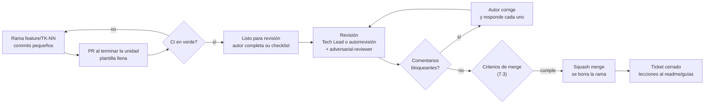

# 07 - Pull requests (sesión con Claude)

> Transcripción de la sesión de definición del proceso de *pull requests* con Claude, que actúa como Principal Software Engineer.

---

## Prompt 1 — Usuario

Ahora a trabajar en la sección 7. Como Principal Software Engineer, documentemos lo siguiente para las 3 *pull requests* que necesitamos, de acuerdo con el objetivo de la sección:

- Plantilla estándar para el PR con checklist, proceso de revisión y aprobación, archivos modificados, comentarios de la revisión, métricas de impacto (si aplican) y lecciones aprendidas.

Criterios para hacer el *merge*: pruebas, cobertura, aprobaciones y que cumpla la definición de hecho.

El objetivo es mantener la calidad del código y facilitar la colaboración.

Agrega 3 ejemplos de PR, uno por cada una de las historias que se crearon en la sección anterior.

---

## Respuesta 1 — Claude

Escribí la sección 7 del `readme.md` y creé la plantilla real de GitHub.

**Plantilla (`.github/pull_request_template.md`).** GitHub la carga sola al abrir un PR. Tiene estas secciones:
- Ticket e historia.
- Qué cambia y por qué.
- Cómo probarlo.
- Archivos modificados por capa.
- Puntos de integración afectados.
- Checklist del autor: definición de hecho común, la del ticket y la del tipo de cambio.
- Capturas.
- Métricas de impacto (antes, después y objetivo).
- Riesgos y cómo revertir.
- Revisión, con una tabla de comentarios por severidad y resolución.
- Lecciones aprendidas.

**Sección 7 del readme:**
- **7.1 Plantilla:** qué contiene cada sección, quién la llena y el formato del título (`feat(inventario): ... (TK-02)`).
- **7.2 Proceso de revisión y aprobación:** diagrama y 5 pasos, desde el PR en borrador hasta el *squash merge*, con las severidades [bloqueante] / [sugerencia] / [nit], respuesta en máximo 1 día hábil y el caso de un solo desarrollador.
- **7.3 Criterios de *merge*:** pruebas (incluidas la integración y los e2e si toca el frontend), calidad estática, cobertura (≥ 80 %, el umbral del ticket y sin bajar respecto de `main`), aprobaciones, definición de hecho e integración. También la configuración de la protección de la rama `main`.
- **3 PR de ejemplo, uno por historia:**

  | PR | Historia | Ticket |
  |---|---|---|
  | `feat(inventario): servicio de movimientos ...` | HU-01 | TK-02 |
  | `feat(inventario): pantalla de existencias ...` | HU-02 | TK-03 (incluye la prueba de integración, por ser el último) |
  | `feat(conteos): servicio de conteo físico ...` | HU-03 | TK-06, del backlog |

**Los PR son ejemplos, no PR reales:** el proyecto todavía no tiene código, y lo dejé indicado al inicio de la sección. Los archivos, los comentarios de revisión y las lecciones salen de problemas reales encontrados en el diseño (por ejemplo, `FOR UPDATE` sin permiso de `UPDATE`, o una expresión de búsqueda distinta a la del índice). Las métricas son objetivos y se reemplazan por las medidas al abrir cada PR.

**Cambios en la sección 6 para mantener la coherencia:**
- Punto de integración 12: el servicio de conteos (TK-06) que consumirá TK-07.
- Criterio de revisión de backend: el servicio valida antes de que actúe un *trigger*, para que el usuario nunca vea un `500` por una regla de negocio.

**Decisiones a validar:**
1. **Para HU-03 elegí TK-06** (servicio de conteos, del backlog), porque ninguno de los 3 tickets detallados es de HU-03.
2. **Con un solo desarrollador, la aprobación obligatoria de GitHub queda desactivada**, porque GitHub no permite aprobar un PR propio. La reemplazan la autorrevisión y la revisión con IA registradas en el PR. Los *checks* sí son obligatorios siempre.
3. **Los nombres de los *checks* obligatorios** (`lint`, `tests` y `e2e`) deberán coincidir con los *jobs* de `.github/workflows/ci.yml` cuando se cree.

---

## Prompt 2 — Usuario

Confirmo las decisiones 1, 2 y 3. Crea el `ci.yml` completo con los 3 nombres de las pruebas o procesos, y agrega a la sección 7.3 una nota con las reglas (la protección de ramas solo funciona con repositorios públicos).

---

## Respuesta 2 — Claude

Quedan confirmadas las 3 decisiones: TK-06 como PR de HU-03, la aprobación con un solo desarrollador y los nombres de los *checks* obligatorios.

**Creé `.github/workflows/ci.yml`** con 5 *jobs*:

| *Job* (`name:`) | ¿Obligatorio? | Qué hace |
|---|---|---|
| `detectar cambios` | No | Detecta si ya existe `app/manage.py` y si el PR toca el frontend |
| `lint` | **Sí** | `ruff check` y `ruff format --check`, con la versión fijada en `requirements-dev.txt` |
| `tests` | **Sí** | PostgreSQL 17 como servicio, crea `app_owner` y `app_user` con `db/init/01_roles.sh`, `makemigrations --check`, `pytest` con cobertura mínima de 80 % y guarda `coverage.xml` |
| `e2e` | **Sí** | Playwright con Chromium; se salta con `if:` si el PR no toca el frontend; guarda las trazas si falla |
| `build de la imagen` | No | `docker build` del `Dockerfile` de `app/` |

Además:
- Corre en cada PR y *push* a `main`, a mano (`workflow_dispatch`) y cada noche, cuando incluye los tests marcados `lento`.
- Un *push* nuevo al mismo PR cancela la ejecución anterior.
- El workflow solo tiene permiso de lectura sobre el repositorio.
- Mientras no exista `app/manage.py`, `lint`, `tests` y `e2e` se saltan, así los PR de solo documentación no fallan.

**Lo validé con `actionlint`**, un linter de workflows de GitHub Actions: sin errores. Corrigió un detalle: el contexto `env` no está disponible dentro de `services`, así que los datos de PostgreSQL de ese bloque van escritos directamente. El workflow no se ha ejecutado en GitHub: correrá en el primer PR.

**En la sección 7.3:**
- Cada criterio indica qué *job* lo verifica.
- Agregué una nota con 8 reglas. Entre ellas: los nombres exactos de los *checks*; que solo se pueden marcar como obligatorios después de ejecutarse una vez; que no se usan filtros de rutas en `on:`; que `e2e` se salta con `if:`; y que **la protección de ramas solo funciona en repositorios públicos** con una cuenta gratuita (en uno privado, las reglas quedan como acuerdo de trabajo).

También actualicé la descripción de la integración continua en la sección 2.4.

**Pasos pendientes en GitHub** (no los puedo hacer desde aquí):
1. Integrar `ci.yml` a `main` con un PR, para que los *jobs* corran una vez.
2. En *Settings → Branches* (o *Rules*), proteger `main` y marcar como obligatorios `lint`, `tests` y `e2e`.

---

## Prompt 3 — Usuario

(Tras una revisión de `CLAUDE.md` contra el readme.) Corrige las inconsistencias como sugieres. La regla de `docs/capabilities` queda comentada con un recordatorio: trabajaremos con OpenSpec, pero aún no definimos las capabilities. Corrige el mapeo de conceptos a Django; sugiero este, pero si no es correcto haz tu sugerencia:
- Rutas → `urls.py` (URL dispatcher).
- Controladores → vistas (`views.py`).
- Validadores → `validators.py` y formularios (`forms.py`).
- Transformers → serializers de DRF (`serializers.py`).

De los demás puntos:
1. Commit cuando lo pida.
3. PR solo al final.
5. Crea el subagente `adversarial-reviewer` (revisor de solo lectura que intenta refutar el cambio contra los scenarios de `openspec/specs/`).
8. Cambia "paciente" por "residente", incluyendo el readme y `openapi.yaml`, por consistencia.

---

## Respuesta 3 — Claude

**Proceso de PR (sección 7.2 del readme):**
- El PR se abre **una sola vez, al terminar la unidad de trabajo**, en lugar de en borrador al primer *push*. Antes, el autor verifica en local con `make lint` y `make test-ci`, que es lo mismo que corre el CI.
- La revisión con un solo desarrollador es la autorrevisión del día siguiente más el subagente **`adversarial-reviewer`**. Lo creé en `.claude/agents/adversarial-reviewer.md` con la especificación indicada.
- Actualicé el diagrama del proceso y la sección 6 ("Quién revisa").

**"Paciente" → "residente"** en el readme (secciones 0.3, 1.2, 3.2 y 4), en `docs/api/openapi.yaml` (validado con Redocly: 0 errores), en `00-ficha-proyecto.md` y en los anexos. Los prompts y respuestas ya registrados en los transcripts conservan su texto original, porque son historia.

**El mapeo propuesto es correcto**, con 3 precisiones que dejé en el recordatorio de `CLAUDE.md`:
- **Controladores:** son las vistas de las pantallas (`views.py`) y, en la API, las vistas de DRF (`apps/api/views.py`).
- **Validadores:** también incluyen la validación de los serializers (`validate_<campo>()`). Las reglas de negocio se validan además en `services.py`, y la base de datos es la última barrera.
- **Transformers:** en las pantallas no hay *transformer*: la vista arma el contexto con `selectors.py`.

Además, al activar la regla habrá que cambiar 2 cosas que venían de otro proyecto: aquí el contrato OpenAPI se escribe a mano, así que sí hay que actualizar `docs/api/openapi.yaml`; y la "spec" de cada capability probablemente vivirá en `openspec/specs/`.

**`CLAUDE.md`:** commit solo cuando se pida, ramas `feature/`, push y PR solo al final, reglas de Git reunidas en su sección, cobertura (80 % en CI y 90 % como umbral de ticket), `como_app_user` y los tests con hilos, vocabulario (Pauta, Movimiento, Transacción), prefijos de nombres de la BD, búsquedas de texto, `numeric(6,2)` de la pauta y autorización de pantallas, API y `/admin/`.

**Pendiente:** el subagente contrasta contra `openspec/specs/`, que todavía no existe. Mientras tanto, `CLAUDE.md` indica que contraste contra los criterios de aceptación del readme y la guía del ticket, y que al invocarlo se le pase el diff, porque no tiene Bash.

---

## Anexo — Texto final escrito en `readme.md` (sección 7)

## 7. Pull Requests

> Documenta 3 de las Pull Requests realizadas durante la ejecución del proyecto

**Objetivo:** mantener la calidad del código y facilitar la colaboración. Cada cambio entra a `main` por un *pull request* (PR) con la misma plantilla, el mismo proceso de revisión y los mismos criterios de *merge*.

> **Estado:** el proyecto todavía no tiene código. Los 3 PR de esta sección son **ejemplos completos** del formato, escritos sobre los tickets de la sección 6. Archivos, comentarios de revisión y lecciones salen del diseño ya hecho. Las métricas son **objetivos**, no mediciones. Al abrir cada PR real, se reemplazan por los datos reales y se agrega el enlace.

#### 7.1 Plantilla estándar

La plantilla vive en [`.github/pull_request_template.md`](.github/pull_request_template.md) y GitHub la carga sola al abrir un PR. Secciones:

| Sección | Qué contiene | Quién la llena |
|---|---|---|
| Ticket e historia | TK, HU, guía, dependencias | Autor |
| Qué cambia y por qué | Problema, solución y decisión técnica principal, en 3 a 6 líneas | Autor |
| Cómo probarlo | Comandos exactos con su resultado esperado | Autor |
| Archivos modificados | Tabla por capa: archivo, tipo de cambio y motivo | Autor |
| Puntos de integración afectados | Los números de la tabla de la sección 6 que provee o consume, y si cambia algún contrato | Autor |
| Checklist del autor | Definición de hecho común, la del ticket y la del tipo de cambio (BD, backend o frontend) | Autor |
| Capturas | Escritorio y celular (solo frontend) | Autor |
| Métricas de impacto | Tests, cobertura, consultas por operación y tiempo de respuesta: antes, después y objetivo | Autor |
| Riesgos y cómo revertir | Qué podría fallar y cómo se deshace | Autor |
| Revisión | Revisor, resumen y tabla de comentarios con severidad y resolución | Revisor |
| Lecciones aprendidas | Qué haríamos distinto y qué hay que llevar a la documentación | Autor y revisor |

**Título:** `<tipo>(<módulo>): <qué hace> (TK-NN)`, con `feat`, `fix`, `refactor`, `test`, `docs` o `chore`. Al hacer *squash*, ese título es el mensaje del commit en `main`.

#### 7.2 Proceso de revisión y aprobación



1. **Autor.** Trabaja la unidad completa en su rama, con commits pequeños, y la verifica en local con `make lint` y `make test-ci` (lo mismo que corre el CI). **Al terminar la unidad** hace *push* y abre **un solo PR**, con la plantilla llena. CI corre en ese momento y en cada *push* posterior; si falla, el autor lo corrige en la misma rama antes de pedir revisión.
2. **Revisor.** Usa los **criterios de revisión de código** de la sección 6. Marca cada comentario como **[bloqueante]**, **[sugerencia]** o **[nit]** y responde en máximo 1 día hábil.
   - **Con un solo desarrollador:** el autor revisa al día siguiente con la lista y pasa además el subagente `adversarial-reviewer` (`.claude/agents/`), que revisa el cambio con el objetivo de refutarlo. Las 2 revisiones quedan registradas como comentarios en el PR.
3. **Autor.** Responde cada comentario: lo corrige (con el commit que lo resuelve) o explica por qué no. Solo el revisor marca un comentario bloqueante como resuelto.
4. **Aprobación.** El revisor aprueba cuando no queda ningún bloqueante abierto. Las sugerencias que no se atiendan pasan al backlog como tarea.
5. ***Merge*.** Con *squash*, cuando se cumplen los criterios de 7.3. Después se borra la rama, se cierra el ticket y las lecciones aprendidas que lo ameriten se pasan al readme o a la guía del ticket.

#### 7.3 Criterios para hacer el *merge*

Un PR se integra a `main` solo si cumple **todos**:

| Criterio | Umbral | Cómo se verifica |
|---|---|---|
| **Pruebas** | `pytest` completo en verde contra PostgreSQL 17, incluida la prueba de integración de la sección 6. Si toca el frontend, también los e2e de Playwright | *Checks* obligatorios `tests` y `e2e` |
| **Calidad estática** | `ruff check`, `ruff format --check` y `makemigrations --check` sin errores | *Checks* obligatorios `lint` (ruff) y `tests` (migraciones) |
| **Cobertura** | ≥ 80 % en todo `apps/` (sección 2.6), más el umbral del ticket (TK-02 ≥ 90 % en `services.py`); la cobertura total no baja respecto de `main` | El *job* `tests` falla con menos de 80 % (`--cov-fail-under=80`) y guarda `coverage.xml`; el umbral del ticket y la comparación con `main` los verifica el autor y los anota en la plantilla |
| **Aprobaciones** | 1 aprobación sin comentarios bloqueantes abiertos. Con un solo desarrollador: autorrevisión y revisión con IA registradas en el PR | Revisión en GitHub y conversaciones resueltas |
| **Definición de hecho** | La común y la del ticket (sección 6), con todos los criterios de aceptación cumplidos | Checklist del autor, revisada por el revisor |
| **Integración** | Rama al día con `main`; ningún contrato de "Puntos de integración" cambiado sin avisar | Protección de rama "*require branches to be up to date*" |

**Protección de la rama `main`** (configuración de GitHub):
- Prohibido el *push* directo.
- *Checks* obligatorios: `lint`, `tests` y, para cambios de frontend, `e2e`.
- Rama al día con `main` y conversaciones resueltas.
- Solo *squash merge*.

Con un solo desarrollador, GitHub no permite aprobar un PR propio. Por eso la aprobación obligatoria queda desactivada y se reemplaza por el registro de las 2 revisiones del paso 2. Los *checks* sí son obligatorios siempre.

> **Nota: reglas para que la protección de rama funcione con el CI** ([`.github/workflows/ci.yml`](.github/workflows/ci.yml))
>
> | # | Regla | Por qué |
> |---|---|---|
> | 1 | Los *checks* obligatorios son los *jobs* de `ci.yml` con `name:` **`lint`**, **`tests`** y **`e2e`**. No se renombran ni se convierten en matriz sin actualizar también la protección de la rama | GitHub busca el *check* por su nombre exacto. Si no coincide (por ejemplo, `test` o `tests (3.12)`), el PR queda para siempre en "*Expected — Waiting for status to be reported*" y no se puede integrar |
> | 2 | Primero se integra `ci.yml` y se abre un PR para que los *jobs* corran; después se marcan como obligatorios | GitHub solo deja elegir *checks* que ya se ejecutaron alguna vez en el repositorio |
> | 3 | El workflow corre **siempre**: nada de `paths:` ni `paths-ignore:` en `on:` | Si el workflow no corre, el *check* obligatorio nunca se reporta y el PR queda bloqueado |
> | 4 | `e2e` se salta con una condición `if:` cuando el PR no toca el frontend (lo detecta el *job* `detectar cambios`) | Un *job* saltado cuenta como aprobado. En `push` a `main` y en el CI nocturno, `e2e` corre siempre |
> | 5 | Cada *job* se activa cuando existe lo que necesita: `lint` e `imagen` con `app/manage.py` (HB-02), `tests` con `app/conftest.py` (HB-03) y `e2e` con `app/e2e/` (TK-03). Antes, se saltan | Los PR de solo documentación (como esta entrega) y los primeros tickets de habilitación no fallan por algo que todavía no existe |
> | 6 | Los tests marcados `lento` (planes de ejecución) solo corren en el CI nocturno | Mantiene rápido el CI de cada PR |
> | 7 | `detectar cambios` y `build de la imagen` corren pero **no** son obligatorios | El primero es auxiliar; el segundo verifica el `Dockerfile` sin bloquear PR de documentación |
> | 8 | **La protección de ramas solo funciona en repositorios públicos** con una cuenta gratuita de GitHub | En un repositorio privado se necesita GitHub Pro, Team o Enterprise. Sin eso, las reglas de 7.3 son un acuerdo de trabajo: antes del *merge*, el autor comprueba a mano que `lint`, `tests` y `e2e` estén en verde |

---

**Pull Request 1**

**`feat(inventario): servicio de movimientos con bloqueo de saldos y correcciones (TK-02)`** · HU-01

| Campo | Valor |
|---|---|
| Rama | `feature/TK-02-servicio-movimientos` → `main` |
| Ticket / historia | TK-02 / HU-01 · guía [`TK-02-servicio-movimientos.md`](docs/tickets/TK-02-servicio-movimientos.md) |
| Depende de | PR de TK-01 (esquema, permisos y *fixtures*), ya integrado |
| Puntos de integración | Provee 2 y 10 · consume 1, 3, 4, 7, 8 y 11 · no cambia ningún contrato |

**Qué cambia y por qué.** Agrega `services.py`, el único código que escribe en `movimiento` y `existencia`, con 4 operaciones: entrada, transferencia, baja y corrección. Cada una valida antes de escribir, bloquea los saldos en orden fijo (`SELECT ... FOR UPDATE` por `entidad_id`) y registra el movimiento en la misma transacción. Así ningún saldo queda negativo, ni siquiera con 2 usuarios a la vez, y no hay *deadlocks* entre transferencias cruzadas. Los errores de negocio son excepciones con el mismo `code` que la API (sección 4.4).

**Cómo probarlo**

```bash
dtest apps/inventario -q
dtest apps/inventario --cov=apps.inventario.services --cov=apps.inventario.exceptions --cov-branch --cov-fail-under=90
for i in $(seq 1 20); do dtest apps/inventario/tests/test_concurrencia.py -q || break; done
```

**Archivos modificados**

| Capa | Archivo | Cambio |
|---|---|---|
| Backend | `app/apps/inventario/exceptions.py` | Nuevo: 10 excepciones de dominio (una base y 9 específicas) con `code` y mensaje en español |
| Backend | `app/apps/inventario/services.py` | Nuevo: `registrar_entrada`, `transferir`, `dar_de_baja`, `corregir` y los *helpers* de bloqueo |
| Tests | `app/apps/inventario/tests/test_services.py` | Nuevo: un test por criterio de aceptación de HU-01, como `app_user` |
| Tests | `app/apps/inventario/tests/test_concurrencia.py` | Nuevo: bajas simultáneas, transferencias cruzadas y atomicidad |
| Infra | `app/requirements-dev.txt` | Modificado: `pytest-cov` |

**Checklist del autor:** definición de hecho común ✔ · los 12 criterios de aceptación de TK-02 con su test ✔ · cobertura de `services.py` ≥ 90 % ✔ · `git grep` confirma que nadie más escribe en inventario ✔ · tests de concurrencia 20 de 20 ✔.

**Métricas de impacto** (objetivos; se reemplazan por las medidas al abrir el PR)

| Métrica | Antes | Objetivo |
|---|---|---|
| Tests de `inventario` | Los de TK-01 | + ~30 (reglas, corrección y concurrencia) |
| Cobertura de `services.py` / ramas de `exceptions.py` | — | ≥ 90 % / 100 % |
| Ejecuciones seguidas de los tests de concurrencia sin fallar | — | 20 de 20 |
| Saldos que no cuadran (`v_conciliacion_existencia`) después de cada test | — | 0 |

**Riesgos y cómo revertir:** no tiene migraciones; revertir el commit de *squash* deja el esquema intacto. El riesgo es un *deadlock* no previsto: los tests de concurrencia tienen tiempo límite para detectarlo en CI y no en producción.

**Revisión** (Tech Lead o autorrevisión + IA): 2 bloqueantes (resueltos), 2 sugerencias, 1 nit

| # | Severidad | Archivo | Comentario | Resolución |
|---|---|---|---|---|
| 1 | [bloqueante] | `services.py` | `corregir` usaba `select_for_update()` sobre `Movimiento`. PostgreSQL exige permiso de `UPDATE` para `FOR UPDATE`, y `app_user` no lo tiene: en producción falla con `permission denied` | Se quitó el bloqueo; la restricción `uq_movimiento_corrige` deja pasar una sola corrección y el `IntegrityError` se traduce a `MovimientoYaCorregido` |
| 2 | [bloqueante] | `test_concurrencia.py` | El test de las 2 bajas simultáneas falla 1 de cada 10 veces: los hilos no arrancan al mismo tiempo | Se agregó `threading.Barrier(2)` y un tiempo límite por hilo; 20 de 20 en verde |
| 3 | [sugerencia] | `services.py` | Explicar en el *docstring* de `_bloquear_saldos` por qué el orden por `entidad_id` evita *deadlocks* | Hecho |
| 4 | [sugerencia] | `exceptions.py` | `DatoInvalido` debería indicar el campo, para que el formulario de TK-04 marque el campo correcto | Se agregó el atributo `campo` (punto de integración 10) |
| 5 | [nit] | `exceptions.py` | "hay 1 dosis disponibles": falta el singular | Corregido; coincide con el criterio de HU-01 |

**Lecciones aprendidas**
- **Los tests deben correr con los permisos de producción.** El comentario 1 no se habría detectado con los tests corriendo como `app_owner`. Por eso existe el *fixture* `como_app_user`, que ya está en la guía de TK-01.
- **Las pruebas de concurrencia necesitan sincronización explícita** (barrera y tiempo límite). Si no, son intermitentes y se pierde la confianza en CI.
- **Diseñar las excepciones pensando en quien las consume** (formularios y API) ahorra un cambio de contrato después.

---

**Pull Request 2**

**`feat(inventario): pantalla de existencias con filtros en vivo y diseño para celular (TK-03)`** · HU-02

| Campo | Valor |
|---|---|
| Rama | `feature/TK-03-pantalla-existencias` → `main` |
| Ticket / historia | TK-03 / HU-02 · guía [`TK-03-pantalla-existencias.md`](docs/tickets/TK-03-pantalla-existencias.md) |
| Depende de | PR de TK-01 y PR 1 (TK-02), ya integrados. Es el último de los 3: incluye la **prueba de integración** |
| Puntos de integración | Provee 9 · consume 1, 2, 5, 6, 7 y 11 · no cambia ningún contrato |

**Qué cambia y por qué.** Agrega la pantalla `/existencias/`, que pasa a ser la página de inicio. El usuario escribe "losartan" y, sin recargar, ve el saldo de cada medicamento por entidad, buscando por nombre comercial o principio activo, sin acentos. La búsqueda vive en `selectors.py`, que reutilizará el endpoint de TK-05. La misma vista responde la página completa o solo el fragmento HTMX, así la URL con filtros funciona sola. En el celular los resultados son tarjetas. Como es el último de los 3 tickets en integrarse, agrega `test_integracion.py`.

**Cómo probarlo**

```bash
dtest apps/inventario -q                                   # incluye selector, vista e integración
docker compose exec -e DB_USER=app_owner -e DB_PASSWORD="$DB_OWNER_PASSWORD" \
    -e DJANGO_ALLOW_ASYNC_UNSAFE=true web pytest -m e2e e2e/ -q
# Manual: https://localhost/existencias/ como consulta.demo → escribir "losartan" → 3 resultados
```

**Archivos modificados**

| Capa | Archivo | Cambio |
|---|---|---|
| Backend | `app/apps/inventario/selectors.py` | Nuevo: `buscar_existencias` y `normalizar` |
| Backend | `app/apps/inventario/forms.py`, `views.py`, `urls.py` | Nuevos: filtros, `ExistenciasView` (página o fragmento) y la ruta |
| Frontend | `templates/inventario/existencias.html`, `_resultados.html`, `_aviso.html` | Nuevos: filtros HTMX, tabla en escritorio, tarjetas en celular, estado vacío y paginación |
| Frontend | `app/apps/inventario/templatetags/inventario_extras.py` | Nuevo: filtro `dosis` (`0.5`, `10`) |
| Frontend | `app/static/js/vendor/htmx.min.js`, `templates/base.html` | Nuevo / modificado: HTMX local y la entrada "Existencias" del menú |
| Infra | `config/settings/base.py`, `config/urls.py`, `requirements.txt`, `requirements-dev.txt` | Modificados: `django-htmx`, página de inicio, `pytest-playwright` |
| Tests | `tests/test_selectors.py`, `test_views_existencias.py`, `test_templatetags.py`, `e2e/test_existencias.py` | Nuevos |
| Tests | `app/apps/inventario/tests/test_integracion.py` | Nuevo: 5 escenarios de servicio → base → pantalla |

**Checklist del autor:** definición de hecho común ✔ · los 11 criterios de aceptación de TK-03 ✔ · prueba de integración en verde ✔ · revisado en Chrome, Firefox y a 390 px ✔ · sin errores de CSP en consola ✔ · capturas agregadas a la sección 1.3 ✔.

**Métricas de impacto** (objetivos)

| Métrica | Objetivo |
|---|---|
| Tiempo de respuesta del fragmento con el mock | < 300 ms |
| Consultas a la BD por página | Constantes: las mismas con 1 que con 13 resultados |
| Accesibilidad (Lighthouse) | ≥ 90 |
| Desplazamiento horizontal a 390 px | Ninguno |
| Escenarios de integración en verde | 5 de 5 |

**Riesgos y cómo revertir:** no tiene migraciones. Revertir el *squash* quita la pantalla, y la página de inicio vuelve a la anterior. El riesgo es que la búsqueda no use el índice trigram y se vuelva lenta con el catálogo completo; se verifica con el plan de ejecución (verificación 4 de la guía).

**Revisión:** 2 bloqueantes (resueltos), 1 sugerencia, 1 nit

| # | Severidad | Archivo | Comentario | Resolución |
|---|---|---|---|---|
| 1 | [bloqueante] | `selectors.py` | Usaba `Unaccent(Lower(...))` de `django.contrib.postgres`, que genera `UNACCENT(LOWER(...))`. No es la expresión del índice (`f_unaccent(lower(...))`), y el plan muestra *Seq Scan* | Se cambió a `_sin_acentos()`, idéntica al índice; el plan ahora usa `ix_medicamento_nombre_trgm` |
| 2 | [bloqueante] | `views.py` | Si la sesión vence mientras se busca, HTMX inserta el formulario de login dentro de la tabla de resultados | `handle_no_permission` responde `HX-Redirect` al login; test agregado |
| 3 | [sugerencia] | `_resultados.html` | `floatformat:"-2"` muestra `0.50` en lugar de `0.5` | Filtro propio `dosis`, con su test |
| 4 | [nit] | `existencias.html` | Falta `aria-live="polite"` en `#resultados` para lectores de pantalla | Agregado |

**Lecciones aprendidas**
- **Un índice por expresión solo sirve si la consulta usa exactamente la misma expresión.** Ahora la revisión de frontend pide el plan de ejecución de las búsquedas.
- **HTMX necesita pensar los casos de error**, no solo el camino feliz: sesión vencida, búsqueda demasiado corta y estado vacío.
- **Integrar el último ticket con una prueba que cruce las 3 capas** detecta contratos rotos que ningún test de un solo ticket ve.

---

**Pull Request 3**

**`feat(conteos): servicio de conteo físico con foto del saldo y cierre (TK-06)`** · HU-03

| Campo | Valor |
|---|---|
| Rama | `feature/TK-06-servicio-conteos` → `main` |
| Ticket / historia | TK-06 / HU-03 (backlog de la sección 6, 3 puntos). La pantalla del conteo llega en TK-07 |
| Depende de | PR de TK-01 (tablas y *triggers* de conteos) y PR 1 (TK-02), ya integrados |
| Puntos de integración | Consume 1, 2, 4, 7 y 8. **Provee uno nuevo:** `apps/conteos/services.py` y sus excepciones, que consumirá TK-07 (se agregó como punto 12 en la sección 6) |

**Qué cambia y por qué.** Implementa la mecánica del conteo de HU-03 (sección 5): iniciar un conteo por entidad y período, capturar o recapturar cada renglón guardando la **foto** del saldo registrado en ese momento, y cerrarlo. La diferencia la calcula la base de datos (columna generada). El conteo **no ajusta existencias**: TK-07 resolverá cada diferencia llamando a `services.dar_de_baja` o `registrar_entrada` de TK-02. Incluye la migración de permisos de los grupos para `conteos`, con el mismo patrón que `inventario/0003`.

**Cómo probarlo**

```bash
dtest apps/conteos -q
dtest apps/conteos --cov=apps.conteos.services --cov-branch --cov-fail-under=90
dtest apps/inventario/tests/test_integracion.py -q          # la integración de las 3 capas sigue en verde
```

**Archivos modificados**

| Capa | Archivo | Cambio |
|---|---|---|
| Backend | `app/apps/conteos/exceptions.py` | Nuevo: `ConteoCerrado` (`CONTEO_CERRADO`), `ConteoSinRenglones` (`CONTEO_SIN_RENGLONES`), `CantidadInvalida` |
| Backend | `app/apps/conteos/services.py` | Nuevo: `iniciar_conteo`, `capturar_renglon` (crea o recaptura y toma la foto del saldo) y `cerrar_conteo` |
| BD | `app/apps/conteos/migrations/0003_permisos_grupos.py` | Nuevo: `view_*` para los 2 grupos; `add_*` y `change_*` de conteos para *Lectura y escritura* |
| Tests | `app/apps/conteos/tests/test_services.py` | Nuevo: los escenarios de HU-03 sobre el conteo 2 del mock, como `app_user` |
| Docs | `readme.md` (sección 6) | Punto de integración 12: servicio de conteos → TK-07 |

**Checklist del autor:** definición de hecho común ✔ · escenarios de HU-03 que no dependen de la pantalla, cada uno con su test ✔ · migración reversible ✔ · cobertura de `services.py` ≥ 90 % ✔ · prueba de integración en verde ✔.

**Métricas de impacto** (objetivos)

| Métrica | Objetivo |
|---|---|
| Diferencia calculada en el caso de la sección 2.6 (18 contadas contra 20 registradas) | −2 |
| Conteo 2 del mock: Omeprazol 58 contra 59 | Diferencia −1 y existencias sin cambios al cerrar |
| Cobertura de `apps/conteos/services.py` | ≥ 90 % |
| Respuestas `500` por cerrar 2 veces el mismo conteo | 0: siempre `ConteoCerrado` |

**Riesgos y cómo revertir:** revertir el *squash* y ejecutar `./scripts/migrate.sh conteos 0002` para quitar los permisos. No toca datos de inventario: el conteo nunca ajusta existencias.

**Revisión:** 2 bloqueantes (resueltos), 1 sugerencia

| # | Severidad | Archivo | Comentario | Resolución |
|---|---|---|---|---|
| 1 | [bloqueante] | `services.py` | Si 2 usuarios cierran el mismo conteo a la vez, el segundo choca con el *trigger* `tg_conteo_cerrado` y la pantalla mostraría un error `500` | `cerrar_conteo` bloquea el conteo con `select_for_update()` (`app_user` sí tiene `UPDATE` en `conteo_fisico`), valida el estado y lanza `ConteoCerrado`; test con 2 hilos |
| 2 | [bloqueante] | `services.py` | `cerrar_conteo` permitía cerrar un conteo sin renglones | Lanza `ConteoSinRenglones`, con el mensaje de HU-03 |
| 3 | [sugerencia] | `services.py` | La foto del saldo se calculaba sumando movimientos; `existencia.saldo` ya es ese dato y está conciliado | Se lee `existencia.saldo` (0 si la fila no existe) |

**Lecciones aprendidas**
- **Los *triggers* son la última barrera, no el mensaje al usuario.** Si el servicio no valida antes, el usuario ve un error `500` en lugar de un mensaje claro. Esto se agregó a los criterios de revisión de backend.
- **El patrón de la migración de permisos se repite en cada app nueva.** Conviene convertirlo en una función compartida antes de TK-07.
- **Que el conteo no ajuste existencias simplificó el servicio:** no necesita bloquear saldos, porque las diferencias se resuelven con el servicio de TK-02, que ya está probado.

**Documentación proceso para esta seccion:** [07-pull-requests.md](07-pull-requests.md)
