## Índice

0. [Ficha del proyecto](#0-ficha-del-proyecto)
1. [Descripción general del producto](#1-descripción-general-del-producto)
2. [Arquitectura del sistema](#2-arquitectura-del-sistema)
3. [Modelo de datos](#3-modelo-de-datos)
4. [Especificación de la API](#4-especificación-de-la-api)
5. [Historias de usuario](#5-historias-de-usuario)
6. [Tickets de trabajo](#6-tickets-de-trabajo)
7. [Pull requests](#7-pull-requests)

---

## 0. Ficha del proyecto

### **0.1. Tu nombre completo:**
Victor Manuel Ramirez Ruvalcaba
### **0.2. Nombre del proyecto:**
Gestion Medicamentos Hogar Gerontologico
### **0.3. Descripción breve del proyecto:**
**Gestión de Medicamentos – Hogar Gerontológico** es una aplicación web responsive (computadora y celular) para controlar el inventario de medicamentos de un hogar de adultos mayores. Gestiona las existencias **por entidad** (cada residente tiene su propio inventario y el hogar es una entidad más), registra entradas indicando quién entregó el medicamento, transferencias entre entidades y bajas por motivo. Permite filtrar por residente, nombre comercial o principio activo, y realizar conteos físicos comparados contra lo registrado. Se despliega inicialmente en un servidor local (con posibilidad de migrar a un servicio de hosting), con acceso por usuario en dos niveles (solo lectura / lectura y escritura) y protección de los datos personales y de salud de los residentes conforme a la LFPDPPP (México).

### **0.4. URL del proyecto:**

>https://github.com/victorm007/AI4Devs-finalproject-vmrr

### 0.5. URL o archivo comprimido del repositorio

> Puedes tenerlo alojado en público o en privado, en cuyo caso deberás compartir los accesos de manera segura. Puedes enviarlos a [alvaro@lidr.co](mailto:alvaro@lidr.co) usando algún servicio como [onetimesecret](https://onetimesecret.com/). También puedes compartir por correo un archivo zip con el contenido
> TBD
---

## 1. Descripción general del producto

> Describe en detalle los siguientes aspectos del producto:

### **1.1. Objetivo:**

> Propósito del producto. Qué valor aporta, qué soluciona, y para quién.

En un hogar gerontológico el control manual de medicamentos genera incertidumbre: no se sabe con certeza cuánto medicamento hay de cada residente, quién lo entregó, qué ocurrió con el sobrante de un residente que egresó o falleció, ni si lo que hay físicamente coincide con lo registrado.

El producto ofrece a la **administración / dirección** del hogar un inventario confiable y consultable desde cualquier dispositivo, que separa claramente qué medicamento pertenece a cada residente y cuál al hogar, y facilita el **corte mensual** de existencias.

**Contexto de uso:** una sola sede, aproximadamente 20 residentes y de 1 a 3 usuarios del sistema.

### **1.2. Características y funcionalidades principales:**

> Enumera y describe las características y funcionalidades específicas que tiene el producto para satisfacer las necesidades identificadas.

**Funcionales**

1. **Catálogo de medicamentos (alta / baja / cambio):** nombre comercial, principio activo, tipo (genérico u original), presentación y concentración. Búsqueda y filtrado por nombre o principio activo. No se controla por lote.
2. **Gestión de entidades:** alta, baja y cambio de residentes (nombre, fecha de nacimiento, estado: activo / egresado / fallecido). El hogar existe como entidad propia.
3. **Existencias por entidad (controladas en dosis):**
   - **Entradas:** registro de quién entregó el medicamento (familiar, el hogar, otro).
   - **Transferencias** entre entidades (hogar → residente, residente → hogar, residente → residente), por ejemplo para reasignar sobrantes tras un egreso o defunción.
   - **Bajas por motivo:** consumo / administración, caducidad, merma, rotura, devolución a la familia, defunción y egreso. La baja por caducidad se registra manualmente al detectar el medicamento vencido.
4. **Pauta del residente:** registro de dosis y frecuencia de cada medicamento por residente (informativo; no incluye registro de administración por turno).
5. **Filtros combinados** por residente, nombre de medicamento y principio activo.
6. **Inventario físico y reportes (en pantalla):**
   - Conteo físico a demanda por residente y por rango de fechas (inicio y fin), comparando existencia física contra lo registrado y resaltando diferencias.
   - Reporte mensual de movimientos y existencias para la dirección.
7. **Usuarios y niveles de acceso globales:** el Administrador da de alta a los usuarios y les asigna su nivel.
   - *Solo lectura:* consulta y reportes.
   - *Lectura y escritura:* todas las operaciones anteriores.
8. **Trazabilidad mínima:** cada movimiento de inventario guarda el usuario que lo registró y la fecha/hora.

**No funcionales**

- **Accesibilidad:** cliente web responsive, utilizable desde computadora y celular.
- **Despliegue:** servidor local en el hogar; la solución debe poder migrarse a un servicio de hosting sin cambios de arquitectura.
- **Seguridad:** autenticación con contraseñas cifradas (hash), sesiones con expiración, comunicación por HTTPS, autorización por nivel de acceso validada en el backend y respaldos periódicos de la base de datos.
- **Privacidad:** tratamiento de datos personales y de salud (nombre, fecha de nacimiento, medicamentos) conforme a la LFPDPPP, con aviso de privacidad.
- **Escala:** dimensionado para una pequeña empresa (1 sede, ~20 residentes, 1 a 3 usuarios).

**Fuera de alcance (MVP)**

Registro de administración por turno (MAR), alertas de stock mínimo o caducidad, control por lote, insumos distintos a medicamentos, multisede, exportación a PDF/Excel, bitácora de auditoría completa e integraciones con sistemas externos.

### **1.3. Diseño y experiencia de usuario:**

> Proporciona imágenes y/o videotutorial mostrando la experiencia del usuario desde que aterriza en la aplicación, pasando por todas las funcionalidades principales.

### **1.4. Instrucciones de instalación:**
> Documenta de manera precisa las instrucciones para instalar y poner en marcha el proyecto en local (librerías, backend, frontend, servidor, base de datos, migraciones y semillas de datos, etc.)

> **Estado:** el código está en desarrollo. Estos son los pasos previstos, que reúnen lo definido en las secciones 2.4, 3.4 y 6. Se validan y ajustan con el primer PR de código.

**Requisitos:** Git, Docker con Docker Compose v2, `make` y [`mkcert`](https://github.com/FiloSottile/mkcert) para el HTTPS local.
- **En Windows:** usa Git Bash, que no trae `make`. Instálalo, por ejemplo con `winget install ezwinports.make` o `choco install make`, o trabaja desde WSL. Los `.sh` deben tener fin de línea LF (HB-01 agrega un `.gitattributes` que lo fuerza).
- **El `Makefile`** de la raíz (lo crea TK-01) tiene atajos legibles para todo lo de abajo; `make help` los lista. Cada paso muestra también el comando que ejecuta, por si no tienes `make`.

```bash
# 1. Código y configuración
git clone <url-del-repositorio> && cd AI4Devs-finalproject-vmrr
cp .env.example .env
#    Edita .env: POSTGRES_PASSWORD, DB_OWNER_PASSWORD, DB_APP_PASSWORD y la clave secreta de Django.
#    Sin $, # ni comillas en los valores: make lee .env y los interpreta distinto que el shell.
#    DB_OWNER_CREATEDB=true solo en desarrollo (permite que pytest cree la base de tests).

# 2. Certificado HTTPS local (los nombres deben coincidir con nginx/default.conf)
mkcert -install
mkcert -cert-file nginx/certs/local.pem -key-file nginx/certs/local-key.pem localhost 127.0.0.1

# 3. Contenedores: al crear el volumen, db crea los usuarios app_owner y app_user
make up              # docker compose up -d --build

# 4. Esquema y datos semilla (Hogar, grupos, motivos de baja, presentaciones), como app_owner
make migrate         # ./scripts/migrate.sh

# 5. Administrador y archivos estáticos
make superuser       # docker compose exec web python manage.py createsuperuser
make static          # docker compose exec web python manage.py collectstatic --noinput

# 6. (Opcional, solo desarrollo y demo) Dataset mock de la sección 3.4
make mock            # docker compose cp app/fixtures/mock/. db:/tmp/mock/  y  psql -U app_owner -f cargar_mock.sql
```

Abre <https://localhost>: después del login aparece la consulta de existencias. Con el mock cargado, entra como `consulta.demo` / `DemoLectura2026!` (solo lectura) u `operador.demo` / `DemoEscritura2026!` (lectura y escritura). El panel de administración está en <https://localhost/admin/>.

**Pruebas:**

```bash
make test            # toda la suite (un solo test: make test T=ruta::nombre_del_test)
make test-ci         # lo mismo que corre el CI en cada PR, con cobertura
make e2e             # pruebas de extremo a extremo con Playwright
make lint            # ruff (Python) y djLint (plantillas), sin modificar archivos
make format          # formatea Python y plantillas

# Sin make, equivale a:
set -a && . ./.env && set +a
docker compose exec -e DB_USER=app_owner -e DB_PASSWORD="$DB_OWNER_PASSWORD" web pytest -q
```

**Volver a empezar** (borra la base local): `make reset` (equivale a `docker compose down -v`, `up` y `migrate.sh`), y repite desde el paso 5.

Las guías de `docs/tickets/` tienen los comandos de verificación de cada parte, y la sección 2.4 describe el despliegue en el servidor del hogar y la demo en una máquina local, que la guía de HB-10 detalla paso a paso.

**Documentación proceso para esta seccion:** [01-descripcion-general-producto.md](01-descripcion-general-producto.md)

---
## 2. Arquitectura del Sistema

### **2.1. Diagrama de arquitectura:**
> Usa el formato que consideres más adecuado para representar los componentes principales de la aplicación y las tecnologías utilizadas. Explica si sigue algún patrón predefinido, justifica por qué se ha elegido esta arquitectura, y destaca los beneficios principales que aportan al proyecto y justifican su uso, así como sacrificios o déficits que implica.

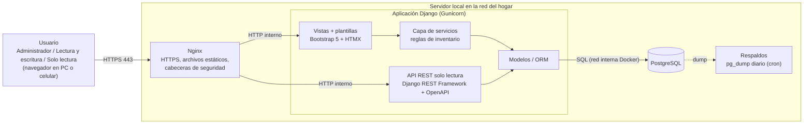

**Patrón:** **monolito modular** sobre el patrón **MVT (Modelo–Vista–Template) de Django**, con páginas **renderizadas en el servidor**. Cada módulo de negocio es una *app* de Django independiente. Las reglas de inventario (entradas, transferencias y bajas) viven en una **capa de servicios** (`services.py`), separada de las vistas, para que la web y la API compartan la misma lógica y se pueda probar de forma aislada.

**Por qué esta arquitectura:**
- **Escala del problema:** 1 sede, ~20 residentes y 1 a 3 usuarios. La carga es mínima, y microservicios, una SPA o colas de mensajes solo añadirían complejidad.
- **Un solo mantenedor (perfil infra/backend):** Django trae ORM, migraciones, autenticación, sesiones, permisos por grupos, CSRF, formularios con validación y panel de administración. Hay menos piezas que integrar y mantener.
- **Rendimiento en celular:** el HTML llega listo desde el servidor, sin descargar ni compilar un *bundle* de JavaScript. HTMX permite filtrar y paginar sin recargar la página completa.
- **Portabilidad:** todo se empaqueta con **Docker Compose**, de modo que el mismo despliegue corre en el servidor del hogar y en una máquina local de demo, y podría moverse a un hosting sin cambiar código ([ADR-0026](docs/adr/0026-despliegue-servidor-del-hogar-y-demo-local.md)).
- **Integridad de datos:** PostgreSQL ofrece transacciones y bloqueo de filas, necesarios para que una transferencia descuente y abone en un solo paso y para que nunca haya existencias negativas.

**Beneficios:**
- Desarrollo rápido.
- Pocas dependencias.
- Despliegue sencillo, de 3 contenedores.
- Seguridad sólida por defecto.
- Facilidad para probar las reglas de negocio.
- Los módulos bien delimitados permiten extraer servicios en el futuro si fuera necesario.

**Sacrificios / déficits:**
- **Escalado solo vertical** (servidor más grande), suficiente para este volumen.
- **Acoplamiento a Django**: cambiar de framework implicaría reescribir.
- **Interactividad limitada** frente a una SPA: no hay edición en tiempo real ni funcionamiento sin conexión.
- **El servidor local es un punto único de falla**, que se mitiga con respaldos diarios y un procedimiento de restauración documentado.
- **Sin acceso desde fuera del hogar** mientras se despliegue solo en la red local.

#### **2.1.1. Diagrama de flujo de datos (DFD)**

**Notación:** rectángulo = entidad externa · círculo = proceso · cilindro = almacén de datos · flecha continua = flujo de datos · flecha punteada = respuesta de error o flujo físico (fuera del sistema).

**Almacenes de datos** (el detalle de cada uno está en la [sección 3](#3-modelo-de-datos)):

| Id | Almacén | Contenido |
|---|---|---|
| D1 | Usuarios y grupos | Usuarios, contraseña (hash), estado activo y grupo (`Solo lectura` / `Lectura y escritura`) |
| D2 | Medicamentos | Catálogo: nombre comercial, principio activo, genérico/original, presentación, concentración, activo |
| D3 | Entidades | El hogar y los residentes (nombre, fecha de nacimiento, estado) |
| D4 | Existencias | Saldo en dosis por entidad y medicamento |
| D5 | Movimientos | Entradas, transferencias y bajas, con usuario y fecha/hora (inmutables) |
| D6 | Pautas | Dosis y frecuencia por residente y medicamento, con vigencia |

##### Nivel 0 — Contexto

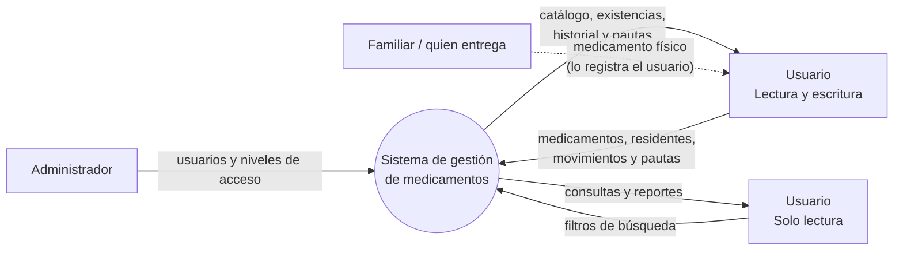

##### Nivel 1 — Procesos principales

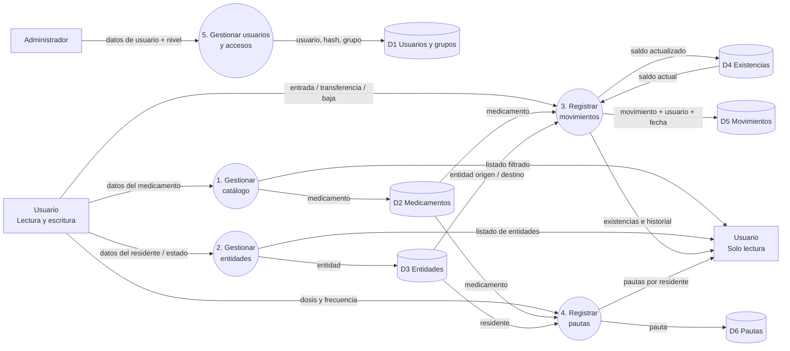

> Todos los procesos validan la sesión y los permisos contra **D1** antes de leer o escribir (proceso 5.4 y 5.5). Un usuario `Solo lectura` solo recibe flujos de salida (consultas); cualquier escritura que intente devuelve `403`.

##### Flujo 1 — Catálogo de medicamentos (alta / baja / cambio)

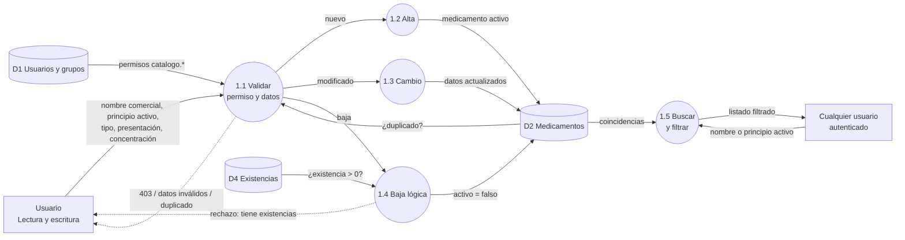

- La **baja es lógica** (`activo = falso`) para conservar el historial de movimientos. Se rechaza si alguna entidad todavía tiene existencias de ese medicamento.
- No se permite duplicar la combinación nombre comercial + presentación + concentración.

##### Flujo 2 — Gestión de entidades (alta / baja / cambio)

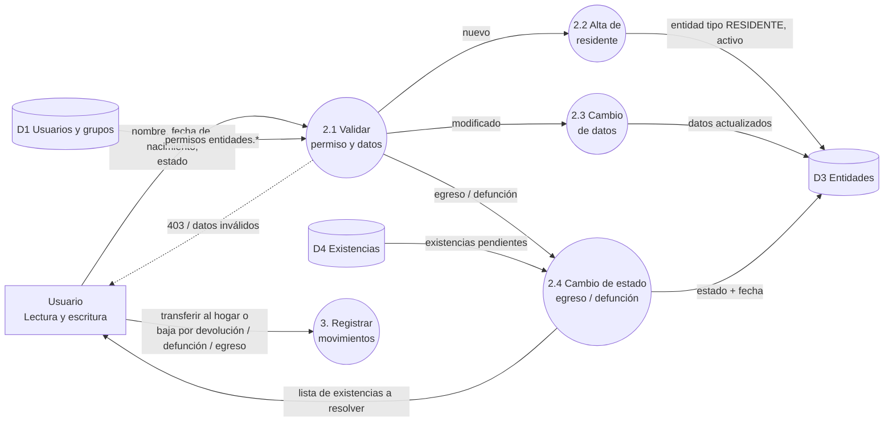

- La entidad **Hogar** se crea en la instalación (semilla) y no se puede dar de baja.
- Los residentes **no se borran**: el egreso o la defunción cambian su estado. El sistema muestra las existencias pendientes del residente para que el usuario las resuelva con el flujo 3.

##### Flujo 3 — Existencias por entidad (entradas, transferencias y bajas)

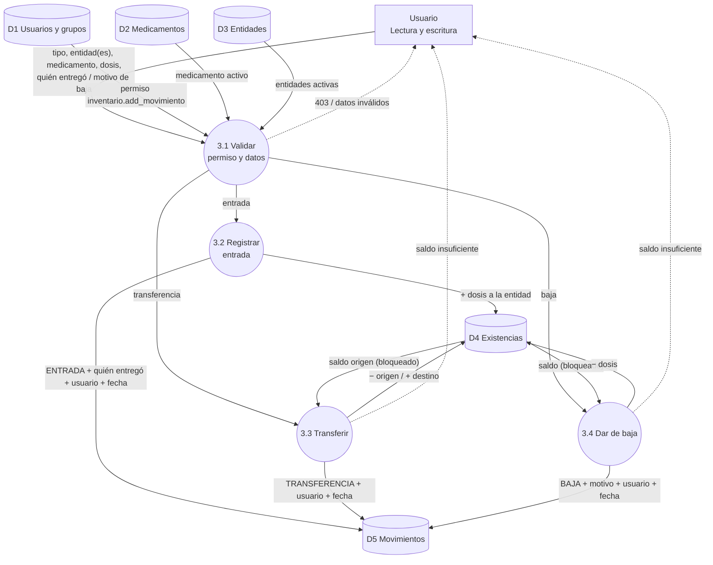

- Cada operación corre en una sola transacción (`transaction.atomic()`): se escribe el movimiento en **D5** y se actualiza el saldo en **D4**, o no se hace nada.
- Transferencias y bajas **bloquean el saldo** (`select_for_update()`) y lo validan antes de descontar, para que nunca quede negativo.
- Motivos de baja: consumo / administración, caducidad, merma, rotura, devolución a la familia, defunción y egreso.
- Los movimientos no se editan ni se borran: un error se corrige con el movimiento inverso.

##### Flujo 4 — Pauta del residente (dosis y frecuencia)

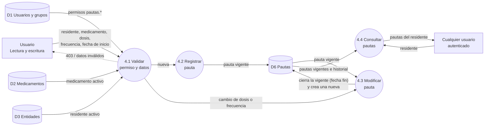

- La pauta es **informativa**: no mueve existencias ni registra la administración.
- Un cambio de dosis o frecuencia cierra la pauta vigente y crea una nueva, así queda el historial.

##### Flujo 5 — Alta de usuarios y nivel de acceso global

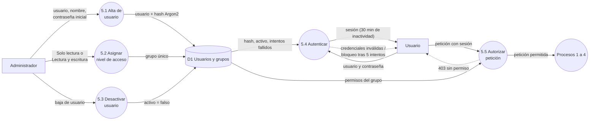

- Solo el **Administrador** (superusuario) da de alta usuarios, desde el panel de administración de Django.
- Cada usuario pertenece a **un solo grupo**, que define su nivel global: `Solo lectura` (consulta y reportes) o `Lectura y escritura` (todas las operaciones de los flujos 1 a 4).
- Los usuarios **se desactivan en lugar de borrarse**, porque sus movimientos deben seguir mostrando quién los registró.

### **2.2. Descripción de componentes principales:**

> Describe los componentes más importantes, incluyendo la tecnología utilizada

| Componente | Tecnología | Responsabilidad |
|---|---|---|
| **Proxy inverso** | Nginx | Termina HTTPS (certificado de `mkcert`), sirve `static/`, aplica cabeceras de seguridad y reenvía el resto a Gunicorn. |
| **Servidor de aplicación** | Gunicorn | Ejecuta la aplicación Django (WSGI) con varios *workers*. |
| **Backend / web** | Python 3.12 + Django 5.2 LTS | Vistas, formularios, autenticación, autorización por grupos y lógica de negocio. |
| **Frontend** | Plantillas Django + Bootstrap 5 + HTMX | Interfaz responsive renderizada en el servidor. HTMX actualiza fragmentos de página (filtros, búsquedas) sin una SPA. |
| **API REST** | Django REST Framework + drf-spectacular | 3 endpoints JSON **de solo lectura** (existencias por entidad, búsqueda de medicamentos, reporte mensual) documentados en OpenAPI. Ver [sección 4](#4-especificación-de-la-api). |
| **Base de datos** | PostgreSQL 17 | Persistencia relacional, transacciones y búsqueda por nombre / principio activo. |
| **Respaldos** | `pg_dump` + GPG + cron | Respaldo diario comprimido y cifrado, con retención de 14 días y copia a disco externo (`scripts/backup_db.sh`, HB-10). |

**Módulos (apps de Django) y sus dependencias:**

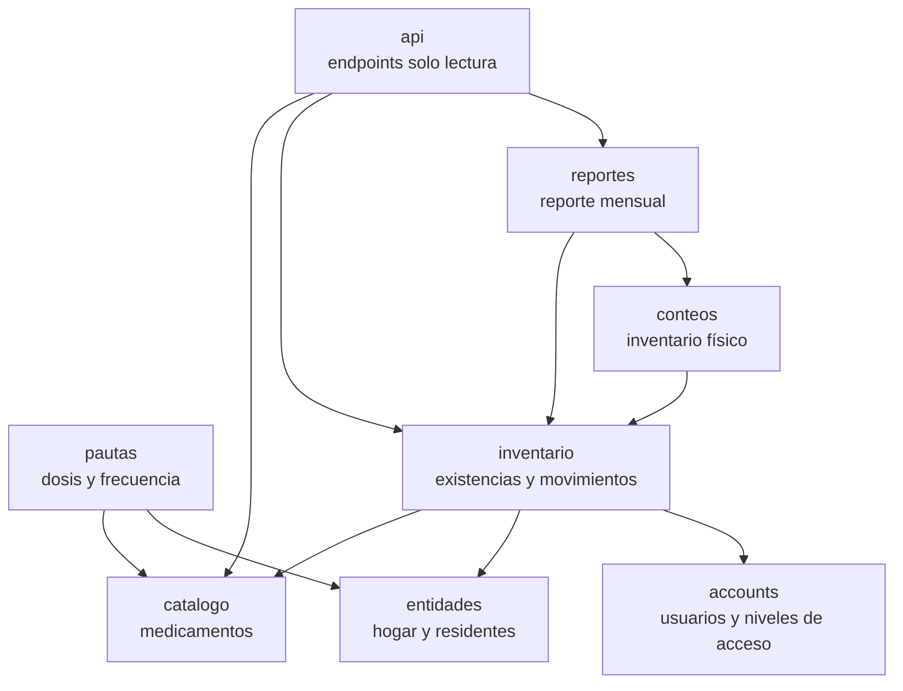

- **accounts:** inicio y cierre de sesión. Grupos `Solo lectura` y `Lectura y escritura`. El Administrador (superusuario) gestiona los usuarios desde el panel de administración de Django.
- **catalogo:** alta, baja y cambio de medicamentos (nombre comercial, principio activo, genérico u original, presentación, concentración) y búsqueda. En el MVP, el alta, la baja y el cambio se hacen desde `/admin/` (sección 5); las pantallas propias quedan para la V2.
- **entidades:** el hogar y los residentes (nombre, fecha de nacimiento, estado). Cada uno es una *entidad* dueña de existencias. En el MVP, los residentes se gestionan desde `/admin/` (sección 5).
- **pautas:** dosis y frecuencia de cada medicamento por residente (informativo; prioridad *Could*, sección 5).
- **inventario:** existencias por entidad y medicamento (en dosis) y registro de **movimientos** (entrada, transferencia, baja con motivo). Incluye `services.py` con las reglas de negocio.
- **conteos:** conteo físico a demanda por entidad y rango de fechas, y comparación contra lo registrado.
- **reportes:** reporte mensual en pantalla de existencias y movimientos.
- **api:** *serializers* y vistas de solo lectura de DRF, además del esquema OpenAPI.

### **2.3. Descripción de alto nivel del proyecto y estructura de ficheros**

> Representa la estructura del proyecto y explica brevemente el propósito de las carpetas principales, así como si obedece a algún patrón o arquitectura específica.

```
AI4Devs-finalproject-vmrr/
├── readme.md                  # documentación del proyecto
├── prompts.md                 # prompts utilizados con IA
├── openspec/                  # OpenSpec: config.yaml (fuentes y reglas), specs/ y changes/ (un cambio por ticket)
├── docs/                      # documentación de apoyo y diagramas
│   ├── api/openapi.yaml       # contrato de la API (sección 4)
│   ├── adr/                   # decisiones de arquitectura (ADR), índice en adr/README.md
│   ├── herramientas/          # límites y pendientes de las herramientas del repositorio (hook de secretos)
│   └── tickets/               # guías paso a paso de los tickets (sección 6)
├── docker-compose.yml         # servicios: nginx, web, db
├── Makefile                   # atajos de desarrollo local (make help); el CI no lo usa
├── .env.example               # variables de entorno de ejemplo (el .env real no se versiona)
├── .github/
│   ├── workflows/ci.yml       # integración continua: lint + tests
│   └── pull_request_template.md  # plantilla de PR (sección 7)
├── nginx/
│   ├── default.conf           # proxy inverso, HTTPS, cabeceras de seguridad
│   └── certs/                 # certificados locales (no versionados)
├── db/
│   └── init/01_roles.sh       # crea los usuarios app_owner y app_user al crear el volumen
├── scripts/
│   ├── verificar.py           # ruff y djLint: lo corren el job lint del CI y el hook de commits
│   ├── migrate.sh             # migrate con las credenciales de app_owner
│   ├── leer_env.sh            # lee .env sin pisar el entorno; la usan los scripts de respaldo (HB-10)
│   ├── backup_db.sh           # respaldo cifrado con pg_dump y GPG (HB-10)
│   ├── restore_db.sh          # restauración de un respaldo, o ensayo en una base aparte (HB-10)
│   └── hogar.cron             # tareas programadas del servidor del hogar (HB-10)
├── tests/                     # tests de las herramientas (hooks y scripts, también test_respaldos.py de HB-10), con pytest; no de la aplicación
├── ruff.toml                  # ruff para scripts/, .claude/hooks/ y tests/ (app/ usa su pyproject.toml)
└── app/                       # proyecto Django
    ├── Dockerfile
    ├── requirements.txt
    ├── requirements-dev.txt   # pytest, ruff y djLint: solo desarrollo y CI, nunca en la imagen de producción
    ├── pyproject.toml         # configuración de ruff, djLint y pytest
    ├── manage.py
    ├── config/                # configuración global
    │   ├── settings/          # base.py, local.py, prod.py
    │   ├── urls.py
    │   └── wsgi.py
    ├── apps/                  # un módulo de negocio por app
    │   ├── expresiones.py     # sin_acentos(): la expresión f_unaccent(lower(...)) de los índices
    │   ├── panel.py           # reglas comunes del panel /admin/ (sin borrado, búsqueda sin acentos)
    │   ├── accounts/
    │   ├── catalogo/
    │   ├── entidades/
    │   ├── pautas/
    │   ├── inventario/
    │   │   ├── models.py      # Existencia, Movimiento, MotivoBaja
    │   │   ├── services.py    # reglas: registrar_entrada, transferir, dar_de_baja, corregir
    │   │   ├── exceptions.py  # errores de negocio con code (sección 4.4)
    │   │   ├── selectors.py   # consultas de lectura (buscar_existencias)
    │   │   ├── forms.py
    │   │   ├── views.py
    │   │   ├── urls.py
    │   │   ├── templates/inventario/
    │   │   └── tests/
    │   ├── conteos/
    │   ├── reportes/
    │   └── api/               # serializers.py, views.py, urls.py
    ├── templates/             # base.html y layout común (Bootstrap)
    ├── static/                # css, js (htmx), imágenes
    ├── fixtures/mock/         # dataset mock para demo y desarrollo (sección 3.4)
    ├── e2e/                   # pruebas de extremo a extremo con Playwright (el servidor corre como app_user)
    ├── conftest.py            # fixtures de pytest compartidos (datos_demo, demo, como_app_user)
    └── pruebas.py             # helpers de los tests (ejecutar_sql, saldo)
```

**Patrón:** estructura estándar de Django organizada **por dominio**: cada app contiene sus modelos, servicios, vistas, plantillas y tests. La configuración está separada por entorno (`local` / `prod`) y se controla con variables de entorno, siguiendo la metodología *12-factor*. La infraestructura (`nginx/`, `scripts/`, `docker-compose.yml`) queda fuera del código de la aplicación.

### **2.4. Infraestructura y despliegue**

> Detalla la infraestructura del proyecto, incluyendo un diagrama en el formato que creas conveniente, y explica el proceso de despliegue que se sigue

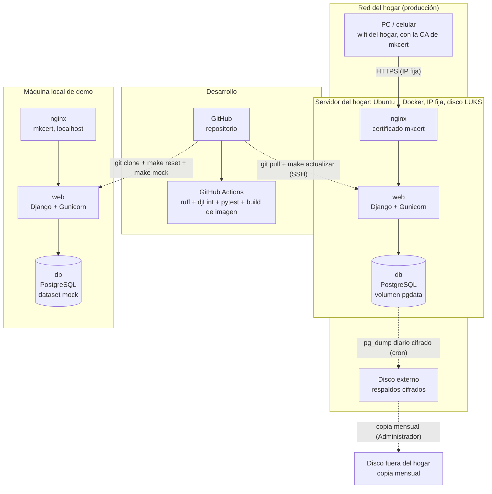

**Entornos:**

| Entorno | Ubicación | Acceso | Certificado | Datos |
|---|---|---|---|---|
| **Desarrollo** | Equipo del desarrollador | `localhost` | `mkcert` (`localhost`) | Semillas y mock |
| **Producción** | Servidor Ubuntu con Docker en el hogar, con IP fija y el disco cifrado con LUKS | Solo la red del hogar | `mkcert`, con la IP del servidor (la CA se instala en cada PC y celular) | Reales |
| **Demo** | Una máquina local: una laptop o el equipo de desarrollo (para quien evalúe a distancia, un video grabado) | `localhost` | `mkcert` (`localhost`) | Mock (sección 3.4), ficticio |

> **Sin VPS por ahora** ([ADR-0026](docs/adr/0026-despliegue-servidor-del-hogar-y-demo-local.md)): no hay fondos para un hosting. Docker Compose y la configuración por variables permiten mover la aplicación a uno sin cambiar la arquitectura; si se hace, un ADR nuevo decide el proveedor, el dominio y Let's Encrypt.

#### **2.4.1. Diagrama de contenedores (C4 – Nivel 2)**

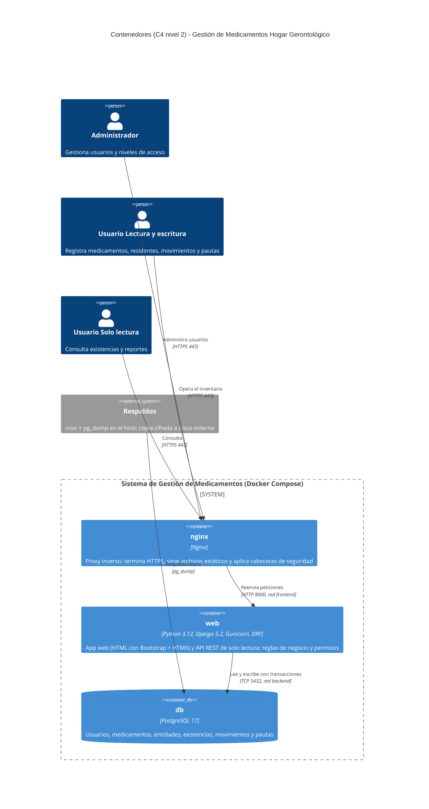

<!-- NOTA: la sintaxis C4Container de Mermaid es experimental. Si el diagrama no se renderiza correctamente en GitHub (etiquetas encimadas o error de render), se puede convertir a un diagrama de flujo (flowchart) con estilo C4, con los mismos elementos y relaciones, como los diagramas de las secciones 2.1 y 2.1.1. -->

> El **app** y la **API backend** viven en el mismo contenedor `web`: los ejecuta el mismo proceso Django y comparten la capa de servicios y los modelos. Así cumplen la misma lógica y los mismos permisos, con un contenedor menos que operar. Su separación interna (vistas HTML, API, servicios, ORM) se ve en el diagrama de la sección 2.1.

**Qué hace cada contenedor:**

| Contenedor | Imagen / tecnología | Responsabilidad | Puertos | Volúmenes | Redes |
|---|---|---|---|---|---|
| **`nginx`** — proxy inverso | `nginx:1.30.7-alpine` | Único punto de entrada. Termina **HTTPS** (certificado de `mkcert`) y redirige 80 → 443. Sirve `/static/` sin pasar por Django. Aplica cabeceras de seguridad (HSTS, CSP, `X-Frame-Options`) y límites de tamaño de petición. Reenvía el resto a `web`. | **80 y 443 publicados** al host | `static` (solo lectura), `nginx/certs` | `frontend` |
| **`web`** — app + API backend | Imagen propia: Python 3.12 + Django 5.2 + Gunicorn | **App web:** renderiza las páginas HTML (Bootstrap + HTMX) de existencias, movimientos, conteos y reportes. En el MVP, el catálogo y los residentes se operan desde `/admin/`, y las pautas son *Could* (sección 5). **API REST** (DRF): 3 endpoints JSON de solo lectura bajo `/api/`, con esquema OpenAPI. **Backend:** autenticación, sesiones, permisos por grupo, reglas de inventario (`services.py`) y panel `/admin/` para gestionar usuarios. | 8000 (solo interno, no publicado) | `static` (escribe con `collectstatic`) | `frontend` y `backend` |
| **`db`** — base de datos | `postgres:17-alpine` | Persistencia relacional de los almacenes D1 a D6. Garantiza transacciones atómicas y bloqueo de filas (`SELECT ... FOR UPDATE`) para que las existencias nunca queden negativas. | 5432 (solo interno, no publicado) | `pgdata` (datos persistentes) | `backend` |

**Flujos de comunicación entre contenedores:**

| # | Origen → destino | Protocolo / puerto | Contenido | Seguridad |
|---|---|---|---|---|
| 1 | Navegador → `nginx` | **HTTPS (TLS 1.2+) / 443** (80 solo redirige) | Peticiones de páginas, formularios (POST), fragmentos HTMX y llamadas `GET /api/...` | Certificado TLS, HSTS, cookie de sesión `Secure` + `HttpOnly` |
| 2 | `nginx` → navegador | HTTPS / 443 | HTML completo o fragmentos HTMX, JSON de la API, archivos estáticos (CSS, JS, imágenes) | Cabeceras CSP, `X-Frame-Options: DENY`, `X-Content-Type-Options` |
| 3 | `nginx` → `web` | **HTTP / 8000** (proxy inverso, red interna `frontend`) | La misma petición, con cabeceras `X-Forwarded-For` y `X-Forwarded-Proto` | No sale del host; Django confía en `X-Forwarded-Proto` solo desde `nginx` |
| 4 | `web` → `db` | **Protocolo PostgreSQL sobre TCP / 5432** (red interna `backend`) | Consultas SQL parametrizadas del ORM y transacciones de inventario | Se conecta como `app_user`, con privilegios mínimos y sin ser dueño de las tablas; credenciales en `.env`; `nginx` no tiene ruta a `db` |
| 5 | Host (cron) → `db` | `docker compose exec db pg_dump` | Respaldo diario comprimido y cifrado (GPG) | Se guarda fuera del contenedor, con retención de 14 días |

**Orden de arranque:** `db` declara un *healthcheck* (`pg_isready`). `web` arranca con `depends_on: condition: service_healthy` y `nginx` arranca después de `web`. Así `web` nunca intenta conectarse a una base de datos que todavía no responde.

**Proceso de despliegue:**
1. **Integración continua:** en cada *push* o *pull request* a `main`, GitHub Actions ([`.github/workflows/ci.yml`](.github/workflows/ci.yml)) ejecuta `scripts/verificar.py` (`ruff` para el lint y el formato de Python, djLint para los de las plantillas), `pytest` con cobertura contra un servicio PostgreSQL 17, las pruebas de extremo a extremo con Playwright si el PR toca el frontend, y el *build* de la imagen. Además revisa el contrato `docs/api/openapi.yaml` con Redocly y las herramientas del repositorio (`scripts/`, `.claude/hooks/` y `tests/`) con ruff y sus propios tests. Desde HB-10, el *job* `respaldos` prueba los scripts de respaldo y restauración con los contenedores levantados. Cada noche corren además los tests lentos. Solo se integra a `main` con los *checks* obligatorios en verde (sección 7.3).
2. **Despliegue en el servidor del hogar:** se hace manualmente por SSH, lo cual es suficiente para un solo mantenedor. Antes de actualizar se hace un respaldo manual y se anota el commit en producción, para poder volver atrás:
   ```bash
   make backup                   # respaldo manual antes de actualizar (HB-10)
   git pull origin main
   docker compose up -d --build
   ./scripts/migrate.sh          # migrate como app_owner; web corre como app_user
   docker compose exec web python manage.py collectstatic --noinput
   docker compose restart nginx  # relee nginx/default.conf, que se monta del repositorio
   # up, migrate.sh y collectstatic son "make actualizar" (TK-01)
   ```
   El paso a paso de la primera instalación, la actualización, la vuelta atrás y la prueba de humo está en la guía de HB-10 ([`docs/tickets/HB-10-despliegue-hogar.md`](docs/tickets/HB-10-despliegue-hogar.md)).
3. **Primera instalación:** el servidor se instala con el disco cifrado con LUKS ([ADR-0026](docs/adr/0026-despliegue-servidor-del-hogar-y-demo-local.md)), y su frase se escribe en cada arranque. Se copia `.env.example` a `.env` y se configuran los secretos, incluidas las contraseñas de los 3 usuarios de PostgreSQL:
   - `POSTGRES_PASSWORD`: superusuario, solo para la inicialización. En la operación, el ensayo de restauración usa el superusuario por el *socket* del contenedor, sin contraseña ([ADR-0026](docs/adr/0026-despliegue-servidor-del-hogar-y-demo-local.md)).
   - `DB_OWNER_PASSWORD`: `app_owner`, para las migraciones y los respaldos.
   - `DB_APP_PASSWORD`: `app_user`, para la aplicación.

   También `HOGAR_NOMBRE`, con el nombre real del hogar (o el de la demo, si es la demo). La primera migración crea el Hogar con ese nombre, una sola vez, y `config.settings.prod` no arranca sin la variable ni con más de 150 caracteres. En desarrollo, sin ella, el Hogar se llama "Hogar Gerontológico Demo". Hasta TK-01, un valor con espacios rompe `scripts/migrate.sh`, que lee `.env` con `. ./.env`: el despliegue en el servidor del hogar va después de TK-01 (sección 6, ficha de TK-01).

   Al crear el volumen `pgdata`, el contenedor `db` ejecuta `db/init/01_roles.sh`, que crea `app_owner` y `app_user` (sección 6, HB-01). Después, en la PC del Administrador y con la CA propia del hogar, se genera el certificado de `mkcert` para la IP fija del servidor. Al servidor solo van el certificado y su llave, nunca la llave de la CA, y la CA se instala en cada PC y celular del hogar. Por último se crea el superusuario con `createsuperuser` (guía de HB-10). El mock nunca se carga en el servidor del hogar. Los grupos de permisos, el Hogar y los catálogos semilla no se cargan aparte: los crean las migraciones de datos (sección 3.1).
4. **Respaldos:** un cron diario ejecuta `scripts/backup_db.sh` (HB-10), que genera un `pg_dump` comprimido y cifrado con la llave pública GPG del Administrador (la privada no queda en el servidor), sin los datos de `axes` ni de sesiones, que no salen del servidor (ADR-0022), con retención de 14 días y copia a un disco externo. Una vez al mes, el Administrador copia el último respaldo a un segundo disco que se guarda fuera del hogar, y `scripts/restore_db.sh --ensayo` restaura un respaldo recién hecho en una base aparte y compara las tablas de negocio, sin detener la aplicación. Si el último respaldo completo tiene más de 26 horas, el mensaje de entrada por SSH lo avisa. El cron también ejecuta cada día `clearsessions`, y cada semana la limpieza de `axes`: los registros de acceso y de fallos de más de 30 días y los intentos fallidos ([ADR-0022](docs/adr/0022-autenticacion-sesion-argon2-axes.md)).
5. **Demo en una máquina local:** la misma imagen y `config.settings.prod`, con el `HOGAR_NOMBRE` de la demo y el mock (sección 3.4). `make reset` y `make mock` la dejan como nueva antes de cada presentación. `make reset` y `make mock` se niegan si ven una señal del servidor del hogar (un `HOGAR_NOMBRE` distinto del de la demo, `RESPALDO_DESTINATARIO` definida o el cron de los respaldos), para que `make` nunca borre la base ni cargue el mock allí (HB-10).
6. **Hosting a futuro:** fuera de alcance mientras no haya fondos ([ADR-0026](docs/adr/0026-despliegue-servidor-del-hogar-y-demo-local.md)). Bastaría aprovisionar un servidor con Docker, clonar el repositorio, restaurar el último respaldo y cambiar las variables de entorno, más el certificado público que decida ese ADR nuevo.

### **2.5. Seguridad**

> Enumera y describe las prácticas de seguridad principales que se han implementado en el proyecto, añadiendo ejemplos si procede

| Práctica | Implementación |
|---|---|
| **Cifrado en tránsito** | HTTPS en todos los entornos, con certificado de `mkcert`. nginx redirige 80 → 443 y envía HSTS, y Django no los repite (`config.settings.prod`); las *cookies* de sesión y CSRF son `Secure` (`SESSION_COOKIE_SECURE` y `CSRF_COOKIE_SECURE`). |
| **Contraseñas** | Hash **Argon2** (`django[argon2]`) y validadores de longitud y complejidad de Django. |
| **Sesiones** | Expiran tras 30 min de inactividad (`SESSION_COOKIE_AGE=1800`, `SESSION_SAVE_EVERY_REQUEST=True`) y al cerrar el navegador. Cookies `HttpOnly` y `SameSite=Lax`. |
| **Fuerza bruta** | `django-axes` (9.1.0, versión fija): bloquea la cuenta 15 minutos tras 5 intentos fallidos, por usuario y no por IP (detrás de nginx, la IP sería la del proxy). |
| **Autorización** | Grupos `Solo lectura` / `Lectura y escritura` con permisos de Django, validados **en el backend** (`PermissionRequiredMixin` en las vistas; en la API, `IsAuthenticated`, porque sus 3 endpoints son de solo lectura, sección 4.2). La interfaz oculta botones según el nivel, pero la autorización real ocurre en el servidor. Ejemplo: un usuario de solo lectura que envía un `POST` a `/inventario/bajas/` recibe `403`. |
| **API** | Solo lectura (`GET`), requiere sesión autenticada y no expone métodos de escritura. |
| **Vulnerabilidades web** | CSRF por defecto en formularios y peticiones HTMX. Protección contra XSS por el *autoescape* de plantillas. Protección contra inyección SQL al usar el ORM con consultas parametrizadas. `X-Frame-Options: DENY` y `Content-Security-Policy` en Nginx. Django envía la misma política CSP (nginx oculta la suya y deja una sola), para que las pruebas que no pasan por nginx la apliquen. |
| **Secretos y configuración** | `SECRET_KEY` y credenciales de base de datos en `.env` (no versionado). `DEBUG=False` y `ALLOWED_HOSTS` restringido en producción. |
| **Aislamiento de red** | PostgreSQL sin puertos expuestos, accesible solo desde el contenedor `web`. |
| **Privilegios mínimos en la base de datos** | 2 usuarios: `app_owner` es dueño de las tablas y solo ejecuta migraciones y respaldos ([ADR-0026](docs/adr/0026-despliegue-servidor-del-hogar-y-demo-local.md)); `app_user` es el que usa la aplicación, sin `UPDATE`, `DELETE` ni `TRUNCATE` sobre `movimiento` y sin poder alterar tablas ni desactivar *triggers*. Así, aunque alguien robe las credenciales de la aplicación, no puede reescribir el historial. Un test en CI verifica estos permisos. |
| **Integridad y trazabilidad** | Cada movimiento guarda usuario y fecha/hora. Los movimientos **no se editan ni se borran**: los errores se corrigen con un movimiento inverso. Las operaciones de inventario corren en `transaction.atomic()` con `select_for_update()` para evitar saldos negativos. |
| **Privacidad (LFPDPPP)** | Minimización de datos (solo nombre y fecha de nacimiento del residente), aviso de privacidad visible y residentes egresados o fallecidos marcados como inactivos en lugar de borrados, para conservar el historial. |
| **Cifrado en reposo** | El disco del servidor del hogar va cifrado con LUKS, con una frase que se escribe en cada arranque; los respaldos van cifrados con GPG (HB-10, ADR-0026). |
| **Respaldos** | Diarios y cifrados (GPG), con retención limitada, una copia mensual fuera del hogar y prueba de restauración mensual. Ni la llave privada GPG ni la de la CA de `mkcert` se guardan en el servidor (HB-10). |
| **Dependencias** | Versiones fijadas en `requirements.txt` y revisión periódica con `pip-audit`. |

### **2.6. Tests**

> Describe brevemente algunos de los tests realizados

**Herramientas:** solo `pytest`, con `pytest-django` y el dataset mock de la sección 3.4 como *fixture* (`datos_demo`), ejecutados en CI contra PostgreSQL real. Playwright (Python, con `pytest-playwright`) para el flujo de extremo a extremo. Las pruebas son funciones con *fixtures* y marcadores de pytest; no se usan clases `TestCase` de Django ni de `unittest`: las transacciones reales se piden con `@pytest.mark.django_db(transaction=True, serialized_rollback=True)` y el número de consultas se comprueba con `django_assert_num_queries`. Los marcadores `lento`, `http`, `integracion`, `infra` y `e2e` se declaran con `--strict-markers`.

**Capas y nombres:** los tests de cada app van planos en `app/apps/<app>/tests/`, sin subcarpetas por tipo, y los de la configuración del proyecto en `app/config/tests/`; la capa se reconoce por el nombre del archivo y, en las demás, por su marcador.

| Capa | Archivos | Marcador |
|---|---|---|
| Servicio y base de datos (sin HTTP) | `test_modelos.py`, `test_formularios.py`, `test_services.py`, `test_selectors.py`, `test_templatetags.py`, `test_esquema.py`, `test_privilegios.py`, `test_concurrencia.py` | `lento` solo en los planes de ejecución (`EXPLAIN`) |
| HTTP (URL + vista + plantilla, con el cliente de pruebas de Django) | `test_views_*.py`, `test_admin*.py` | `http` |
| Flujo completo (Vista → Servicio → Base de datos → `v_conciliacion_existencia`) | `test_integracion.py` | `integracion` |
| Infraestructura y configuración (HTTPS por cabecera, CSRF, CSP, conexión y usuarios de BD) | `app/config/tests/test_conexion.py` (HB-03), `app/config/tests/test_proxy.py` (HB-04) | `infra` |
| Extremo a extremo (Playwright) | `app/e2e/` | `e2e` |

Todas las capas corren contra PostgreSQL real, incluida la de servicio y base de datos, que por eso no se llama "unitaria". Toda prueba E2E es funcional, porque verifica un criterio de aceptación tal como lo vive el usuario; lo contrario no es cierto: las de `test_views_*`, `test_admin*`, `test_integracion.py` y las de contrato de la API también son funcionales y no usan navegador. `-m http` corre solo la capa HTTP y `-m infra`, solo la de infraestructura y configuración, que no lleva `http` porque prueba configuración y no las vistas de una app. Las verificaciones de HB-01 y HB-02 y los `curl` de HB-04 son comandos con resultado esperado que van en el PR: no son tests de pytest y no llevan marcador.

**Permisos reales también en pantalla:** el *fixture* `como_app_user` hace `SET LOCAL ROLE app_user` y falla si el test no tiene transacción envolvente (con `transaction=True`, cada hilo hace `SET ROLE app_user`). En los e2e, el servidor de pruebas corre como `app_user` y Django envía la misma CSP que nginx, así un script o un estilo en línea falla también en `live_server`.

**Aislamiento:** `pytest-django` crea una base aparte (`test_<POSTGRES_DB>`) en el mismo PostgreSQL, le aplica las migraciones y la borra al terminar; la base de desarrollo no se toca (por eso `app_owner` tiene `CREATEDB` en desarrollo y CI). Cada test corre dentro de una transacción que se revierte, así que empieza con el mock recién cargado. Los de concurrencia y Playwright (`transaction=True`) confirman sus datos y al final se vacían las tablas; `serialized_rollback=True` restaura los datos semilla de las migraciones. En CI, además, el servidor de PostgreSQL es un contenedor nuevo en cada *job*.

| Tipo | Caso | Resultado esperado |
|---|---|---|
| **Unitario (servicios)** | Registrar una entrada de 30 dosis para un residente | La existencia del residente aumenta en 30 y se crea un movimiento con usuario, fecha y quién entregó. |
| **Unitario (servicios)** | Dar de baja más dosis de las disponibles | Se lanza `ExistenciaInsuficiente` y el saldo no cambia. |
| **Unitario (servicios)** | Transferir del hogar a un residente cuando falla el abono al destino | La transacción se revierte y el saldo del hogar queda igual (atomicidad). |
| **Concurrencia** | Dos bajas simultáneas que juntas superan la existencia (`@pytest.mark.django_db(transaction=True)` con hilos) | Solo una se aplica y el saldo nunca es negativo. |
| **Unitario (conteos)** | Conteo físico de 18 dosis cuando el sistema registra 20 | La diferencia reportada es −2. |
| **Permisos** | Usuario `Solo lectura` envía un `POST` para registrar una baja | Responde `403` y no se crea el movimiento. |
| **Permisos** | Usuario sin sesión accede a cualquier pantalla | Redirige al login. |
| **API** | `GET /api/v1/existencias?entidad_id=<id>` sin autenticación / autenticado | `401` / `200` con solo las existencias de esa entidad (casos completos en la sección 4.6). |
| **Extremo a extremo** | Login → alta de medicamento → entrada a residente → consulta filtrada por principio activo | El medicamento aparece con la existencia correcta. |

**Criterio:** cobertura ≥ 80 % en todo el código de `apps/`, con ramas y sin contar migraciones ni tests (`[tool.coverage]` de `app/pyproject.toml`, la misma medida en local y en el CI), que el CI exige en cada PR (sección 7.3). Las capas de servicios y permisos, que concentran las reglas críticas del negocio, tienen además el umbral de su ticket (por ejemplo, ≥ 90 % en `services.py`).

**Documentación proceso para esta seccion:**[02-arquitectura.md](02-arquitectura.md)

---

## 3. Modelo de Datos

### **3.1. Diagrama del modelo de datos:**

> Recomendamos usar mermaid para el modelo de datos, y utilizar todos los parámetros que permite la sintaxis para dar el máximo detalle, por ejemplo las claves primarias y foráneas.

**Motor:** PostgreSQL 17. **Convenciones:**
- Claves primarias sustitutas `bigint GENERATED BY DEFAULT AS IDENTITY` (las tablas de catálogo pequeñas usan `smallint`).
- Las claves naturales se protegen con `UNIQUE`.
- Las fechas con hora son `timestamptz`.
- Las cantidades son `numeric(10,2)`, para admitir media tableta sin errores de redondeo.
- **Todas las claves foráneas son `ON DELETE RESTRICT`** (`PROTECT` en Django): no se puede borrar físicamente ningún registro con historial.

```mermaid
erDiagram
    usuario {
        bigint id PK "IDENTITY"
        varchar username UK "150, NOT NULL"
        varchar password "128, NOT NULL, hash Argon2"
        varchar first_name "150, NOT NULL, DEFAULT vacio"
        varchar last_name "150, NOT NULL, DEFAULT vacio"
        varchar email "254, NOT NULL, DEFAULT vacio"
        boolean is_active "NOT NULL, DEFAULT true, baja logica"
        boolean is_superuser "NOT NULL, DEFAULT false, Administrador"
        boolean is_staff "NOT NULL, DEFAULT false, acceso a /admin"
        timestamptz last_login "NULL"
        timestamptz date_joined "NOT NULL, DEFAULT now()"
    }
    auth_group {
        int id PK "IDENTITY"
        varchar name UK "150, NOT NULL: Solo lectura / Lectura y escritura"
    }
    usuario_groups {
        bigint id PK "IDENTITY"
        bigint usuario_id FK, UK "NOT NULL, UNIQUE: un solo grupo por usuario"
        int group_id FK "NOT NULL"
    }
    auth_permission {
        int id PK "IDENTITY"
        varchar codename "100, NOT NULL, ej. add_movimiento"
        varchar name "255, NOT NULL"
        int content_type_id "FK a django_content_type (no mostrado)"
    }
    auth_group_permissions {
        bigint id PK "IDENTITY"
        int group_id FK "NOT NULL, UK compuesto con permission_id"
        int permission_id FK "NOT NULL"
    }
    presentacion {
        smallint id PK "IDENTITY"
        varchar nombre UK "60, NOT NULL, unico sin distinguir mayusculas ni acentos: tableta, capsula, jarabe..."
        boolean activo "NOT NULL, DEFAULT true"
    }
    principio_activo {
        bigint id PK "IDENTITY"
        varchar nombre UK "150, NOT NULL, unico sin distinguir mayusculas"
        timestamptz creado_en "NOT NULL, DEFAULT now()"
    }
    medicamento {
        bigint id PK "IDENTITY"
        varchar nombre_comercial "150, NOT NULL"
        varchar tipo "10, NOT NULL, CHECK GENERICO u ORIGINAL"
        smallint presentacion_id FK "NOT NULL"
        varchar concentracion "60, NOT NULL, ej. 500 mg"
        boolean activo "NOT NULL, DEFAULT true, baja logica"
        timestamptz creado_en "NOT NULL, DEFAULT now()"
        timestamptz actualizado_en "NOT NULL, DEFAULT now()"
    }
    medicamento_principio_activo {
        bigint id PK "IDENTITY"
        bigint medicamento_id FK "NOT NULL, UK compuesto con principio_activo_id"
        bigint principio_activo_id FK "NOT NULL"
    }
    entidad {
        bigint id PK "IDENTITY, UK compuesto (id, tipo)"
        varchar tipo "10, NOT NULL, CHECK HOGAR o RESIDENTE"
        varchar nombre "150, obligatorio solo si HOGAR; NULL si RESIDENTE"
        timestamptz creado_en "NOT NULL, DEFAULT now()"
        timestamptz actualizado_en "NOT NULL, DEFAULT now()"
    }
    residente {
        bigint entidad_id PK, FK "FK compuesta (entidad_id, tipo) a entidad"
        varchar tipo "10, NOT NULL, CHECK = RESIDENTE"
        varchar primer_nombre "60, NOT NULL"
        varchar segundo_nombre "60, NULL"
        varchar primer_apellido "60, NOT NULL"
        varchar segundo_apellido "60, NULL"
        date fecha_nacimiento "NOT NULL"
        date fecha_ingreso "NOT NULL"
        varchar estado "10, NOT NULL, DEFAULT ACTIVO, CHECK ACTIVO, EGRESADO, FALLECIDO"
        date fecha_baja "NULL si ACTIVO, obligatoria en otro caso"
    }
    existencia {
        bigint id PK "IDENTITY"
        bigint entidad_id FK "NOT NULL, UK compuesto con medicamento_id"
        bigint medicamento_id FK "NOT NULL"
        numeric saldo "10,2, NOT NULL, DEFAULT 0, CHECK mayor o igual a 0"
        timestamptz actualizado_en "NOT NULL, DEFAULT now()"
    }
    motivo_baja {
        smallint id PK "IDENTITY"
        varchar clave UK "30, NOT NULL, ej. CADUCIDAD"
        varchar descripcion "100, NOT NULL"
        boolean activo "NOT NULL, DEFAULT true"
    }
    movimiento {
        bigint id PK "IDENTITY"
        varchar tipo "15, NOT NULL, CHECK ENTRADA, TRANSFERENCIA, BAJA"
        bigint medicamento_id FK "NOT NULL"
        numeric cantidad "10,2, NOT NULL, CHECK mayor a 0, en dosis"
        bigint entidad_origen_id FK "NULL en ENTRADA"
        bigint entidad_destino_id FK "NULL en BAJA"
        smallint motivo_baja_id FK "obligatorio solo en BAJA"
        varchar origen_entrada "10, CHECK FAMILIAR, HOGAR, OTRO; solo ENTRADA"
        varchar entregado_por "150, quien entrego; solo ENTRADA"
        bigint corrige_a_id FK, UK "NULL, movimiento que corrige"
        text nota "NULL"
        bigint usuario_id FK "NOT NULL, quien registro"
        timestamptz fecha_hora "NOT NULL, DEFAULT now()"
    }
    pauta {
        bigint id PK "IDENTITY"
        bigint residente_id FK "NOT NULL, a residente.entidad_id"
        bigint medicamento_id FK "NOT NULL"
        numeric dosis "6,2, NOT NULL, CHECK mayor a 0, dosis por toma"
        smallint frecuencia_horas "NOT NULL, CHECK 1 a 168, cada N horas"
        boolean si_necesario "NOT NULL, DEFAULT false, PRN"
        text indicaciones "NULL"
        date fecha_inicio "NOT NULL"
        date fecha_fin "NULL = vigente, CHECK mayor o igual a fecha_inicio"
        bigint registrado_por_id FK "NOT NULL, a usuario"
        timestamptz creado_en "NOT NULL, DEFAULT now()"
    }
    conteo_fisico {
        bigint id PK "IDENTITY"
        bigint entidad_id FK "NOT NULL"
        date periodo_inicio "NOT NULL"
        date periodo_fin "NOT NULL, CHECK mayor o igual a periodo_inicio"
        varchar estado "10, NOT NULL, DEFAULT EN_PROCESO, CHECK EN_PROCESO o CERRADO"
        bigint usuario_id FK "NOT NULL, quien realiza el conteo"
        timestamptz creado_en "NOT NULL, DEFAULT now()"
        timestamptz cerrado_en "NULL, obligatoria si CERRADO"
        text nota "NULL"
    }
    detalle_conteo {
        bigint id PK "IDENTITY"
        bigint conteo_id FK "NOT NULL, UK compuesto con medicamento_id"
        bigint medicamento_id FK "NOT NULL"
        numeric cantidad_fisica "10,2, NOT NULL, CHECK mayor o igual a 0"
        numeric cantidad_sistema "10,2, NOT NULL, foto del saldo al contar"
        numeric diferencia "10,2, GENERATED: fisica menos sistema, STORED"
    }

    usuario ||--o| usuario_groups : "tiene a lo sumo uno"
    auth_group ||--o{ usuario_groups : "agrupa"
    auth_group ||--o{ auth_group_permissions : "otorga"
    auth_permission ||--o{ auth_group_permissions : "incluido en"
    presentacion ||--o{ medicamento : "clasifica"
    medicamento ||--|{ medicamento_principio_activo : "contiene"
    principio_activo ||--o{ medicamento_principio_activo : "forma parte de"
    entidad ||--o| residente : "subtipo"
    entidad ||--o{ existencia : "posee"
    medicamento ||--o{ existencia : "se almacena como"
    medicamento ||--o{ movimiento : "se mueve en"
    entidad |o--o{ movimiento : "origen"
    entidad |o--o{ movimiento : "destino"
    motivo_baja |o--o{ movimiento : "justifica"
    usuario ||--o{ movimiento : "registra"
    movimiento |o--o| movimiento : "corrige a"
    residente ||--o{ pauta : "tiene"
    medicamento ||--o{ pauta : "se prescribe en"
    usuario ||--o{ pauta : "registra"
    entidad ||--o{ conteo_fisico : "se cuenta en"
    usuario ||--o{ conteo_fisico : "realiza"
    conteo_fisico ||--|{ detalle_conteo : "incluye"
    medicamento ||--o{ detalle_conteo : "se cuenta en"
```

**Correspondencia con los almacenes del DFD (sección 2.1.1):**

| Almacén | Tablas |
|---|---|
| D1 Usuarios y grupos | `usuario`, `auth_group`, `usuario_groups`, `auth_permission`, `auth_group_permissions` |
| D2 Medicamentos | `medicamento`, `presentacion`, `principio_activo`, `medicamento_principio_activo` |
| D3 Entidades | `entidad` (supertipo), `residente` (subtipo) |
| D4 Existencias | `existencia` |
| D5 Movimientos | `movimiento`, `motivo_baja` |
| D6 Pautas | `pauta` |
| Conteos físicos | `conteo_fisico`, `detalle_conteo` |

**Restricciones avanzadas (DDL PostgreSQL).** Django genera la mayoría con `UniqueConstraint`, `CheckConstraint`, `ExclusionConstraint` y `GeneratedField`. Las demás se agregan en migraciones con `RunSQL`. Los índices únicos por expresión (`uq_medicamento_nombre_pres_conc`, `uq_principio_activo_nombre` y `uq_presentacion_nombre`) se declaran como `UniqueConstraint` con expresiones en `Meta.constraints`, no con `RunSQL`: así los formularios de Django (incluido `/admin/`) los validan y muestran el error junto al campo, en lugar de un error `500`.

```sql
CREATE EXTENSION IF NOT EXISTS btree_gist;  -- para la restricción de exclusión de pautas
CREATE EXTENSION IF NOT EXISTS pg_trgm;     -- búsqueda por nombre / principio activo (ver 3.3)
CREATE EXTENSION IF NOT EXISTS unaccent;    -- comparar sin acentos: "Losartán" = "losartan"

-- Envoltura IMMUTABLE de unaccent, necesaria para usarla en índices
CREATE FUNCTION f_unaccent(text) RETURNS text
    LANGUAGE sql IMMUTABLE PARALLEL SAFE STRICT
    RETURN public.unaccent('public.unaccent'::regdictionary, $1);

-- D1: cada usuario pertenece a un solo grupo
ALTER TABLE usuario_groups ADD CONSTRAINT uq_usuario_un_grupo UNIQUE (usuario_id);

-- D2: sin duplicados de nombre comercial + presentación + concentración
--     (sin distinguir mayúsculas ni acentos)
CREATE UNIQUE INDEX uq_medicamento_nombre_pres_conc
    ON medicamento (f_unaccent(lower(nombre_comercial)), presentacion_id, f_unaccent(lower(concentracion)));
CREATE UNIQUE INDEX uq_principio_activo_nombre ON principio_activo (f_unaccent(lower(nombre)));
CREATE UNIQUE INDEX uq_presentacion_nombre     ON presentacion     (f_unaccent(lower(nombre)));
ALTER TABLE medicamento ADD CONSTRAINT ck_medicamento_tipo CHECK (tipo IN ('GENERICO', 'ORIGINAL'));
ALTER TABLE medicamento_principio_activo
    ADD CONSTRAINT uq_mpa_medicamento_principio UNIQUE (medicamento_id, principio_activo_id);

-- D3: un solo Hogar y subtipo coherente con el supertipo
CREATE UNIQUE INDEX uq_entidad_un_hogar ON entidad (tipo) WHERE tipo = 'HOGAR';
ALTER TABLE entidad
    ADD CONSTRAINT uq_entidad_id_tipo UNIQUE (id, tipo),
    ADD CONSTRAINT ck_entidad_tipo    CHECK (tipo IN ('HOGAR', 'RESIDENTE')),
    ADD CONSTRAINT ck_entidad_nombre  CHECK ((tipo = 'HOGAR') = (nombre IS NOT NULL));
ALTER TABLE residente
    ADD CONSTRAINT ck_residente_tipo  CHECK (tipo = 'RESIDENTE'),
    ADD CONSTRAINT ck_residente_estado CHECK (estado IN ('ACTIVO', 'EGRESADO', 'FALLECIDO')),
    ADD CONSTRAINT fk_residente_entidad FOREIGN KEY (entidad_id, tipo)
        REFERENCES entidad (id, tipo) ON DELETE RESTRICT,
    ADD CONSTRAINT ck_residente_baja  CHECK ((estado = 'ACTIVO') = (fecha_baja IS NULL)),
    ADD CONSTRAINT ck_residente_fechas CHECK (fecha_baja IS NULL OR fecha_baja >= fecha_ingreso);

-- D4: un saldo por entidad y medicamento, nunca negativo
ALTER TABLE existencia
    ADD CONSTRAINT uq_existencia UNIQUE (entidad_id, medicamento_id),
    ADD CONSTRAINT ck_existencia_saldo CHECK (saldo >= 0);

-- D5: columnas obligatorias y prohibidas según el tipo de movimiento
ALTER TABLE movimiento ADD CONSTRAINT ck_movimiento_por_tipo CHECK (
    (tipo = 'ENTRADA'
        AND entidad_origen_id IS NULL AND entidad_destino_id IS NOT NULL
        AND motivo_baja_id IS NULL
        AND (corrige_a_id IS NOT NULL OR (origen_entrada IS NOT NULL AND entregado_por IS NOT NULL)))
 OR (tipo = 'TRANSFERENCIA'
        AND entidad_origen_id IS NOT NULL AND entidad_destino_id IS NOT NULL
        AND entidad_origen_id <> entidad_destino_id
        AND motivo_baja_id IS NULL AND origen_entrada IS NULL AND entregado_por IS NULL)
 OR (tipo = 'BAJA'
        AND entidad_origen_id IS NOT NULL AND entidad_destino_id IS NULL
        AND motivo_baja_id IS NOT NULL AND origen_entrada IS NULL AND entregado_por IS NULL)
);
ALTER TABLE movimiento
    ADD CONSTRAINT ck_movimiento_cantidad CHECK (cantidad > 0),
    ADD CONSTRAINT uq_movimiento_corrige UNIQUE (corrige_a_id),
    ADD CONSTRAINT ck_movimiento_no_autocorrige CHECK (corrige_a_id <> id);

-- D5: inmutabilidad (doble barrera: privilegios + trigger)
REVOKE UPDATE, DELETE ON movimiento FROM app_user;
CREATE FUNCTION fn_movimiento_inmutable() RETURNS trigger LANGUAGE plpgsql AS $$
BEGIN
    RAISE EXCEPTION 'Los movimientos son inmutables: registre un movimiento de corrección';
END $$;
CREATE TRIGGER tg_movimiento_inmutable BEFORE UPDATE OR DELETE ON movimiento
    FOR EACH ROW EXECUTE FUNCTION fn_movimiento_inmutable();

-- D6: sin pautas con vigencias traslapadas para el mismo residente y medicamento
ALTER TABLE pauta
    ADD CONSTRAINT ck_pauta_dosis      CHECK (dosis > 0),
    ADD CONSTRAINT ck_pauta_frecuencia CHECK (frecuencia_horas BETWEEN 1 AND 168),
    ADD CONSTRAINT ck_pauta_fechas     CHECK (fecha_fin IS NULL OR fecha_fin >= fecha_inicio),
    ADD CONSTRAINT ex_pauta_sin_traslape EXCLUDE USING gist (
        residente_id WITH =, medicamento_id WITH =,
        daterange(fecha_inicio, fecha_fin, '[]') WITH &&);

-- Conteos: un renglón por medicamento y diferencia calculada por la base de datos
ALTER TABLE conteo_fisico
    ADD CONSTRAINT ck_conteo_periodo CHECK (periodo_fin >= periodo_inicio),
    ADD CONSTRAINT ck_conteo_cierre  CHECK ((estado = 'CERRADO') = (cerrado_en IS NOT NULL));
ALTER TABLE detalle_conteo
    ADD CONSTRAINT uq_detalle_conteo UNIQUE (conteo_id, medicamento_id),
    ADD CONSTRAINT ck_detalle_fisica CHECK (cantidad_fisica >= 0);
-- diferencia: numeric(10,2) GENERATED ALWAYS AS (cantidad_fisica - cantidad_sistema) STORED

-- Índices de rendimiento y restricciones de integridad adicionales: ver sección 3.3
```

**Datos semilla (migración de datos):**
- La entidad `HOGAR`.
- Los grupos `Solo lectura` y `Lectura y escritura` con sus permisos.
- Los motivos de baja: `CONSUMO`, `CADUCIDAD`, `MERMA`, `ROTURA`, `DEVOLUCION_FAMILIA`, `DEFUNCION`, `EGRESO` y `CORRECCION`.
- Las presentaciones más comunes: tableta, cápsula, jarabe, gotas, ampolleta, parche, crema, inhalador.

### **3.2. Descripción de entidades principales:**

> Recuerda incluir el máximo detalle de cada entidad, como el nombre y tipo de cada atributo, descripción breve si procede, claves primarias y foráneas, relaciones y tipo de relación, restricciones (unique, not null…), etc.

#### D1 — Usuarios y grupos

**`usuario`**: modelo de usuario propio de Django (`AbstractUser`), definido desde el inicio del proyecto como recomienda Django. Representa a quienes usan el sistema.

| Atributo | Tipo | Restricciones | Descripción |
|---|---|---|---|
| `id` | bigint | PK, identity | Identificador |
| `username` | varchar(150) | NOT NULL, UNIQUE | Nombre de inicio de sesión |
| `password` | varchar(128) | NOT NULL | Hash Argon2; nunca la contraseña en claro |
| `first_name` / `last_name` | varchar(150) | NOT NULL, DEFAULT `''` | Nombre para mostrar |
| `email` | varchar(254) | NOT NULL, DEFAULT `''` | Opcional |
| `is_active` | boolean | NOT NULL, DEFAULT true | `false` = usuario dado de baja (no se borra) |
| `is_superuser` | boolean | NOT NULL, DEFAULT false | `true` = **Administrador** |
| `is_staff` | boolean | NOT NULL, DEFAULT false | Acceso al panel `/admin/`: el Administrador y los usuarios de los 2 grupos (habilitadores, sección 5). Solo el Administrador gestiona usuarios y consulta los grupos, que son de solo consulta (HB-08) |
| `last_login` | timestamptz | NULL | Último inicio de sesión |
| `date_joined` | timestamptz | NOT NULL, DEFAULT now() | Fecha de alta |

**Relaciones:**
- `usuario` 1 — 0..1 `usuario_groups` (**un solo grupo**, por el `UNIQUE (usuario_id)`).
- 1 — N con `movimiento`, `pauta` y `conteo_fisico` (quién registró).

**`auth_group` / `usuario_groups` / `auth_permission` / `auth_group_permissions`**: tablas del sistema de permisos de Django.
- `auth_group` contiene exactamente 2 filas: **Solo lectura** (permisos `view_*`) y **Lectura y escritura** (permisos `view_*`, `add_*` y `change_*` de los módulos de negocio).
- `usuario_groups` es la tabla puente usuario ↔ grupo. Django la define como N:M; el `UNIQUE (usuario_id)` la reduce a **N:1**.
- Un usuario que no es superusuario debe tener exactamente un grupo. El "a lo sumo uno" lo garantiza la base de datos y el "al menos uno" lo valida el formulario del panel de administración.

#### D2 — Medicamentos

**`presentacion`**: catálogo de formas farmacéuticas.

| Atributo | Tipo | Restricciones | Descripción |
|---|---|---|---|
| `id` | smallint | PK, identity | Identificador |
| `nombre` | varchar(60) | NOT NULL, UNIQUE sin distinguir mayúsculas ni acentos (`uq_presentacion_nombre`) | Tableta, cápsula, jarabe, gotas… |
| `activo` | boolean | NOT NULL, DEFAULT true | Permite retirar opciones sin borrarlas |

**`principio_activo`**: sustancia activa (ej. *paracetamol*, *losartán*).

| Atributo | Tipo | Restricciones | Descripción |
|---|---|---|---|
| `id` | bigint | PK, identity | Identificador |
| `nombre` | varchar(150) | NOT NULL, UNIQUE sin distinguir mayúsculas ni acentos | Nombre de la sustancia; índice trigram para búsqueda (3.3) |
| `creado_en` | timestamptz | NOT NULL, DEFAULT now() | Fecha de alta |

**`medicamento`**: producto del catálogo.

| Atributo | Tipo | Restricciones | Descripción |
|---|---|---|---|
| `id` | bigint | PK, identity | Identificador |
| `nombre_comercial` | varchar(150) | NOT NULL | Nombre del producto; índice trigram para búsqueda (3.3) |
| `tipo` | varchar(10) | NOT NULL, CHECK (`GENERICO`, `ORIGINAL`) | Genérico u original |
| `presentacion_id` | smallint | FK → `presentacion.id`, NOT NULL | Forma farmacéutica |
| `concentracion` | varchar(60) | NOT NULL | Texto libre normalizado, ej. `500 mg`, `50 mg / 12.5 mg` |
| `activo` | boolean | NOT NULL, DEFAULT true | **Baja lógica**; se rechaza si existe saldo > 0 en alguna entidad |
| `creado_en` / `actualizado_en` | timestamptz | NOT NULL, DEFAULT now() | Control de cambios |

- **UNIQUE** (nombre comercial, `presentacion_id`, concentración), sin distinguir mayúsculas ni acentos (`f_unaccent(lower(...))`). La unicidad aplica también a los inactivos: en lugar de duplicar, se reactiva.
- **Relaciones:**
  - N:1 con `presentacion`.
  - N:M con `principio_activo`, a través de `medicamento_principio_activo`.
  - 1:N con `existencia`, `movimiento`, `pauta` y `detalle_conteo`.

**`medicamento_principio_activo`**: tabla puente. Un medicamento tiene **uno o más** principios activos (por ejemplo, una combinación) y un principio activo aparece en muchos medicamentos.

| Atributo | Tipo | Restricciones | Descripción |
|---|---|---|---|
| `id` | bigint | PK, identity | Identificador |
| `medicamento_id` | bigint | FK → `medicamento.id`, NOT NULL | Medicamento |
| `principio_activo_id` | bigint | FK → `principio_activo.id`, NOT NULL | Principio activo |

- UNIQUE (`medicamento_id`, `principio_activo_id`). El "al menos uno" se valida en la entrada y no en la base, para mantener la flexibilidad (un `CHECK` no puede contar los renglones de la tabla puente): en el MVP, el formulario del panel en el alta y en el cambio del medicamento; en la V2, `POST` y `PATCH /medicamentos`. Las 2 vías dan el mismo mensaje, definido en `apps/catalogo/validadores.py`: "Un medicamento debe tener al menos un principio activo.".

#### D3 — Entidades

**`entidad`**: **supertipo** de todo lo que puede poseer existencias: el Hogar y cada residente. Gracias a él, `existencia`, `movimiento` y `conteo_fisico` tienen una sola FK real hacia "la entidad".

| Atributo | Tipo | Restricciones | Descripción |
|---|---|---|---|
| `id` | bigint | PK, identity; UNIQUE (`id`, `tipo`) | Identificador |
| `tipo` | varchar(10) | NOT NULL, CHECK (`HOGAR`, `RESIDENTE`) | Discriminador del subtipo |
| `nombre` | varchar(150) | NULL; CHECK: obligatorio si y solo si `tipo = 'HOGAR'` | Nombre del Hogar. En los residentes queda nulo, porque su nombre vive desglosado en `residente` (sin duplicarlo) |
| `creado_en` / `actualizado_en` | timestamptz | NOT NULL, DEFAULT now() | Control de cambios |

- **Un solo Hogar:** índice único parcial `(tipo) WHERE tipo = 'HOGAR'`. Se crea con la semilla y la aplicación no permite modificar su tipo ni darlo de baja.

**`residente`**: **subtipo** de `entidad`, con los datos propios del residente (relación 1:0..1).

| Atributo | Tipo | Restricciones | Descripción |
|---|---|---|---|
| `entidad_id` | bigint | PK; FK compuesta (`entidad_id`, `tipo`) → `entidad (id, tipo)` | Misma clave que su entidad |
| `tipo` | varchar(10) | NOT NULL, CHECK = `RESIDENTE` | Garantiza que solo una entidad `RESIDENTE` tenga fila aquí |
| `primer_nombre` | varchar(60) | NOT NULL | Primer nombre (dato personal, LFPDPPP) |
| `segundo_nombre` | varchar(60) | NULL | Segundo nombre, si lo tiene |
| `primer_apellido` | varchar(60) | NOT NULL | Primer apellido |
| `segundo_apellido` | varchar(60) | NULL | Segundo apellido, si lo tiene |
| `fecha_nacimiento` | date | NOT NULL | Dato personal (LFPDPPP) |
| `fecha_ingreso` | date | NOT NULL | Ingreso al hogar |
| `estado` | varchar(10) | NOT NULL, DEFAULT `ACTIVO`, CHECK (`ACTIVO`, `EGRESADO`, `FALLECIDO`) | La baja es **lógica** |
| `fecha_baja` | date | NULL; CHECK: nula si y solo si `ACTIVO`, y ≥ `fecha_ingreso` | Fecha de egreso o defunción |

- **Nombre para mostrar:** se compone al vuelo (`primer_nombre segundo_nombre primer_apellido segundo_apellido`, omitiendo los nulos) y no se guarda. El índice `ix_residente_nombre` (3.3) acelera la búsqueda y el orden por residente.
- **Relaciones:** 1:N con `pauta`. Las existencias, movimientos y conteos del residente cuelgan de su `entidad`.

#### D4 — Existencias

**`existencia`**: saldo actual, en dosis, de un medicamento en una entidad.

| Atributo | Tipo | Restricciones | Descripción |
|---|---|---|---|
| `id` | bigint | PK, identity | Identificador |
| `entidad_id` | bigint | FK → `entidad.id`, NOT NULL | Dueño del saldo |
| `medicamento_id` | bigint | FK → `medicamento.id`, NOT NULL | Medicamento |
| `saldo` | numeric(10,2) | NOT NULL, DEFAULT 0, CHECK ≥ 0 | Dosis disponibles (admite 0.5) |
| `actualizado_en` | timestamptz | NOT NULL, DEFAULT now() | Último movimiento aplicado |

- UNIQUE (`entidad_id`, `medicamento_id`).
- **Dato derivado controlado:** el saldo es la suma de los movimientos de esa entidad y ese medicamento. Se guarda materializado porque el DFD lo exige como almacén (D4) y para no sumar todo el historial en cada consulta. Solo lo modifica `inventario/services.py`, dentro de la **misma transacción** que inserta el movimiento y con `SELECT ... FOR UPDATE`. Una consulta de conciliación verifica que `saldo` coincida con la suma de los movimientos; se ejecuta en los tests y como verificación periódica.

#### D5 — Movimientos

**`motivo_baja`**: catálogo de motivos de baja.

| Atributo | Tipo | Restricciones | Descripción |
|---|---|---|---|
| `id` | smallint | PK, identity | Identificador |
| `clave` | varchar(30) | NOT NULL, UNIQUE | `CONSUMO`, `CADUCIDAD`, `MERMA`, `ROTURA`, `DEVOLUCION_FAMILIA`, `DEFUNCION`, `EGRESO`, `CORRECCION` |
| `descripcion` | varchar(100) | NOT NULL | Texto para mostrar |
| `activo` | boolean | NOT NULL, DEFAULT true | Permite retirar motivos sin borrarlos |

**`movimiento`**: registro **inmutable** de cada entrada, transferencia o baja. Es la trazabilidad mínima del sistema.

| Atributo | Tipo | Restricciones | Descripción |
|---|---|---|---|
| `id` | bigint | PK, identity | Identificador |
| `tipo` | varchar(15) | NOT NULL, CHECK (`ENTRADA`, `TRANSFERENCIA`, `BAJA`) | Tipo de operación |
| `medicamento_id` | bigint | FK → `medicamento.id`, NOT NULL | Medicamento movido |
| `cantidad` | numeric(10,2) | NOT NULL, CHECK > 0 | Dosis; siempre positiva (el sentido lo dan origen y destino) |
| `entidad_origen_id` | bigint | FK → `entidad.id`, NULL | De dónde sale (transferencia y baja) |
| `entidad_destino_id` | bigint | FK → `entidad.id`, NULL | A dónde entra (entrada y transferencia) |
| `motivo_baja_id` | smallint | FK → `motivo_baja.id`, NULL | Obligatorio solo en `BAJA` |
| `origen_entrada` | varchar(10) | NULL, CHECK (`FAMILIAR`, `HOGAR`, `OTRO`) | Quién aporta, solo en `ENTRADA` |
| `entregado_por` | varchar(150) | NULL | Nombre de quien entregó, solo en `ENTRADA` |
| `corrige_a_id` | bigint | FK → `movimiento.id`, NULL, UNIQUE | Movimiento que este corrige (cada movimiento se corrige una sola vez) |
| `nota` | text | NULL | Observaciones |
| `usuario_id` | bigint | FK → `usuario.id`, NOT NULL | Quién registró |
| `fecha_hora` | timestamptz | NOT NULL, DEFAULT now() | Cuándo se registró |

**Reglas por tipo** (CHECK `ck_movimiento_por_tipo`):

| Tipo | Origen | Destino | Motivo | Origen de entrada / entregado por | Efecto en `existencia` |
|---|---|---|---|---|---|
| `ENTRADA` | NULL | obligatorio | NULL | obligatorios (salvo en una corrección) | + destino |
| `TRANSFERENCIA` | obligatorio | obligatorio, ≠ origen | NULL | NULL | − origen / + destino |
| `BAJA` | obligatorio | NULL | obligatorio | NULL | − origen |

- **Inmutabilidad:** el usuario de base de datos de la aplicación no tiene privilegios `UPDATE` ni `DELETE` sobre la tabla, y un *trigger* rechaza cualquier intento de modificación.
- **Corrección de errores:** se registra el movimiento inverso con `corrige_a_id`:
  - Una entrada se corrige con una baja de motivo `CORRECCION`.
  - Una baja se corrige con una entrada.
  - Una transferencia se corrige con la transferencia en sentido contrario.
- **Relaciones:**
  - N:1 con `medicamento`, `usuario` y `motivo_baja` (opcional).
  - N:0..1 con `entidad`, dos veces (origen y destino).
  - 0..1:0..1 consigo misma (corrección).

#### D6 — Pautas

**`pauta`**: dosis y frecuencia de un medicamento para un residente, con vigencia. Es informativa: no mueve existencias.

| Atributo | Tipo | Restricciones | Descripción |
|---|---|---|---|
| `id` | bigint | PK, identity | Identificador |
| `residente_id` | bigint | FK → `residente.entidad_id`, NOT NULL | Solo residentes, nunca el Hogar |
| `medicamento_id` | bigint | FK → `medicamento.id`, NOT NULL | Medicamento pautado |
| `dosis` | numeric(6,2) | NOT NULL, CHECK > 0 | Dosis por toma (ej. 0.5, 1, 2) |
| `frecuencia_horas` | smallint | NOT NULL, CHECK 1–168 | Cada cuántas horas (8, 12, 24; semanal = 168) |
| `si_necesario` | boolean | NOT NULL, DEFAULT false | Pauta "en caso necesario" (PRN); la frecuencia es el intervalo mínimo |
| `indicaciones` | text | NULL | Ej. "en ayunas", "con alimentos" |
| `fecha_inicio` | date | NOT NULL | Inicio de vigencia |
| `fecha_fin` | date | NULL, CHECK ≥ `fecha_inicio` | NULL = vigente |
| `registrado_por_id` | bigint | FK → `usuario.id`, NOT NULL | Quién registró |
| `creado_en` | timestamptz | NOT NULL, DEFAULT now() | Fecha de registro |

- **Vigencia sin traslapes:** una restricción de exclusión (`EXCLUDE USING gist`) impide dos pautas con vigencias superpuestas para el mismo residente y medicamento.
- **Cambio de pauta:** se cierra la vigente (`fecha_fin`) y se crea una nueva, así se conserva el historial.

#### Conteos físicos

**`conteo_fisico`**: encabezado de un inventario físico de una entidad para un período.

| Atributo | Tipo | Restricciones | Descripción |
|---|---|---|---|
| `id` | bigint | PK, identity | Identificador |
| `entidad_id` | bigint | FK → `entidad.id`, NOT NULL | Entidad inventariada (residente u Hogar) |
| `periodo_inicio` / `periodo_fin` | date | NOT NULL, CHECK fin ≥ inicio | Rango de fechas a demanda |
| `estado` | varchar(10) | NOT NULL, DEFAULT `EN_PROCESO`, CHECK (`EN_PROCESO`, `CERRADO`) | Permite contar en varias sesiones |
| `usuario_id` | bigint | FK → `usuario.id`, NOT NULL | Quién realiza el conteo |
| `creado_en` | timestamptz | NOT NULL, DEFAULT now() | Inicio del conteo |
| `cerrado_en` | timestamptz | NULL; CHECK: obligatoria si y solo si `CERRADO` | Cierre del conteo |
| `nota` | text | NULL | Observaciones |

**`detalle_conteo`**: un renglón por medicamento contado.

| Atributo | Tipo | Restricciones | Descripción |
|---|---|---|---|
| `id` | bigint | PK, identity | Identificador |
| `conteo_id` | bigint | FK → `conteo_fisico.id`, NOT NULL | Conteo al que pertenece |
| `medicamento_id` | bigint | FK → `medicamento.id`, NOT NULL | Medicamento contado |
| `cantidad_fisica` | numeric(10,2) | NOT NULL, CHECK ≥ 0 | Dosis contadas físicamente |
| `cantidad_sistema` | numeric(10,2) | NOT NULL | **Foto** del saldo registrado al momento de contar |
| `diferencia` | numeric(10,2) | GENERATED ALWAYS AS (`cantidad_fisica − cantidad_sistema`) STORED | Calculada por la base de datos; nunca se escribe a mano |

- UNIQUE (`conteo_id`, `medicamento_id`).
- `cantidad_sistema` no es redundante: es un hecho histórico (el saldo de ese momento), que cambia después con nuevos movimientos.
- El conteo **no ajusta existencias automáticamente**. Si hay diferencias, el usuario registra los movimientos que correspondan (por ejemplo, una baja por merma). La mecánica completa está en la historia HU-03 (sección 5).

#### Normalización (3FN)

- **1FN:** todos los atributos son atómicos. No hay listas ni grupos repetidos: los principios activos de un medicamento van en una tabla puente, no en una columna separada por comas.
- **2FN:** todas las tablas usan una clave primaria sustituta de una sola columna, así que no hay dependencias parciales. En las tablas puente y de detalle, los atributos dependen de la combinación completa.
- **3FN:** ningún atributo no clave depende de otro atributo no clave:
  - La forma farmacéutica vive en `presentacion` y el motivo de baja en `motivo_baja`, en lugar de repetirse como texto.
  - Los datos del residente están en `residente` y no se repiten en `movimiento` ni en `pauta`.
  - El nombre del residente se guarda una sola vez, desglosado en 4 campos atómicos. `entidad.nombre` solo se usa para el Hogar, así el nombre completo no se repite en dos tablas.
  - El estado activo de una entidad no se duplica: se deriva de `residente.estado` (el Hogar siempre está activo).
- **Excepciones documentadas y controladas:**
  - `existencia.saldo`: dato derivado materializado, mantenido en la misma transacción que el movimiento y conciliable.
  - `detalle_conteo.cantidad_sistema`: foto histórica, no redundancia.
  - `detalle_conteo.diferencia`: columna generada por la base de datos.
  - El **reporte mensual no tiene tabla**: se calcula con consultas sobre `movimiento` y `existencia`.

#### Antipatrones evitados

| Antipatrón | Riesgo | Cómo se evita en este modelo |
|---|---|---|
| **Asociación polimórfica** (`entidad_tipo` + `entidad_id` sin FK) | Referencias huérfanas: la base de datos no puede validar la FK | Supertipo `entidad` con subtipo `residente`. Todas las FK son reales y la FK compuesta (`entidad_id`, `tipo`) impide subtipos incoherentes |
| **Listas separadas por comas** (*jaywalking*) en principio activo | No se puede filtrar ni indexar bien, y hay duplicados ocultos | Tabla puente `medicamento_principio_activo` |
| **EAV** (entidad-atributo-valor) | Sin tipos ni restricciones; consultas complejas | Columnas explícitas y tipadas en cada tabla |
| **ENUM/CHECK para listas que cambian** | Requiere migraciones para agregar valores | `presentacion` y `motivo_baja` son tablas de catálogo. CHECK solo para dominios fijos ligados a la lógica (`tipo` de movimiento, `estado`) |
| **Restricciones solo en la aplicación** | Un error o un acceso directo a la base de datos rompe las reglas | `UNIQUE`, `CHECK`, `EXCLUDE` y FK en PostgreSQL. La aplicación valida primero para dar mensajes claros |
| **Borrado físico de historial** | Se pierde la trazabilidad y quedan FK rotas | Baja lógica (`activo`, `estado`, `is_active`), `ON DELETE RESTRICT` y movimientos inmutables |
| **`FLOAT` para cantidades** | Errores de redondeo en saldos | `numeric(10,2)` |
| **Claves naturales mutables como PK** | Cambiar un nombre rompe las referencias | PK sustitutas e índices `UNIQUE` sobre las claves naturales |
| **Datos derivados sin control** | Saldos que no cuadran | Saldo actualizado solo en la transacción del movimiento, con `CHECK ≥ 0`, conciliación y diferencia generada por la base de datos |
| **Fechas sin zona horaria** | Horas ambiguas al migrar a un VPS | `timestamptz` para fecha y hora; `date` para fechas de calendario |
| **Columnas repetidas** (`dosis1`, `dosis2`…) | Esquema rígido | Una fila por pauta, con vigencia |
| **Contraseñas legibles** | Exposición de credenciales | Solo el hash Argon2 en `usuario.password` |

### **3.3. Optimización para rendimiento: índices y restricciones de integridad**

**Volumen esperado.** El catálogo y las entidades son pequeños: unos 300 medicamentos y 21 entidades (20 residentes y el Hogar). La tabla que crece es **`movimiento`**: si se registran las bajas por consumo, son unas 20 personas × 8 medicamentos × 1 a 3 registros al día, es decir, **60,000 a 175,000 filas por año**. Le siguen `detalle_conteo` y `pauta`. Por eso los índices se concentran en las 3 consultas frecuentes y en `movimiento`. En las tablas de catálogo el beneficio principal es la **búsqueda parcial sin acentos**, que sin índice no escala.

**Principios aplicados:**
- Cada índice atiende una consulta concreta. No se indexa "por si acaso", porque cada índice encarece las escrituras.
- **Sin índices redundantes:** Django crea un índice por cada `ForeignKey`. Cuando un índice compuesto ya empieza por esa columna, se declara `db_index=False` para no duplicarlo. Las FK siguen protegidas por `RESTRICT`, porque el índice compuesto también sirve para esas comprobaciones.
- **Orden de columnas:** primero la de igualdad (`=`), luego la de rango u orden (`fecha`).
- **Índices parciales e `INCLUDE`** donde reducen tamaño o permiten *index-only scans*, sin indexar columnas que se actualizan en cada movimiento (`existencia.saldo`).

#### Consulta 1 — Búsqueda por medicamento y/o principio activo, con existencias

```sql
-- Búsqueda parcial, sin acentos ni mayúsculas (mínimo 3 caracteres, como exige trigram).
-- UNION en lugar de OR, para que cada rama use su propio índice.
WITH coincidencias AS (
    SELECT m.id
    FROM medicamento m
    WHERE m.activo
      AND f_unaccent(lower(m.nombre_comercial)) LIKE '%' || f_unaccent(lower(:q)) || '%'
    UNION
    SELECT mpa.medicamento_id
    FROM principio_activo pa
    JOIN medicamento_principio_activo mpa ON mpa.principio_activo_id = pa.id
    WHERE f_unaccent(lower(pa.nombre)) LIKE '%' || f_unaccent(lower(:q)) || '%'
)
SELECT m.id, m.nombre_comercial, p.nombre AS presentacion, m.concentracion,
       e.entidad_id, e.saldo
FROM coincidencias c
JOIN medicamento m       ON m.id = c.id AND m.activo
JOIN presentacion p      ON p.id = m.presentacion_id
LEFT JOIN existencia e   ON e.medicamento_id = m.id AND e.saldo > 0
                        AND (:entidad_id IS NULL OR e.entidad_id = :entidad_id)
ORDER BY m.nombre_comercial;
```

| Índice | Tabla | Definición | Para qué |
|---|---|---|---|
| `ix_medicamento_nombre_trgm` | `medicamento` | `GIN (f_unaccent(lower(nombre_comercial)) gin_trgm_ops) WHERE activo` | Búsqueda parcial por nombre, solo en el catálogo vigente |
| `ix_principio_activo_trgm` | `principio_activo` | `GIN (f_unaccent(lower(nombre)) gin_trgm_ops)` | Búsqueda parcial por principio activo |
| `ix_mpa_principio_medicamento` | `medicamento_principio_activo` | `(principio_activo_id, medicamento_id)` | Principio activo → medicamentos (el `UNIQUE (medicamento_id, principio_activo_id)` cubre el sentido inverso) |
| `ix_existencia_med_entidad` | `existencia` | `(medicamento_id, entidad_id)` | Medicamento → existencias en todas las entidades. El `UNIQUE (entidad_id, medicamento_id)` cubre entidad → medicamentos |

> **Por qué `existencia.saldo` no va en el índice:** el saldo cambia en cada movimiento. Si estuviera indexado (incluso en `INCLUDE`), PostgreSQL no podría hacer actualizaciones *HOT* y tendría que reescribir los índices cada vez. Además, la tabla se declara con `fillfactor = 90` para dejar espacio a esas actualizaciones en la misma página.

#### Consulta 2 — Búsqueda por medicamento y detalles del conteo físico

```sql
-- a) Detalle de un conteo (pantalla del conteo)
SELECT d.medicamento_id, m.nombre_comercial, d.cantidad_fisica, d.cantidad_sistema, d.diferencia
FROM detalle_conteo d JOIN medicamento m ON m.id = d.medicamento_id
WHERE d.conteo_id = :conteo_id;

-- b) Historial de conteos de un medicamento (¿en qué conteos hubo diferencias?)
SELECT c.id, c.entidad_id, c.periodo_inicio, c.periodo_fin, d.cantidad_fisica, d.cantidad_sistema, d.diferencia
FROM detalle_conteo d JOIN conteo_fisico c ON c.id = d.conteo_id
WHERE d.medicamento_id = :medicamento_id AND d.diferencia <> 0
ORDER BY c.periodo_fin DESC;

-- c) Existencia vs registrados: movimientos de una entidad y un medicamento en el período del conteo
SELECT tipo, cantidad, fecha_hora
FROM movimiento
WHERE (entidad_origen_id = :entidad_id OR entidad_destino_id = :entidad_id)
  AND medicamento_id = :medicamento_id
  AND fecha_hora >= :periodo_inicio AND fecha_hora < :periodo_fin + 1;
```

| Índice | Tabla | Definición | Para qué |
|---|---|---|---|
| `uq_detalle_conteo` (ya existente) | `detalle_conteo` | `UNIQUE (conteo_id, medicamento_id)` | Consulta a: renglones de un conteo |
| `ix_detalle_medicamento_conteo` | `detalle_conteo` | `(medicamento_id, conteo_id) INCLUDE (cantidad_fisica, cantidad_sistema, diferencia)` | Consulta b: historial por medicamento con *index-only scan* (el detalle casi no se actualiza) |
| `ix_detalle_con_diferencia` | `detalle_conteo` | `(medicamento_id) WHERE diferencia <> 0` | Consulta b: solo los renglones con diferencias; índice muy pequeño |
| `ix_conteo_entidad_periodo` | `conteo_fisico` | `(entidad_id, periodo_fin DESC)` | Conteos de un residente o del Hogar, del más reciente al más antiguo |
| `ix_movimiento_origen_med_fecha` | `movimiento` | `(entidad_origen_id, medicamento_id, fecha_hora) WHERE entidad_origen_id IS NOT NULL` | Consulta c (salidas). Parcial: excluye las entradas, que no tienen origen |
| `ix_movimiento_dest_med_fecha` | `movimiento` | `(entidad_destino_id, medicamento_id, fecha_hora) WHERE entidad_destino_id IS NOT NULL` | Consulta c (entradas). El planificador puede combinar ambos índices con un *BitmapOr*, o usar `ix_movimiento_med_fecha` y filtrar por entidad, según las estadísticas de la tabla |
| `ix_movimiento_med_fecha` | `movimiento` | `(medicamento_id, fecha_hora)` | Historial (kárdex) de un medicamento en todas las entidades |
| `brin_movimiento_fecha` | `movimiento` | `BRIN (fecha_hora)` | Reporte mensual por rango de fechas. `movimiento` solo recibe inserciones en orden cronológico, el caso ideal para BRIN: el índice ocupa unos KB |

#### Consulta 3 — Pautas por residente

```sql
-- a) Pautas vigentes de un residente (la consulta más frecuente)
SELECT p.*, m.nombre_comercial
FROM pauta p JOIN medicamento m ON m.id = p.medicamento_id
WHERE p.residente_id = :residente_id
  AND p.fecha_inicio <= current_date
  AND (p.fecha_fin IS NULL OR p.fecha_fin >= current_date);

-- b) Historial de pautas del residente
SELECT * FROM pauta WHERE residente_id = :residente_id ORDER BY fecha_inicio DESC;
```

| Índice | Tabla | Definición | Para qué |
|---|---|---|---|
| `ix_pauta_vigente` | `pauta` | `(residente_id, medicamento_id) WHERE fecha_fin IS NULL` | Consulta a: las pautas abiertas, que son casi todas las vigentes. Índice parcial y pequeño |
| `ix_pauta_residente_inicio` | `pauta` | `(residente_id, fecha_inicio DESC)` | Consulta b, y las pautas vigentes con fecha de fin futura |
| `ex_pauta_sin_traslape` (ya existente) | `pauta` | `GiST (residente_id, medicamento_id, daterange)` | Integridad de la vigencia; también sirve para buscar la pauta vigente de un medicamento específico |
| `ix_residente_nombre` | `residente` | `(f_unaccent(lower(primer_apellido)), f_unaccent(lower(primer_nombre)))` | Buscar y ordenar residentes por apellido y nombre, sin acentos |

#### DDL de índices

```sql
-- Consulta 1
CREATE INDEX ix_medicamento_nombre_trgm ON medicamento
    USING gin (f_unaccent(lower(nombre_comercial)) gin_trgm_ops) WHERE activo;
CREATE INDEX ix_principio_activo_trgm ON principio_activo
    USING gin (f_unaccent(lower(nombre)) gin_trgm_ops);
CREATE INDEX ix_mpa_principio_medicamento ON medicamento_principio_activo (principio_activo_id, medicamento_id);
CREATE INDEX ix_existencia_med_entidad ON existencia (medicamento_id, entidad_id);
ALTER TABLE existencia SET (fillfactor = 90);

-- Consulta 2
CREATE INDEX ix_detalle_medicamento_conteo ON detalle_conteo (medicamento_id, conteo_id)
    INCLUDE (cantidad_fisica, cantidad_sistema, diferencia);
CREATE INDEX ix_detalle_con_diferencia ON detalle_conteo (medicamento_id) WHERE diferencia <> 0;
CREATE INDEX ix_conteo_entidad_periodo ON conteo_fisico (entidad_id, periodo_fin DESC);
CREATE INDEX ix_movimiento_origen_med_fecha ON movimiento (entidad_origen_id, medicamento_id, fecha_hora)
    WHERE entidad_origen_id IS NOT NULL;
CREATE INDEX ix_movimiento_dest_med_fecha ON movimiento (entidad_destino_id, medicamento_id, fecha_hora)
    WHERE entidad_destino_id IS NOT NULL;
CREATE INDEX ix_movimiento_med_fecha ON movimiento (medicamento_id, fecha_hora);
CREATE INDEX brin_movimiento_fecha ON movimiento USING brin (fecha_hora);

-- Consulta 3
CREATE INDEX ix_pauta_vigente ON pauta (residente_id, medicamento_id) WHERE fecha_fin IS NULL;
CREATE INDEX ix_pauta_residente_inicio ON pauta (residente_id, fecha_inicio DESC);
CREATE INDEX ix_residente_nombre ON residente (f_unaccent(lower(primer_apellido)), f_unaccent(lower(primer_nombre)));
```

**Índices de FK que Django no debe crear** (`db_index=False`), porque ya los cubre un índice compuesto:

| FK | Cubierta por |
|---|---|
| `medicamento_principio_activo.medicamento_id` | `UNIQUE (medicamento_id, principio_activo_id)` |
| `medicamento_principio_activo.principio_activo_id` | `ix_mpa_principio_medicamento` |
| `existencia.entidad_id` | `uq_existencia (entidad_id, medicamento_id)` |
| `existencia.medicamento_id` | `ix_existencia_med_entidad` |
| `movimiento.entidad_origen_id` / `entidad_destino_id` | `ix_movimiento_origen_med_fecha` / `ix_movimiento_dest_med_fecha` |
| `movimiento.medicamento_id` | `ix_movimiento_med_fecha` |
| `detalle_conteo.conteo_id` / `medicamento_id` | `uq_detalle_conteo` / `ix_detalle_medicamento_conteo` |
| `conteo_fisico.entidad_id` | `ix_conteo_entidad_periodo` |
| `pauta.residente_id` | `ix_pauta_residente_inicio` |

#### Restricciones de integridad adicionales

Complementan las de la sección 3.1. Llevan a la base de datos las reglas de negocio que antes solo validaba la aplicación, para que ni un error de código ni un acceso directo puedan romperlas.

| Regla | Mecanismo | Tabla |
|---|---|---|
| No se da de baja un medicamento con existencias | *Trigger* `BEFORE UPDATE OF activo` | `medicamento` |
| No entran existencias a un medicamento inactivo ni a un residente egresado o fallecido (salvo correcciones) | *Trigger* `BEFORE INSERT` | `movimiento` |
| Solo se registran pautas para residentes activos y medicamentos activos | *Trigger* `BEFORE INSERT` | `pauta` |
| Un conteo cerrado no se modifica, ni su encabezado ni sus renglones | *Triggers* `BEFORE UPDATE OR DELETE` / `INSERT OR UPDATE OR DELETE` | `conteo_fisico`, `detalle_conteo` |
| Los textos obligatorios no pueden ser solo espacios | `CHECK (btrim(col) <> '')` | `medicamento`, `principio_activo`, `presentacion`, `entidad`, `residente`, `movimiento` |
| Fechas del residente coherentes | `CHECK` | `residente` |
| La foto del saldo en el conteo no es negativa | `CHECK` | `detalle_conteo` |

```sql
-- Textos obligatorios no vacíos y fechas coherentes
ALTER TABLE medicamento      ADD CONSTRAINT ck_medicamento_textos
    CHECK (btrim(nombre_comercial) <> '' AND btrim(concentracion) <> '');
ALTER TABLE principio_activo ADD CONSTRAINT ck_principio_activo_nombre CHECK (btrim(nombre) <> '');
ALTER TABLE presentacion     ADD CONSTRAINT ck_presentacion_nombre     CHECK (btrim(nombre) <> '');
ALTER TABLE entidad          ADD CONSTRAINT ck_entidad_nombre_no_vacio CHECK (nombre IS NULL OR btrim(nombre) <> '');
ALTER TABLE residente
    ADD CONSTRAINT ck_residente_nombres
        CHECK (btrim(primer_nombre) <> '' AND btrim(primer_apellido) <> ''),
    ADD CONSTRAINT ck_residente_nacimiento
        CHECK (fecha_nacimiento >= DATE '1900-01-01' AND fecha_ingreso >= fecha_nacimiento);
ALTER TABLE movimiento       ADD CONSTRAINT ck_movimiento_entregado
    CHECK (entregado_por IS NULL OR btrim(entregado_por) <> '');
ALTER TABLE detalle_conteo   ADD CONSTRAINT ck_detalle_sistema CHECK (cantidad_sistema >= 0);

-- Medicamento: la baja lógica se rechaza si hay existencias
CREATE FUNCTION fn_medicamento_baja_sin_existencias() RETURNS trigger LANGUAGE plpgsql AS $$
BEGIN
    IF OLD.activo AND NOT NEW.activo AND EXISTS (
        SELECT 1 FROM existencia WHERE medicamento_id = NEW.id AND saldo > 0) THEN
        RAISE EXCEPTION 'No se puede dar de baja el medicamento %: tiene existencias', NEW.id;
    END IF;
    RETURN NEW;
END $$;
CREATE TRIGGER tg_medicamento_baja BEFORE UPDATE OF activo ON medicamento
    FOR EACH ROW EXECUTE FUNCTION fn_medicamento_baja_sin_existencias();

-- Movimiento: el destino debe estar activo (las correcciones quedan exentas)
CREATE FUNCTION fn_movimiento_validar_destino() RETURNS trigger LANGUAGE plpgsql AS $$
BEGIN
    IF NEW.entidad_destino_id IS NOT NULL AND NEW.corrige_a_id IS NULL THEN
        IF NOT (SELECT activo FROM medicamento WHERE id = NEW.medicamento_id) THEN
            RAISE EXCEPTION 'El medicamento % está dado de baja', NEW.medicamento_id;
        END IF;
        IF EXISTS (SELECT 1 FROM residente
                   WHERE entidad_id = NEW.entidad_destino_id AND estado <> 'ACTIVO') THEN
            RAISE EXCEPTION 'La entidad destino % no está activa', NEW.entidad_destino_id;
        END IF;
    END IF;
    RETURN NEW;
END $$;
CREATE TRIGGER tg_movimiento_validar_destino BEFORE INSERT ON movimiento
    FOR EACH ROW EXECUTE FUNCTION fn_movimiento_validar_destino();

-- Pauta: solo residentes y medicamentos activos
CREATE FUNCTION fn_pauta_validar() RETURNS trigger LANGUAGE plpgsql AS $$
BEGIN
    IF NOT EXISTS (SELECT 1 FROM residente
                   WHERE entidad_id = NEW.residente_id AND estado = 'ACTIVO') THEN
        RAISE EXCEPTION 'El residente % no está activo', NEW.residente_id;
    END IF;
    IF NOT (SELECT activo FROM medicamento WHERE id = NEW.medicamento_id) THEN
        RAISE EXCEPTION 'El medicamento % está dado de baja', NEW.medicamento_id;
    END IF;
    RETURN NEW;
END $$;
CREATE TRIGGER tg_pauta_validar BEFORE INSERT ON pauta
    FOR EACH ROW EXECUTE FUNCTION fn_pauta_validar();

-- Conteo cerrado: inmutable
CREATE FUNCTION fn_conteo_cerrado() RETURNS trigger LANGUAGE plpgsql AS $$
BEGIN
    IF OLD.estado = 'CERRADO' THEN
        RAISE EXCEPTION 'El conteo % está cerrado y no se puede modificar', OLD.id;
    END IF;
    IF TG_OP = 'DELETE' THEN RETURN OLD; END IF;
    RETURN NEW;
END $$;
CREATE TRIGGER tg_conteo_cerrado BEFORE UPDATE OR DELETE ON conteo_fisico
    FOR EACH ROW EXECUTE FUNCTION fn_conteo_cerrado();

CREATE FUNCTION fn_detalle_conteo_cerrado() RETURNS trigger LANGUAGE plpgsql AS $$
DECLARE
    v_conteo bigint;
BEGIN
    IF TG_OP = 'DELETE' THEN v_conteo := OLD.conteo_id; ELSE v_conteo := NEW.conteo_id; END IF;
    IF (SELECT estado FROM conteo_fisico WHERE id = v_conteo) = 'CERRADO' THEN
        RAISE EXCEPTION 'El conteo % está cerrado', v_conteo;
    END IF;
    IF TG_OP = 'DELETE' THEN RETURN OLD; END IF;
    RETURN NEW;
END $$;
CREATE TRIGGER tg_detalle_conteo_cerrado BEFORE INSERT OR UPDATE OR DELETE ON detalle_conteo
    FOR EACH ROW EXECUTE FUNCTION fn_detalle_conteo_cerrado();
```

> Las reglas siguen validándose también en la aplicación (formularios y `services.py`), para dar mensajes claros al usuario. La base de datos es la **última barrera**, no la única.

#### Implementación en Django y verificación

- **Índices:** se declaran en `Meta.indexes` de cada modelo.
  - Índices por expresión, con `GinIndex(OpClass(Func(Lower('nombre_comercial'), function='f_unaccent'), name='gin_trgm_ops'), condition=Q(activo=True))`.
  - Índices compuestos y parciales, con `Index(fields=[...], condition=Q(...), include=[...])`.
  - El índice de fechas de movimiento, con `BrinIndex(fields=['fecha_hora'])`.
  - Django no acepta nombres de índice de más de 30 caracteres (error `models.E034`), por eso los nombres usan abreviaturas como `med` y `dest`.
- **Extensiones, función, *triggers* y `fillfactor`:** se agregan en migraciones con `RunSQL`, cada una con su `reverse_sql` para poder revertirla.
- **Búsquedas desde el ORM:** se usa una expresión anotada, `annotate(n=Func(Lower('nombre_comercial'), function='f_unaccent')).filter(n__contains=...)`. Así coincide exactamente con la expresión del índice.
- **Verificación:**
  - Se cargan datos sintéticos de un año (unos 175,000 movimientos) y se revisa con `EXPLAIN (ANALYZE, BUFFERS)` que cada consulta frecuente use su índice.
  - Un test de integración lo comprueba con `django_assert_num_queries` y el plan de ejecución de las consultas clave.
  - En producción, `pg_stat_statements` identifica consultas lentas, y `pg_stat_user_indexes` detecta índices que no se usan para eliminarlos.

### **3.4. Datos de prueba (mock) para demo y desarrollo**

| Archivo | Contenido |
|---|---|
| [`app/fixtures/mock/demo.json`](app/fixtures/mock/demo.json) | Dataset completo en JSON |
| [`app/fixtures/mock/cargar_mock.sql`](app/fixtures/mock/cargar_mock.sql) | Script que lo inserta con las funciones JSON de PostgreSQL (`jsonb_to_recordset`, `jsonb_array_elements_text`) en una sola transacción |

> ⚠️ **Datos 100 % ficticios y contraseñas públicas.** Solo para los entornos de desarrollo y demo; nunca en producción.

**Escenario:** septiembre y la primera quincena de octubre de 2026 en un hogar con 3 residentes. El consumo se registra al corte de cada mes. Las horas están en `America/Mexico_City` (UTC−06:00).

**Usuarios** (el Administrador se crea aparte con `createsuperuser`):

| Usuario | Nombre | Grupo | Contraseña demo |
|---|---|---|---|
| `consulta.demo` | Laura Méndez Castro | Solo lectura | `DemoLectura2026!` |
| `operador.demo` | Jorge Salinas Pérez | Lectura y escritura | `DemoEscritura2026!` |

Las contraseñas vienen como hash **PBKDF2** con el formato de Django (`pbkdf2_sha256$1000000$...`), porque PostgreSQL no puede calcular Argon2. Django las acepta mientras `PBKDF2PasswordHasher` siga en `PASSWORD_HASHERS` después de Argon2, y en el primer inicio de sesión **las rehace automáticamente con Argon2**.

**Residentes:**

| Id | Nombre | Nacimiento | Ingreso | Pauta |
|---|---|---|---|---|
| 101 | María Guadalupe Hernández López | 1938-04-12 | 2023-02-01 | Metformina 850 mg: 1 dosis cada 12 h, con el desayuno y la cena |
| 102 | José Luis Ramírez Ortega | 1941-11-03 | 2024-06-15 | Cozaar 50 mg: 1 dosis cada 24 h, por la mañana |
| 103 | Carmen Torres Vega (sin segundo nombre) | 1935-07-22 | 2025-01-10 | Paracetamol 500 mg: 1 dosis cada 8 h **en caso necesario** (PRN) |

**Medicamentos (15) y existencias finales** (13 principios activos):

| Id | Nombre comercial | Tipo | Presentación | Concentración | Principio(s) activo(s) | Existencias |
|---|---|---|---|---|---|---|
| 1 | Metformina | Genérico | tableta | 850 mg | Metformina | María 62 |
| 2 | Losartán | Genérico | tableta | 50 mg | Losartán | Hogar 20 · José Luis 10 |
| 3 | Cozaar | Original | tableta | 50 mg | Losartán | José Luis 32 |
| 4 | Hyzaar | Original | tableta | 50 mg / 12.5 mg | Losartán + Hidroclorotiazida | — |
| 5 | Omeprazol | Genérico | cápsula | 20 mg | Omeprazol | Hogar 59 |
| 6 | Paracetamol | Genérico | tableta | 500 mg | Paracetamol | Hogar 80 · Carmen 14 |
| 7 | Tempra | Original | jarabe | 160 mg / 5 ml | Paracetamol | Hogar 0 (caducado) |
| 8 | Eutirox | Original | tableta | 100 mcg | Levotiroxina | Carmen 33 |
| 9 | Atorvastatina | Genérico | tableta | 20 mg | Atorvastatina | María 1 |
| 10 | Aspirina Protect | Original | tableta | 100 mg | Ácido acetilsalicílico | Hogar 58 |
| 11 | Donepezilo | Genérico | tableta | 10 mg | Donepezilo | José Luis 2 |
| 12 | Quetiapina | Genérico | tableta | 25 mg | Quetiapina | — |
| 13 | Ventolin | Original | inhalador | 100 mcg / dosis | Salbutamol | — |
| 14 | Exelon | Original | parche | 4.6 mg / 24 h | Rivastigmina | Carmen 3 |
| 15 | Hipromelosa | Genérico | gotas | 0.5 % | Hipromelosa | — |

**Movimientos (28):**
- **15 entradas.** Incluyen compras del hogar, entregas de familiares y una donación (`OTRO`).
- **2 transferencias:**
  - Del Hogar a Carmen, paracetamol para su pauta PRN.
  - **Préstamo** de losartán genérico del Hogar a José Luis mientras su familia trae Cozaar.
- **11 bajas:**
  - Consumo mensual.
  - Merma (blíster húmedo), caducidad (frasco de Tempra) y rotura (cápsula).
  - Una **corrección**: el 1 de octubre se capturó una entrada de 600 en lugar de 60. Se corrigió con una baja `CORRECCION` que la referencia (`corrige_a_id`) y se registró la entrada correcta. El historial conserva los tres movimientos.

**Conteos físicos (2):**

| Id | Entidad | Período | Estado | Resultado |
|---|---|---|---|---|
| 1 | María | 2026-09-01 a 2026-09-30 | `CERRADO` | Metformina cuadra (2 = 2). **Falta 1 tableta de atorvastatina** (0 contra 1) |
| 2 | Hogar | 2026-10-01 a 2026-10-15 | `EN_PROCESO` | Paracetamol y aspirina cuadran. **Falta 1 cápsula de omeprazol** (58 contra 59). Quedan por contar Losartán y Tempra |

**Cómo cargarlo** (en una base recién migrada, con los datos semilla):

```bash
docker compose cp app/fixtures/mock/. db:/tmp/mock/
docker compose exec db psql -U app_owner -d <base> -v ON_ERROR_STOP=1 -f /tmp/mock/cargar_mock.sql
```

Se carga con `app_owner` (sección 6, TK-01): el script crea una vista temporal y reajusta las secuencias, y `app_user` no tiene permiso para ninguna de las 2 cosas.

Para volver a empezar: `docker compose down -v`, `docker compose up -d`, `migrate` y cargar de nuevo.

**Validaciones del script** (si algo falla, la transacción completa se revierte):
- Exige que existan el Hogar y las semillas, y **rechaza la carga si la base ya tiene datos** de negocio.
- Las referencias del JSON (grupo, presentación, motivo, usuario, entidad) se resuelven con `LEFT JOIN`. Una referencia inexistente aborta la carga por `NOT NULL` o `CHECK`, en lugar de omitir la fila en silencio.
- **Las existencias no se escriben a mano:** se calculan sumando los movimientos y se comparan contra `existencias_esperadas` del JSON.
- Verifica que **ningún saldo sea negativo en ningún momento** de la historia (suma acumulada con función de ventana).
- Verifica que la foto `cantidad_sistema` de cada conteo sea el saldo real a la hora del conteo.
- Los conteos se insertan `EN_PROCESO` y después se cierran, porque el *trigger* impide agregar renglones a un conteo cerrado.
- Reajusta las secuencias de identidad tras insertar ids explícitos.
- Todos los `CHECK` y *triggers* de las secciones 3.1 y 3.3 siguen activos durante la carga.

**Guion sugerido para la demo:**

| # | Acción | Qué demuestra |
|---|---|---|
| 1 | Buscar "losartan" (sin acento) | Encuentra Losartán y Cozaar por nombre y principio activo, y Hyzaar por su combinación. Muestra existencias por entidad |
| 2 | Buscar "paracetamol" | Aparece Tempra (jarabe) por su principio activo, aunque el nombre no coincida |
| 3 | Entrar como `consulta.demo` e intentar registrar una baja | Solo lectura: responde `403` |
| 4 | Ver el historial de María | La entrada errónea de 600, su corrección y la entrada correcta: los movimientos son inmutables |
| 5 | Ver las existencias de José Luis | El préstamo de losartán genérico del Hogar |
| 6 | Abrir el conteo 2 del Hogar y terminarlo | Conteo en proceso, diferencia calculada y cierre |
| 7 | Dar de baja Tempra (saldo 0) y luego Paracetamol (saldo > 0) en `/admin/` | La primera se permite (baja lógica); la segunda se rechaza con un mensaje en el formulario |
| 8 | Ver las pautas de Carmen | Pauta "en caso necesario" (PRN) |

**Verificación realizada:** el dataset se cargó en un contenedor `postgres:17` sobre las tablas y el DDL de las secciones 3.1 y 3.3, tal como están documentados. Resultado:
- La carga terminó sin errores: 2 usuarios, 13 principios activos, 15 medicamentos, 3 residentes, 3 pautas, 28 movimientos, 13 existencias, 2 conteos y 5 renglones de conteo.
- Las consultas de la sección 3.3 devuelven lo esperado, y los planes de ejecución usan los índices de búsqueda, de pautas, de conteos y de movimientos.
- Las reglas de integridad rechazaron:
  - Modificar un movimiento.
  - Dar de baja un medicamento con existencias.
  - Agregar un renglón a un conteo cerrado.
  - Duplicar "LOSARTAN 50 MG".
  - Una pauta traslapada.
  - Una baja sin motivo.
  - Una segunda carga del mock.

**Documentación proceso para esta seccion:** [03-modelo-datos.md](03-modelo-datos.md)

---

## 4. Especificación de la API

> Si tu backend se comunica a través de API, describe los endpoints principales (máximo 3) en formato OpenAPI. Opcionalmente puedes añadir un ejemplo de petición y de respuesta para mayor claridad

**Alcance del MVP: 3 endpoints de solo lectura.** La aplicación genera sus páginas en el servidor (sección 2), así que las 7 funcionalidades del MVP se operan desde **pantallas web**, que llaman directamente a `services.py`. En el MVP la API REST expone solo las 3 consultas de mayor valor, para integraciones y para documentar el contrato:

| Endpoint | Funcionalidad | Por qué este |
|---|---|---|
| `GET /existencias` | 5. Existencias por residente, medicamento o principio activo | Es la consulta más valiosa del sistema |
| `GET /medicamentos?q=` | 2. Búsqueda sin acentos por nombre o principio activo | Usa la búsqueda optimizada de la sección 3.3 |
| `GET /reportes/mensual` | 7. Movimientos y saldos del mes | Es la salida que pide la dirección |

**Contrato completo:** [`docs/api/openapi.yaml`](docs/api/openapi.yaml), escrito en **OpenAPI 3.2.0** con un enfoque *design-first*. Tiene 27 rutas y 34 operaciones, y cada operación declara su alcance en la extensión **`x-alcance`**:
- **`MVP`**: los 3 endpoints anteriores.
- **`V2`**: las otras 31, que quedan **diseñadas para una versión posterior** con clientes externos, por ejemplo una app móvil. Incluyen autenticación, altas, movimientos y conteos por API.

Se validó con **Redocly CLI** (`npx @redocly/cli lint docs/api/openapi.yaml`): **0 errores**. Quedan 2 advertencias intencionales, las dos en operaciones `V2`:
- Un ejemplo de petición inválido a propósito, para provocar el error `400`.
- `GET /auth/csrf` no tiene respuestas 4XX.

#### 4.1. Convenciones

| Aspecto | Decisión | Alcance |
|---|---|---|
| URL base | `https://{host}/api/v1`. La versión va en la ruta | MVP |
| Formato | JSON UTF-8, campos en `snake_case` y en español (iguales al modelo de datos) | MVP |
| Cantidades | En **dosis**, `number` con hasta 2 decimales (`multipleOf: 0.01`), por ejemplo 0.5 tableta | MVP |
| Fechas | `YYYY-MM-DD`. Fecha y hora en ISO 8601 con zona: `2026-10-01T10:00:00-06:00` | MVP |
| Paginación | `?pagina=1&por_pagina=20` (máximo 100). Respuesta `{ total, pagina, por_pagina, resultados[] }` | MVP |
| Búsqueda | `q` con un mínimo de 3 caracteres, parcial, sin mayúsculas ni acentos: usa los índices trigram de la sección 3.3 | MVP |
| Solo lectura | Los endpoints del MVP solo aceptan `GET`; cualquier otro método responde `405` | MVP |
| Peticiones estrictas | `additionalProperties: false`: un campo desconocido responde `400` con `CAMPO_DESCONOCIDO` | V2 |
| Baja lógica | Acciones explícitas (`POST .../baja`, `POST .../egreso`), no `DELETE` | V2 |
| Inmutabilidad | Los movimientos no tienen `PUT`, `PATCH` ni `DELETE` (`405`). Se corrigen con `POST /movimientos/{id}/correccion` | V2 |
| Doble envío | Cabecera `Idempotency-Key` en los `POST` de movimientos (requiere la tabla `clave_idempotencia`) | V2 |
| Respuesta de movimientos | `201` con el movimiento y los saldos resultantes de las entidades afectadas | V2 |

> **Doble envío en el MVP:** las pantallas web lo resuelven sin tabla nueva. Después de guardar se redirige (patrón *Post/Redirect/Get*) y el botón de enviar se desactiva al pulsarlo.

#### 4.2. Autenticación y niveles de acceso

**MVP:** la API usa la **misma sesión de Django** que la aplicación web. El usuario inicia sesión en la pantalla de login y el navegador envía la cookie `sessionid` (30 min de inactividad). No hay endpoints de login ni tokens.
- Los 3 endpoints son de lectura, así que **cualquier usuario autenticado** puede usarlos: `Solo lectura`, `Lectura y escritura` o Administrador.
- Al ser `GET`, no requieren la cabecera CSRF.
- Sin sesión responden `401`.

**V2:** se agregan `GET /auth/csrf`, `POST /auth/login`, `POST /auth/logout` y `GET /auth/me`, y las operaciones de escritura, que exigen la cabecera `X-CSRFToken`. Cada operación declara su nivel en `x-nivel-acceso`:

| Nivel | Puede |
|---|---|
| `SOLO_LECTURA` | Todos los `GET` |
| `LECTURA_ESCRITURA` | Todo lo anterior y las operaciones de escritura |
| `ADMINISTRADOR` | Igual que lectura y escritura, y además la gestión de usuarios y la consulta de los grupos en `/admin/` |

La gestión de usuarios se hace en `/admin/` y no forma parte de la API.

#### 4.3. Endpoints

| Funcionalidad | Método y ruta | Nivel | Alcance |
|---|---|---|---|
| 2. Medicamentos | `GET /medicamentos` (filtros `q`, `principio_activo_id`, `tipo`, `presentacion_id`, `activo`) | Lectura | **MVP** |
| 5. Existencias | `GET /existencias` (filtros `entidad_id`, `medicamento_id`, `principio_activo_id`, `q`, `incluir_sin_saldo`) | Lectura | **MVP** |
| 7. Reporte mensual | `GET /reportes/mensual?anio=&mes=&entidad_id=` | Lectura | **MVP** |
| 1. Sesión | `GET /auth/csrf` · `POST /auth/login` · `POST /auth/logout` · `GET /auth/me` | Público / autenticado | V2 |
| Catálogos | `GET /presentaciones` · `GET /motivos-baja` · `GET /principios-activos` · `POST /principios-activos` | Lectura / escritura | V2 |
| 2. Medicamentos | `GET /medicamentos/{id}` · `POST /medicamentos` · `PATCH /medicamentos/{id}` · `POST /medicamentos/{id}/baja` · `POST /medicamentos/{id}/reactivacion` | Lectura / escritura | V2 |
| 3. Entidades y residentes | `GET /entidades` · `GET /residentes` · `GET /residentes/{id}` · `POST /residentes` · `PATCH /residentes/{id}` · `POST /residentes/{id}/egreso` | Lectura / escritura | V2 |
| 4. Movimientos | `GET /movimientos` · `GET /movimientos/{id}` · `POST /movimientos/entradas` · `POST /movimientos/transferencias` · `POST /movimientos/bajas` · `POST /movimientos/{id}/correccion` | Lectura / escritura | V2 |
| 6. Conteo físico | `GET /conteos` · `GET /conteos/{id}` · `POST /conteos` · `PUT /conteos/{id}/detalles/{medicamento_id}` · `DELETE /conteos/{id}/detalles/{medicamento_id}` · `POST /conteos/{id}/cierre` | Lectura / escritura | V2 |

> **Nota para la V2: al menos un principio activo.** En `POST /medicamentos` y `PATCH /medicamentos/{id}` (cuando trae `principios_activos_ids`), el esquema del campo exige lo mismo que el formulario del panel (al menos uno) y comparte su mensaje: un valor que no es *array*, incluido `null`, responde `400 VALIDACION` con `TIPO_INVALIDO`, y la lista vacía (`minItems: 1`) responde `400 VALIDACION` con `errores[] = { campo: principios_activos_ids, codigo: CAMPO_VACIO, mensaje: "Un medicamento debe tener al menos un principio activo." }`, el mismo mensaje de `exigir_principio_activo()` (`apps/catalogo/validadores.py`). Esa función protege además a cualquier código que guarde sin pasar por el esquema. Así la regla no depende del *inline* de `/admin/` (ajustes de la revisión de HB-09).

#### 4.4. Errores

Todos los errores usan **Problem Details (RFC 9457)**, con el tipo `application/problem+json`. Además del estándar llevan un `code` estable que la aplicación puede usar en sus condiciones, y `errores[]` con el detalle por campo:

```json
{
  "type": "https://hogar.example/errores/validacion",
  "title": "Datos inválidos",
  "status": 400,
  "code": "VALIDACION",
  "detail": "La petición tiene 1 error de validación.",
  "instance": "/api/v1/medicamentos",
  "errores": [
    { "campo": "q", "codigo": "LONGITUD_INVALIDA", "mensaje": "La búsqueda requiere al menos 3 caracteres." }
  ]
}
```

**Errores que pueden devolver los endpoints del MVP:**

| HTTP | `code` | Cuándo ocurre |
|---|---|---|
| 400 | `VALIDACION` | Un parámetro no es válido. `errores[].codigo`: `LONGITUD_INVALIDA` (`q` con menos de 3 caracteres), `TIPO_INVALIDO` (`entidad_id=abc`), `VALOR_FUERA_DE_RANGO` (`mes=13`, `por_pagina=500`), `OPCION_INVALIDA` (`tipo=OTRO`) |
| 401 | `NO_AUTENTICADO` | No hay sesión o la sesión expiró |
| 404 | `NO_ENCONTRADO` | `entidad_id` inexistente en el reporte mensual |
| 405 | `METODO_NO_PERMITIDO` | Cualquier método distinto de `GET` |
| 500 | `ERROR_INTERNO` | Error inesperado; el detalle no expone información interna |

El contrato define además los códigos de las operaciones `V2`: `CREDENCIALES_INVALIDAS`, `SIN_PERMISO`, `CSRF_INVALIDO`, `ESTADO_INVALIDO`, `MEDICAMENTO_DUPLICADO`, `PRINCIPIO_ACTIVO_DUPLICADO`, `MEDICAMENTO_CON_EXISTENCIAS`, `MOVIMIENTO_YA_CORREGIDO`, `MOVIMIENTO_ES_CORRECCION`, `CONTEO_CERRADO`, `IDEMPOTENCIA_CONFLICTO`, `EXISTENCIA_INSUFICIENTE`, `ENTIDAD_INACTIVA`, `MEDICAMENTO_INACTIVO`, `MISMA_ENTIDAD`, `MOTIVO_RESERVADO`, `REFERENCIA_INVALIDA`, `CONTEO_SIN_RENGLONES` y `DEMASIADOS_INTENTOS`. El criterio es `409` cuando la operación choca con el estado del recurso y `422` cuando viola una regla de negocio.

En el MVP, esas mismas reglas de negocio las valida `services.py` y las pantallas web las muestran como mensajes en el formulario.

#### 4.5. Endpoints principales (MVP)

**1. `GET /existencias`: consultar existencias por residente, medicamento o principio activo**

```yaml
/existencias:
  get:
    tags: [Existencias]
    operationId: listarExistencias
    summary: Consultar existencias
    description: Filtros combinables. Por defecto solo devuelve saldos mayores a 0.
    x-alcance: MVP
    x-nivel-acceso: SOLO_LECTURA
    parameters:
      - { name: entidad_id,          in: query, description: Residente o el Hogar, schema: { type: integer, format: int64, minimum: 1 } }
      - { name: medicamento_id,      in: query, schema: { type: integer, format: int64, minimum: 1 } }
      - { name: principio_activo_id, in: query, schema: { type: integer, format: int64, minimum: 1 } }
      - { name: q,                   in: query, schema: { type: string, minLength: 3, maxLength: 100 } }
      - { name: incluir_sin_saldo,   in: query, schema: { type: boolean, default: false } }
      - $ref: '#/components/parameters/Pagina'
      - $ref: '#/components/parameters/PorPagina'
    responses:
      '200':
        description: Página de existencias, ordenada por entidad (Hogar primero) y nombre comercial.
        content:
          application/json:
            schema: { $ref: '#/components/schemas/PaginaExistencias' }   # entidad, medicamento, saldo, actualizado_en
      '400': { $ref: '#/components/responses/Validacion' }
      '401': { $ref: '#/components/responses/NoAutenticado' }
```

```http
GET /api/v1/existencias?principio_activo_id=2
Cookie: sessionid=<sesión>
```

```json
200 OK
{
  "total": 3, "pagina": 1, "por_pagina": 20,
  "resultados": [
    { "entidad": { "id": 1, "tipo": "HOGAR", "nombre": "Hogar Gerontológico Demo", "activa": true },
      "medicamento": { "id": 2, "nombre_comercial": "Losartán", "presentacion": "tableta", "concentracion": "50 mg" },
      "saldo": 20, "actualizado_en": "2026-10-02T09:00:00-06:00" },
    { "entidad": { "id": 102, "tipo": "RESIDENTE", "nombre": "José Luis Ramírez Ortega", "activa": true },
      "medicamento": { "id": 3, "nombre_comercial": "Cozaar", "presentacion": "tableta", "concentracion": "50 mg" },
      "saldo": 32, "actualizado_en": "2026-10-03T11:00:00-06:00" },
    { "entidad": { "id": 102, "tipo": "RESIDENTE", "nombre": "José Luis Ramírez Ortega", "activa": true },
      "medicamento": { "id": 2, "nombre_comercial": "Losartán", "presentacion": "tableta", "concentracion": "50 mg" },
      "saldo": 10, "actualizado_en": "2026-10-02T09:00:00-06:00" }
  ]
}
```

**2. `GET /medicamentos`: buscar medicamentos por nombre o principio activo, sin acentos**

```yaml
/medicamentos:
  get:
    tags: [Medicamentos]
    operationId: listarMedicamentos
    summary: Buscar medicamentos
    description: q busca en el nombre comercial o en cualquiera de sus principios activos, sin mayúsculas ni acentos.
    x-alcance: MVP
    x-nivel-acceso: SOLO_LECTURA
    parameters:
      - { name: q,                   in: query, schema: { type: string, minLength: 3, maxLength: 100 } }
      - { name: principio_activo_id, in: query, schema: { type: integer, format: int64, minimum: 1 } }
      - { name: tipo,                in: query, schema: { type: string, enum: [GENERICO, ORIGINAL] } }
      - { name: presentacion_id,     in: query, schema: { type: integer, format: int64, minimum: 1 } }
      - { name: activo,              in: query, schema: { type: boolean, default: true } }
      - { name: orden,               in: query, schema: { type: string, enum: [nombre_comercial, -nombre_comercial, creado_en, -creado_en], default: nombre_comercial } }
      - $ref: '#/components/parameters/Pagina'
      - $ref: '#/components/parameters/PorPagina'
    responses:
      '200':
        description: Página de medicamentos con su presentación y principios activos.
        content:
          application/json:
            schema: { $ref: '#/components/schemas/PaginaMedicamentos' }
      '400': { $ref: '#/components/responses/Validacion' }
      '401': { $ref: '#/components/responses/NoAutenticado' }
```

```http
GET /api/v1/medicamentos?q=paracetamol
Cookie: sessionid=<sesión>
```

```json
200 OK
{
  "total": 2, "pagina": 1, "por_pagina": 20,
  "resultados": [
    { "id": 6, "nombre_comercial": "Paracetamol", "tipo": "GENERICO",
      "presentacion": { "id": 1, "nombre": "tableta" }, "concentracion": "500 mg",
      "principios_activos": [ { "id": 5, "nombre": "Paracetamol" } ],
      "activo": true, "creado_en": "2026-09-01T08:00:00-06:00", "actualizado_en": "2026-09-01T08:00:00-06:00" },
    { "id": 7, "nombre_comercial": "Tempra", "tipo": "ORIGINAL",
      "presentacion": { "id": 3, "nombre": "jarabe" }, "concentracion": "160 mg / 5 ml",
      "principios_activos": [ { "id": 5, "nombre": "Paracetamol" } ],
      "activo": true, "creado_en": "2026-09-01T08:00:00-06:00", "actualizado_en": "2026-09-01T08:00:00-06:00" }
  ]
}
```

Tempra aparece aunque su nombre no coincida, porque su principio activo es paracetamol.

**3. `GET /reportes/mensual`: movimientos y saldos de un mes**

```yaml
/reportes/mensual:
  get:
    tags: [Reportes]
    operationId: obtenerReporteMensual
    summary: Movimientos y saldos de un mes
    description: Se calcula al momento a partir de movimiento; un mes en curso muestra el saldo a la fecha.
    x-alcance: MVP
    x-nivel-acceso: SOLO_LECTURA
    parameters:
      - { name: anio,       in: query, required: true, schema: { type: integer, minimum: 2020, maximum: 2100 } }
      - { name: mes,        in: query, required: true, schema: { type: integer, minimum: 1, maximum: 12 } }
      - { name: entidad_id, in: query, description: Si se omite incluye todas las entidades, schema: { type: integer, format: int64, minimum: 1 } }
    responses:
      '200':
        description: Por entidad y medicamento, saldo_inicial, entradas, transferencias, bajas (total y por motivo) y saldo_final.
        content:
          application/json:
            schema: { $ref: '#/components/schemas/ReporteMensual' }
      '400': { $ref: '#/components/responses/Validacion' }
      '401': { $ref: '#/components/responses/NoAutenticado' }
      '404': { $ref: '#/components/responses/NoEncontrado' }
```

```http
GET /api/v1/reportes/mensual?anio=2026&mes=10&entidad_id=101
Cookie: sessionid=<sesión>
```

```json
200 OK
{
  "anio": 2026, "mes": 10, "desde": "2026-10-01", "hasta": "2026-10-31",
  "generado_en": "2026-10-19T09:00:00-06:00",
  "entidades": [
    { "entidad": { "id": 101, "tipo": "RESIDENTE", "nombre": "María Guadalupe Hernández López", "activa": true },
      "medicamentos": [
        { "medicamento": { "id": 9, "nombre_comercial": "Atorvastatina", "presentacion": "tableta", "concentracion": "20 mg" },
          "saldo_inicial": 1, "entradas": 0, "transferencias_recibidas": 0, "transferencias_enviadas": 0,
          "bajas": 0, "bajas_por_motivo": {}, "saldo_final": 1 },
        { "medicamento": { "id": 1, "nombre_comercial": "Metformina", "presentacion": "tableta", "concentracion": "850 mg" },
          "saldo_inicial": 2, "entradas": 660, "transferencias_recibidas": 0, "transferencias_enviadas": 0,
          "bajas": 600, "bajas_por_motivo": { "CORRECCION": 600 }, "saldo_final": 62 }
      ] }
  ]
}
```

El reporte de octubre de María muestra la corrección: 660 de entradas (600 capturadas por error y 60 correctas) y 600 de baja `CORRECCION`. El saldo final cuadra: 2 + 660 − 600 = 62.

#### 4.6. Casos de prueba de la API del MVP (sobre el dataset mock)

Con el mock de la sección 3.4 recién cargado. La sesión es la de `operador.demo` salvo que se indique otra cosa.

| # | Petición | Esperado |
|---|---|---|
| 1 | `GET /existencias` sin sesión | `401 NO_AUTENTICADO` |
| 2 | Con la sesión de `consulta.demo` (solo lectura): `GET /existencias` | `200`: el nivel de solo lectura puede consultar la API |
| 3 | `GET /existencias?principio_activo_id=2` | `200`, `total: 3`: Hogar Losartán 20, José Luis Cozaar 32, José Luis Losartán 10 |
| 4 | `GET /existencias?entidad_id=103` | `200`: Eutirox 33, Exelon 3, Paracetamol 14 |
| 5 | `GET /existencias?entidad_id=1&incluir_sin_saldo=true` | `200`, `total: 5`, incluye Tempra con saldo 0 |
| 6 | `GET /existencias?q=lo` | `400 VALIDACION`, `errores[0].codigo: LONGITUD_INVALIDA` |
| 7 | `GET /medicamentos?q=losartan` | `200`, `total: 3`: Cozaar, Hyzaar y Losartán |
| 8 | `GET /medicamentos?q=paracetamol` | `200`, `total: 2`: Paracetamol y Tempra (por principio activo) |
| 9 | `GET /medicamentos?q=ACIDO` | `200`: Aspirina Protect, por "Ácido acetilsalicílico" (sin mayúsculas ni acentos) |
| 10 | `GET /medicamentos?tipo=ORIGINAL` | `200`, `total: 7` |
| 11 | `GET /medicamentos?por_pagina=500` | `400 VALIDACION`, `VALOR_FUERA_DE_RANGO` |
| 12 | `GET /reportes/mensual?anio=2026&mes=9&entidad_id=101` | Metformina 0 + 60 − 58 = 2; Atorvastatina 0 + 30 − 29 = 1 |
| 13 | `GET /reportes/mensual?anio=2026&mes=10&entidad_id=101` | Metformina 2 + 660 − 600 = 62, `bajas_por_motivo: { CORRECCION: 600 }` |
| 14 | `GET /reportes/mensual?anio=2026&mes=13` | `400 VALIDACION`, `VALOR_FUERA_DE_RANGO` |
| 15 | `GET /reportes/mensual?anio=2026&mes=9&entidad_id=999` | `404 NO_ENCONTRADO` |
| 16 | `POST /existencias` | `405 METODO_NO_PERMITIDO` |

Las reglas de escritura (saldo insuficiente, duplicados, conteo cerrado, corrección, permisos de solo lectura) se prueban en el MVP desde los tests de `services.py` y de las pantallas web (sección 2.6). Los casos de la API `V2` están en los ejemplos de `openapi.yaml`.

#### 4.7. Implementación

- **MVP:** 3 vistas de Django REST Framework de solo lectura (`ListAPIView`), con `SessionAuthentication` y el permiso `IsAuthenticated`. Las consultas son las de la sección 3.3 y reusan los mismos índices.
- **Un `EXCEPTION_HANDLER` propio** traduce las excepciones a Problem Details: `ValidationError` → `400 VALIDACION`, `NotAuthenticated` → `401`, `NotFound` → `404`, `MethodNotAllowed` → `405`.
- **Tests de contrato:** las pruebas de `pytest` validan cada respuesta de los 3 endpoints contra los esquemas de `openapi.yaml` con un validador de JSON Schema 2020-12 (`jsonschema`). Los 16 casos de la tabla anterior son la base de esos tests. TK-05 agrega `jsonschema` a `requirements-dev.txt` y un *helper* compartido en `pruebas.py` que carga `openapi.yaml`, resuelve sus `$ref` y valida la respuesta contra el esquema de la operación y el código HTTP. El *job* `contrato` del CI ejecuta además el lint de Redocly en cada PR.
- **V2:** las operaciones marcadas `V2` se implementan sobre la misma capa `services.py`. Las vistas de la API serán delgadas y aplicarán las mismas reglas que las pantallas web.
- **Herramientas y OpenAPI 3.2:** drf-spectacular genera un esquema 3.0/3.1 para la documentación interactiva (Swagger UI en `/api/v1/docs/`). El archivo 3.2 es el contrato de diseño y la fuente de verdad. Si alguna herramienta todavía no soporta 3.2, el contrato se baja a 3.1 cambiando `dataValue` por `value` y quitando el campo `summary` de los tags.

**Documentación proceso para esta seccion:** [04-api.md](04-api.md)

---

## 5. Historias de Usuario

> Documenta 3 de las historias de usuario principales utilizadas durante el desarrollo, teniendo en cuenta las buenas prácticas de producto al respecto.

**Criterio de selección.** De las 8 funcionalidades de la sección 1.2 se eligieron las 3 que resuelven el problema central del hogar: no saber con certeza **cuánto medicamento hay, de quién es y si coincide con lo que hay en el anaquel**. Cada historia entrega valor por sí sola y en este orden:

| # | Historia | Valor inmediato | Prioridad | Puntos |
|---|---|---|---|---|
| HU-01 | Registrar movimientos de inventario | Desde el primer día queda registrado quién trajo cada medicamento, a quién pertenece y en qué se usó | Must | 8 |
| HU-02 | Consultar existencias | Responder en segundos "¿cuánto le queda a este residente?" desde la computadora o el celular | Must | 5 |
| HU-03 | Conteo físico contra lo registrado | Detectar faltantes y mermas en cada corte, con evidencia por medicamento | Must | 8 |

**Habilitadores** (necesarios, pero sin valor por sí solos, así que no se cuentan como historias principales): inicio de sesión con los 2 niveles de acceso, catálogo de medicamentos y alta de residentes. En el MVP se operan desde el panel `/admin/` de Django (ver más abajo).

**Siguiente en el backlog:** el reporte mensual (funcionalidad 6, *Should*), que se calcula sobre los movimientos de HU-01. Su historia se definirá en una iteración posterior; el endpoint `GET /reportes/mensual` ya está diseñado (sección 4.5). Las pautas (funcionalidad 4) son informativas y no bloquean el inventario (*Could*).

#### Épicas

Las épicas agrupan el trabajo por objetivo de negocio. Cada una reúne funcionalidades de la sección 1.2, sus historias o habilitadores y los tickets que las implementan (sección 6). Así se ve qué avance de valor representa cada ticket y cuándo está completo un frente de trabajo.

| Épica | Funcionalidades (1.2) | Historias y habilitadores | Tickets | Puntos | Prioridad | Semanas |
|---|---|---|---|---|---|---|
| **EP-01** · Configuración base: catálogo, entidades y usuarios | 1, 2 y 7 | Habilitadores en `/admin/` | HB-01 a HB-06 y HB-08 a HB-10 | 26 | Must (habilitadora) | 1–2 (HB-10: 6) |
| **EP-02** · Registro de movimientos de inventario | 3 y 8 | HU-01 | TK-01, TK-02 y TK-04 | 13 | Must | 3–4 |
| **EP-03** · Consulta y filtrado de existencias | 5 (y 3) | HU-02 | TK-03 y TK-05 | 5 | Must | 4–5 |
| **EP-04** · Conteos físicos y reportes para la dirección | 6 | HU-03 y reporte mensual (historia por definir) | TK-06 y TK-07 | 8, más el reporte sin estimar | Must (HU-03), *Should* (reporte) | 5–6 |
| **EP-05** · Pautas de los residentes | 4 | Pantallas de pautas (historia por definir) | HB-07 (solo el esquema) | 2, más las pantallas sin estimar | *Could* (el esquema es Must: lo usa el mock) | 2 |
| **Total** | | | | **54** | | |

**EP-01 · Configuración base: catálogo, entidades y usuarios**
- **Objetivo:** dejar listos y mantenibles los elementos estructurales del sistema: medicamentos, residentes, el Hogar y el control de acceso. No entrega valor por sí sola, pero todas las demás épicas dependen de ella.
- **Incluye:**
  - **Catálogo de medicamentos:** alta, cambio y baja lógica de nombre comercial, principio activo, tipo (genérico u original), presentación y concentración.
  - **Entidades:** alta y cambio de residentes y de su estado (activo, egresado o fallecido). El Hogar es una entidad fija que crean las migraciones.
  - **Usuarios y niveles de acceso globales:** el Administrador da de alta a los usuarios y les asigna el grupo *Solo lectura* o *Lectura y escritura* desde el panel `/admin/`.
  - **Base técnica** que lo hace posible: contenedores, conexión con los 2 usuarios de base de datos y HTTPS (HB-01 a HB-04).
  - **Puesta en producción:** el despliegue en el servidor del hogar, los respaldos cifrados con su prueba de restauración y la demo en una máquina local (HB-10, semana 6).
- **Tickets:** HB-01 a HB-04 (base técnica, 10 puntos), HB-05 y HB-06 (modelos de catálogo y entidades, 6), HB-08 y HB-09 (login, grupos y panel, 5) y HB-10 (despliegue, 5).
- **Se da por terminada cuando** el Administrador crea un usuario de cada grupo por HTTPS, y uno de *Lectura y escritura* da de alta medicamentos y residentes en `/admin/` sin poder borrar nada. Su última parte, HB-10, termina cuando el sistema corre en el servidor del hogar y el ensayo de restauración del respaldo cuadra.

**EP-02 · Registro de movimientos de inventario**
- **Objetivo:** registrar las operaciones diarias que cambian las existencias de cada entidad, con trazabilidad de quién, cuándo y por qué.
- **Incluye:** HU-01, con las entradas (quién entregó y el origen), las transferencias entre entidades, las bajas por motivo (consumo, caducidad, merma, rotura, devolución a la familia, defunción o egreso) y la corrección de un movimiento con su movimiento inverso.
- **Tickets:** TK-01 (esquema de existencias, movimientos y conteos; también es la base de EP-03 y EP-04), TK-02 (servicio de movimientos) y TK-04 (formularios e historial).
- **Se da por terminada cuando** se cumplen los criterios de aceptación de HU-01 y la vista de conciliación queda vacía después de cualquier secuencia de movimientos.

**EP-03 · Consulta y filtrado de existencias**
- **Objetivo:** responder en segundos cuánto medicamento le queda a cada residente y al Hogar, desde la computadora o el celular.
- **Incluye:** HU-02, con los filtros combinados por residente, nombre comercial o principio activo y la búsqueda sin mayúsculas ni acentos que usa los índices trigram, en pantalla y en `GET /api/v1/existencias`.
- **Tickets:** TK-03 (pantalla con HTMX) y TK-05 (endpoint de la API).
- **Se da por terminada cuando** se cumplen los criterios de aceptación de HU-02 y la prueba de integración de la sección 6 pasa en CI.

**EP-04 · Conteos físicos y reportes para la dirección**
- **Objetivo:** controlar periódicamente que lo registrado coincida con lo que hay en el anaquel, y entregar a la dirección un corte confiable.
- **Incluye:**
  - **HU-03:** conteo físico a demanda por entidad y período, que compara lo físico contra lo registrado y resalta las diferencias. Cada diferencia se resuelve con un movimiento de EP-02.
  - **Reporte mensual** de movimientos y existencias: su historia se definirá en una iteración posterior; el endpoint `GET /reportes/mensual` ya está diseñado (sección 4.5).
- **Tickets:** TK-06 (servicio de conteos) y TK-07 (pantallas del conteo). El reporte mensual tendrá los suyos cuando se defina su historia.
- **Se da por terminada cuando** se cumplen los criterios de aceptación de HU-03 y los de la historia del reporte mensual. Si el reporte no entra en el MVP, la épica cierra sin él y el reporte pasa a la siguiente iteración (sección 5, "Riesgo del plan").

**EP-05 · Pautas de los residentes**
- **Objetivo:** registrar, de forma informativa, la dosis, la frecuencia, las indicaciones y la vigencia de cada medicamento por residente. No mueve existencias ni registra la administración por turno.
- **Incluye:** el esquema de la tabla `pauta` con sus reglas (sin vigencias traslapadas, solo residentes y medicamentos activos) y, más adelante, sus pantallas.
- **Tickets:** HB-07 (esquema). Las pantallas son *Could*: su historia y sus tickets se definirán si hay tiempo después de EP-04.
- **Pendientes de HB-07 para la historia de pautas.** Las 2 revisiones adversariales de HB-07 dejaron ajustes que no afectan al mock ni a TK-01 y se resuelven junto con las pantallas. El detalle, con su origen, está en la [guía de HB-07](docs/tickets/HB-07-pautas.md) (final de la sección 5):
  - decidir si se quedan los índices que Django crea sobre `medicamento_id` y `registrado_por_id`, que no usa ninguna consulta de la sección 3.3;
  - decidir si `tg_pauta_validar` cubre también `UPDATE`, para que no se reabra la pauta de un residente egresado, o si lo impide el servicio de pautas;
  - `Pauta.__str__` sin consultas extra en los listados y con "(en caso necesario)" en las pautas PRN;
  - `Pauta.clean()` sin `TypeError` ante fechas sin convertir, y un formulario que incluya las 2 fechas;
  - acotar el requisito de mensajes de la spec de pautas a `full_clean()` y los formularios, y agrupar los escenarios de privilegios de `app_user`;
  - tests del formulario y del borde `fecha_fin = fecha_inicio`, que es válido (rango de un día).
- **Se da por terminada cuando** existan la historia y las pantallas de pautas. En el MVP solo se entrega el esquema.

#### Habilitadores en el panel `/admin/` de Django

**Qué es.** Django incluye un panel de administración (`django.contrib.admin`) que se publica en la ruta `/admin/`. Al registrar un modelo en el `admin.py` de su app, Django genera las pantallas para listar, buscar, filtrar, dar de alta y editar ese modelo, sin programar vistas, formularios ni plantillas. El panel usa la misma autenticación, los mismos grupos y los mismos permisos que el resto de la aplicación. En este proyecto ya se usaba para la gestión de usuarios (secciones 2.2 y 4.2).

**Por qué se usa por ahora en lugar de pantallas propias.** El catálogo de medicamentos y los residentes se capturan al arrancar y después cambian poco. Hacerles pantallas propias costaría cerca de una semana de las 6, y ese tiempo rinde más en HU-01, HU-02 y HU-03, que son las que dan valor diario. Las pantallas propias, con Bootstrap y HTMX como el resto de la aplicación, quedan para la V2.

| Habilitador | Qué se hace en `/admin/` | Quién |
|---|---|---|
| Usuarios y niveles de acceso | Alta de usuarios, asignación del grupo y desactivación | Administrador |
| Catálogo de medicamentos | Alta, cambio y baja lógica de medicamentos, principios activos y presentaciones | *Lectura y escritura* (edita) y *Solo lectura* (consulta) |
| Residentes | Alta, cambio de datos y cambio de estado (activo, egresado, fallecido) | *Lectura y escritura* (edita) y *Solo lectura* (consulta) |

El Hogar es una entidad fija que crean las migraciones, así que no se da de alta.

Se implementan en los tickets de habilitación HB-08 (login, grupos y usuarios) y HB-09 (catálogo y residentes), sobre los modelos de HB-05 a HB-07 (sección 6).

**Ventajas para un desarrollo rápido:**
- **Poco código:** cada modelo se configura en unas 20–30 líneas de `admin.py` (columnas, búsqueda, filtros y campos editables). Toda la configuración del panel (HB-09) cabe en horas, no en días.
- **Validaciones incluidas:** los formularios del panel aplican las validaciones del modelo y las restricciones declaradas en `Meta.constraints` (por ejemplo, rechazan un segundo "Losartán 50 mg tableta") y muestran el error junto al campo.
- **Permisos ya resueltos:** el panel respeta los permisos de Django por grupo (`view`, `add`, `change`), validados en el servidor.
- **Búsqueda, filtros y paginación** incluidos sin código.
- **Historial de cambios:** el panel registra quién creó o modificó cada registro y cuándo (`LogEntry`).
- **Mantenido por Django:** es parte de Django 5.2 LTS, así que recibe correcciones de seguridad sin trabajo extra.
- **Desechable sin costo:** cuando lleguen las pantallas propias, se quitan los modelos del panel y nada más cambia, porque las reglas viven en los modelos, en la base de datos y en `services.py`.

**Controles que se configuran para que el panel respete las reglas del proyecto:**
- **Sin borrado:** se desactiva la acción "Eliminar" (`has_delete_permission = False`). La baja es lógica: se cambia `activo` o `estado`.
- **Movimientos, existencias y conteos no se registran en el panel.** Solo se operan desde las pantallas de HU-01 y HU-03, así nadie puede editar un saldo ni un movimiento a mano.
- **Principios activos en línea:** en el formulario del medicamento se agregan sus principios activos en la misma pantalla (*inline* de la tabla puente).
- **Acceso de los grupos:** los usuarios de los 2 grupos tienen `is_staff = True` para entrar al panel. Solo el Administrador ve las secciones de usuarios y grupos.
- **Reglas que viven en *triggers*:** el formulario las valida antes de guardar, para que el usuario vea un mensaje y no un error `500`. Por ejemplo, el formulario de `MedicamentoAdmin` rechaza desmarcar `activo` si el medicamento tiene existencias ("No se puede dar de baja: hay existencias de este medicamento"); el *trigger* `tg_medicamento_baja` queda como última barrera.

**Limitaciones aceptadas para el MVP:** la interfaz es genérica (no tiene el estilo de la aplicación) y es menos cómoda en el celular. Como estas operaciones se hacen pocas veces y desde la computadora, no afecta el uso diario.

**Plan de 6 semanas** (1 desarrollador, sprints de 1 semana):

| Semana | Entrega | Puntos |
|---|---|---|
| 1 | **HB-01 a HB-04**: contenedores `db`, `web` y `nginx`, conexión con los 2 usuarios de base de datos y modelo de usuario (sección 6) | 10 |
| 2 | **HB-05 a HB-09**: catálogo, residentes y pautas (sección 3: D2, D3 y D6), login, grupos y habilitadores en `/admin/` | 13 |
| 3 | **TK-01**: esquema de existencias, movimientos y conteos (sección 6) | 5 |
| 3–4 | **HU-01** (servicios, pantallas y tests de concurrencia) | 8 |
| 4–5 | **HU-02** (pantalla con filtros HTMX y `GET /existencias`) | 5 |
| 5–6 | **HU-03** (captura, diferencias y cierre) | 8 |
| 6 | **HB-10**: despliegue en el servidor del hogar, respaldos y demo local; pruebas de extremo a extremo y, si alcanza, el reporte mensual | 5 |

**Riesgo del plan:** con la habilitación detallada en tickets, el MVP suma 54 puntos (sección 6), unos 9 por semana, y las semanas 1 y 2 quedan por encima de ese ritmo. El margen está en la semana 6, que también lleva HB-10 (5 puntos): si algo se retrasa, el reporte mensual (*Should*) pasa a la siguiente iteración. Las 3 historias y el despliegue no se recortan. HB-10 queda en la ruta crítica de esa última semana: su parte A (scripts y ensayo) se adelanta en cuanto TK-01 esté en `main`, y la parte B necesita una noche de cron para su último criterio.

**ROI desde el primer día:** el hogar carga sus existencias actuales como entradas (HU-01) y desde ese momento puede consultarlas (HU-02). El primer conteo (HU-03) ya compara el anaquel contra un registro confiable, en lugar de contra una libreta.

---

**Historia de Usuario 1**

**HU-01 · Registrar entradas, transferencias y bajas de medicamentos por entidad**

> **Como** usuario de *Lectura y escritura*,
> **quiero** registrar cada entrada, transferencia y baja de un medicamento indicando a qué entidad (residente u Hogar) pertenece,
> **para** saber en todo momento cuánto medicamento tiene cada residente y el Hogar, quién lo entregó y por qué salió.

| Campo | Valor |
|---|---|
| Épica | EP-02 · Registro de movimientos de inventario |
| Prioridad | Must (1 de 3) |
| Estimación | 8 puntos |
| Funcionalidades | 3 (existencias por entidad) y 8 (trazabilidad mínima) de la sección 1.2 |
| Depende de | Habilitadores de EP-01: login, catálogo de medicamentos, residentes |
| Módulo | `inventario` (`services.py`: `registrar_entrada`, `transferir`, `dar_de_baja`, `corregir`) |

**Reglas de negocio**
- Las cantidades están en **dosis** y admiten 2 decimales (0.5 tableta).
- **Entrada:** destino obligatorio, origen (`FAMILIAR`, `HOGAR`, `OTRO`) y nombre de quien entregó.
- **Transferencia:** origen y destino distintos. Sirve para préstamos y para reasignar sobrantes tras un egreso o defunción.
- **Baja:** motivo obligatorio del catálogo (consumo, caducidad, merma, rotura, devolución a la familia, defunción, egreso).
- Ningún saldo puede quedar negativo. El movimiento y el cambio de saldo se guardan en la misma transacción.
- Los movimientos **no se editan ni se borran**. Un error se corrige una sola vez con el movimiento inverso, que referencia al original.
- Las entradas y transferencias solo pueden ir a entidades activas y con medicamentos activos. Un residente egresado o fallecido sí puede ceder o dar de baja sus sobrantes. Las correcciones quedan exentas.

**Criterios de aceptación** (sobre el dataset mock de la sección 3.4)

```gherkin
Escenario: Entrada entregada por un familiar
  Dado que inicié sesión como "operador.demo"
  Y que Carmen Torres Vega tiene 33 dosis de Eutirox 100 mcg
  Cuando registro una entrada de 30 dosis de Eutirox para Carmen, origen "FAMILIAR", entregado por "Rosa Torres"
  Entonces el saldo de Eutirox de Carmen es 63
  Y el movimiento guarda mi usuario, la fecha y hora, y "Rosa Torres" como quien entregó

Escenario: Transferencia del Hogar a un residente
  Dado que el Hogar tiene 80 dosis de Paracetamol 500 mg y Carmen tiene 14
  Cuando transfiero 10 dosis de Paracetamol del Hogar a Carmen
  Entonces el saldo del Hogar es 70 y el de Carmen es 24
  Y se registra un solo movimiento de tipo TRANSFERENCIA

Escenario: Baja mayor que la existencia
  Dado que María Guadalupe Hernández López tiene 1 dosis de Atorvastatina 20 mg
  Cuando intento dar de baja 5 dosis por consumo
  Entonces veo el mensaje "Existencia insuficiente: hay 1 dosis disponible"
  Y no se crea el movimiento y el saldo sigue en 1

Escenario: Baja sin motivo
  Cuando intento registrar una baja sin seleccionar motivo
  Entonces el formulario marca el campo "Motivo" como obligatorio y no se guarda nada

Escenario: Transferencia a la misma entidad
  Cuando intento transferir del Hogar al Hogar
  Entonces veo el mensaje "El origen y el destino deben ser distintos"

Escenario: Corrección de una captura errónea
  Dado que el 1 de octubre se registró por error una entrada de 600 dosis de Metformina para María
  Cuando elijo "Corregir" sobre ese movimiento
  Entonces se crea una baja de 600 dosis con motivo CORRECCION que referencia la entrada original
  Y el historial de María muestra los dos movimientos
  Y la opción "Corregir" ya no aparece en ninguno de los dos

Escenario: Usuario de solo lectura
  Dado que inicié sesión como "consulta.demo"
  Entonces no veo los botones para registrar movimientos
  Y si envío directamente un POST a /inventario/bajas/ recibo 403 y no se crea el movimiento

Escenario: Doble clic al guardar
  Cuando pulso "Guardar" dos veces seguidas en una entrada
  Entonces solo se registra un movimiento
```

**Requisitos no funcionales:** dos bajas simultáneas que juntas superan la existencia aplican solo una (`select_for_update`). Formularios usables en el celular.

**Definición de terminado:** tests unitarios de `services.py` para cada regla, test de concurrencia, test de permisos (`403`), cobertura ≥ 80 % en servicios, consulta de conciliación saldo = suma de movimientos en verde, y revisión en pantalla de celular.

---

**Historia de Usuario 2**

**HU-02 · Consultar existencias por residente, medicamento o principio activo**

> **Como** usuario del hogar (*Solo lectura* o *Lectura y escritura*),
> **quiero** consultar las existencias filtrando por residente, por nombre comercial o por principio activo, sin preocuparme por mayúsculas ni acentos,
> **para** saber al instante cuánto medicamento le queda a cada residente y al Hogar, y decidir si hay que pedir más a la familia o prestar del Hogar.

| Campo | Valor |
|---|---|
| Épica | EP-03 · Consulta y filtrado de existencias |
| Prioridad | Must (2 de 3) |
| Estimación | 5 puntos |
| Funcionalidades | 3 (existencias), 5 (filtros combinados) y 1 (búsqueda en el catálogo) de la sección 1.2 |
| Depende de | HU-01 (sin movimientos no hay saldos) |
| Módulo | `inventario` (pantalla con filtros HTMX) y `api` (`GET /existencias`, `GET /medicamentos`, sección 4.5) |

**Reglas de negocio**
- Los filtros se combinan: residente u Hogar, medicamento, principio activo y texto libre.
- El texto libre requiere al menos 3 caracteres y busca en el nombre comercial **y** en los principios activos, sin mayúsculas ni acentos.
- Por defecto solo se muestran saldos mayores a 0. La opción "Incluir sin saldo" muestra también los agotados.
- Orden: el Hogar primero, después los residentes, y dentro de cada uno por nombre comercial.
- Cada renglón muestra entidad, medicamento (nombre, presentación y concentración), saldo en dosis y fecha del último movimiento.

**Criterios de aceptación** (sobre el dataset mock de la sección 3.4)

```gherkin
Escenario: Buscar sin acentos encuentra por nombre y por principio activo
  Dado que inicié sesión como "consulta.demo"
  Cuando busco "losartan"
  Entonces veo 3 renglones: Hogar · Losartán 20, José Luis · Cozaar 32 y José Luis · Losartán 10
  Y Hyzaar no aparece porque no tiene existencias

Escenario: Existencias de un residente
  Cuando filtro por la residente Carmen Torres Vega
  Entonces veo Eutirox 33, Exelon 3 y Paracetamol 14

Escenario: Medicamento con otro nombre comercial
  Cuando busco "paracetamol" y marco "Incluir sin saldo"
  Entonces veo Paracetamol del Hogar 80, Paracetamol de Carmen 14 y Tempra del Hogar 0
  Y Tempra aparece aunque su nombre no coincida, porque su principio activo es paracetamol

Escenario: Búsqueda demasiado corta
  Cuando busco "lo"
  Entonces veo el mensaje "Escribe al menos 3 caracteres" y la lista no cambia

Escenario: Sin resultados
  Cuando busco "ibuprofeno"
  Entonces veo "No hay existencias que coincidan con la búsqueda"

Escenario: La API devuelve lo mismo que la pantalla
  Cuando consulto GET /api/v1/existencias?principio_activo_id=2 con una sesión válida
  Entonces recibo 200 con total 3 y los mismos saldos que la pantalla
  Y sin sesión recibo 401
```

**Requisitos no funcionales:** el resultado se actualiza al escribir, sin recargar la página (HTMX), y responde en menos de 1 segundo con los volúmenes de la sección 3.3 gracias a los índices trigram. La tabla se lee en el celular sin desplazamiento horizontal.

**Definición de terminado:** tests de las consultas con el mock (casos 1 a 6 de la sección 4.6; los casos 7 a 11 son de `GET /medicamentos`, que se hará con la historia de reportes), test de contrato de `GET /existencias` contra `openapi.yaml`, plan de ejecución que usa los índices de la sección 3.3, y revisión en pantalla de celular.

---

**Historia de Usuario 3**

**HU-03 · Conteo físico de una entidad comparado contra lo registrado**

> **Como** usuario de *Lectura y escritura* responsable del corte,
> **quiero** capturar lo que hay físicamente de cada medicamento de un residente o del Hogar y ver la diferencia contra lo registrado,
> **para** detectar faltantes o sobrantes a tiempo, aclarar su causa y entregar a la dirección un corte confiable.

| Campo | Valor |
|---|---|
| Épica | EP-04 · Conteos físicos y reportes para la dirección |
| Prioridad | Must (3 de 3) |
| Estimación | 8 puntos |
| Funcionalidades | 6 (inventario físico a demanda, existencia contra registrado) de la sección 1.2 |
| Depende de | HU-01 y HU-02 |
| Módulo | `conteos` |

**Reglas de negocio**
- Un conteo es de **una entidad** y un **período** (fecha de inicio y fin) elegidos a demanda.
- Al iniciarlo se listan los medicamentos con saldo de esa entidad. También se puede agregar un medicamento que aparezca físicamente sin estar registrado.
- Al capturar cada renglón se guarda la **foto** del saldo registrado en ese momento. La diferencia (físico − registrado) la calcula la base de datos.
- El conteo puede quedar `EN_PROCESO` y continuarse en otra sesión. Al cerrarlo queda `CERRADO`, con fecha, y ya no se modifica.
- No se puede cerrar un conteo sin renglones.
- El conteo **no ajusta existencias automáticamente**. Cada diferencia se resuelve con un movimiento de HU-01 (por ejemplo, una baja por merma), así queda la razón en el historial.

**Mecánica del conteo**

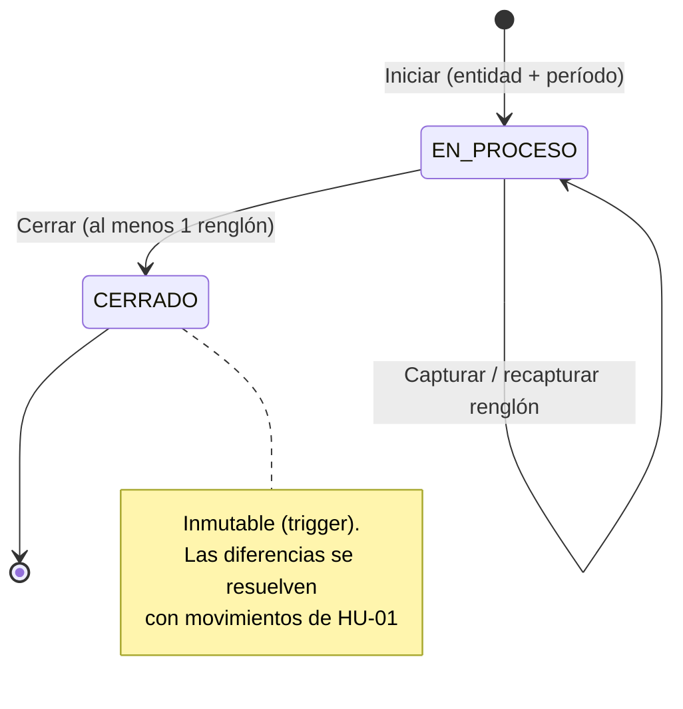

1. **Iniciar.** El usuario elige la entidad (un residente o el Hogar) y el período, por ejemplo del 1 al 30 de septiembre. Se crea el conteo `EN_PROCESO` y la pantalla lista los medicamentos con saldo de esa entidad como renglones pendientes.
2. **Capturar.** Frente al anaquel, el usuario escribe cuántas dosis hay de cada medicamento. Al guardar el renglón:
   - Se toma la **foto** del saldo registrado en ese instante (`cantidad_sistema`).
   - La base de datos calcula la `diferencia` (físico − registrado).
   - La pantalla la resalta: negativa = **faltante**, positiva = **sobrante**, 0 = cuadra.
   
   Si después se corrige el número contado, se recaptura el renglón y la foto se vuelve a tomar en ese momento. Un medicamento que aparece en el anaquel sin estar registrado se agrega como renglón con registrado 0.
3. **Revisar las diferencias.** El período sirve para investigar la causa: para un renglón con diferencia, la pantalla muestra los movimientos de esa entidad y ese medicamento dentro del período (consulta c de la sección 3.3). Así se ve, por ejemplo, si faltó registrar el consumo de unos días.
4. **Resolver.** Cada diferencia se aclara con un movimiento de HU-01. El renglón tiene el botón "Registrar baja" (faltante) o "Registrar entrada" (sobrante), que abre el formulario con entidad, medicamento y cantidad ya llenados. En una baja, el usuario elige el motivo real (merma, rotura, consumo no registrado…). En una entrada por sobrante, el origen se llena como `OTRO` y "entregado por" como "Conteo físico #2". En los dos casos, la nota del movimiento indica el conteo de origen ("Diferencia del conteo #2"). Si la diferencia fue un error de captura, basta con recapturar el renglón.
5. **Cerrar.** El usuario cierra el conteo cuando terminó de contar. Queda `CERRADO` con la fecha y hora de cierre, y los *triggers* de la sección 3.3 impiden modificarlo. Cerrar no exige que todas las diferencias estén resueltas: el conteo es la evidencia de lo que se encontró, y los movimientos son la evidencia de cómo se resolvió.

**Por qué no ajusta solo:** un ajuste automático escondería la causa de la diferencia y movería saldos sin un responsable ni un motivo. Al resolverla con un movimiento:
- Queda quién lo registró, cuándo y por qué.
- El saldo sigue siendo la suma de los movimientos, de modo que la conciliación de la sección 3.2 se mantiene.
- El reporte mensual muestra las mermas con su motivo.

**Ejemplo con el mock:** en el conteo 2 del Hogar se contaron 58 cápsulas de Omeprazol contra 59 registradas (diferencia −1). El operador revisa los movimientos de octubre, no encuentra una baja que la explique y registra desde el renglón una baja de 1 dosis con motivo `MERMA`. El saldo pasa a 58. El renglón del conteo conserva su foto (59 registradas, diferencia −1) como evidencia de lo que se encontró.

**Criterios de aceptación** (sobre el dataset mock de la sección 3.4)

```gherkin
Escenario: Continuar un conteo en proceso y ver diferencias
  Dado que inicié sesión como "operador.demo"
  Y que el conteo 2 del Hogar (1 al 15 de octubre de 2026) está EN_PROCESO
  Cuando lo abro
  Entonces veo Paracetamol y Aspirina Protect con diferencia 0
  Y Omeprazol con 58 contadas contra 59 registradas, diferencia −1, resaltada en rojo
  Y Losartán y Tempra aparecen como pendientes de contar

Escenario: Capturar un renglón que cuadra
  Cuando capturo 20 dosis de Losartán
  Entonces el renglón muestra 20 registradas y diferencia 0

Escenario: Cerrar el conteo
  Dado que ya capturé todos los renglones del conteo 2
  Cuando lo cierro
  Entonces el conteo queda CERRADO con la fecha y hora de cierre
  Y ya no puedo capturar ni modificar renglones
  Y las existencias del Hogar no cambian

Escenario: Resolver una diferencia
  Dado un conteo con Omeprazol −1
  Cuando elijo "Registrar baja" en ese renglón
  Entonces se abre el formulario de baja de HU-01 con el Hogar, Omeprazol y 1 dosis ya llenados
  Y al guardarlo con motivo MERMA el saldo de Omeprazol del Hogar queda en 58
  Y la nota del movimiento dice "Diferencia del conteo #2"
  Y el renglón del conteo conserva 59 registradas y diferencia −1

Escenario: Revisar los movimientos del período
  Dado un conteo con Omeprazol −1
  Cuando abro el detalle del renglón
  Entonces veo los movimientos de Omeprazol del Hogar entre el 1 y el 15 de octubre de 2026

Escenario: Consultar un conteo cerrado
  Cuando abro el conteo 1 de María (septiembre de 2026)
  Entonces veo Metformina con diferencia 0 y Atorvastatina con 0 contadas contra 1 registrada, diferencia −1
  Y no hay opciones para editarlo

Escenario: Cerrar sin renglones
  Dado un conteo nuevo sin renglones capturados
  Cuando intento cerrarlo
  Entonces veo el mensaje "Captura al menos un medicamento antes de cerrar el conteo"

Escenario: Usuario de solo lectura
  Dado que inicié sesión como "consulta.demo"
  Entonces puedo ver los conteos y sus diferencias, pero no iniciar, capturar ni cerrar
```

**Requisitos no funcionales:** la captura funciona en el celular, frente al anaquel: un campo numérico por renglón que se guarda al salir del campo (HTMX), sin perder lo capturado si se interrumpe.

**Definición de terminado:** tests de la diferencia calculada (18 contra 20 = −2, sección 2.6), test del *trigger* que impide modificar un conteo cerrado, test de permisos, y el paso 6 del guion de demo (sección 3.4) ejecutado de extremo a extremo con Playwright.

**Documentación proceso para esta seccion:** [05-historias-usuario.md](05-historias-usuario.md)

---

## 6. Tickets de Trabajo

> Documenta 3 de los tickets de trabajo principales del desarrollo, uno de backend, uno de frontend, y uno de bases de datos. Da todo el detalle requerido para desarrollar la tarea de inicio a fin teniendo en cuenta las buenas prácticas al respecto. 

Los 3 tickets forman el camino crítico del MVP: el esquema que guarda los saldos, la lógica que los mueve y la pantalla que los muestra. Cada uno se desarrolla en su propia rama y se integra con un *pull request* (sección 7).

Cada ticket tiene además una **guía paso a paso** en [`docs/tickets/`](docs/tickets/), pensada para que un desarrollador junior lo implemente sin bloqueos: tareas en orden, archivos a crear, código de referencia, tests con ejemplos, criterios de calidad, comandos de verificación con su resultado esperado y una tabla de problemas frecuentes.

Antes de los 3, 9 **tickets de habilitación** (HB-01 a HB-09, semanas 1 y 2) dejan listos los contenedores, la conexión con los 2 usuarios de base de datos, los modelos de catálogo, residentes y pautas, el login y los habilitadores del panel `/admin/` (sección 5). Al final, un décimo (HB-10, semana 6) lleva el sistema al servidor del hogar con sus respaldos y prepara la demo en una máquina local. Tienen el mismo formato y su propia guía, y su detalle está al final de esta sección.

| Ticket | Tipo | Historia | Puntos | Depende de | Bloquea a |
|---|---|---|---|---|---|
| TK-01 | Base de datos | Base de HU-01, HU-02 y HU-03 | 5 | HB-03 y HB-05 a HB-08 (usuarios de BD, catálogo, residentes, pautas y grupos) | TK-02, TK-03, TK-06 |
| TK-02 | Backend | HU-01 | 5 | TK-01 | TK-04, TK-06 |
| TK-03 | Frontend | HU-02 | 3 | TK-01 (y TK-02 para tener saldos reales) | TK-05 |

**Estimación:** escala Fibonacci (1, 2, 3, 5, 8), relativa a la complejidad, al riesgo y al esfuerzo. TK-01 y los tickets de habilitación son trabajo de base que las estimaciones de las historias no incluían, así que el MVP suma **54 puntos**: 21 de las historias, 5 de TK-01 y 28 de habilitación.

**Backlog del MVP** (tickets restantes, se detallan al planear su sprint):

| Ticket | Tipo | Historia | Puntos | Depende de | Alcance |
|---|---|---|---|---|---|
| TK-04 | Frontend + vistas | HU-01 | 3 | TK-02 | Formularios de entrada, transferencia y baja; historial de movimientos por entidad con el botón "Corregir"; patrón *Post/Redirect/Get* y botón deshabilitado contra el doble envío |
| TK-05 | Backend (API) | HU-02 | 2 | TK-03 | `GET /api/v1/existencias` con DRF sobre el selector de TK-03, manejador de errores Problem Details y tests de contrato contra `openapi.yaml` |
| TK-06 | Backend | HU-03 | 3 | TK-01, TK-02 | Servicio de conteos: iniciar, capturar con foto del saldo, recapturar y cerrar, con sus excepciones (`CONTEO_CERRADO`, `CONTEO_SIN_RENGLONES`) |
| TK-07 | Frontend | HU-03 | 5 | TK-04, TK-06 | Pantallas del conteo: captura en el celular que guarda al salir del campo, diferencias resaltadas, movimientos del período y "Registrar baja/entrada" desde el renglón |

| Historia | Puntos | Tickets |
|---|---|---|
| HU-01 | 8 | TK-02 (5) + TK-04 (3) |
| HU-02 | 5 | TK-03 (3) + TK-05 (2) |
| HU-03 | 8 | TK-06 (3) + TK-07 (5) |
| Base | 5 | TK-01 (5) |
| Habilitación | 28 | HB-01 a HB-10 (tabla siguiente) |
| **Total** | **54** | 13 en los 3 tickets documentados abajo + 13 en el backlog + 28 de habilitación |

Quedan fuera de esta cuenta los endpoints `GET /medicamentos` y `GET /reportes/mensual`, que se estimarán con la historia de reportes.

**Tickets de habilitación** (semanas 1 y 2, y HB-10 en la semana 6; detalle al final de esta sección):

| Ticket | Tipo | Alcance | Puntos | Depende de | Bloquea a | Guía |
|---|---|---|---|---|---|---|
| HB-01 | Infraestructura | Servicio `db` (PostgreSQL 17), volumen `pgdata` y los 2 usuarios de BD | 2 | — | HB-02 | [HB-01](docs/tickets/HB-01-postgresql.md) |
| HB-02 | Infraestructura | Proyecto Django, `Dockerfile` y servicio `web` | 3 | HB-01 | HB-03 | [HB-02](docs/tickets/HB-02-imagen-web.md) |
| HB-03 | Infraestructura + BD | Conexión con variables `DB_*`, `web` como `app_user`, `migrate.sh`, modelo `Usuario` y privilegios | 3 | HB-02 | HB-04, HB-05 | [HB-03](docs/tickets/HB-03-conexion-bd.md) |
| HB-04 | Infraestructura | Servicio `nginx` con HTTPS local y cabeceras de seguridad | 2 | HB-03 | HB-08, TK-03 | [HB-04](docs/tickets/HB-04-nginx.md) |
| HB-05 | Base de datos | Catálogo (D2), extensiones, `f_unaccent` e índices trigram | 3 | HB-03 | HB-06 | [HB-05](docs/tickets/HB-05-catalogo.md) |
| HB-06 | Base de datos | Entidades: Hogar y residentes (D3) | 3 | HB-05 | HB-07, HB-08 | [HB-06](docs/tickets/HB-06-entidades.md) |
| HB-07 | Base de datos | Esquema de pautas (D6), sin pantallas | 2 | HB-06 | TK-01 | [HB-07](docs/tickets/HB-07-pautas.md) |
| HB-08 | Backend + frontend | Login, `base.html`, los 2 grupos, usuarios en `/admin/` y `django-axes` | 3 | HB-04, HB-06 | HB-09, TK-01, TK-03 | [HB-08](docs/tickets/HB-08-login-grupos.md) |
| HB-09 | Panel `/admin/` | Catálogo y residentes en el panel, sin borrado y con búsqueda sin acentos | 2 | HB-08 | — | [HB-09](docs/tickets/HB-09-admin-catalogo-residentes.md) |
| HB-10 | Infraestructura + operación | Despliegue en el servidor del hogar, respaldos cifrados con restauración probada y demo en una máquina local | 5 | TK-01 (y el MVP integrado, para instalar en el hogar) | — | [HB-10](docs/tickets/HB-10-despliegue-hogar.md) |

**Definición de hecho común** (aplica a todos los tickets, TK y HB, además de la propia de cada uno):
- El código pasa `ruff check` y `ruff format --check`, las plantillas pasan `djlint --check` y `djlint --lint`, y no hay `print` ni código comentado. No hay formateador de CSS ni de JS: el proyecto solo usa los de Bootstrap y HTMX, ya minificados en `static/*/vendor/`, que no se reformatean.
- CI en verde: lint, `python manage.py makemigrations --check` y `pytest` contra PostgreSQL 17 (cada *job* se activa cuando existe lo que necesita, sección 7.3).
- Cobertura ≥ 80 % en `apps/` (la exige el CI), más el umbral propio del ticket (sección 2.6).
- *Pull request* revisado y aprobado, con la descripción, cómo probarlo y el enlace al ticket. Se integra a `main` con *squash merge*.
- No hay secretos en el código ni datos personales en los logs (LFPDPPP).
- La documentación afectada del `readme.md` está actualizada.

#### Orden de ejecución

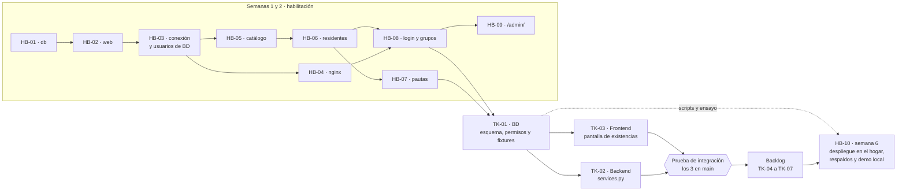

0. **Habilitación primero, en el orden del diagrama.** Cada ticket HB se integra a `main` antes de empezar los que dependen de él. Después de HB-03, HB-04 (nginx) y la cadena HB-05 → HB-07 pueden avanzar en paralelo. HB-09 no bloquea a TK-01: puede integrarse mientras TK-01 avanza.
1. **TK-01 después de HB-07 y HB-08, y sin paralelo entre los TK.** Crea las tablas, los permisos de los grupos y los *fixtures* de prueba que usan los otros 2. Se integra a `main` antes de empezar TK-02 o TK-03.
2. **TK-02 y TK-03 pueden avanzar en paralelo.** TK-03 se desarrolla con los saldos del mock y no necesita el servicio. Con un solo desarrollador, va primero TK-02, porque está en el camino crítico de TK-04 y TK-06.
3. **Orden de integración: TK-01 → TK-02 → TK-03.** El último en integrar hace `git rebase main`, ejecuta la **prueba de integración** (más abajo) en su rama y la deja en el repositorio. Desde ahí corre en CI en cada PR.
4. **HB-10 al final, en la semana 6.** Sus scripts y el ensayo en el equipo de desarrollo (parte A de la guía) pueden hacerse desde que TK-01 está en `main`, porque usan su `Makefile` y su lectura de `.env`. La instalación en el servidor del hogar (parte B) espera al MVP integrado, con la prueba de integración y los e2e en verde. La demo local (parte C) usa el mock de TK-01. Conviene adelantar la parte A: la semana 6 es la última, y la parte B necesita una noche para comprobar el cron.

**Archivos que tocan varios tickets** (reglas para evitar conflictos):

| Archivo | TK-01 | TK-02 | TK-03 | Regla |
|---|---|---|---|---|
| `app/conftest.py`, `app/pruebas.py` | Agrega los *fixtures* y `saldo` | Solo los usa | Solo los usa | Los crea HB-03 (`conftest.py` vacío y `ejecutar_sql`). Después, solo TK-01 los modifica. Un *fixture* nuevo se pide en el PR de TK-01 o en uno propio |
| `apps/inventario/migrations/` | `0001` a `0004` | — | — | TK-02 y TK-03 no crean migraciones. Si alguno la necesita, se renumera después del *rebase* |
| `config/settings/base.py` | — | — | `django_htmx`, `LOGIN_REDIRECT_URL` | Lo crea HB-02 y lo completan HB-03 a HB-08 (`DATABASES` es de HB-03). Cambios en bloques distintos |
| `requirements.txt` / `requirements-dev.txt` | — | — | `django-htmx` / `pytest-playwright` | Los crea HB-02 (`djlint`, `pytest`, `pytest-django`, `pytest-cov` y `ruff`); TK-05 agrega `jsonschema`. Una dependencia por línea, en orden alfabético |
| `docker-compose.yml`, `.env.example` | Descomenta `HOGAR_NOMBRE` en `.env.example` | — | — | Los crean HB-01 a HB-04 (y HB-06 agrega `HOGAR_NOMBRE`, comentada). Los tickets TK no los modifican, salvo TK-01 en esa línea. HB-10 solo cambia comentarios de `.env.example` |

#### Puntos de integración

Son los contratos entre las capas. Si un ticket cambia uno, avisa en su PR a los tickets que lo consumen.

| # | Punto de integración | Lo provee | Lo consume | Contrato | Cómo se verifica |
|---|---|---|---|---|---|
| 1 | Modelos `Existencia`, `Movimiento`, `MotivoBaja` | TK-01 | TK-02, TK-03 | Nombres de campos de la sección 3.2; `Movimiento.Tipo` y `Movimiento.OrigenEntrada`; relaciones `existencias` y `correcciones` | Los tests de TK-02 y TK-03 importan los modelos |
| 2 | Escritura de saldos | TK-02 | TK-03 | Solo `services.py` escribe `existencia.saldo` (≥ 0, 2 decimales) y `actualizado_en` en cada movimiento; TK-03 solo lee | `git grep` de TK-02 y prueba de integración |
| 3 | Restricciones de la base ↔ excepciones de dominio | TK-01 | TK-02 | El servicio valida antes de escribir; la base es la última barrera. `uq_movimiento_corrige` se traduce a `MovimientoYaCorregido` | Tests de esquema (TK-01) y de servicios (TK-02) |
| 4 | Privilegios de `app_user` | HB-03 (todas las tablas) y TK-01 (`movimiento`) | TK-02, TK-03 | La aplicación solo hace `SELECT`/`INSERT` en `movimiento`, sin `FOR UPDATE` sobre esa tabla | Los tests de TK-02 y la prueba de integración corren como `app_user` |
| 5 | Permisos de los grupos | TK-01 (migración `0003`, sobre los grupos de HB-08) | TK-03 (y TK-04) | Los 2 grupos tienen `view_existencia`; *Lectura y escritura* además `add_movimiento` | Tests de vista de TK-03 con `consulta.demo` |
| 6 | Búsqueda sin acentos | HB-05 (`f_unaccent`, índices trigram) | TK-03 | El ORM usa exactamente `f_unaccent(lower(campo))` | Plan de ejecución (TK-03, verificación 4) |
| 7 | *Fixtures* de prueba | TK-01 (`ejecutar_sql` desde HB-03) | TK-02, TK-03 | `datos_demo`, `demo`, `como_app_user`, `ejecutar_sql`, `saldo` | Los 3 tickets los usan sin modificarlos |
| 8 | Vista de conciliación | TK-01 | TK-02, prueba de integración | `v_conciliacion_existencia` vacía = todo cuadra | *Fixture* `autouse` de TK-02 |
| 9 | Selector `buscar_existencias` | TK-03 | TK-05 (API) | Argumentos por nombre, igual que los campos de `FiltroExistenciasForm`; devuelve un `QuerySet[Existencia]` ordenado | Tests de selector de TK-03 |
| 10 | Excepciones con `code` y `campo` | TK-02 | TK-04 (formularios), TK-05/V2 (API) | `code` igual a la sección 4.4; `DatoInvalido.campo` indica qué campo del formulario marcar | Tests de servicios de TK-02 |
| 11 | `Entidad.activa` y `Entidad.__str__` | HB-06 | TK-01, TK-02, TK-03 | `activa`: el Hogar siempre, un residente solo si su estado es `ACTIVO`. `__str__`: nombre del Hogar o nombre completo del residente. Sin su fila en `residente`: no activa y `Entidad <id>`. En listas, con `select_related("residente")` | Requisitos previos de cada guía |
| 12 | Servicio de conteos y sus excepciones | TK-06 | TK-07 | `iniciar_conteo`, `capturar_renglon` y `cerrar_conteo` con argumentos por nombre; `ConteoCerrado` y `ConteoSinRenglones` con `code` de la sección 4.4; el conteo nunca ajusta existencias | Tests de servicio de TK-06 (PR 3, sección 7) |

#### Prueba de integración final

Comprueba que los 3 tickets funcionan juntos: lo que registra el servicio (TK-02), guardado con las reglas de la base (TK-01), aparece en la pantalla (TK-03). La escribe quien integra el último ticket, en `apps/inventario/tests/test_integracion.py`, y desde entonces corre en CI en cada PR. Código, pasos y resultado esperado: [`docs/tickets/integracion.md`](docs/tickets/integracion.md).

| # | Escenario (como `app_user`, con el mock) | Resultado esperado |
|---|---|---|
| 1 | Entrada de 30 Eutirox a Carmen y transferencia de 0.5 Omeprazol del Hogar a Carmen; se consulta la pantalla filtrada por Carmen | Eutirox 63, Exelon 3, Omeprazol "0.5 dosis" y Paracetamol 14 |
| 2 | Baja de 5 Atorvastatina de María (saldo 1) | `ExistenciaInsuficiente`; la pantalla sigue mostrando 1 |
| 3 | Baja de la última Atorvastatina de María | Desaparece de la búsqueda y reaparece como "Agotado" con "Incluir sin saldo" |
| 4 | Corrección de la entrada de Eutirox | La pantalla vuelve a mostrar 33 |
| 5 | Al final de cada escenario | `v_conciliacion_existencia` vacía |

Además, sobre una instalación desde cero (`docker compose down -v`, `migrate.sh` y el mock), se ejecutan la suite completa, los e2e de Playwright y una prueba de humo con curl (ver la guía).

#### Criterios de revisión de código

Quién revisa: el Tech Lead, o, si el autor es el único desarrollador, el propio autor al día siguiente con esta lista más la revisión del subagente `adversarial-reviewer`, registrada en el PR. Se aprueba solo si no queda ningún comentario **bloqueante**.

| Ámbito | El revisor comprueba que… | Severidad si falla |
|---|---|---|
| Alcance | El PR hace solo lo del ticket y cumple todos sus criterios de aceptación | Bloqueante |
| Tamaño | Menos de ~400 líneas sin contar migraciones generadas ni plantillas; si no, se divide | Sugerencia |
| Tests | Cada criterio de aceptación tiene un test; los tests fallan si se quita el código que prueban | Bloqueante |
| Integración | No cambia un punto de integración sin avisar; la prueba de integración pasa | Bloqueante |
| Seguridad | Sin secretos, sin datos personales en logs, permisos validados en el servidor, sin el filtro `safe` ni SQL armado con texto del usuario | Bloqueante |
| Datos | Cantidades en `Decimal`; escrituras de inventario solo por `services.py`, dentro de una transacción | Bloqueante |
| **Infra** (HB-01 a HB-04) | Sin secretos en el repositorio, en la imagen ni en Compose; solo `nginx` publica puertos; `web` corre sin `root` y solo recibe sus variables; imágenes y dependencias con versión fija | Bloqueante |
| **BD** (TK-01, HB-03, HB-05 a HB-07) | Nombres idénticos a las secciones 3.1 y 3.3; toda migración reversible; `sqlmigrate` revisado; sin índices duplicados; privilegios de `app_user` intactos | Bloqueante |
| **Backend** (TK-02, TK-06) | Bloqueo en orden fijo; sin `FOR UPDATE` sobre `movimiento`; cada excepción con su `code`; el servicio valida antes de que actúe un *trigger* (el usuario nunca ve un `500` por una regla de negocio); *docstrings* con ejemplo | Bloqueante |
| **Frontend** (TK-03, HB-08, HB-09) | Sin JavaScript en línea (CSP); `<label>` en cada campo; *responsive* a 390 px; la vista sin lógica de búsqueda; sin N+1 | Bloqueante |
| Legibilidad | Nombres y comentarios en español, como el resto del código; funciones cortas; sin código muerto | Sugerencia |
| Documentación | El readme refleja cualquier cambio de diseño | Bloqueante si cambia un contrato |

Los comentarios se marcan como **[bloqueante]**, **[sugerencia]** o **[nit]** (detalle menor). El autor responde cada uno: lo corrige o explica por qué no.

---

**Ticket 1**

**TK-01 · [BD] Esquema de existencias, movimientos y conteos, con restricciones, *triggers* e índices**

| Campo | Valor |
|---|---|
| Tipo | Base de datos |
| Historias | HU-01 (movimientos), HU-02 (consulta de existencias), HU-03 (conteos) |
| Prioridad | Must, camino crítico |
| Estimación | **5 puntos** |
| Rama | `feature/TK-01-esquema-inventario` |
| Depende de | HB-03 (`Usuario`, los 2 usuarios de BD y los privilegios de `app_user`), HB-05 a HB-07 (`Medicamento`, `Entidad`, `Residente`, `Pauta`, extensiones y `f_unaccent`) y HB-08 (los 2 grupos) |

**Guía paso a paso:** [`docs/tickets/TK-01-esquema-inventario.md`](docs/tickets/TK-01-esquema-inventario.md). Incluye tareas, archivos, código, tests con ejemplos, criterios de calidad y comandos de verificación.

**Contexto.** Las 3 historias dependen de que el saldo sea confiable. Este ticket lleva a migraciones de Django las tablas D4, D5 y de conteos de la sección 3, para que la base de datos sea la **última barrera**: aunque un error de código intente dejar un saldo negativo o editar un movimiento, PostgreSQL lo rechaza.

**Descripción técnica**

**Tecnologías y librerías**

| Tecnología | Versión | Uso en este ticket |
|---|---|---|
| PostgreSQL | 17 (`postgres:17-alpine`) | Tablas, `CHECK`, `UNIQUE`, columna generada, índices parciales, `INCLUDE` y BRIN, *triggers* en PL/pgSQL, vista de conciliación |
| Extensiones `pg_trgm`, `unaccent`, `btree_gist` | Las de PostgreSQL 17 | Ya instaladas en HB-05; este ticket las usa en índices y restricciones |
| Django ORM y migraciones | Django 5.2 LTS | `CheckConstraint(condition=...)`, `UniqueConstraint`, `GeneratedField`, `db_default`, `Index(include=..., condition=...)`, `RunSQL` y `RunPython` |
| `django.contrib.postgres` | Incluido en Django | `BrinIndex` |
| psycopg | 3.x (`psycopg[binary]`) | Controlador de PostgreSQL de Django |
| pytest + pytest-django | Las del proyecto (sección 2.6) | Tests de esquema y de privilegios |

No agrega dependencias nuevas.

1. **Modelos** (`apps/inventario/models.py` y `apps/conteos/models.py`), con los tipos y nombres de la sección 3.2:

   | Modelo | Tabla | Puntos clave |
   |---|---|---|
   | `MotivoBaja` | `motivo_baja` | `clave` única; `activo` |
   | `Existencia` | `existencia` | `saldo` `DecimalField(10, 2)`, `db_default=0`; `actualizado_en` `db_default=Now()` |
   | `Movimiento` | `movimiento` | `tipo` con `TextChoices`; `cantidad` `DecimalField(10, 2)`; `corrige_a` `ForeignKey('self', null=True, on_delete=PROTECT)` con la restricción `uq_movimiento_corrige` (así conserva el nombre del DDL); `fecha_hora` `db_default=Now()` |
   | `ConteoFisico` | `conteo_fisico` | `estado` con `TextChoices`, `db_default='EN_PROCESO'`; `cerrado_en` nullable |
   | `DetalleConteo` | `detalle_conteo` | `diferencia = GeneratedField(expression=F('cantidad_fisica') - F('cantidad_sistema'), output_field=DecimalField(10, 2), db_persist=True)` |

   - Todas las FK con `on_delete=PROTECT` (`ON DELETE RESTRICT`).
   - `db_index=False` en las FK cubiertas por un índice compuesto (tabla "Índices de FK que Django no debe crear", sección 3.3).
   - `Meta.db_table` con el nombre en español de la sección 3. Los modelos no tienen `save()` ni `delete()` personalizados: la lógica vive en `services.py` (TK-02).

2. **Restricciones declarativas** en `Meta.constraints`, con los mismos nombres del DDL para que los errores sean reconocibles:
   - `uq_existencia` y `ck_existencia_saldo`.
   - `ck_movimiento_por_tipo` (con `Q` por tipo, idéntico al DDL de la sección 3.1), `ck_movimiento_cantidad`, `ck_movimiento_entregado` y `ck_movimiento_no_autocorrige`.
   - `ck_conteo_periodo`, `ck_conteo_cierre`, `uq_detalle_conteo`, `ck_detalle_fisica` y `ck_detalle_sistema`.

3. **Índices** en `Meta.indexes`: los de `existencia`, `movimiento`, `conteo_fisico` y `detalle_conteo` de la sección 3.3, incluidos los parciales, el `INCLUDE` y `BrinIndex(fields=['fecha_hora'], name='brin_movimiento_fecha')`.

4. **Migraciones `RunSQL`** (`inventario/migrations/0004_sql.py` y `conteos/migrations/0002_triggers.py`), cada sentencia con su `reverse_sql`:
   - `fn_movimiento_inmutable` + `tg_movimiento_inmutable`.
   - `fn_movimiento_validar_destino` + `tg_movimiento_validar_destino`.
   - `fn_conteo_cerrado` + `tg_conteo_cerrado`, y `fn_detalle_conteo_cerrado` + `tg_detalle_conteo_cerrado`.
   - `fn_medicamento_baja_sin_existencias` + `tg_medicamento_baja` (sección 3.3). Es del catálogo, pero consulta `existencia`, así que nace con esa tabla.
   - `ALTER TABLE existencia SET (fillfactor = 90)`.
   - Vista de conciliación: devuelve las existencias cuyo saldo no coincide con la suma de sus movimientos. Vacía = todo cuadra.

     ```sql
     CREATE VIEW v_conciliacion_existencia AS
     WITH suma AS (
         SELECT entidad_destino_id AS entidad_id, medicamento_id, cantidad FROM movimiento
          WHERE entidad_destino_id IS NOT NULL
         UNION ALL
         SELECT entidad_origen_id, medicamento_id, -cantidad FROM movimiento
          WHERE entidad_origen_id IS NOT NULL
     )
     SELECT coalesce(e.entidad_id, s.entidad_id)         AS entidad_id,
            coalesce(e.medicamento_id, s.medicamento_id) AS medicamento_id,
            coalesce(e.saldo, 0)                         AS saldo,
            coalesce(s.total, 0)                         AS suma_movimientos
     FROM existencia e
     FULL JOIN (SELECT entidad_id, medicamento_id, sum(cantidad) AS total
                FROM suma GROUP BY 1, 2) s
       ON s.entidad_id = e.entidad_id AND s.medicamento_id = e.medicamento_id
     WHERE coalesce(e.saldo, 0) <> coalesce(s.total, 0);
     ```

5. **Dos usuarios de base de datos y privilegios mínimos.** La inmutabilidad solo es real si la aplicación **no** se conecta con el dueño de las tablas: el dueño puede volver a darse permisos (`GRANT`) o desactivar el *trigger* (`ALTER TABLE ... DISABLE TRIGGER`). Por eso hay 2 usuarios, con el **mismo nombre en todos los entornos** (solo cambian las contraseñas). Así las migraciones son deterministas:

   | Usuario | Lo usa | Puede | No puede |
   |---|---|---|---|
   | `app_owner` | `migrate`, la carga del mock y los tests | Crear y modificar tablas; es dueño de la base y del esquema `public` | — |
   | `app_user` | La aplicación (`web`) en tiempo de ejecución | `SELECT`, `INSERT`, `UPDATE` y `DELETE` en las tablas | `UPDATE`, `DELETE` ni `TRUNCATE` en `movimiento`; crear o alterar tablas; desactivar *triggers* |

   Los 2 usuarios y los privilegios generales **ya existen** cuando empieza este ticket:
   - **HB-01**, `db/init/01_roles.sh`: script de inicio del contenedor de PostgreSQL, montado en `/docker-entrypoint-initdb.d/`. Crea los 2 usuarios con las contraseñas de `.env` (`DB_OWNER_PASSWORD`, `DB_APP_PASSWORD`), deja a `app_owner` como dueño de la base y le da a `app_user` solo `CONNECT` y `USAGE` en el esquema. Con `GRANT app_user TO app_owner`, los tests pueden actuar como `app_user` (`SET ROLE`); esto no le da a `app_user` ningún permiso del dueño. Es idempotente. En desarrollo y CI, `app_owner` tiene además `CREATEDB` para que `pytest` cree la base de tests; en producción no lo tiene.
   - **HB-03**, migración `accounts/migrations/0002_privilegios.py` (`RunSQL`, ejecutada por `app_owner`): da a `app_user` `SELECT`, `INSERT`, `UPDATE` y `DELETE` sobre todas las tablas, también las que creen las migraciones siguientes (`ALTER DEFAULT PRIVILEGES`). Va en una migración, y no en el script de inicio, porque los permisos por defecto son de cada base: así también aplican en la base de tests que crea `pytest`.
   - **HB-03**, `scripts/migrate.sh`: ejecuta `migrate` con las credenciales de `app_owner`. El contenedor `web` arranca con `DB_USER=app_user`.

   Este ticket agrega lo propio de `movimiento`: **en su migración**, después de crear la tabla, `REVOKE UPDATE, DELETE, TRUNCATE ON movimiento FROM app_user;` (con su `reverse_sql`, que vuelve a dar esos permisos). Las tablas nuevas dependen de `accounts.0002_privilegios` para nacer con los permisos de `app_user`.

6. **Migración de datos** (`inventario/migrations/0002_motivos_baja.py`) de los 8 motivos de baja (`CONSUMO` … `CORRECCION`), idempotente con `update_or_create` por `clave` y con su función inversa.

7. **Permisos de los grupos** (`inventario/migrations/0003_permisos_grupos.py`): los grupos se crearon en HB-08, antes que estos modelos. La migración les asigna `view_existencia`, `view_movimiento` y `view_motivobaja`, y a *Lectura y escritura* además `add_movimiento`. Nadie recibe `change_movimiento` ni `delete_movimiento`.

8. **Admin:** ninguno de estos modelos se registra en `/admin/` (sección 5, "Controles"). Se agrega un test que lo verifica. Además, el formulario de `MedicamentoAdmin` (HB-09) rechaza desmarcar `activo` si el medicamento tiene existencias, con el mensaje de la sección 5. Esa validación necesita la tabla `existencia`, por eso va aquí.

9. **Fixtures de prueba compartidos** (punto de integración 7): `datos_demo` (carga el mock con `cargar_mock.sql` adaptado), `demo` (accesos a entidades, medicamentos, motivos y usuario), `como_app_user` (el test corre con los permisos de la aplicación; falla si no hay transacción envolvente, para no correr en silencio como `app_owner`) y el helper `saldo`, junto a `ejecutar_sql` (de HB-03). TK-02 y TK-03 los usan sin modificarlos.

10. **`Makefile` de la raíz:** atajos de desarrollo local (`make up`, `make migrate`, `make test`, `make mock`…) sobre los mismos comandos de la guía, con `make help` como punto de entrada. Se crea en este ticket porque es el primero en que todos sus comandos funcionan (`make mock` necesita las tablas de inventario y `make test` los *fixtures*). El CI no lo usa. Como fija cómo se lee `.env`, este ticket también hace que admita valores con espacios sin comillas: `HOGAR_NOMBRE` (HB-06) quedó comentada en `.env.example` porque `. ./.env` (`scripts/migrate.sh` y los atajos `dtest`, `dj` y `dpsql`) la rompe, y así el servidor del hogar puede poner su nombre real.

**Fuera de alcance:** la lógica de negocio (TK-02), las pantallas y la API, los usuarios de base de datos (HB-01 y HB-03) y las tablas de catálogo, entidades y pautas (HB-05 a HB-07).

**Criterios de aceptación**
- [ ] `python manage.py migrate` crea el esquema en una base vacía, y `migrate inventario zero` y `migrate conteos zero` lo revierten sin errores.
- [ ] `makemigrations --check` no detecta cambios pendientes.
- [ ] `make help` lista los 17 comandos, y `make migrate`, `make test` y `make mock` hacen lo mismo que sus comandos directos.
- [ ] Un valor con espacios y sin comillas en `.env`, como `HOGAR_NOMBRE=Hogar Gerontológico Demo`, funciona con `make`, con `scripts/migrate.sh` y los atajos, y con `docker compose`; `.env.example` lo trae sin comentar, y en una base nueva el Hogar queda con ese nombre.
- [ ] `\d movimiento` en `psql` muestra todas las restricciones e índices de las secciones 3.1 y 3.3 con sus nombres exactos.
- [ ] Sin índices duplicados: ninguna FK de la tabla de la sección 3.3 tiene un índice propio además del compuesto.
- [ ] El mock de la sección 3.4 se carga con `cargar_mock.sql` sin errores, y `SELECT count(*) FROM v_conciliacion_existencia` devuelve 0.
- [ ] Cada regla de la base de datos rechaza su caso inválido:

  | Caso | Resultado esperado |
  |---|---|
  | `UPDATE movimiento SET cantidad = 1 WHERE id = 1` | Error del *trigger*: "Los movimientos son inmutables…" |
  | `DELETE FROM movimiento WHERE id = 1` | Error del *trigger* |
  | Entrada sin `entidad_destino_id` | Viola `ck_movimiento_por_tipo` |
  | Baja sin `motivo_baja_id` | Viola `ck_movimiento_por_tipo` |
  | Transferencia con origen = destino | Viola `ck_movimiento_por_tipo` |
  | `cantidad = 0` | Viola `ck_movimiento_cantidad` |
  | Segunda corrección del mismo movimiento | Viola `uq_movimiento_corrige` |
  | `UPDATE existencia SET saldo = -1` | Viola `ck_existencia_saldo` |
  | Entrada a un residente egresado | Error de `tg_movimiento_validar_destino` |
  | Insertar un renglón en el conteo 1 (cerrado) | Error de `tg_detalle_conteo_cerrado` |
  | Desmarcar `activo` de un medicamento con existencias | Error de `tg_medicamento_baja`; en el panel, el mensaje del formulario |
  | `UPDATE detalle_conteo SET diferencia = 0` | Error: columna generada |
  | Como `app_user`: `UPDATE`, `DELETE` o `TRUNCATE` sobre `movimiento` | `permission denied for table movimiento` |
  | Como `app_user`: `ALTER TABLE movimiento DISABLE TRIGGER ALL` | `must be owner of table movimiento` |

- [ ] El dueño de todas las tablas es `app_owner`, y `app_user` conserva `SELECT` e `INSERT` sobre `movimiento` y los 4 permisos sobre las demás tablas.
- [ ] En una instalación nueva (`docker compose down -v` y `up`), los 2 usuarios se crean solos, y `scripts/migrate.sh` deja la base lista para que `web` arranque como `app_user`.

- [ ] Con datos sintéticos de un año (175,000 movimientos), `EXPLAIN (ANALYZE, BUFFERS)` de las consultas 1c y 2 de la sección 3.3 usa sus índices, sin *Seq Scan* sobre `movimiento`.

**Pruebas**
- `apps/inventario/tests/test_esquema.py` y `apps/conteos/tests/test_esquema.py`: un test por fila de la tabla anterior, con `pytest.raises(IntegrityError)` o `InternalError` y verificación del nombre de la restricción en el mensaje.
- Test de migraciones: aplicar y revertir hasta `zero` en CI.
- Test que comprueba que `admin.site` no tiene registrados `Movimiento`, `Existencia`, `ConteoFisico` ni `DetalleConteo`.
- `apps/accounts/tests/test_privilegios.py` (lo crea HB-03 con los tests de dueño y permisos generales): este ticket agrega los de `movimiento`. Consulta `has_table_privilege('app_user', 'movimiento', 'UPDATE' | 'DELETE' | 'TRUNCATE')` (falso) y `'INSERT'` (verdadero), y ejecuta las 2 filas de `app_user` de la tabla anterior con una conexión como `app_user` (`SET ROLE app_user` dentro de la transacción del test).
- CI: el servicio de PostgreSQL ejecuta `db/init/01_roles.sh` antes de los tests, igual que en desarrollo.
- Test de plan de ejecución: `connection.cursor().execute('EXPLAIN …')` y verificación del nombre del índice en el plan (marcado `@pytest.mark.lento`, corre en CI nocturno).

**Definición de hecho**
- [ ] Criterios de aceptación cumplidos y definición de hecho común.
- [ ] Migraciones revisadas línea por línea en el PR: el SQL generado (`sqlmigrate`) coincide con el DDL de las secciones 3.1 y 3.3.
- [ ] El `Makefile` y sus comandos documentados en la sección 1.4.
- [ ] El diagrama ER de la sección 3.1 sigue siendo fiel al esquema; si algo cambió, se actualizó.

**Riesgos**
- `GeneratedField` y `db_default` requieren Django ≥ 5.0: ya cubierto con Django 5.2 LTS.
- Los *triggers* no se ven desde el ORM: se mitigan con los tests de esquema y con la vista de conciliación.

---

**Ticket 2**

**TK-02 · [Backend] Servicio de movimientos de inventario: entradas, transferencias, bajas y correcciones**

| Campo | Valor |
|---|---|
| Tipo | Backend |
| Historia | HU-01 |
| Prioridad | Must, camino crítico |
| Estimación | **5 puntos** |
| Rama | `feature/TK-02-servicio-movimientos` |
| Depende de | TK-01 |

**Guía paso a paso:** [`docs/tickets/TK-02-servicio-movimientos.md`](docs/tickets/TK-02-servicio-movimientos.md).

**Contexto.** HU-01 exige que cada movimiento actualice el saldo de forma atómica, que ningún saldo quede negativo ni con usuarios concurrentes, y que los errores se corrijan con el movimiento inverso. Este ticket construye la capa `services.py`, que es **el único punto del sistema que escribe en `movimiento` y `existencia`**. Las pantallas de HU-01, el conteo de HU-03 y la API V2 la reutilizan.

**Descripción técnica**

**Tecnologías y librerías**

| Tecnología | Versión | Uso en este ticket |
|---|---|---|
| Python | 3.12 | `decimal.Decimal` para cantidades, `logging`, *type hints* |
| Django | 5.2 LTS | `transaction.atomic`, `select_for_update`, `bulk_create(ignore_conflicts=True)`, expresión `Now()` |
| PostgreSQL | 17 | Bloqueo de filas (`SELECT ... FOR UPDATE`), `INSERT ... ON CONFLICT DO NOTHING`, nivel de aislamiento *read committed* |
| pytest + pytest-django | Las del proyecto | `django_db(transaction=True, serialized_rollback=True)` para los tests con hilos |
| `threading` y `concurrent.futures` | Biblioteca estándar | Tests de concurrencia y de *deadlocks* |
| pytest-cov | Última estable, fijada en `requirements-dev.txt` | Cobertura de `services.py` y `exceptions.py` (**dependencia nueva de desarrollo**, si no estaba) |

1. **Excepciones de dominio** (`apps/inventario/exceptions.py`). Cada una lleva un `code` igual al del contrato de la API (sección 4.4) y un mensaje para el usuario:

   | Excepción | `code` | Cuándo |
   |---|---|---|
   | `ErrorInventario` | — | Base de todas |
   | `DatoInvalido` | `VALIDACION` | Falta un dato obligatorio (origen de la entrada, quién entregó) o tiene un valor no permitido (motivo inactivo) |
   | `CantidadInvalida` | `VALIDACION` | Subclase de `DatoInvalido`: cantidad ≤ 0, con más de 2 decimales o fuera de rango |
   | `ExistenciaInsuficiente` | `EXISTENCIA_INSUFICIENTE` | El origen no tiene saldo suficiente. Incluye el disponible |
   | `MismaEntidad` | `MISMA_ENTIDAD` | Transferencia con origen = destino |
   | `EntidadInactiva` | `ENTIDAD_INACTIVA` | Destino egresado o fallecido (salvo correcciones) |
   | `MedicamentoInactivo` | `MEDICAMENTO_INACTIVO` | Medicamento dado de baja (salvo correcciones) |
   | `MotivoReservado` | `MOTIVO_RESERVADO` | Baja manual con el motivo `CORRECCION` |
   | `MovimientoYaCorregido` | `MOVIMIENTO_YA_CORREGIDO` | El movimiento ya tiene corrección |
   | `MovimientoEsCorreccion` | `MOVIMIENTO_ES_CORRECCION` | Se intenta corregir una corrección |

2. **Servicios** (`apps/inventario/services.py`). Funciones con argumentos solo por nombre. Cada una corre en `transaction.atomic()` y devuelve el `Movimiento` creado:

   ```python
   def registrar_entrada(*, usuario, destino, medicamento, cantidad,
                         origen_entrada, entregado_por, nota="") -> Movimiento: ...
   def transferir(*, usuario, origen, destino, medicamento, cantidad, nota="") -> Movimiento: ...
   def dar_de_baja(*, usuario, origen, medicamento, cantidad, motivo, nota="") -> Movimiento: ...
   def corregir(*, usuario, movimiento, nota="") -> Movimiento: ...
   ```

3. **Bloqueo de saldos sin carreras ni *deadlocks*.** Una función privada asegura que la fila de `existencia` exista y la bloquea:

   ```python
   def _bloquear_saldos(medicamento, *entidades) -> dict[int, Existencia]:
       # 1) Crea las filas que falten sin carrera: INSERT ... ON CONFLICT DO NOTHING
       Existencia.objects.bulk_create(
           [Existencia(entidad=e, medicamento=medicamento) for e in entidades],
           ignore_conflicts=True)
       # 2) SELECT ... FOR UPDATE en orden fijo (entidad_id): dos transferencias
       #    cruzadas (Hogar→Carmen y Carmen→Hogar) no se bloquean mutuamente
       filas = (Existencia.objects.select_for_update()
                .filter(medicamento=medicamento, entidad__in=entidades)
                .order_by("entidad_id"))
       return {f.entidad_id: f for f in filas}
   ```

   Después se valida el saldo con la fila ya bloqueada (`ExistenciaInsuficiente` si no alcanza), se actualizan `saldo` y `actualizado_en` con `save(update_fields=[...])` y se inserta el movimiento, todo en la misma transacción.

4. **Reglas por operación:**
   - **Validaciones previas** (antes de tocar la base, para dar mensajes claros): cantidad `Decimal` > 0 con máximo 2 decimales, entidades y medicamento activos, motivo distinto de `CORRECCION`, origen ≠ destino.
   - **Corrección:**

     | Movimiento original | Corrección generada |
     |---|---|
     | `ENTRADA` a X | `BAJA` desde X, motivo `CORRECCION` |
     | `BAJA` desde X | `ENTRADA` a X, sin origen de entrada ni entregado por |
     | `TRANSFERENCIA` X → Y | `TRANSFERENCIA` Y → X |

     La corrección lleva `corrige_a` al original y la misma cantidad y medicamento. Si el saldo ya no alcanza (por ejemplo, la entrada errónea ya se consumió), se lanza `ExistenciaInsuficiente`. Las correcciones quedan exentas de la regla de entidad o medicamento activo.
   - **Carrera en la corrección:** si dos usuarios corrigen el mismo movimiento a la vez, el `IntegrityError` de `uq_movimiento_corrige` se traduce a `MovimientoYaCorregido`. No se usa `select_for_update` sobre `movimiento`: PostgreSQL exige permiso de `UPDATE` para `FOR UPDATE`, y `app_user` no lo tiene.
   - **Los tests corren como `app_user`** (`SET LOCAL ROLE app_user`), igual que en producción, para detectar cualquier operación que necesite un permiso que la aplicación no tiene.

5. **Autorización.** El servicio no decide permisos: las vistas usan `PermissionRequiredMixin` con `inventario.add_movimiento` (sección 2.5). El servicio recibe `usuario` solo para registrar quién hizo el movimiento.

6. **Registro de eventos:** `logger.info("movimiento_registrado", extra={"movimiento_id", "tipo", "usuario_id"})`, sin nombres de residentes (LFPDPPP).

**Fuera de alcance:** formularios, vistas y plantillas de HU-01 (TK-04), la API V2 y la idempotencia por `Idempotency-Key`. En el MVP el doble envío se resuelve en la pantalla (sección 4.1).

**Criterios de aceptación** (con el mock de la sección 3.4)
- [ ] `registrar_entrada` de 30 dosis de Eutirox a Carmen, origen `FAMILIAR`, entregado por "Rosa Torres": el saldo pasa de 33 a 63 y el movimiento guarda usuario, fecha y hora, origen y quien entregó.
- [ ] `transferir` 10 de Paracetamol del Hogar a Carmen: Hogar 80 → 70, Carmen 14 → 24, y se crea 1 solo movimiento.
- [ ] `transferir` a una entidad sin fila previa de `existencia` la crea con el saldo transferido.
- [ ] `dar_de_baja` de 5 Atorvastatina de María (saldo 1) lanza `ExistenciaInsuficiente` con `disponible = 1`, y no se crea nada.
- [ ] `dar_de_baja` con motivo `CORRECCION` lanza `MotivoReservado`.
- [ ] `transferir` del Hogar al Hogar lanza `MismaEntidad`.
- [ ] `corregir` la entrada errónea de 600 de Metformina de María crea una baja `CORRECCION` de 600 que la referencia. Si se intenta de nuevo, lanza `MovimientoYaCorregido`, y corregir esa baja lanza `MovimientoEsCorreccion`.
- [ ] Una cantidad de `0.5` se acepta; `0.555` lanza `CantidadInvalida`.
- [ ] **Concurrencia:** 2 bajas simultáneas de 1 Atorvastatina (saldo 1), en hilos con conexiones separadas: una se aplica, la otra lanza `ExistenciaInsuficiente`, y el saldo final es 0.
- [ ] **Sin *deadlocks*:** 20 transferencias cruzadas simultáneas Hogar ↔ Carmen terminan todas, y los saldos finales cuadran.
- [ ] **Atomicidad:** si falla la inserción del movimiento, después de descontar el origen, el saldo del origen no cambia.
- [ ] Después de cada test, `v_conciliacion_existencia` está vacía.

**Pruebas**
- `apps/inventario/tests/test_services.py`: un test por criterio, sobre el mock con los *fixtures* `demo` y `como_app_user` de TK-01.
- `apps/inventario/tests/test_concurrencia.py`: `@pytest.mark.django_db(transaction=True, serialized_rollback=True)` con `threading` y `connection.close()` en cada hilo.
- Un *fixture* `autouse` que verifica la vista de conciliación al terminar cada test del módulo.

**Definición de hecho**
- [ ] Criterios de aceptación cumplidos y definición de hecho común.
- [ ] Cobertura ≥ 90 % en `services.py` y 100 % de las ramas de `exceptions.py`.
- [ ] Ningún otro módulo escribe en `Movimiento` ni en `Existencia`: verificado con `grep` en el PR (solo `services.py`, los tests y las migraciones).
- [ ] *Docstring* de cada función pública con reglas, excepciones y un ejemplo.
- [ ] Los tests de concurrencia corren en CI contra PostgreSQL real, no contra SQLite.

**Riesgos**
- Los tests de concurrencia pueden ser intermitentes: se usan barreras (`threading.Barrier`) para que los hilos arranquen juntos y un tiempo límite por test.
- `select_for_update` exige estar dentro de una transacción: lo garantiza `transaction.atomic()`, y lo verifica un test que llama al helper fuera de una transacción y espera un error.

---

**Ticket 3**

**TK-03 · [Frontend] Pantalla de consulta de existencias con filtros en vivo y diseño para celular**

| Campo | Valor |
|---|---|
| Tipo | Frontend (plantillas Django + Bootstrap 5 + HTMX) |
| Historia | HU-02 |
| Prioridad | Must |
| Estimación | **3 puntos** |
| Rama | `feature/TK-03-pantalla-existencias` |
| Depende de | TK-01. TK-02 para probar con saldos reales; para desarrollar basta con el mock |

**Guía paso a paso:** [`docs/tickets/TK-03-pantalla-existencias.md`](docs/tickets/TK-03-pantalla-existencias.md).

**Contexto.** Es la pantalla que más se usará: responde "¿cuánto le queda a este residente?". Se consulta desde la computadora de la dirección y desde el celular, a pie de anaquel. Será la **página de inicio** después del login.

**Descripción técnica**

**Tecnologías y librerías**

| Tecnología | Versión | Uso en este ticket |
|---|---|---|
| Django | 5.2 LTS | `ListView`, `LoginRequiredMixin`, `PermissionRequiredMixin`, formularios, filtro de plantilla propio y la etiqueta `` (Django 5.1+) |
| Bootstrap | 5.3.9 (de `base.html`, HB-08) | Rejilla *responsive*, tabla en escritorio y `list-group` en el celular, `d-md-none` / `d-md-table` |
| HTMX | 2.0.x, servido desde `static/` | `hx-get`, `hx-trigger` con espera, `hx-target`, `hx-push-url`, `hx-swap-oob`, `hx-indicator` |
| django-htmx | Última estable, fijada en `requirements.txt` | `request.htmx` y `HttpResponseClientRedirect` (**dependencia nueva**) |
| pytest-django | La del proyecto | Tests de selector y de vista (`client`, `CaptureQueriesContext`) |
| pytest-playwright + Chromium | Última estable, fijada en `requirements-dev.txt` | Pruebas de extremo a extremo: búsqueda en vivo, celular y teclado (**dependencia nueva de desarrollo**) |
| Lighthouse (Chrome DevTools) | El del navegador | Accesibilidad ≥ 90 |

1. **Consulta reutilizable** (`apps/inventario/selectors.py`): `buscar_existencias(*, entidad=None, medicamento=None, principio_activo=None, q=None, incluir_sin_saldo=False) -> QuerySet[Existencia]`.
   - `select_related("entidad", "entidad__residente", "medicamento", "medicamento__presentacion")`, para evitar N+1.
   - `q` busca en el nombre comercial y en los principios activos, con la expresión `f_unaccent(lower(...))` de la sección 3.3, para que se usen los índices trigram. El endpoint `GET /existencias` reutilizará esta función.
   - Orden: el Hogar primero (`entidad__tipo`: `HOGAR` < `RESIDENTE`), después el residente por apellido y nombre, y después el nombre comercial.

2. **Formulario de filtros** (`apps/inventario/forms.py`, `FiltroExistenciasForm`, por `GET`):

   | Campo | Control | Validación |
   |---|---|---|
   | `entidad` | `select`: "Todos", el Hogar y los residentes. Los egresados o fallecidos aparecen marcados, porque pueden tener sobrantes | Debe existir |
   | `principio_activo` | `select` | Debe existir |
   | `q` | `input type="search"`, `minlength=3`, `maxlength=100` | De 3 a 100 caracteres, recortado |
   | `incluir_sin_saldo` | `checkbox` "Incluir sin saldo" | Booleano |
   | `medicamento` | Oculto. Se llena al tocar el nombre de un medicamento en los resultados | Debe existir |

3. **Vista** (`apps/inventario/views.py`, `ExistenciasView`, `ListView`):
   - `LoginRequiredMixin` + `PermissionRequiredMixin("inventario.view_existencia")`: los 2 grupos pueden consultar.
   - Paginación de 20.
   - Si la petición viene de HTMX (`request.htmx`, de `django-htmx`), responde solo el fragmento `inventario/_resultados.html`. Si no, la página completa `inventario/existencias.html`, así la URL funciona sola, con el botón "Atrás" y al recargar.
   - Si `q` tiene 1 o 2 caracteres, responde la cabecera `HX-Reswap: none`, para que la lista no cambie, y muestra el aviso "Escribe al menos 3 caracteres" con `hx-swap-oob`.

4. **Interacción HTMX** en el formulario:

   ```html
   <form hx-get="" hx-target="#resultados"
         hx-trigger="input changed delay:300ms from:#id_q, change"
         hx-push-url="true" hx-indicator="#cargando">
   ```

   - La búsqueda se lanza 300 ms después de dejar de escribir, y al cambiar un `select` o el *checkbox*.
   - `hx-push-url` mantiene los filtros en la URL, así se puede compartir o guardar.
   - El contenedor `#resultados` tiene `aria-live="polite"`, para que un lector de pantalla anuncie el cambio.
   - Sin JavaScript propio en línea: HTMX se sirve desde `static/`, compatible con la `Content-Security-Policy` de Nginx (sección 2.5).

5. **Diseño *responsive*** (Bootstrap 5):
   - **≥ 768 px:** tabla con Entidad · Medicamento (nombre, presentación y concentración) · Saldo · Último movimiento.
   - **< 768 px:** cada existencia es una tarjeta (`list-group`) con el medicamento en negritas, la entidad debajo y el saldo alineado a la derecha. No hay desplazamiento horizontal.
   - **Formato:** saldo con el filtro propio `dosis` (`10`, `0.5`, `62`, sin ceros sobrantes) y la palabra "dosis"; saldo 0 en gris con la etiqueta "Agotado". Fecha en formato `d/m/Y H:i`, hora de `America/Mexico_City`.
   - **Estado vacío:** "No hay existencias que coincidan con la búsqueda", con el botón "Limpiar filtros".
   - Controles táctiles de al menos 44 × 44 px y etiquetas `<label>` visibles en todos los campos.

6. **Navegación:** la entrada "Existencias" en el menú de `base.html`, y `LOGIN_REDIRECT_URL` apuntando a esta pantalla.

**Fuera de alcance:** el endpoint `GET /api/v1/existencias` (TK-05, que reutiliza el selector), la exportación y los botones de registrar movimientos en cada renglón (llegan con TK-04).

**Criterios de aceptación** (con el mock de la sección 3.4)
- [ ] Como `consulta.demo`, al buscar "losartan" aparecen 3 renglones en este orden: Hogar · Losartán 20, José Luis · Cozaar 32, José Luis · Losartán 10. Hyzaar no aparece.
- [ ] Al filtrar por Carmen Torres Vega aparecen Eutirox 33, Exelon 3 y Paracetamol 14.
- [ ] "paracetamol" con "Incluir sin saldo" muestra Hogar · Paracetamol 80, Hogar · Tempra 0 ("Agotado") y Carmen · Paracetamol 14.
- [ ] "ACIDO" encuentra Aspirina Protect (Hogar 58), sin importar mayúsculas ni acentos.
- [ ] Al escribir "lo" aparece el aviso y la lista anterior no cambia; no se hace la consulta a la base de datos.
- [ ] "ibuprofeno" muestra el estado vacío con "Limpiar filtros".
- [ ] Los resultados se actualizan sin recargar la página, y la URL refleja los filtros. Al abrir esa URL en otra pestaña se ve el mismo resultado.
- [ ] Sin sesión, la pantalla redirige al login y, después de iniciar sesión, vuelve a la consulta.
- [ ] En un viewport de 390 × 844 (celular) no hay desplazamiento horizontal y se ven las tarjetas en lugar de la tabla.
- [ ] Sin N+1: la página hace el mismo número de consultas a la base de datos con 1 resultado que con todas las existencias del mock (13).
- [ ] Con el mock, la respuesta del fragmento tarda menos de 300 ms en el servidor local.

**Pruebas**
- `apps/inventario/tests/test_selectors.py`: los casos de búsqueda anteriores directamente contra `buscar_existencias`.
- `apps/inventario/tests/test_views_existencias.py`:
  - Página completa contra fragmento (cabecera `HX-Request`).
  - `q` corto con `HX-Reswap: none`.
  - Redirección sin sesión.
  - Mismo número de consultas con 1 y con 20 resultados (`django_assert_num_queries`).
- `app/e2e/conftest.py`: el servidor de pruebas (`live_server`) corre como `app_user`.
- `app/e2e/test_existencias.py` (Playwright), sin errores de JavaScript ni violaciones de CSP en la consola:
  - Escribir "losartan" y esperar 3 renglones.
  - Viewport de celular: `document.documentElement.scrollWidth <= window.innerWidth`.
  - Navegación solo con teclado por los filtros.

**Definición de hecho**
- [ ] Criterios de aceptación cumplidos y definición de hecho común.
- [ ] Revisado en Chrome y Firefox de escritorio, y en Chrome de Android (o su emulación) a 390 px.
- [ ] Sin errores en la consola del navegador ni violaciones de la CSP.
- [ ] Lighthouse: Accesibilidad ≥ 90 en la pantalla.
- [ ] Capturas de escritorio y de celular agregadas al PR y a la sección 1.3 del `readme.md`.

**Riesgos**
- Que la búsqueda no use el índice si la expresión del ORM no coincide exactamente con la del índice: se cubre con el test de plan de ejecución de TK-01 aplicado al selector.
- Tablas con nombres largos en el celular: se resuelve con las tarjetas y con `text-break`.

---

#### Tickets de habilitación (HB-01 a HB-10)

Dejan lista la base sobre la que se construyen TK-01 a TK-07: contenedores, conexión segura a la base de datos, modelos de catálogo, residentes y pautas, y los habilitadores del panel `/admin/` (sección 5). HB-10 cierra el MVP: lo instala en el servidor del hogar. Cada ticket tiene una guía paso a paso en [`docs/tickets/`](docs/tickets/) con tareas, archivos, código de referencia, tests con ejemplos, criterios de calidad, comandos de verificación y problemas frecuentes. Aplica además la definición de hecho común.

**Decisiones de diseño de la habilitación:**
- **Los 2 usuarios de base de datos existen desde el primer día** (HB-01 y HB-03), y no desde TK-01. Así la aplicación nunca corre como dueño de las tablas, y el CI, que ya los espera, funciona desde el primer ticket con código.
- **La conexión usa variables separadas** (`DB_HOST`, `DB_PORT`, `DB_NAME`, `DB_USER`, `DB_PASSWORD`) y no una sola `DATABASE_URL`. Los tests y `migrate.sh` cambian solo el usuario y la contraseña para conectarse como `app_owner`, y las contraseñas con caracteres especiales no necesitan codificarse para una URL. Son las mismas variables del CI.
- **Nginx entra en la semana 1** (HB-04), para probar el login y el panel por HTTPS desde el principio, con la CSP real.
- **Las pautas solo tienen esquema** (HB-07): son *Could*, pero el dataset mock inserta pautas y TK-01 lo carga.
- **El CI activa cada *job* cuando existe lo que necesita** (sección 7.3, regla 5): `lint` e `imagen` con `app/manage.py` (HB-02), `tests` con `app/conftest.py` (HB-03) y `e2e` con `app/e2e/` (TK-03).
- **El despliegue es un habilitador al final** (HB-10, semana 6): el plan lo daba por hecho sin ticket. Se escribe y se ensaya en el equipo de desarrollo después de TK-01, y se instala en el hogar con el MVP completo. Solo hay servidor del hogar y demo local, sin VPS ([ADR-0026](docs/adr/0026-despliegue-servidor-del-hogar-y-demo-local.md)).

---

**HB-01 · [Infra] Servicio de PostgreSQL y usuarios de base de datos**

| Campo | Valor |
|---|---|
| Tipo | Infraestructura |
| Prioridad | Must, habilitador (semana 1) |
| Estimación | **2 puntos** |
| Rama | `feature/HB-01-postgresql` |
| Depende de | — |
| Guía | [`docs/tickets/HB-01-postgresql.md`](docs/tickets/HB-01-postgresql.md) |

**Descripción técnica.** Crea `docker-compose.yml` con **solo** el servicio `db` (sección 2.4.1): imagen `postgres:17-alpine`, volumen `pgdata`, red `backend`, *healthcheck* con `pg_isready` y ningún puerto publicado. Monta `db/init/` en `/docker-entrypoint-initdb.d/` (solo lectura), donde `01_roles.sh` crea `app_owner` (dueño de la base y del esquema `public`, con `CREATEDB` solo si `DB_OWNER_CREATEDB=true`) y `app_user` (solo `CONNECT` y `USAGE`), de forma idempotente. Agrega `.env.example` con `POSTGRES_*`, `DB_OWNER_PASSWORD`, `DB_OWNER_CREATEDB` y `DB_APP_PASSWORD`, y un `.gitattributes` que fuerza LF en los `.sh`. Compose falla con un mensaje claro si falta una contraseña (`${VAR:?}`).

**Criterios de aceptación**
- [ ] `docker compose up -d db` deja `db` en `healthy` en menos de 30 s.
- [ ] Con un volumen nuevo, `\du` muestra `app_owner` (`Create DB` en desarrollo) y `app_user` sin atributos.
- [ ] `app_owner` es dueño de la base `hogar` y del esquema `public`.
- [ ] `app_user` se autentica por TCP con la contraseña de `.env` y no puede crear tablas (`permission denied for schema public`).
- [ ] Ejecutar `01_roles.sh` por segunda vez no da error.
- [ ] `docker compose port db 5432` no muestra ningún puerto publicado, y los datos sobreviven a `docker compose restart db`.

**Definición de hecho**
- [ ] `.env` fuera del repositorio; `.env.example` solo con valores de ejemplo.
- [ ] `01_roles.sh` con fin de línea LF y permiso de ejecución en Git.
- [ ] Salida de `\du` y del `CREATE TABLE` rechazado en el PR.

---

**HB-02 · [Infra] Proyecto Django, imagen y servicio `web`**

| Campo | Valor |
|---|---|
| Tipo | Infraestructura |
| Prioridad | Must, habilitador (semana 1) |
| Estimación | **3 puntos** |
| Rama | `feature/HB-02-imagen-web` |
| Depende de | HB-01 |
| Guía | [`docs/tickets/HB-02-imagen-web.md`](docs/tickets/HB-02-imagen-web.md) |

**Descripción técnica.** Crea el proyecto Django 5.2 en `app/`, con la configuración separada en `config/settings/{base,local,prod}.py` (sección 2.3). `SECRET_KEY` (obligatoria), `DEBUG` y `ALLOWED_HOSTS` vienen del entorno, con `es-mx`, `America/Mexico_City` y `USE_TZ = True`. `DATABASES` todavía no se define: Django arranca con el backend `dummy` hasta HB-03. Agrega `requirements.txt` (Django, Gunicorn) y `requirements-dev.txt` (djLint, congelado en 1.50.4; pytest, pytest-django, pytest-cov, ruff) con versiones fijas, y `pyproject.toml` con la configuración de ruff y de djLint (perfil `django`, sin revisar `staticfiles/` ni `static/vendor/`). El `Dockerfile` (`python:3.12-slim`) instala primero las dependencias, solo instala las de desarrollo con `INSTALAR_DEV=true`, corre como el usuario sin privilegios `django` y arranca Gunicorn en el puerto 8000. En Compose, `web` monta `./app` y el volumen `static`, está en las redes `frontend` y `backend`, espera a `db` sana, recibe solo sus variables (sin contraseñas de PostgreSQL) y no publica puertos.

**Criterios de aceptación**
- [ ] `docker compose up -d` deja `db` sana y `web` corriendo; `manage.py check` no reporta problemas.
- [ ] Una petición a `http://localhost:8000/` desde el contenedor responde `404` de Django (Gunicorn atiende).
- [ ] `whoami` en `web` responde `django`, y `web` no publica puertos.
- [ ] `web` alcanza `db:5432` por la red `backend` y no recibe `POSTGRES_PASSWORD` ni `DB_OWNER_PASSWORD`.
- [ ] Sin `SECRET_KEY` en `.env`, Compose se niega a arrancar con un mensaje claro.
- [ ] La imagen construida con `INSTALAR_DEV=false` (la del CI) no contiene pytest.
- [ ] En el PR, el CI corre `lint` y `build de la imagen` en verde, y `tests` y `e2e` aparecen saltados.
- [ ] `djlint . --check` lee `[tool.djlint]` de `pyproject.toml` y, sin plantillas todavía, responde `No files to check!`; el paso de djLint del CI se omite.

**Definición de hecho**
- [ ] Versiones fijadas anotadas en el PR.
- [ ] `ruff check` y `ruff format --check` sin errores.

---

**HB-03 · [Infra/BD] Integración de Django con PostgreSQL**

| Campo | Valor |
|---|---|
| Tipo | Infraestructura y base de datos |
| Prioridad | Must, habilitador (semana 1) |
| Estimación | **3 puntos** |
| Rama | `feature/HB-03-conexion-bd` |
| Depende de | HB-02 |
| Guía | [`docs/tickets/HB-03-conexion-bd.md`](docs/tickets/HB-03-conexion-bd.md) |

**Descripción técnica.** Configura `DATABASES` desde `DB_HOST`, `DB_PORT`, `DB_NAME`, `DB_USER` y `DB_PASSWORD`. En Compose, `web` se conecta como `app_user`. Crea `scripts/migrate.sh`, que ejecuta `migrate` como `app_owner`. Agrega `psycopg[binary]` y `Django[argon2]`. Crea la app `accounts` con el modelo `Usuario(AbstractUser)` (tabla `usuario`, sección 3.2, D1) y `AUTH_USER_MODEL = "accounts.Usuario"` **antes del primer `migrate`**. Configura Argon2 como *hasher* principal (PBKDF2 se conserva para el mock) y los validadores de contraseña (mínimo 10 caracteres). Crea la migración `accounts/0002_privilegios.py`: `app_user` recibe `SELECT`, `INSERT`, `UPDATE` y `DELETE` sobre todas las tablas, también las futuras (`ALTER DEFAULT PRIVILEGES`). Configura pytest en `pyproject.toml` (marcadores `lento`, `http`, `integracion`, `infra` y `e2e` con `--strict-markers`) y la cobertura (`[tool.coverage]`: solo `apps/`, con ramas, sin migraciones ni tests), y crea `conftest.py`, que activa el *job* `tests` del CI, y `pruebas.py`, con el helper `ejecutar_sql`.

**Criterios de aceptación**
- [ ] En una base nueva, `./scripts/migrate.sh` aplica `accounts.0001_initial` y `0002_privilegios` sin errores.
- [ ] Desde `web`, `SELECT current_user` devuelve `app_user`; `dj migrate` falla por falta de permisos (las migraciones solo corren con `migrate.sh`).
- [ ] Todas las tablas son de `app_owner`; `app_user` tiene los 4 permisos sobre ellas y no puede crear tablas.
- [ ] Una tabla creada por `app_owner` después de `0002` nace con los permisos de `app_user`.
- [ ] Las contraseñas nuevas se guardan con Argon2, y un *hash* PBKDF2 del mock se valida.
- [ ] `migrate accounts 0001` revierte los privilegios y `migrate` los vuelve a aplicar.
- [ ] El *job* `tests` del CI corre y pasa, con cobertura ≥ 80 % en `apps/`.

**Definición de hecho**
- [ ] Ninguna contraseña en el código: solo `os.environ`.
- [ ] Salida de `showmigrations accounts` y de `current_user` en el PR.

---

**HB-04 · [Infra] Nginx con HTTPS local**

| Campo | Valor |
|---|---|
| Tipo | Infraestructura |
| Prioridad | Must, habilitador (semana 1) |
| Estimación | **2 puntos** |
| Rama | `feature/HB-04-nginx` |
| Depende de | HB-03 |
| Guía | [`docs/tickets/HB-04-nginx.md`](docs/tickets/HB-04-nginx.md) |

**Descripción técnica.** Agrega el servicio `nginx` (`nginx:1.30.7-alpine`, red `frontend`, puertos 80 y 443, el único contenedor que publica puertos) con `nginx/default.conf`. Redirige 80 → 443, termina TLS 1.2+ con el certificado de `mkcert` (`nginx/certs/`, fuera del repositorio), sirve `/static/` desde el volumen `static` y reenvía el resto a `web:8000` con `X-Forwarded-For` y `X-Forwarded-Proto`. Aplica las cabeceras de la sección 2.5: HSTS, `X-Frame-Options: DENY`, `X-Content-Type-Options`, `Referrer-Policy` y una `Content-Security-Policy` de solo recursos propios, y oculta las que repite Django. Django envía la misma política CSP (`CONTENT_SECURITY_POLICY` y un *middleware*), para que las pruebas sin nginx la apliquen. En Django: `SECURE_PROXY_SSL_HEADER`, `CSRF_TRUSTED_ORIGINS` desde el entorno y *cookies* `Secure`. En `prod.py` se silencian los avisos de HSTS y redirección, porque los hace nginx.

**Criterios de aceptación**
- [ ] `http://localhost/` responde `301` a `https://localhost/`.
- [ ] `https://localhost/admin/login/` responde `200` con las 5 cabeceras de seguridad, y el certificado es de confianza en el equipo de desarrollo.
- [ ] `/static/admin/css/base.css` lo sirve nginx (sin pasar por Django).
- [ ] Solo `nginx` publica puertos, y `nginx` no alcanza a `db`.
- [ ] El Administrador de HB-03 entra al panel por HTTPS sin error de CSRF ni violaciones de CSP en la consola.
- [ ] Django reconoce HTTPS por la cabecera de nginx y rechaza formularios de otro origen (`403`).
- [ ] Django envía la misma política CSP que nginx (un test del CI compara las 2), y por HTTPS llega una sola cabecera CSP.

**Definición de hecho**
- [ ] `nginx -t` sin errores; certificados fuera del repositorio.
- [ ] Cabeceras y tabla de puertos en el PR.

---

**HB-05 · [BD] Catálogo de medicamentos (D2)**

| Campo | Valor |
|---|---|
| Tipo | Base de datos |
| Prioridad | Must, habilitador (semana 2) |
| Estimación | **3 puntos** |
| Rama | `feature/HB-05-catalogo` |
| Depende de | HB-03 |
| Guía | [`docs/tickets/HB-05-catalogo.md`](docs/tickets/HB-05-catalogo.md) |

**Descripción técnica.** Crea la app `catalogo`. Su primera migración instala `btree_gist`, `pg_trgm` y `unaccent`, y crea la función `f_unaccent` (sección 3.1); depende de `accounts.0002_privilegios`. Modelos `Presentacion`, `PrincipioActivo`, `Medicamento` y la tabla puente `MedicamentoPrincipioActivo`, con los nombres de la sección 3.2. Restricciones en `Meta.constraints`, que el panel valida antes de llegar a la base: `uq_medicamento_nombre_pres_conc` y `uq_principio_activo_nombre` (únicos por expresión `f_unaccent(lower(...))`, con mensaje), `ck_medicamento_tipo`, `ck_medicamento_textos`, `ck_principio_activo_nombre`, `ck_presentacion_nombre` y `uq_mpa_medicamento_principio`. Índices `ix_medicamento_nombre_trgm` (GIN parcial, `WHERE activo`), `ix_principio_activo_trgm` e `ix_mpa_principio_medicamento`, sin índices duplicados sobre las FK de la tabla puente. Migración de datos con las 8 presentaciones. Crea `apps/expresiones.py` con `sin_acentos()` (la expresión exacta de los índices) y `no_vacio()`.

**Criterios de aceptación**
- [ ] `\dx` muestra las 3 extensiones, y `f_unaccent(lower('Losartán'))` devuelve `losartan`.
- [ ] `\d medicamento` muestra todas las restricciones e índices con sus nombres exactos.
- [ ] "LOSARTAN 50 MG tableta" se rechaza si existe "Losartán 50 mg tableta"; con `full_clean()` el error es un mensaje, no una excepción de la base.
- [ ] Textos solo con espacios y tipos fuera de `GENERICO`/`ORIGINAL` se rechazan en la base.
- [ ] El plan de ejecución de la búsqueda por nombre desde el ORM usa `ix_medicamento_nombre_trgm` (test `lento`).
- [ ] Existen las 8 presentaciones semilla, y `migrate catalogo zero` revierte todo.

**Definición de hecho**
- [ ] `sqlmigrate` revisado contra las secciones 3.1 y 3.3.
- [ ] Salida de `\d medicamento` y del test `lento` en el PR.

---

**HB-06 · [BD] Entidades: el Hogar y los residentes (D3)**

| Campo | Valor |
|---|---|
| Tipo | Base de datos |
| Prioridad | Must, habilitador (semana 2) |
| Estimación | **3 puntos** |
| Rama | `feature/HB-06-entidades` |
| Depende de | HB-05 |
| Guía | [`docs/tickets/HB-06-entidades.md`](docs/tickets/HB-06-entidades.md) |

**Descripción técnica.** Crea la app `entidades` con `Entidad` (supertipo) y `Residente` (subtipo, con la misma clave). Restricciones `uq_entidad_un_hogar`, `uq_entidad_id_tipo`, `ck_entidad_tipo`, `ck_entidad_nombre`, `ck_entidad_nombre_no_vacio`, `ck_residente_tipo`, `ck_residente_estado`, `ck_residente_baja`, `ck_residente_fechas`, `ck_residente_nombres` y `ck_residente_nacimiento` (secciones 3.1 y 3.3), y el índice `ix_residente_nombre`. La FK compuesta `fk_residente_entidad (entidad_id, tipo) → entidad (id, tipo)` va en una migración `RunSQL`, porque Django no declara FK compuestas. Una migración de datos crea el Hogar con el nombre de `HOGAR_NOMBRE` (por defecto, "Hogar Gerontológico Demo"). Provee el punto de integración 11: `Entidad.activa` y `Entidad.__str__`. El alta pasa por `services.registrar_residente()`, que crea la entidad y el residente en una sola transacción.

**Criterios de aceptación**
- [ ] La migración crea un solo Hogar, con `id = 1` en una base nueva; un segundo Hogar viola `uq_entidad_un_hogar`.
- [ ] Un residente no puede colgar del Hogar (`fk_residente_entidad`).
- [ ] Cada `CHECK` de entidad y residente rechaza su caso inválido (un test por restricción).
- [ ] `activa` es verdadero para el Hogar y para los residentes `ACTIVO`, y falso para `EGRESADO` y `FALLECIDO`; `str()` devuelve el nombre del Hogar o "Carmen Torres Vega", sin los nombres vacíos.
- [ ] `registrar_residente()` con datos inválidos lanza `ValidationError` y no deja una entidad suelta; funciona como `app_user`.
- [ ] `migrate entidades zero` revierte todo.

**Definición de hecho**
- [ ] `sqlmigrate` revisado contra las secciones 3.1 y 3.3.
- [ ] Salida de `\d residente` y de la fila del Hogar en el PR.

---

**HB-07 · [BD] Esquema de pautas (D6)**

| Campo | Valor |
|---|---|
| Tipo | Base de datos |
| Prioridad | Must como esquema (el mock lo necesita); las pantallas de pautas son *Could* |
| Estimación | **2 puntos** |
| Rama | `feature/HB-07-pautas` |
| Depende de | HB-06 |
| Guía | [`docs/tickets/HB-07-pautas.md`](docs/tickets/HB-07-pautas.md) |

**Descripción técnica.** Crea la app `pautas` con el modelo `Pauta` (sección 3.2, D6): `dosis` `numeric(6,2)`, `frecuencia_horas` `smallint` y la vigencia `fecha_inicio`/`fecha_fin`. Restricciones `ck_pauta_dosis`, `ck_pauta_frecuencia`, `ck_pauta_fechas` y la de exclusión `ex_pauta_sin_traslape` (`ExclusionConstraint` con `daterange(..., '[]')`, sobre `btree_gist`). Índices `ix_pauta_vigente` (parcial) e `ix_pauta_residente_inicio`, sin índice propio sobre `residente_id`. Migración `RunSQL` con `fn_pauta_validar` + `tg_pauta_validar` (sección 3.3). Sin pantallas y sin registro en `/admin/`.

**Criterios de aceptación**
- [ ] `\d pauta` muestra las restricciones, los 2 índices y el *trigger* con sus nombres exactos.
- [ ] Dosis 0, frecuencia 0 o 169 y fin anterior al inicio se rechazan.
- [ ] 2 pautas traslapadas del mismo residente y medicamento se rechazan (también si una termina el día en que empieza la otra); cerrar la vigente permite registrar la nueva.
- [ ] No se registran pautas de residentes egresados ni de medicamentos dados de baja.
- [ ] `migrate pautas zero` revierte todo.

**Definición de hecho**
- [ ] Salida de `\d pauta` en el PR.

---

**HB-08 · [Backend/Frontend] Login, grupos y usuarios**

| Campo | Valor |
|---|---|
| Tipo | Backend y frontend |
| Prioridad | Must, habilitador (semana 2) |
| Estimación | **3 puntos** |
| Rama | `feature/HB-08-login-grupos` |
| Depende de | HB-04, HB-06 |
| Guía | [`docs/tickets/HB-08-login-grupos.md`](docs/tickets/HB-08-login-grupos.md) |

**Descripción técnica.** Página de inicio de sesión propia en `/accounts/login/` y cierre de sesión por `POST`, con la plantilla común `base.html` (Bootstrap 5.3.9 servido desde `static/`, sin CDN ni JavaScript en línea, por la CSP), que heredarán todas las pantallas. Migración de datos con los 2 grupos: **Solo lectura** recibe `view_*` y **Lectura y escritura** `view_*`, `add_*` y `change_*`, sobre los modelos del catálogo y de residentes. Nadie recibe `delete_*`. Migración `RunSQL` con `uq_usuario_un_grupo`. En el panel, `UsuarioAdmin` exige exactamente un grupo a quien no es Administrador, le activa `is_staff` y no permite borrar usuarios; los grupos no se crean ni se borran a mano. Seguridad de la sección 2.5: `django-axes` bloquea la cuenta 15 min tras 5 intentos fallidos, y la sesión expira tras 30 min de inactividad y al cerrar el navegador.

**Criterios de aceptación**
- [ ] `/` lleva al login; con credenciales correctas se entra al panel y con incorrectas aparece "Usuario o contraseña incorrectos".
- [ ] Existen exactamente los 2 grupos con sus permisos; ninguno tiene `delete_*` ni permisos sobre usuarios.
- [ ] Un usuario no puede tener 2 grupos (`uq_usuario_un_grupo`), y el formulario del panel avisa si se elige ninguno o más de uno.
- [ ] Solo el Administrador ve "Usuarios" y "Grupos" (`403` para los demás), y nadie borra usuarios.
- [ ] El sexto intento tras 5 contraseñas incorrectas responde `429` con el mensaje de cuenta bloqueada.
- [ ] El login tiene `<label>` en cada campo, se usa bien a 390 px y no tiene violaciones de CSP.
- [ ] Las plantillas (`base.html`, `login.html`, `bloqueado.html`) pasan `djlint --check` y `djlint --lint`; desde este ticket el CI corre djLint.

**Definición de hecho**
- [ ] Capturas del login en escritorio y celular en el PR.
- [ ] Versión de `django-axes` fijada y anotada.

---

**HB-09 · [Panel] Catálogo y residentes en `/admin/`**

| Campo | Valor |
|---|---|
| Tipo | Panel de administración |
| Prioridad | Must, habilitador (semana 2) |
| Estimación | **2 puntos** |
| Rama | `feature/HB-09-admin-catalogo-residentes` |
| Depende de | HB-08 |
| Guía | [`docs/tickets/HB-09-admin-catalogo-residentes.md`](docs/tickets/HB-09-admin-catalogo-residentes.md) |

**Descripción técnica.** Registra en el panel `Presentacion`, `PrincipioActivo`, `Medicamento` (con sus principios activos en línea, al menos uno, con *autocomplete*) y `Residente`, con los "Controles" de la sección 5: sin la acción "Eliminar" (la baja es lógica), búsqueda sin mayúsculas ni acentos con `f_unaccent(lower(...))`, filtros por estado, tipo y presentación, y sin consultas N+1 en las listas. El alta de residentes llama a `registrar_residente()` y no pide el estado; el egreso o la defunción se registran cambiando `estado` y `fecha_baja`. `Entidad` no se registra: el Hogar es fijo. Las reglas comunes viven en `apps/panel.py`, y la búsqueda divide el término en palabras: cada una debe aparecer en algún campo. Como desde el panel se dan de alta presentaciones, el `UNIQUE` literal de `presentacion.nombre` (HB-05) se reemplaza por `uq_presentacion_nombre` sobre `f_unaccent(lower(nombre))` (migración `catalogo/0004_presentacion_unica`), para que "Tableta" no duplique "tableta" ni, con ella, un medicamento; el alta de un medicamento solo ofrece presentaciones activas.

**Criterios de aceptación**
- [ ] *Solo lectura* consulta el catálogo y los residentes (`200`), pero no da de alta ni cambia nada (`403`).
- [ ] *Lectura y escritura* da de alta un medicamento con su principio activo en la misma pantalla; sin principio activo, en el alta o en el cambio, el formulario muestra "Un medicamento debe tener al menos un principio activo." y no guarda.
- [ ] Un duplicado sin acentos y un egreso sin fecha de baja muestran un mensaje junto al formulario, nunca un `500`.
- [ ] Desmarcar `activo` da de baja un medicamento; nadie puede borrar (`403`, incluido el Administrador).
- [ ] Buscar "losartan" encuentra "Losartán" por nombre y por principio activo; "hernandez" encuentra "Hernández".
- [ ] El alta de un residente crea su entidad `RESIDENTE` y lo deja `ACTIVO`.
- [ ] Una presentación duplicada sin acentos ("Tableta" con "tableta") muestra un mensaje en el panel, y la base la rechaza por `uq_presentacion_nombre`.

**Definición de hecho**
- [ ] Capturas del alta de un medicamento y del mensaje de duplicado en el PR.
- [ ] Sin violaciones de CSP en el panel.

---

**HB-10 · [Infra] Despliegue en el servidor del hogar, respaldos y demo local**

| Campo | Valor |
|---|---|
| Tipo | Infraestructura y operación |
| Prioridad | Must, habilitador (semana 6) |
| Estimación | **5 puntos** |
| Rama | `feature/HB-10-despliegue-hogar` |
| Depende de | TK-01 (`Makefile` y lectura de `.env` con espacios); para instalar en el hogar, el MVP integrado |
| Guía | [`docs/tickets/HB-10-despliegue-hogar.md`](docs/tickets/HB-10-despliegue-hogar.md) |

**Descripción técnica.** Lleva el sistema al servidor del hogar y prepara la demo en una máquina local ([ADR-0026](docs/adr/0026-despliegue-servidor-del-hogar-y-demo-local.md)), en 3 partes:

- **A, en el repositorio:**
  - `scripts/backup_db.sh` hace un `pg_dump -Fc` como `app_owner`, sin los datos de `axes` ni de sesiones (ADR-0022), cifrado con la llave pública GPG del Administrador, con retención de 14 días y copia a un disco externo montado. Sin llave o sin disco falla con un mensaje, y nunca deja un respaldo sin cifrar.
  - `scripts/restore_db.sh` restaura solo en una base vacía, desde un archivo o desde la entrada estándar, y repone los permisos de base que `pg_dump` no respalda. Con `--ensayo`, restaura en una base aparte, compara las tablas de negocio con la base en uso y la borra.
  - `scripts/hogar.cron` programa el respaldo y `clearsessions` cada día, y la limpieza de `axes` cada semana (registros de más de 30 días e intentos fallidos).
  - El `Makefile` suma los *targets* `backup`, `restore`, `restore-ensayo` y `candado` (que evalúa el candado sin hacer nada más), y `make reset` y `make mock` se niegan si ven una señal del servidor del hogar: un `HOGAR_NOMBRE` distinto del de la demo, `RESPALDO_DESTINATARIO` definida o `/etc/cron.d/hogar`.
  - Los tests de los scripts van en `tests/test_respaldos.py` y los del candado en `tests/test_candado.py`, y se quitan las menciones del VPS de `prod.py`, `.env.example` y `docker-compose.yml`.
  - El *job* `respaldos` del CI, no obligatorio, corre esos tests con los contenedores levantados.
- **B, en el servidor del hogar:**
  - Ubuntu Server 24.04 LTS con el disco cifrado con LUKS (y una copia de su cabecera), IP fija reservada en el router, SSH con llave, `ufw` y Docker Engine con rotación de logs.
  - El `.env` de producción: `config.settings.prod`, `INSTALAR_DEV=false`, `DB_OWNER_CREATEDB=false`, y `ALLOWED_HOSTS` y `CSRF_TRUSTED_ORIGINS` con la IP.
  - El certificado de `mkcert` con la IP, emitido en la PC del Administrador con la CA del hogar, que no va al servidor. La CA se instala en cada PC y celular, y su carpeta se resguarda cifrada en una memoria USB.
  - La primera instalación sin mock, los usuarios reales con su grupo, el cron, el aviso de respaldo al entrar por SSH y la primera restauración de ensayo.
  - La copia mensual de los respaldos a un segundo disco que se guarda fuera del hogar.
- **C, la demo:** una máquina local con la misma imagen y la misma configuración, el Hogar de la demo y el mock.

**Criterios de aceptación**
- [ ] `tests/test_respaldos.py` pasa. Comprueba que:
  - el respaldo queda cifrado y sin la llave no se lee;
  - el respaldo no lleva los datos de `axes` ni de sesiones, solo su esquema;
  - tras restaurar, `app_user` sigue sin `UPDATE`, `DELETE` ni `TRUNCATE` sobre `movimiento`, y existe `tg_movimiento_inmutable`;
  - la restauración de ensayo cuadra tabla por tabla y borra su base, también con el respaldo por la entrada estándar;
  - la retención borra los respaldos de más de 14 días;
  - sin llave pública o sin disco montado, el script falla sin dejar un respaldo legible;
  - si la copia al disco externo falla (lleno o en solo lectura), el respaldo no se da por bueno.
- [ ] `restore_db.sh` se niega a restaurar sobre una base que tiene tablas, y en una base vacía restaura todo con los permisos de base de `db/init/01_roles.sh`, que `pg_dump` no respalda.
- [ ] En el servidor, desde una PC y un celular de la red del hogar, `https://<IP del servidor>` muestra el candado válido, y el login funciona sin error de CSRF ni violaciones de CSP.
- [ ] `check --deploy` con el `.env` del servidor no da advertencias, y solo `nginx` publica puertos (80 y 443).
- [ ] El disco del servidor está cifrado con LUKS (`lsblk -f` muestra `crypto_LUKS`), y la copia de su cabecera está en las 2 memorias USB.
- [ ] El *job* `respaldos` del CI corre los tests de los respaldos y del candado en el PR y queda en verde, y en el servidor `make candado` se niega.
- [ ] El Hogar tiene el nombre real, nunca el de la demo (`grep -c '^HOGAR_NOMBRE=Hogar Gerontológico Demo$' .env` da 0 antes del primer `make migrate`). No hay datos del mock, y cada usuario real tiene exactamente un grupo.
- [ ] El cron dejó un respaldo en el disco externo, y el ensayo desde la PC del Administrador (guía, paso 12.6) lo restaura y cuadra.
- [ ] Una actualización con `make backup`, `git pull`, `make actualizar` y `docker compose restart nginx` deja la aplicación funcionando. La vuelta atrás, que decide con `showmigrations` antes y después, se probó en el equipo de desarrollo.
- [ ] En la máquina de demo, `make reset` y `make mock` dejan listo el guion de la sección 3.4, y los 2 se niegan con otro nombre de Hogar o con `RESPALDO_DESTINATARIO` definida.
- [ ] Hay un respaldo en el disco que se guarda fuera del hogar, y el mensaje de entrada por SSH avisa si el último respaldo tiene más de 26 horas.

**Definición de hecho**
- [ ] Ni el repositorio ni el servidor tienen la llave privada GPG ni `rootCA-key.pem`, y el repositorio no tiene secretos. El `.env` del servidor tiene permiso `600`.
- [ ] Las 2 memorias USB de resguardo (una en el hogar y otra fuera) tienen la llave privada GPG, su revocación, la carpeta de la CA cifrada y la cabecera de LUKS, y `rootCA-key.pem` no quedó en la PC del Administrador.
- [ ] En el PR van la salida del ensayo de restauración y la de `docker compose ps` del servidor, sin datos de residentes.
- [ ] La sección 8 de la guía (operación) está revisada con quien administrará el servidor.

**Documentación proceso para esta seccion:** [06-tickets-trabajo.md](06-tickets-trabajo.md)

---

## 7. Pull Requests

> Documenta 3 de las Pull Requests realizadas durante la ejecución del proyecto

**Objetivo:** mantener la calidad del código y facilitar la colaboración. Cada cambio entra a `main` por un *pull request* (PR) con la misma plantilla, el mismo proceso de revisión y los mismos criterios de *merge*.

> **Estado:** el proyecto todavía no tiene código. Los 3 PR de esta sección son **ejemplos completos** del formato, escritos sobre los tickets de la sección 6. Archivos, comentarios de revisión y lecciones salen del diseño ya hecho. Las métricas son **objetivos**, no mediciones. Al abrir cada PR real, se reemplazan por los datos reales y se agrega el enlace.

#### 7.1 Plantilla estándar

La plantilla vive en [`.github/pull_request_template.md`](.github/pull_request_template.md) y GitHub la carga sola al abrir un PR. Secciones:

| Sección | Qué contiene | Quién la llena |
|---|---|---|
| Ticket e historia | TK, HU, guía, dependencias | Autor |
| Qué cambia y por qué | Problema, solución y decisión técnica principal, en 3 a 6 líneas | Autor |
| Cómo probarlo | Comandos exactos con su resultado esperado | Autor |
| Archivos modificados | Tabla por capa: archivo, tipo de cambio y motivo | Autor |
| Puntos de integración afectados | Los números de la tabla de la sección 6 que provee o consume, y si cambia algún contrato | Autor |
| Checklist del autor | Definición de hecho común, la del ticket y la del tipo de cambio (BD, backend o frontend) | Autor |
| Capturas | Escritorio y celular (solo frontend) | Autor |
| Métricas de impacto | Tests, cobertura, consultas por operación y tiempo de respuesta: antes, después y objetivo | Autor |
| Riesgos y cómo revertir | Qué podría fallar y cómo se deshace | Autor |
| Revisión | Revisor, resumen y tabla de comentarios con severidad y resolución | Revisor |
| Lecciones aprendidas | Qué haríamos distinto y qué hay que llevar a la documentación | Autor y revisor |

**Título:** `<tipo>(<módulo>): <qué hace> (TK-NN)`, con `feat`, `fix`, `refactor`, `test`, `docs` o `chore`. Al hacer *squash*, ese título es el mensaje del commit en `main`.

#### 7.2 Proceso de revisión y aprobación

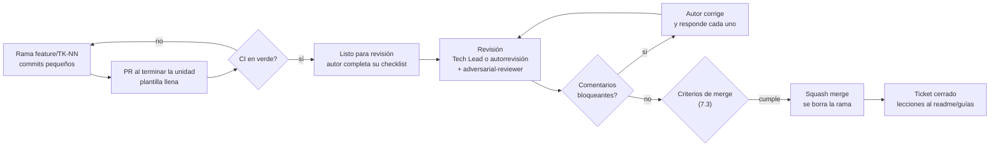

1. **Autor.** Trabaja la unidad completa en su rama, con commits pequeños, y la verifica en local con `make lint` y `make test-ci` (lo mismo que corre el CI). Con Claude Code, además, los hooks del proyecto formatean cada archivo de código que escribe y corren `scripts/verificar.py`, el mismo del *job* `lint`, antes de cada commit. **Al terminar la unidad** hace *push* y abre **un solo PR**, con la plantilla llena (con Claude Code, la skill `/push pr`, que sube la rama sin forzar y verifica antes con `scripts/verificar.py`). CI corre en ese momento y en cada *push* posterior; si falla, el autor lo corrige en la misma rama antes de pedir revisión.
2. **Revisor.** Usa los **criterios de revisión de código** de la sección 6. Marca cada comentario como **[bloqueante]**, **[sugerencia]** o **[nit]** y responde en máximo 1 día hábil.
   - **Con un solo desarrollador:** el autor revisa al día siguiente con la lista y pasa además el subagente `adversarial-reviewer` (`.claude/agents/`), que revisa el cambio con el objetivo de refutarlo, también contra las decisiones de arquitectura aceptadas de [`docs/adr/`](docs/adr/README.md). Las 2 revisiones quedan registradas como comentarios en el PR.
3. **Autor.** Responde cada comentario: lo corrige (con el commit que lo resuelve) o explica por qué no. Solo el revisor marca un comentario bloqueante como resuelto.
4. **Aprobación.** El revisor aprueba cuando no queda ningún bloqueante abierto. Las sugerencias que no se atiendan pasan al backlog como tarea.
5. ***Merge*.** Con *squash*, cuando se cumplen los criterios de 7.3. Después se borra la rama, se cierra el ticket y las lecciones aprendidas que lo ameriten se pasan al readme o a la guía del ticket.

#### 7.3 Criterios para hacer el *merge*

Un PR se integra a `main` solo si cumple **todos**:

| Criterio | Umbral | Cómo se verifica |
|---|---|---|
| **Pruebas** | `pytest` completo en verde contra PostgreSQL 17, incluida la prueba de integración de la sección 6. Si toca el frontend, también los e2e de Playwright | *Checks* obligatorios `tests` y `e2e` |
| **Calidad estática** | `ruff check`, `ruff format --check`, `djlint --check`, `djlint --lint` y `makemigrations --check` sin errores | *Checks* obligatorios `lint` (`scripts/verificar.py`: ruff y djLint) y `tests` (migraciones) |
| **Cobertura** | ≥ 80 % en todo `apps/` (sección 2.6), más el umbral del ticket (TK-02 ≥ 90 % en `services.py`); la cobertura total no baja respecto de `main` | El *job* `tests` falla con menos de 80 % (`--cov-fail-under=80`) y guarda `coverage.xml`; el umbral del ticket y la comparación con `main` los verifica el autor y los anota en la plantilla |
| **Aprobaciones** | 1 aprobación sin comentarios bloqueantes abiertos. Con un solo desarrollador: autorrevisión y revisión con IA registradas en el PR | Revisión en GitHub y conversaciones resueltas |
| **Definición de hecho** | La común y la del ticket (sección 6), con todos los criterios de aceptación cumplidos | Checklist del autor, revisada por el revisor |
| **Integración** | Rama al día con `main`; ningún contrato de "Puntos de integración" cambiado sin avisar | Protección de rama "*require branches to be up to date*" |

**Protección de la rama `main`** (configuración de GitHub):
- Prohibido el *push* directo.
- *Checks* obligatorios: `lint`, `tests` y, para cambios de frontend, `e2e`.
- Rama al día con `main` y conversaciones resueltas.
- Solo *squash merge*.

Con un solo desarrollador, GitHub no permite aprobar un PR propio. Por eso la aprobación obligatoria queda desactivada y se reemplaza por el registro de las 2 revisiones del paso 2. Los *checks* sí son obligatorios siempre.

> **Nota: reglas para que la protección de rama funcione con el CI** ([`.github/workflows/ci.yml`](.github/workflows/ci.yml))
>
> | # | Regla | Por qué |
> |---|---|---|
> | 1 | Los *checks* obligatorios son los *jobs* de `ci.yml` con `name:` **`lint`**, **`tests`** y **`e2e`**. No se renombran ni se convierten en matriz sin actualizar también la protección de la rama | GitHub busca el *check* por su nombre exacto. Si no coincide (por ejemplo, `test` o `tests (3.12)`), el PR queda para siempre en "*Expected — Waiting for status to be reported*" y no se puede integrar |
> | 2 | Primero se integra `ci.yml` y se abre un PR para que los *jobs* corran; después se marcan como obligatorios | GitHub solo deja elegir *checks* que ya se ejecutaron alguna vez en el repositorio |
> | 3 | El workflow corre **siempre**: nada de `paths:` ni `paths-ignore:` en `on:` | Si el workflow no corre, el *check* obligatorio nunca se reporta y el PR queda bloqueado |
> | 4 | `e2e` se salta con una condición `if:` cuando el PR no toca el frontend (lo detecta el *job* `detectar cambios`) | Un *job* saltado cuenta como aprobado. En `push` a `main` y en el CI nocturno, `e2e` corre siempre |
> | 5 | Cada *job* se activa cuando existe lo que necesita: `lint` e `imagen` con `app/manage.py` (HB-02), `tests` con `app/conftest.py` (HB-03) y `e2e` con `app/e2e/` (TK-03). Antes, se saltan | Los PR de solo documentación (como esta entrega) y los primeros tickets de habilitación no fallan por algo que todavía no existe |
> | 6 | Los tests marcados `lento` (planes de ejecución) solo corren en el CI nocturno | Mantiene rápido el CI de cada PR |
> | 7 | `detectar cambios`, `build de la imagen`, `contrato OpenAPI`, `herramientas del repositorio` y, desde HB-10, `respaldos (scripts de HB-10)` corren pero **no** son obligatorios | El primero es auxiliar; el segundo verifica el `Dockerfile` sin bloquear PR de documentación; los 2 siguientes revisan el contrato y los hooks y scripts, que no son código de la aplicación; `respaldos` prueba los scripts de respaldo con los contenedores levantados y tarda varios minutos |
> | 8 | **La protección de ramas solo funciona en repositorios públicos** con una cuenta gratuita de GitHub | En un repositorio privado se necesita GitHub Pro, Team o Enterprise. Sin eso, las reglas de 7.3 son un acuerdo de trabajo: antes del *merge*, el autor comprueba a mano que `lint`, `tests` y `e2e` estén en verde |

---

**Pull Request 1**

**`feat(inventario): servicio de movimientos con bloqueo de saldos y correcciones (TK-02)`** · HU-01

| Campo | Valor |
|---|---|
| Rama | `feature/TK-02-servicio-movimientos` → `main` |
| Ticket / historia | TK-02 / HU-01 · guía [`TK-02-servicio-movimientos.md`](docs/tickets/TK-02-servicio-movimientos.md) |
| Depende de | PR de TK-01 (esquema, permisos y *fixtures*), ya integrado |
| Puntos de integración | Provee 2 y 10 · consume 1, 3, 4, 7, 8 y 11 · no cambia ningún contrato |

**Qué cambia y por qué.** Agrega `services.py`, el único código que escribe en `movimiento` y `existencia`, con 4 operaciones: entrada, transferencia, baja y corrección. Cada una valida antes de escribir, bloquea los saldos en orden fijo (`SELECT ... FOR UPDATE` por `entidad_id`) y registra el movimiento en la misma transacción. Así ningún saldo queda negativo, ni siquiera con 2 usuarios a la vez, y no hay *deadlocks* entre transferencias cruzadas. Los errores de negocio son excepciones con el mismo `code` que la API (sección 4.4).

**Cómo probarlo**

```bash
dtest apps/inventario -q
dtest apps/inventario --cov=apps.inventario.services --cov=apps.inventario.exceptions --cov-branch --cov-fail-under=90
for i in $(seq 1 20); do dtest apps/inventario/tests/test_concurrencia.py -q || break; done
```

**Archivos modificados**

| Capa | Archivo | Cambio |
|---|---|---|
| Backend | `app/apps/inventario/exceptions.py` | Nuevo: 10 excepciones de dominio (una base y 9 específicas) con `code` y mensaje en español |
| Backend | `app/apps/inventario/services.py` | Nuevo: `registrar_entrada`, `transferir`, `dar_de_baja`, `corregir` y los *helpers* de bloqueo |
| Tests | `app/apps/inventario/tests/test_services.py` | Nuevo: un test por criterio de aceptación de HU-01, como `app_user` |
| Tests | `app/apps/inventario/tests/test_concurrencia.py` | Nuevo: bajas simultáneas, transferencias cruzadas y atomicidad |
| Infra | `app/requirements-dev.txt` | Modificado: `pytest-cov` |

**Checklist del autor:** definición de hecho común ✔ · los 12 criterios de aceptación de TK-02 con su test ✔ · cobertura de `services.py` ≥ 90 % ✔ · `git grep` confirma que nadie más escribe en inventario ✔ · tests de concurrencia 20 de 20 ✔.

**Métricas de impacto** (objetivos; se reemplazan por las medidas al abrir el PR)

| Métrica | Antes | Objetivo |
|---|---|---|
| Tests de `inventario` | Los de TK-01 | + ~30 (reglas, corrección y concurrencia) |
| Cobertura de `services.py` / ramas de `exceptions.py` | — | ≥ 90 % / 100 % |
| Ejecuciones seguidas de los tests de concurrencia sin fallar | — | 20 de 20 |
| Saldos que no cuadran (`v_conciliacion_existencia`) después de cada test | — | 0 |

**Riesgos y cómo revertir:** no tiene migraciones; revertir el commit de *squash* deja el esquema intacto. El riesgo es un *deadlock* no previsto: los tests de concurrencia tienen tiempo límite para detectarlo en CI y no en producción.

**Revisión** (Tech Lead o autorrevisión + IA): 2 bloqueantes (resueltos), 2 sugerencias, 1 nit

| # | Severidad | Archivo | Comentario | Resolución |
|---|---|---|---|---|
| 1 | [bloqueante] | `services.py` | `corregir` usaba `select_for_update()` sobre `Movimiento`. PostgreSQL exige permiso de `UPDATE` para `FOR UPDATE`, y `app_user` no lo tiene: en producción falla con `permission denied` | Se quitó el bloqueo; la restricción `uq_movimiento_corrige` deja pasar una sola corrección y el `IntegrityError` se traduce a `MovimientoYaCorregido` |
| 2 | [bloqueante] | `test_concurrencia.py` | El test de las 2 bajas simultáneas falla 1 de cada 10 veces: los hilos no arrancan al mismo tiempo | Se agregó `threading.Barrier(2)` y un tiempo límite por hilo; 20 de 20 en verde |
| 3 | [sugerencia] | `services.py` | Explicar en el *docstring* de `_bloquear_saldos` por qué el orden por `entidad_id` evita *deadlocks* | Hecho |
| 4 | [sugerencia] | `exceptions.py` | `DatoInvalido` debería indicar el campo, para que el formulario de TK-04 marque el campo correcto | Se agregó el atributo `campo` (punto de integración 10) |
| 5 | [nit] | `exceptions.py` | "hay 1 dosis disponibles": falta el singular | Corregido; coincide con el criterio de HU-01 |

**Lecciones aprendidas**
- **Los tests deben correr con los permisos de producción.** El comentario 1 no se habría detectado con los tests corriendo como `app_owner`. Por eso existe el *fixture* `como_app_user`, que ya está en la guía de TK-01.
- **Las pruebas de concurrencia necesitan sincronización explícita** (barrera y tiempo límite). Si no, son intermitentes y se pierde la confianza en CI.
- **Diseñar las excepciones pensando en quien las consume** (formularios y API) ahorra un cambio de contrato después.

---

**Pull Request 2**

**`feat(inventario): pantalla de existencias con filtros en vivo y diseño para celular (TK-03)`** · HU-02

| Campo | Valor |
|---|---|
| Rama | `feature/TK-03-pantalla-existencias` → `main` |
| Ticket / historia | TK-03 / HU-02 · guía [`TK-03-pantalla-existencias.md`](docs/tickets/TK-03-pantalla-existencias.md) |
| Depende de | PR de TK-01 y PR 1 (TK-02), ya integrados. Es el último de los 3: incluye la **prueba de integración** |
| Puntos de integración | Provee 9 · consume 1, 2, 5, 6, 7 y 11 · no cambia ningún contrato |

**Qué cambia y por qué.** Agrega la pantalla `/existencias/`, que pasa a ser la página de inicio. El usuario escribe "losartan" y, sin recargar, ve el saldo de cada medicamento por entidad, buscando por nombre comercial o principio activo, sin acentos. La búsqueda vive en `selectors.py`, que reutilizará el endpoint de TK-05. La misma vista responde la página completa o solo el fragmento HTMX, así la URL con filtros funciona sola. En el celular los resultados son tarjetas. Como es el último de los 3 tickets en integrarse, agrega `test_integracion.py`.

**Cómo probarlo**

```bash
dtest apps/inventario -q                                   # incluye selector, vista e integración
docker compose exec -e DB_USER=app_owner -e DB_PASSWORD="$DB_OWNER_PASSWORD" \
    -e DJANGO_ALLOW_ASYNC_UNSAFE=true web pytest -m e2e e2e/ -q
# Manual: https://localhost/existencias/ como consulta.demo → escribir "losartan" → 3 resultados
```

**Archivos modificados**

| Capa | Archivo | Cambio |
|---|---|---|
| Backend | `app/apps/inventario/selectors.py` | Nuevo: `buscar_existencias` y `normalizar` |
| Backend | `app/apps/inventario/forms.py`, `views.py`, `urls.py` | Nuevos: filtros, `ExistenciasView` (página o fragmento) y la ruta |
| Frontend | `templates/inventario/existencias.html`, `_resultados.html`, `_aviso.html` | Nuevos: filtros HTMX, tabla en escritorio, tarjetas en celular, estado vacío y paginación |
| Frontend | `app/apps/inventario/templatetags/inventario_extras.py` | Nuevo: filtro `dosis` (`0.5`, `10`) |
| Frontend | `app/static/js/vendor/htmx.min.js`, `templates/base.html` | Nuevo / modificado: HTMX local y la entrada "Existencias" del menú |
| Infra | `config/settings/base.py`, `config/urls.py`, `requirements.txt`, `requirements-dev.txt` | Modificados: `django-htmx`, página de inicio, `pytest-playwright` |
| Tests | `tests/test_selectors.py`, `test_views_existencias.py`, `test_templatetags.py`, `e2e/test_existencias.py` | Nuevos |
| Tests | `app/apps/inventario/tests/test_integracion.py` | Nuevo: 5 escenarios de servicio → base → pantalla |

**Checklist del autor:** definición de hecho común ✔ · los 11 criterios de aceptación de TK-03 ✔ · prueba de integración en verde ✔ · revisado en Chrome, Firefox y a 390 px ✔ · sin errores de CSP en consola ✔ · capturas agregadas a la sección 1.3 ✔.

**Métricas de impacto** (objetivos)

| Métrica | Objetivo |
|---|---|
| Tiempo de respuesta del fragmento con el mock | < 300 ms |
| Consultas a la BD por página | Constantes: las mismas con 1 que con 13 resultados |
| Accesibilidad (Lighthouse) | ≥ 90 |
| Desplazamiento horizontal a 390 px | Ninguno |
| Escenarios de integración en verde | 5 de 5 |

**Riesgos y cómo revertir:** no tiene migraciones. Revertir el *squash* quita la pantalla, y la página de inicio vuelve a la anterior. El riesgo es que la búsqueda no use el índice trigram y se vuelva lenta con el catálogo completo; se verifica con el plan de ejecución (verificación 4 de la guía).

**Revisión:** 2 bloqueantes (resueltos), 1 sugerencia, 1 nit

| # | Severidad | Archivo | Comentario | Resolución |
|---|---|---|---|---|
| 1 | [bloqueante] | `selectors.py` | Usaba `Unaccent(Lower(...))` de `django.contrib.postgres`, que genera `UNACCENT(LOWER(...))`. No es la expresión del índice (`f_unaccent(lower(...))`), y el plan muestra *Seq Scan* | Se cambió a `_sin_acentos()`, idéntica al índice; el plan ahora usa `ix_medicamento_nombre_trgm` |
| 2 | [bloqueante] | `views.py` | Si la sesión vence mientras se busca, HTMX inserta el formulario de login dentro de la tabla de resultados | `handle_no_permission` responde `HX-Redirect` al login; test agregado |
| 3 | [sugerencia] | `_resultados.html` | `floatformat:"-2"` muestra `0.50` en lugar de `0.5` | Filtro propio `dosis`, con su test |
| 4 | [nit] | `existencias.html` | Falta `aria-live="polite"` en `#resultados` para lectores de pantalla | Agregado |

**Lecciones aprendidas**
- **Un índice por expresión solo sirve si la consulta usa exactamente la misma expresión.** Ahora la revisión de frontend pide el plan de ejecución de las búsquedas.
- **HTMX necesita pensar los casos de error**, no solo el camino feliz: sesión vencida, búsqueda demasiado corta y estado vacío.
- **Integrar el último ticket con una prueba que cruce las 3 capas** detecta contratos rotos que ningún test de un solo ticket ve.

---

**Pull Request 3**

**`feat(conteos): servicio de conteo físico con foto del saldo y cierre (TK-06)`** · HU-03

| Campo | Valor |
|---|---|
| Rama | `feature/TK-06-servicio-conteos` → `main` |
| Ticket / historia | TK-06 / HU-03 (backlog de la sección 6, 3 puntos). La pantalla del conteo llega en TK-07 |
| Depende de | PR de TK-01 (tablas y *triggers* de conteos) y PR 1 (TK-02), ya integrados |
| Puntos de integración | Consume 1, 2, 4, 7 y 8. **Provee uno nuevo:** `apps/conteos/services.py` y sus excepciones, que consumirá TK-07 (se agregó como punto 12 en la sección 6) |

**Qué cambia y por qué.** Implementa la mecánica del conteo de HU-03 (sección 5): iniciar un conteo por entidad y período, capturar o recapturar cada renglón guardando la **foto** del saldo registrado en ese momento, y cerrarlo. La diferencia la calcula la base de datos (columna generada). El conteo **no ajusta existencias**: TK-07 resolverá cada diferencia llamando a `services.dar_de_baja` o `registrar_entrada` de TK-02. Incluye la migración de permisos de los grupos para `conteos`, con el mismo patrón que `inventario/0003`.

**Cómo probarlo**

```bash
dtest apps/conteos -q
dtest apps/conteos --cov=apps.conteos.services --cov-branch --cov-fail-under=90
dtest apps/inventario/tests/test_integracion.py -q          # la integración de las 3 capas sigue en verde
```

**Archivos modificados**

| Capa | Archivo | Cambio |
|---|---|---|
| Backend | `app/apps/conteos/exceptions.py` | Nuevo: `ConteoCerrado` (`CONTEO_CERRADO`), `ConteoSinRenglones` (`CONTEO_SIN_RENGLONES`), `CantidadInvalida` |
| Backend | `app/apps/conteos/services.py` | Nuevo: `iniciar_conteo`, `capturar_renglon` (crea o recaptura y toma la foto del saldo) y `cerrar_conteo` |
| BD | `app/apps/conteos/migrations/0003_permisos_grupos.py` | Nuevo: `view_*` para los 2 grupos; `add_*` y `change_*` de conteos para *Lectura y escritura* |
| Tests | `app/apps/conteos/tests/test_services.py` | Nuevo: los escenarios de HU-03 sobre el conteo 2 del mock, como `app_user` |
| Docs | `readme.md` (sección 6) | Punto de integración 12: servicio de conteos → TK-07 |

**Checklist del autor:** definición de hecho común ✔ · escenarios de HU-03 que no dependen de la pantalla, cada uno con su test ✔ · migración reversible ✔ · cobertura de `services.py` ≥ 90 % ✔ · prueba de integración en verde ✔.

**Métricas de impacto** (objetivos)

| Métrica | Objetivo |
|---|---|
| Diferencia calculada en el caso de la sección 2.6 (18 contadas contra 20 registradas) | −2 |
| Conteo 2 del mock: Omeprazol 58 contra 59 | Diferencia −1 y existencias sin cambios al cerrar |
| Cobertura de `apps/conteos/services.py` | ≥ 90 % |
| Respuestas `500` por cerrar 2 veces el mismo conteo | 0: siempre `ConteoCerrado` |

**Riesgos y cómo revertir:** revertir el *squash* y ejecutar `./scripts/migrate.sh conteos 0002` para quitar los permisos. No toca datos de inventario: el conteo nunca ajusta existencias.

**Revisión:** 2 bloqueantes (resueltos), 1 sugerencia

| # | Severidad | Archivo | Comentario | Resolución |
|---|---|---|---|---|
| 1 | [bloqueante] | `services.py` | Si 2 usuarios cierran el mismo conteo a la vez, el segundo choca con el *trigger* `tg_conteo_cerrado` y la pantalla mostraría un error `500` | `cerrar_conteo` bloquea el conteo con `select_for_update()` (`app_user` sí tiene `UPDATE` en `conteo_fisico`), valida el estado y lanza `ConteoCerrado`; test con 2 hilos |
| 2 | [bloqueante] | `services.py` | `cerrar_conteo` permitía cerrar un conteo sin renglones | Lanza `ConteoSinRenglones`, con el mensaje de HU-03 |
| 3 | [sugerencia] | `services.py` | La foto del saldo se calculaba sumando movimientos; `existencia.saldo` ya es ese dato y está conciliado | Se lee `existencia.saldo` (0 si la fila no existe) |

**Lecciones aprendidas**
- **Los *triggers* son la última barrera, no el mensaje al usuario.** Si el servicio no valida antes, el usuario ve un error `500` en lugar de un mensaje claro. Esto se agregó a los criterios de revisión de backend.
- **El patrón de la migración de permisos se repite en cada app nueva.** Conviene convertirlo en una función compartida antes de TK-07.
- **Que el conteo no ajuste existencias simplificó el servicio:** no necesita bloquear saldos, porque las diferencias se resuelven con el servicio de TK-02, que ya está probado.

**Documentación proceso para esta seccion:** [07-pull-requests.md](07-pull-requests.md)