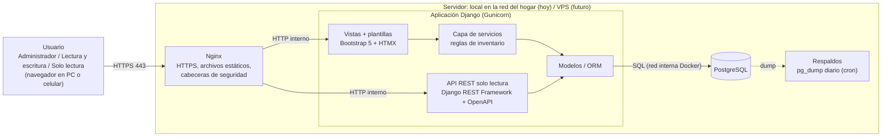
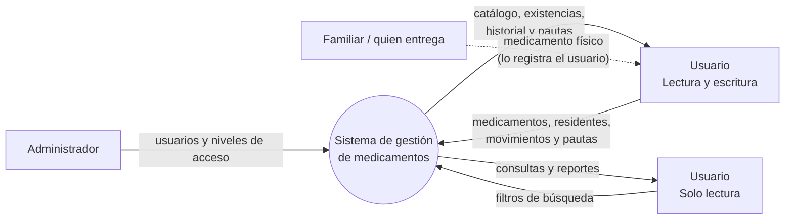
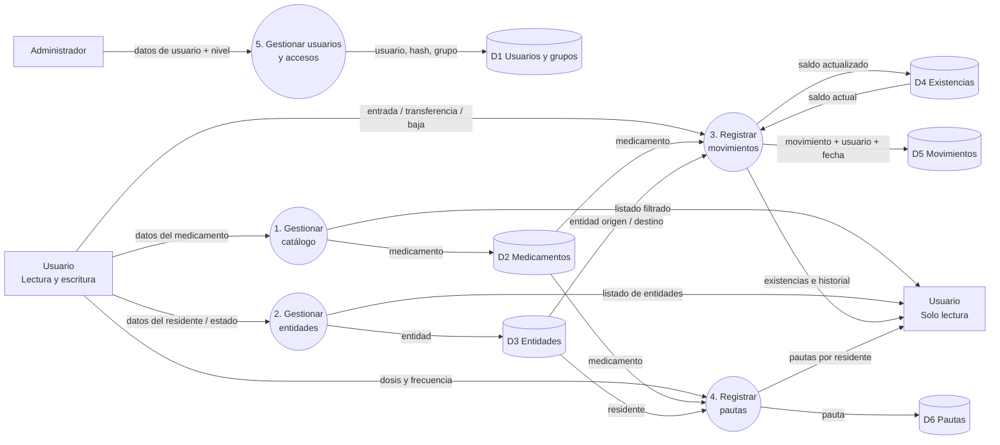
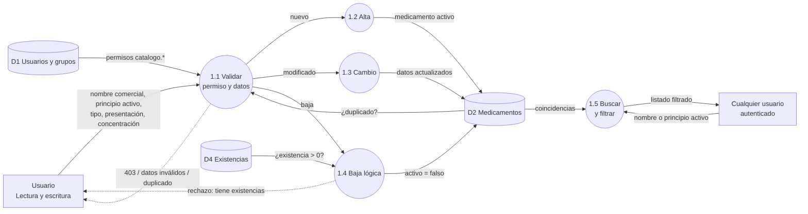
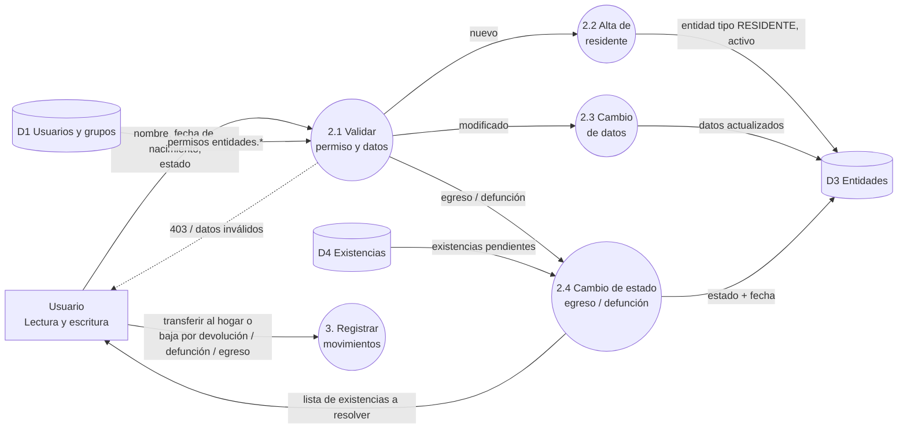
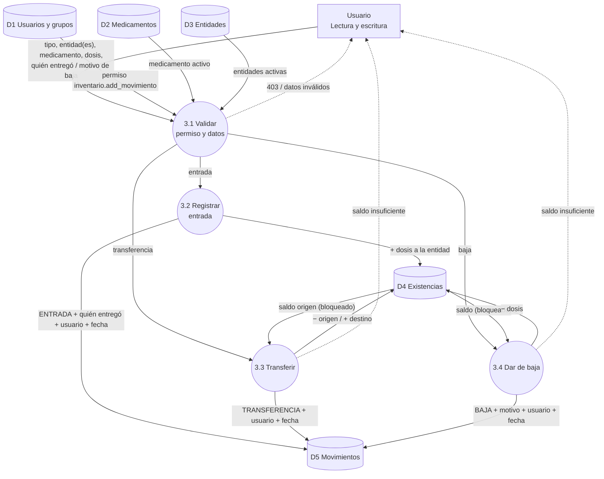
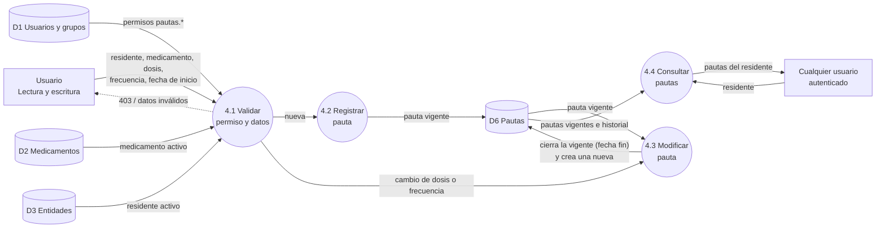
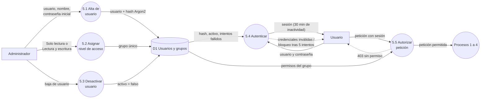
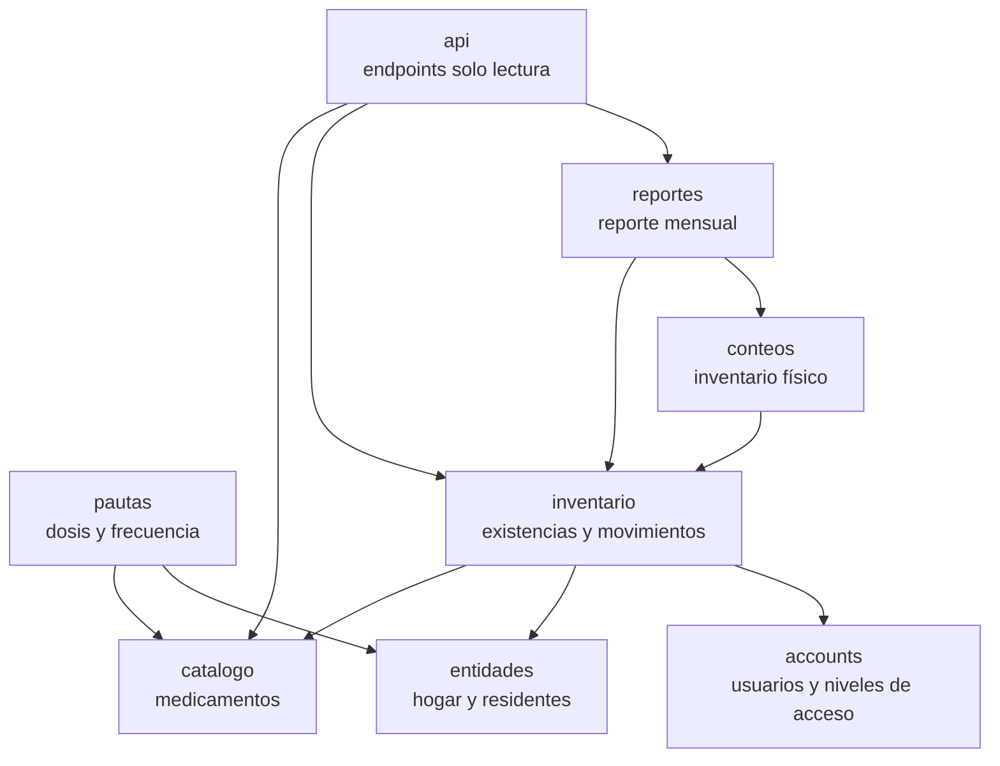
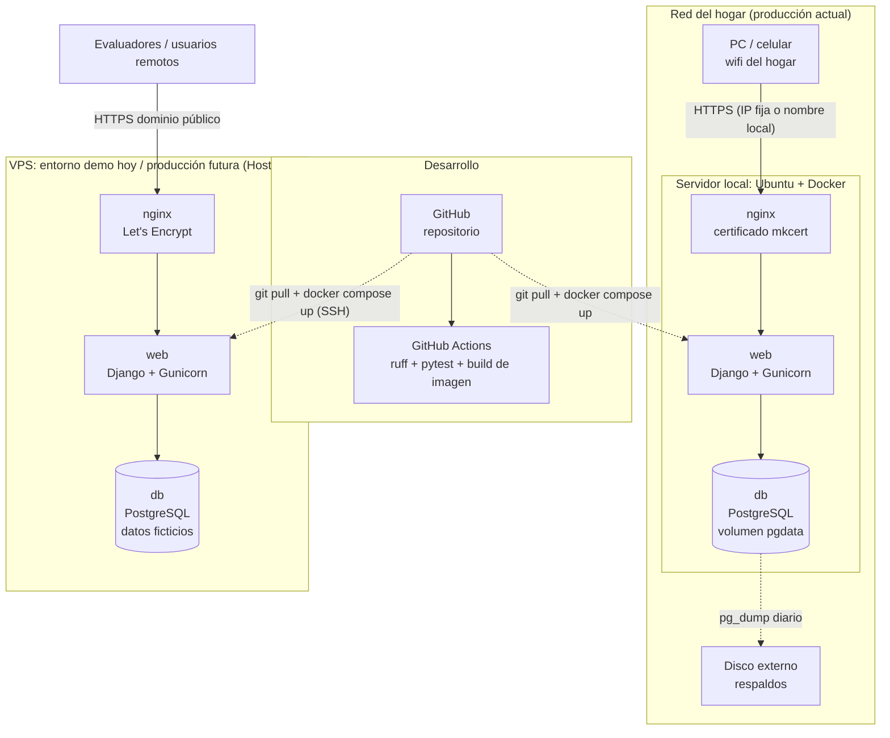

## Índice

0. [Ficha del proyecto](#0-ficha-del-proyecto)
1. [Descripción general del producto](#1-descripción-general-del-producto)
2. [Arquitectura del sistema](#2-arquitectura-del-sistema)
3. [Modelo de datos](#3-modelo-de-datos)
4. [Especificación de la API](#4-especificación-de-la-api)
5. [Historias de usuario](#5-historias-de-usuario)
6. [Tickets de trabajo](#6-tickets-de-trabajo)
7. [Pull requests](#7-pull-requests)

---

## 0. Ficha del proyecto

### **0.1. Tu nombre completo:**
Victor Manuel Ramirez Ruvalcaba
### **0.2. Nombre del proyecto:**
Gestion Medicamentos Hogar Gerontologico
### **0.3. Descripción breve del proyecto:**
**Gestión de Medicamentos – Hogar Gerontológico** es una aplicación web responsive (computadora y celular) para controlar el inventario de medicamentos de un hogar de adultos mayores. Gestiona las existencias **por entidad** (cada residente tiene su propio inventario y el hogar es una entidad más), registra entradas indicando quién entregó el medicamento, transferencias entre entidades y bajas por motivo. Permite filtrar por paciente, nombre comercial o principio activo, y realizar conteos físicos comparados contra lo registrado. Se despliega inicialmente en un servidor local (con posibilidad de migrar a un servicio de hosting), con acceso por usuario en dos niveles (solo lectura / lectura y escritura) y protección de los datos personales y de salud de los residentes conforme a la LFPDPPP (México).

### **0.4. URL del proyecto:**

>https://github.com/victorm007/AI4Devs-finalproject-vmrr

### 0.5. URL o archivo comprimido del repositorio

> Puedes tenerlo alojado en público o en privado, en cuyo caso deberás compartir los accesos de manera segura. Puedes enviarlos a [alvaro@lidr.co](mailto:alvaro@lidr.co) usando algún servicio como [onetimesecret](https://onetimesecret.com/). También puedes compartir por correo un archivo zip con el contenido
---

## 1. Descripción general del producto

> Describe en detalle los siguientes aspectos del producto:

### **1.1. Objetivo:**

> Propósito del producto. Qué valor aporta, qué soluciona, y para quién.

En un hogar gerontológico el control manual de medicamentos genera incertidumbre: no se sabe con certeza cuánto medicamento hay de cada residente, quién lo entregó, qué ocurrió con el sobrante de un residente que egresó o falleció, ni si lo que hay físicamente coincide con lo registrado.

El producto ofrece a la **administración / dirección** del hogar un inventario confiable y consultable desde cualquier dispositivo, que separa claramente qué medicamento pertenece a cada residente y cuál al hogar, y facilita el **corte mensual** de existencias.

**Contexto de uso:** una sola sede, aproximadamente 20 residentes y de 1 a 3 usuarios del sistema.

### **1.2. Características y funcionalidades principales:**

> Enumera y describe las características y funcionalidades específicas que tiene el producto para satisfacer las necesidades identificadas.

**Funcionales**

1. **Catálogo de medicamentos (alta / baja / cambio):** nombre comercial, principio activo, tipo (genérico u original), presentación y concentración. Búsqueda y filtrado por nombre o principio activo. No se controla por lote.
2. **Gestión de entidades:** alta, baja y cambio de residentes (nombre, fecha de nacimiento, estado: activo / egresado / fallecido). El hogar existe como entidad propia.
3. **Existencias por entidad (controladas en dosis):**
   - **Entradas:** registro de quién entregó el medicamento (familiar, el hogar, otro).
   - **Transferencias** entre entidades (hogar → residente, residente → hogar, residente → residente), por ejemplo para reasignar sobrantes tras un egreso o defunción.
   - **Bajas por motivo:** consumo / administración, caducidad, merma, rotura, devolución a la familia, defunción y egreso. La baja por caducidad se registra manualmente al detectar el medicamento vencido.
4. **Pauta del residente:** registro de dosis y frecuencia de cada medicamento por paciente (informativo; no incluye registro de administración por turno).
5. **Filtros combinados** por paciente, nombre de medicamento y principio activo.
6. **Inventario físico y reportes (en pantalla):**
   - Conteo físico a demanda por paciente y por rango de fechas (inicio y fin), comparando existencia física contra lo registrado y resaltando diferencias.
   - Reporte mensual de movimientos y existencias para la dirección.
7. **Usuarios y niveles de acceso globales:** el Administrador da de alta a los usuarios y les asigna su nivel.
   - *Solo lectura:* consulta y reportes.
   - *Lectura y escritura:* todas las operaciones anteriores.
8. **Trazabilidad mínima:** cada movimiento de inventario guarda el usuario que lo registró y la fecha/hora.

**No funcionales**

- **Accesibilidad:** cliente web responsive, utilizable desde computadora y celular.
- **Despliegue:** servidor local en el hogar; la solución debe poder migrarse a un servicio de hosting sin cambios de arquitectura.
- **Seguridad:** autenticación con contraseñas cifradas (hash), sesiones con expiración, comunicación por HTTPS, autorización por nivel de acceso validada en el backend y respaldos periódicos de la base de datos.
- **Privacidad:** tratamiento de datos personales y de salud (nombre, fecha de nacimiento, medicamentos) conforme a la LFPDPPP, con aviso de privacidad.
- **Escala:** dimensionado para una pequeña empresa (1 sede, ~20 residentes, 1 a 3 usuarios).

**Fuera de alcance (MVP)**

Registro de administración por turno (MAR), alertas de stock mínimo o caducidad, control por lote, insumos distintos a medicamentos, multisede, exportación a PDF/Excel, bitácora de auditoría completa e integraciones con sistemas externos.

### **1.3. Diseño y experiencia de usuario:**

> Proporciona imágenes y/o videotutorial mostrando la experiencia del usuario desde que aterriza en la aplicación, pasando por todas las funcionalidades principales.

### **1.4. Instrucciones de instalación:**
> Documenta de manera precisa las instrucciones para instalar y poner en marcha el proyecto en local (librerías, backend, frontend, servidor, base de datos, migraciones y semillas de datos, etc.)

---

## 2. Arquitectura del Sistema

### **2.1. Diagrama de arquitectura:**
> Usa el formato que consideres más adecuado para representar los componentes principales de la aplicación y las tecnologías utilizadas. Explica si sigue algún patrón predefinido, justifica por qué se ha elegido esta arquitectura, y destaca los beneficios principales que aportan al proyecto y justifican su uso, así como sacrificios o déficits que implica.



**Patrón:** **monolito modular** sobre el patrón **MVT (Modelo–Vista–Template) de Django**, con páginas **renderizadas en el servidor**. Cada módulo de negocio es una *app* de Django independiente. Las reglas de inventario (entradas, transferencias y bajas) viven en una **capa de servicios** (`services.py`), separada de las vistas, para que la web y la API compartan la misma lógica y se pueda probar de forma aislada.

**Por qué esta arquitectura:**
- **Escala del problema:** 1 sede, ~20 residentes y 1 a 3 usuarios. La carga es mínima, y microservicios, una SPA o colas de mensajes solo añadirían complejidad.
- **Un solo mantenedor (perfil infra/backend):** Django trae ORM, migraciones, autenticación, sesiones, permisos por grupos, CSRF, formularios con validación y panel de administración. Hay menos piezas que integrar y mantener.
- **Rendimiento en celular:** el HTML llega listo desde el servidor, sin descargar ni compilar un *bundle* de JavaScript. HTMX permite filtrar y paginar sin recargar la página completa.
- **Portabilidad:** todo se empaqueta con **Docker Compose**, de modo que el mismo despliegue corre en el servidor local y en un VPS de HostGator sin cambiar código.
- **Integridad de datos:** PostgreSQL ofrece transacciones y bloqueo de filas, necesarios para que una transferencia descuente y abone en un solo paso y para que nunca haya existencias negativas.

**Beneficios:**
- Desarrollo rápido.
- Pocas dependencias.
- Despliegue sencillo, de 3 contenedores.
- Seguridad sólida por defecto.
- Facilidad para probar las reglas de negocio.
- Los módulos bien delimitados permiten extraer servicios en el futuro si fuera necesario.

**Sacrificios / déficits:**
- **Escalado solo vertical** (servidor más grande), suficiente para este volumen.
- **Acoplamiento a Django**: cambiar de framework implicaría reescribir.
- **Interactividad limitada** frente a una SPA: no hay edición en tiempo real ni funcionamiento sin conexión.
- **El servidor local es un punto único de falla**, que se mitiga con respaldos diarios y un procedimiento de restauración documentado.
- **Sin acceso desde fuera del hogar** mientras se despliegue solo en la red local.

#### **2.1.1. Diagrama de flujo de datos (DFD)**

**Notación:** rectángulo = entidad externa · círculo = proceso · cilindro = almacén de datos · flecha continua = flujo de datos · flecha punteada = respuesta de error o flujo físico (fuera del sistema).

**Almacenes de datos** (el detalle de cada uno está en la [sección 3](#3-modelo-de-datos)):

| Id | Almacén | Contenido |
|---|---|---|
| D1 | Usuarios y grupos | Usuarios, contraseña (hash), estado activo y grupo (`Solo lectura` / `Lectura y escritura`) |
| D2 | Medicamentos | Catálogo: nombre comercial, principio activo, genérico/original, presentación, concentración, activo |
| D3 | Entidades | El hogar y los residentes (nombre, fecha de nacimiento, estado) |
| D4 | Existencias | Saldo en dosis por entidad y medicamento |
| D5 | Movimientos | Entradas, transferencias y bajas, con usuario y fecha/hora (inmutables) |
| D6 | Pautas | Dosis y frecuencia por residente y medicamento, con vigencia |

##### Nivel 0 — Contexto



##### Nivel 1 — Procesos principales



> Todos los procesos validan la sesión y los permisos contra **D1** antes de leer o escribir (proceso 5.4 y 5.5). Un usuario `Solo lectura` solo recibe flujos de salida (consultas); cualquier escritura que intente devuelve `403`.

##### Flujo 1 — Catálogo de medicamentos (alta / baja / cambio)



- La **baja es lógica** (`activo = falso`) para conservar el historial de movimientos. Se rechaza si alguna entidad todavía tiene existencias de ese medicamento.
- No se permite duplicar la combinación nombre comercial + presentación + concentración.

##### Flujo 2 — Gestión de entidades (alta / baja / cambio)



- La entidad **Hogar** se crea en la instalación (semilla) y no se puede dar de baja.
- Los residentes **no se borran**: el egreso o la defunción cambian su estado. El sistema muestra las existencias pendientes del residente para que el usuario las resuelva con el flujo 3.

##### Flujo 3 — Existencias por entidad (entradas, transferencias y bajas)



- Cada operación corre en una sola transacción (`transaction.atomic()`): se escribe el movimiento en **D5** y se actualiza el saldo en **D4**, o no se hace nada.
- Transferencias y bajas **bloquean el saldo** (`select_for_update()`) y lo validan antes de descontar, para que nunca quede negativo.
- Motivos de baja: consumo / administración, caducidad, merma, rotura, devolución a la familia, defunción y egreso.
- Los movimientos no se editan ni se borran: un error se corrige con el movimiento inverso.

##### Flujo 4 — Pauta del residente (dosis y frecuencia)



- La pauta es **informativa**: no mueve existencias ni registra la administración.
- Un cambio de dosis o frecuencia cierra la pauta vigente y crea una nueva, así queda el historial.

##### Flujo 5 — Alta de usuarios y nivel de acceso global



- Solo el **Administrador** (superusuario) da de alta usuarios, desde el panel de administración de Django.
- Cada usuario pertenece a **un solo grupo**, que define su nivel global: `Solo lectura` (consulta y reportes) o `Lectura y escritura` (todas las operaciones de los flujos 1 a 4).
- Los usuarios **se desactivan en lugar de borrarse**, porque sus movimientos deben seguir mostrando quién los registró.

### **2.2. Descripción de componentes principales:**

> Describe los componentes más importantes, incluyendo la tecnología utilizada

| Componente | Tecnología | Responsabilidad |
|---|---|---|
| **Proxy inverso** | Nginx | Termina HTTPS (certificado `mkcert` en la red local, Let's Encrypt en el VPS), sirve `static/`, aplica cabeceras de seguridad y reenvía el resto a Gunicorn. |
| **Servidor de aplicación** | Gunicorn | Ejecuta la aplicación Django (WSGI) con varios *workers*. |
| **Backend / web** | Python 3.12 + Django 5.2 LTS | Vistas, formularios, autenticación, autorización por grupos y lógica de negocio. |
| **Frontend** | Plantillas Django + Bootstrap 5 + HTMX | Interfaz responsive renderizada en el servidor. HTMX actualiza fragmentos de página (filtros, búsquedas) sin una SPA. |
| **API REST** | Django REST Framework + drf-spectacular | 3 endpoints JSON **de solo lectura** (existencias por entidad, búsqueda de medicamentos, reporte mensual) documentados en OpenAPI. Ver [sección 4](#4-especificación-de-la-api). |
| **Base de datos** | PostgreSQL 17 | Persistencia relacional, transacciones y búsqueda por nombre / principio activo. |
| **Respaldos** | `pg_dump` + cron | Respaldo diario comprimido, con retención de 14 días y copia a disco externo. |

**Módulos (apps de Django) y sus dependencias:**



- **accounts:** inicio y cierre de sesión. Grupos `Solo lectura` y `Lectura y escritura`. El Administrador (superusuario) gestiona los usuarios desde el panel de administración de Django.
- **catalogo:** alta, baja y cambio de medicamentos (nombre comercial, principio activo, genérico u original, presentación, concentración) y búsqueda.
- **entidades:** el hogar y los residentes (nombre, fecha de nacimiento, estado). Cada uno es una *entidad* dueña de existencias.
- **pautas:** dosis y frecuencia de cada medicamento por residente (informativo).
- **inventario:** existencias por entidad y medicamento (en dosis) y registro de **movimientos** (entrada, transferencia, baja con motivo). Incluye `services.py` con las reglas de negocio.
- **conteos:** conteo físico a demanda por entidad y rango de fechas, y comparación contra lo registrado.
- **reportes:** reporte mensual en pantalla de existencias y movimientos.
- **api:** *serializers* y vistas de solo lectura de DRF, además del esquema OpenAPI.

### **2.3. Descripción de alto nivel del proyecto y estructura de ficheros**

> Representa la estructura del proyecto y explica brevemente el propósito de las carpetas principales, así como si obedece a algún patrón o arquitectura específica.

```
AI4Devs-finalproject-vmrr/
├── readme.md                  # documentación del proyecto
├── prompts.md                 # prompts utilizados con IA
├── docs/                      # documentación de apoyo y diagramas
├── docker-compose.yml         # servicios: nginx, web, db
├── .env.example               # variables de entorno de ejemplo (el .env real no se versiona)
├── .github/workflows/ci.yml   # integración continua: lint + tests
├── nginx/
│   ├── default.conf           # proxy inverso, HTTPS, cabeceras de seguridad
│   └── certs/                 # certificados locales (no versionados)
├── scripts/
│   ├── backup_db.sh           # respaldo con pg_dump
│   └── restore_db.sh          # restauración de un respaldo
└── app/                       # proyecto Django
    ├── Dockerfile
    ├── requirements.txt
    ├── manage.py
    ├── config/                # configuración global
    │   ├── settings/          # base.py, local.py, prod.py
    │   ├── urls.py
    │   └── wsgi.py
    ├── apps/                  # un módulo de negocio por app
    │   ├── accounts/
    │   ├── catalogo/
    │   ├── entidades/
    │   ├── pautas/
    │   ├── inventario/
    │   │   ├── models.py      # Existencia, Movimiento
    │   │   ├── services.py    # reglas: registrar_entrada, transferir, dar_de_baja
    │   │   ├── forms.py
    │   │   ├── views.py
    │   │   ├── urls.py
    │   │   ├── templates/inventario/
    │   │   └── tests/
    │   ├── conteos/
    │   ├── reportes/
    │   └── api/               # serializers.py, views.py, urls.py
    ├── templates/             # base.html y layout común (Bootstrap)
    ├── static/                # css, js (htmx), imágenes
    └── fixtures/              # datos de ejemplo y grupos de permisos
```

**Patrón:** estructura estándar de Django organizada **por dominio**: cada app contiene sus modelos, servicios, vistas, plantillas y tests. La configuración está separada por entorno (`local` / `prod`) y se controla con variables de entorno, siguiendo la metodología *12-factor*. La infraestructura (`nginx/`, `scripts/`, `docker-compose.yml`) queda fuera del código de la aplicación.

### **2.4. Infraestructura y despliegue**

> Detalla la infraestructura del proyecto, incluyendo un diagrama en el formato que creas conveniente, y explica el proceso de despliegue que se sigue



**Entornos:**

| Entorno | Ubicación | Acceso | Certificado | Datos |
|---|---|---|---|---|
| **Desarrollo** | Equipo del desarrollador | `localhost` | — | Semillas de ejemplo |
| **Producción local** | Servidor Ubuntu con Docker en el hogar | Solo red del hogar | `mkcert` (CA local instalada en los dispositivos) | Reales |
| **Demo** | VPS HostGator (alternativa: video grabado en el equipo de desarrollo si aún no hay VPS) | Internet | Let's Encrypt | Ficticios |
| **Producción futura** | VPS, cuando haya presupuesto | Internet | Let's Encrypt | Reales (migrados con `pg_dump` / `pg_restore`) |

**Contenedores (`docker-compose.yml`):**
- `nginx`: único servicio con puertos expuestos (80 → redirección a 443).
- `web`: Django + Gunicorn, accesible solo dentro de la red interna de Docker.
- `db`: PostgreSQL con un volumen persistente `pgdata`. No expone puertos al exterior.

**Proceso de despliegue:**
1. **Integración continua:** en cada *push* o *pull request* a `main`, GitHub Actions ejecuta `ruff` (lint), `pytest` contra un servicio PostgreSQL y el *build* de la imagen. Solo se integra a `main` con el pipeline en verde.
2. **Despliegue (local o VPS):** se hace manualmente por SSH, lo cual es suficiente para un solo mantenedor:
   ```bash
   git pull origin main
   docker compose up -d --build
   docker compose exec web python manage.py migrate
   docker compose exec web python manage.py collectstatic --noinput
   ```
3. **Primera instalación:** se copia `.env.example` a `.env` y se configuran los secretos, se generan los certificados (`mkcert` en local, `certbot` en el VPS), se crea el superusuario con `createsuperuser` y se cargan los grupos de permisos con `loaddata grupos`.
4. **Respaldos:** un cron diario ejecuta `scripts/backup_db.sh`, que genera un `pg_dump` comprimido y cifrado, con retención de 14 días y copia a un disco externo. Una vez al mes se prueba la restauración con `scripts/restore_db.sh`.
5. **Migración a hosting:** se aprovisiona el VPS con Ubuntu y Docker, se clona el repositorio, se restaura el último respaldo y se apunta el dominio. No hay cambios de código, solo variables de entorno.

### **2.5. Seguridad**

> Enumera y describe las prácticas de seguridad principales que se han implementado en el proyecto, añadiendo ejemplos si procede

| Práctica | Implementación |
|---|---|
| **Cifrado en tránsito** | HTTPS en todos los entornos. En producción: `SECURE_SSL_REDIRECT=True`, HSTS, `SESSION_COOKIE_SECURE` y `CSRF_COOKIE_SECURE`. |
| **Contraseñas** | Hash **Argon2** (`django[argon2]`) y validadores de longitud y complejidad de Django. |
| **Sesiones** | Expiran tras 30 min de inactividad (`SESSION_COOKIE_AGE=1800`, `SESSION_SAVE_EVERY_REQUEST=True`) y al cerrar el navegador. Cookies `HttpOnly` y `SameSite=Lax`. |
| **Fuerza bruta** | `django-axes`: bloquea temporalmente la cuenta tras 5 intentos fallidos. |
| **Autorización** | Grupos `Solo lectura` / `Lectura y escritura` con permisos de Django, validados **en el backend** (`PermissionRequiredMixin` en vistas y `DjangoModelPermissions` en la API). La interfaz oculta botones según el nivel, pero la autorización real ocurre en el servidor. Ejemplo: un usuario de solo lectura que envía un `POST` a `/inventario/bajas/` recibe `403`. |
| **API** | Solo lectura (`GET`), requiere sesión autenticada y no expone métodos de escritura. |
| **Vulnerabilidades web** | CSRF por defecto en formularios y peticiones HTMX. Protección contra XSS por el *autoescape* de plantillas. Protección contra inyección SQL al usar el ORM con consultas parametrizadas. `X-Frame-Options: DENY` y `Content-Security-Policy` en Nginx. |
| **Secretos y configuración** | `SECRET_KEY` y credenciales de base de datos en `.env` (no versionado). `DEBUG=False` y `ALLOWED_HOSTS` restringido en producción. |
| **Aislamiento de red** | PostgreSQL sin puertos expuestos, accesible solo desde el contenedor `web`. El usuario de base de datos de la aplicación tiene privilegios mínimos. |
| **Integridad y trazabilidad** | Cada movimiento guarda usuario y fecha/hora. Los movimientos **no se editan ni se borran**: los errores se corrigen con un movimiento inverso. Las operaciones de inventario corren en `transaction.atomic()` con `select_for_update()` para evitar saldos negativos. |
| **Privacidad (LFPDPPP)** | Minimización de datos (solo nombre y fecha de nacimiento del residente), aviso de privacidad visible y residentes egresados o fallecidos marcados como inactivos en lugar de borrados, para conservar el historial. |
| **Respaldos** | Diarios y cifrados (GPG), con retención limitada y prueba de restauración mensual. |
| **Dependencias** | Versiones fijadas en `requirements.txt` y revisión periódica con `pip-audit`. |

### **2.6. Tests**

> Describe brevemente algunos de los tests realizados

**Herramientas:** `pytest` + `pytest-django` + `factory_boy`, ejecutados en CI contra PostgreSQL real. Playwright (Python) para el flujo de extremo a extremo.

| Tipo | Caso | Resultado esperado |
|---|---|---|
| **Unitario (servicios)** | Registrar una entrada de 30 dosis para un residente | La existencia del residente aumenta en 30 y se crea un movimiento con usuario, fecha y quién entregó. |
| **Unitario (servicios)** | Dar de baja más dosis de las disponibles | Se lanza `ExistenciaInsuficiente` y el saldo no cambia. |
| **Unitario (servicios)** | Transferir del hogar a un residente cuando falla el abono al destino | La transacción se revierte y el saldo del hogar queda igual (atomicidad). |
| **Concurrencia** | Dos bajas simultáneas que juntas superan la existencia (`TransactionTestCase`) | Solo una se aplica y el saldo nunca es negativo. |
| **Unitario (conteos)** | Conteo físico de 18 dosis cuando el sistema registra 20 | La diferencia reportada es −2. |
| **Permisos** | Usuario `Solo lectura` envía un `POST` para registrar una baja | Responde `403` y no se crea el movimiento. |
| **Permisos** | Usuario sin sesión accede a cualquier pantalla | Redirige al login. |
| **API** | `GET /api/existencias/?entidad=<id>` sin autenticación / autenticado | `403` / `200` con solo las existencias de esa entidad. |
| **Extremo a extremo** | Login → alta de medicamento → entrada a residente → consulta filtrada por principio activo | El medicamento aparece con la existencia correcta. |

**Criterio:** cobertura ≥ 80 % en las capas de servicios y permisos, que concentran las reglas críticas del negocio.

---

## 3. Modelo de Datos

### **3.1. Diagrama del modelo de datos:**

> Recomendamos usar mermaid para el modelo de datos, y utilizar todos los parámetros que permite la sintaxis para dar el máximo detalle, por ejemplo las claves primarias y foráneas.


### **3.2. Descripción de entidades principales:**

> Recuerda incluir el máximo detalle de cada entidad, como el nombre y tipo de cada atributo, descripción breve si procede, claves primarias y foráneas, relaciones y tipo de relación, restricciones (unique, not null…), etc.

---

## 4. Especificación de la API

> Si tu backend se comunica a través de API, describe los endpoints principales (máximo 3) en formato OpenAPI. Opcionalmente puedes añadir un ejemplo de petición y de respuesta para mayor claridad

---

## 5. Historias de Usuario

> Documenta 3 de las historias de usuario principales utilizadas durante el desarrollo, teniendo en cuenta las buenas prácticas de producto al respecto.

**Historia de Usuario 1**

**Historia de Usuario 2**

**Historia de Usuario 3**

---

## 6. Tickets de Trabajo

> Documenta 3 de los tickets de trabajo principales del desarrollo, uno de backend, uno de frontend, y uno de bases de datos. Da todo el detalle requerido para desarrollar la tarea de inicio a fin teniendo en cuenta las buenas prácticas al respecto. 

**Ticket 1**

**Ticket 2**

**Ticket 3**

---

## 7. Pull Requests

> Documenta 3 de las Pull Requests realizadas durante la ejecución del proyecto

**Pull Request 1**

**Pull Request 2**

**Pull Request 3**

