## Índice

0. [Ficha del proyecto](#0-ficha-del-proyecto)
1. [Descripción general del producto](#1-descripción-general-del-producto)
2. [Arquitectura del sistema](#2-arquitectura-del-sistema)
3. [Modelo de datos](#3-modelo-de-datos)
4. [Especificación de la API](#4-especificación-de-la-api)
5. [Historias de usuario](#5-historias-de-usuario)
6. [Tickets de trabajo](#6-tickets-de-trabajo)
7. [Pull requests](#7-pull-requests)

---

## 0. Ficha del proyecto

### **0.1. Tu nombre completo:**
Victor Manuel Ramirez Ruvalcaba
### **0.2. Nombre del proyecto:**
Gestion Medicamentos Hogar Gerontologico
### **0.3. Descripción breve del proyecto:**
**Gestión de Medicamentos – Hogar Gerontológico** es una aplicación web responsive (computadora y celular) para controlar el inventario de medicamentos de un hogar de adultos mayores. Gestiona las existencias **por entidad** (cada residente tiene su propio inventario y el hogar es una entidad más), registra entradas indicando quién entregó el medicamento, transferencias entre entidades y bajas por motivo. Permite filtrar por paciente, nombre comercial o principio activo, y realizar conteos físicos comparados contra lo registrado. Se despliega inicialmente en un servidor local (con posibilidad de migrar a un servicio de hosting), con acceso por usuario en dos niveles (solo lectura / lectura y escritura) y protección de los datos personales y de salud de los residentes conforme a la LFPDPPP (México).

### **0.4. URL del proyecto:**

>https://github.com/victorm007/AI4Devs-finalproject-vmrr

### 0.5. URL o archivo comprimido del repositorio

> Puedes tenerlo alojado en público o en privado, en cuyo caso deberás compartir los accesos de manera segura. Puedes enviarlos a [alvaro@lidr.co](mailto:alvaro@lidr.co) usando algún servicio como [onetimesecret](https://onetimesecret.com/). También puedes compartir por correo un archivo zip con el contenido
---

## 1. Descripción general del producto

> Describe en detalle los siguientes aspectos del producto:

### **1.1. Objetivo:**

> Propósito del producto. Qué valor aporta, qué soluciona, y para quién.

En un hogar gerontológico el control manual de medicamentos genera incertidumbre: no se sabe con certeza cuánto medicamento hay de cada residente, quién lo entregó, qué ocurrió con el sobrante de un residente que egresó o falleció, ni si lo que hay físicamente coincide con lo registrado.

El producto ofrece a la **administración / dirección** del hogar un inventario confiable y consultable desde cualquier dispositivo, que separa claramente qué medicamento pertenece a cada residente y cuál al hogar, y facilita el **corte mensual** de existencias.

**Contexto de uso:** una sola sede, aproximadamente 20 residentes y de 1 a 3 usuarios del sistema.

### **1.2. Características y funcionalidades principales:**

> Enumera y describe las características y funcionalidades específicas que tiene el producto para satisfacer las necesidades identificadas.

**Funcionales**

1. **Catálogo de medicamentos (alta / baja / cambio):** nombre comercial, principio activo, tipo (genérico u original), presentación y concentración. Búsqueda y filtrado por nombre o principio activo. No se controla por lote.
2. **Gestión de entidades:** alta, baja y cambio de residentes (nombre, fecha de nacimiento, estado: activo / egresado / fallecido). El hogar existe como entidad propia.
3. **Existencias por entidad (controladas en dosis):**
   - **Entradas:** registro de quién entregó el medicamento (familiar, el hogar, otro).
   - **Transferencias** entre entidades (hogar → residente, residente → hogar, residente → residente), por ejemplo para reasignar sobrantes tras un egreso o defunción.
   - **Bajas por motivo:** consumo / administración, caducidad, merma, rotura, devolución a la familia, defunción y egreso. La baja por caducidad se registra manualmente al detectar el medicamento vencido.
4. **Pauta del residente:** registro de dosis y frecuencia de cada medicamento por paciente (informativo; no incluye registro de administración por turno).
5. **Filtros combinados** por paciente, nombre de medicamento y principio activo.
6. **Inventario físico y reportes (en pantalla):**
   - Conteo físico a demanda por paciente y por rango de fechas (inicio y fin), comparando existencia física contra lo registrado y resaltando diferencias.
   - Reporte mensual de movimientos y existencias para la dirección.
7. **Usuarios y niveles de acceso globales:** el Administrador da de alta a los usuarios y les asigna su nivel.
   - *Solo lectura:* consulta y reportes.
   - *Lectura y escritura:* todas las operaciones anteriores.
8. **Trazabilidad mínima:** cada movimiento de inventario guarda el usuario que lo registró y la fecha/hora.

**No funcionales**

- **Accesibilidad:** cliente web responsive, utilizable desde computadora y celular.
- **Despliegue:** servidor local en el hogar; la solución debe poder migrarse a un servicio de hosting sin cambios de arquitectura.
- **Seguridad:** autenticación con contraseñas cifradas (hash), sesiones con expiración, comunicación por HTTPS, autorización por nivel de acceso validada en el backend y respaldos periódicos de la base de datos.
- **Privacidad:** tratamiento de datos personales y de salud (nombre, fecha de nacimiento, medicamentos) conforme a la LFPDPPP, con aviso de privacidad.
- **Escala:** dimensionado para una pequeña empresa (1 sede, ~20 residentes, 1 a 3 usuarios).

**Fuera de alcance (MVP)**

Registro de administración por turno (MAR), alertas de stock mínimo o caducidad, control por lote, insumos distintos a medicamentos, multisede, exportación a PDF/Excel, bitácora de auditoría completa e integraciones con sistemas externos.

### **1.3. Diseño y experiencia de usuario:**

> Proporciona imágenes y/o videotutorial mostrando la experiencia del usuario desde que aterriza en la aplicación, pasando por todas las funcionalidades principales.

### **1.4. Instrucciones de instalación:**
> Documenta de manera precisa las instrucciones para instalar y poner en marcha el proyecto en local (librerías, backend, frontend, servidor, base de datos, migraciones y semillas de datos, etc.)

---

## 2. Arquitectura del Sistema

### **2.1. Diagrama de arquitectura:**
> Usa el formato que consideres más adecuado para representar los componentes principales de la aplicación y las tecnologías utilizadas. Explica si sigue algún patrón predefinido, justifica por qué se ha elegido esta arquitectura, y destaca los beneficios principales que aportan al proyecto y justifican su uso, así como sacrificios o déficits que implica.

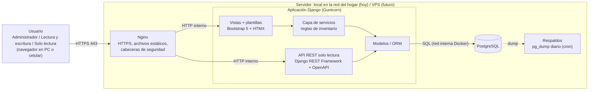

**Patrón:** **monolito modular** sobre el patrón **MVT (Modelo–Vista–Template) de Django**, con páginas **renderizadas en el servidor**. Cada módulo de negocio es una *app* de Django independiente. Las reglas de inventario (entradas, transferencias y bajas) viven en una **capa de servicios** (`services.py`), separada de las vistas, para que la web y la API compartan la misma lógica y se pueda probar de forma aislada.

**Por qué esta arquitectura:**
- **Escala del problema:** 1 sede, ~20 residentes y 1 a 3 usuarios. La carga es mínima, y microservicios, una SPA o colas de mensajes solo añadirían complejidad.
- **Un solo mantenedor (perfil infra/backend):** Django trae ORM, migraciones, autenticación, sesiones, permisos por grupos, CSRF, formularios con validación y panel de administración. Hay menos piezas que integrar y mantener.
- **Rendimiento en celular:** el HTML llega listo desde el servidor, sin descargar ni compilar un *bundle* de JavaScript. HTMX permite filtrar y paginar sin recargar la página completa.
- **Portabilidad:** todo se empaqueta con **Docker Compose**, de modo que el mismo despliegue corre en el servidor local y en un VPS de HostGator sin cambiar código.
- **Integridad de datos:** PostgreSQL ofrece transacciones y bloqueo de filas, necesarios para que una transferencia descuente y abone en un solo paso y para que nunca haya existencias negativas.

**Beneficios:**
- Desarrollo rápido.
- Pocas dependencias.
- Despliegue sencillo, de 3 contenedores.
- Seguridad sólida por defecto.
- Facilidad para probar las reglas de negocio.
- Los módulos bien delimitados permiten extraer servicios en el futuro si fuera necesario.

**Sacrificios / déficits:**
- **Escalado solo vertical** (servidor más grande), suficiente para este volumen.
- **Acoplamiento a Django**: cambiar de framework implicaría reescribir.
- **Interactividad limitada** frente a una SPA: no hay edición en tiempo real ni funcionamiento sin conexión.
- **El servidor local es un punto único de falla**, que se mitiga con respaldos diarios y un procedimiento de restauración documentado.
- **Sin acceso desde fuera del hogar** mientras se despliegue solo en la red local.

#### **2.1.1. Diagrama de flujo de datos (DFD)**

**Notación:** rectángulo = entidad externa · círculo = proceso · cilindro = almacén de datos · flecha continua = flujo de datos · flecha punteada = respuesta de error o flujo físico (fuera del sistema).

**Almacenes de datos** (el detalle de cada uno está en la [sección 3](#3-modelo-de-datos)):

| Id | Almacén | Contenido |
|---|---|---|
| D1 | Usuarios y grupos | Usuarios, contraseña (hash), estado activo y grupo (`Solo lectura` / `Lectura y escritura`) |
| D2 | Medicamentos | Catálogo: nombre comercial, principio activo, genérico/original, presentación, concentración, activo |
| D3 | Entidades | El hogar y los residentes (nombre, fecha de nacimiento, estado) |
| D4 | Existencias | Saldo en dosis por entidad y medicamento |
| D5 | Movimientos | Entradas, transferencias y bajas, con usuario y fecha/hora (inmutables) |
| D6 | Pautas | Dosis y frecuencia por residente y medicamento, con vigencia |

##### Nivel 0 — Contexto

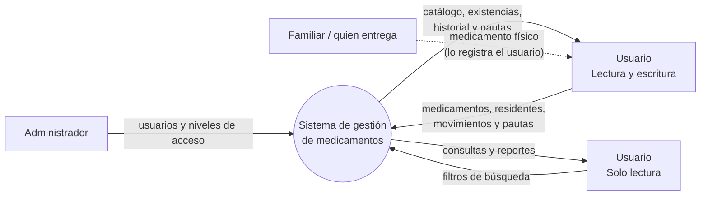

##### Nivel 1 — Procesos principales

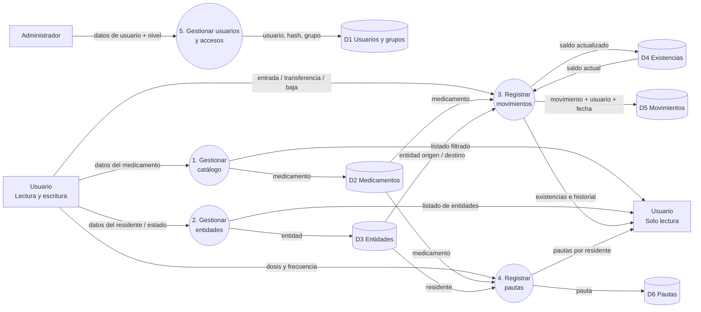

> Todos los procesos validan la sesión y los permisos contra **D1** antes de leer o escribir (proceso 5.4 y 5.5). Un usuario `Solo lectura` solo recibe flujos de salida (consultas); cualquier escritura que intente devuelve `403`.

##### Flujo 1 — Catálogo de medicamentos (alta / baja / cambio)

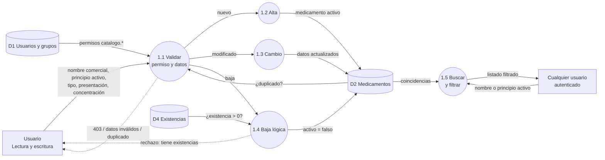

- La **baja es lógica** (`activo = falso`) para conservar el historial de movimientos. Se rechaza si alguna entidad todavía tiene existencias de ese medicamento.
- No se permite duplicar la combinación nombre comercial + presentación + concentración.

##### Flujo 2 — Gestión de entidades (alta / baja / cambio)

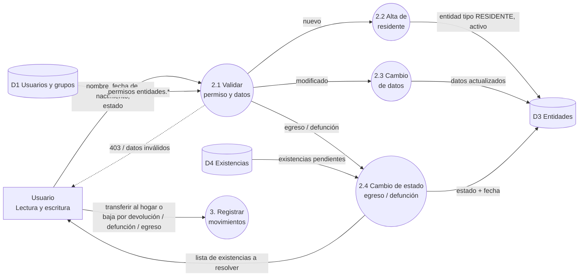

- La entidad **Hogar** se crea en la instalación (semilla) y no se puede dar de baja.
- Los residentes **no se borran**: el egreso o la defunción cambian su estado. El sistema muestra las existencias pendientes del residente para que el usuario las resuelva con el flujo 3.

##### Flujo 3 — Existencias por entidad (entradas, transferencias y bajas)

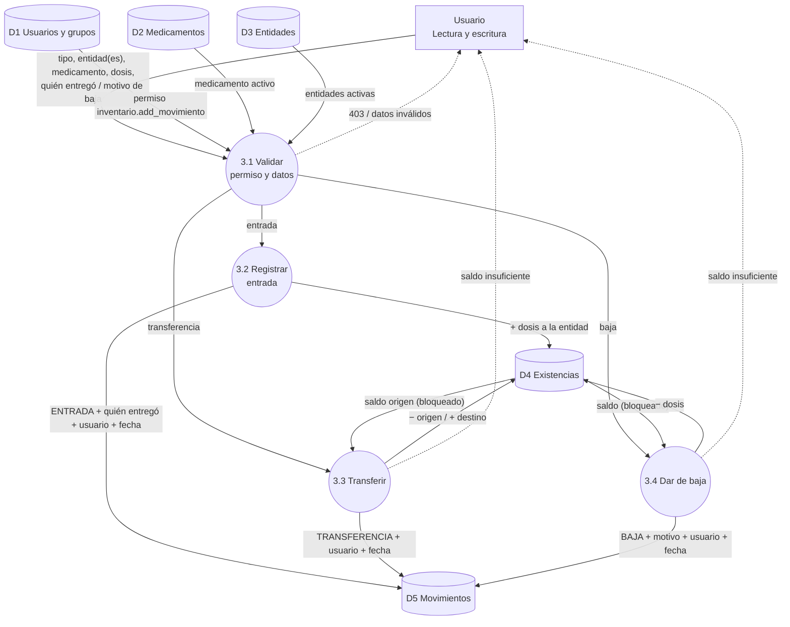

- Cada operación corre en una sola transacción (`transaction.atomic()`): se escribe el movimiento en **D5** y se actualiza el saldo en **D4**, o no se hace nada.
- Transferencias y bajas **bloquean el saldo** (`select_for_update()`) y lo validan antes de descontar, para que nunca quede negativo.
- Motivos de baja: consumo / administración, caducidad, merma, rotura, devolución a la familia, defunción y egreso.
- Los movimientos no se editan ni se borran: un error se corrige con el movimiento inverso.

##### Flujo 4 — Pauta del residente (dosis y frecuencia)

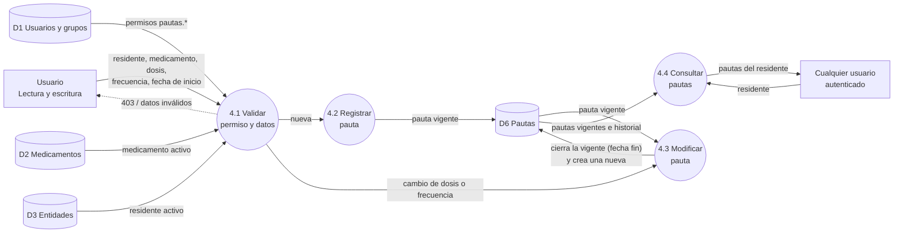

- La pauta es **informativa**: no mueve existencias ni registra la administración.
- Un cambio de dosis o frecuencia cierra la pauta vigente y crea una nueva, así queda el historial.

##### Flujo 5 — Alta de usuarios y nivel de acceso global

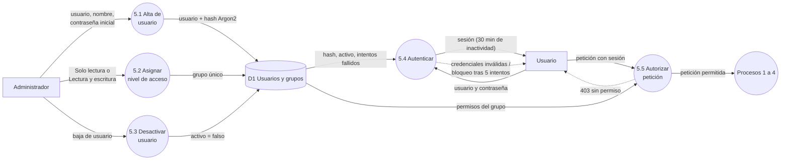

- Solo el **Administrador** (superusuario) da de alta usuarios, desde el panel de administración de Django.
- Cada usuario pertenece a **un solo grupo**, que define su nivel global: `Solo lectura` (consulta y reportes) o `Lectura y escritura` (todas las operaciones de los flujos 1 a 4).
- Los usuarios **se desactivan en lugar de borrarse**, porque sus movimientos deben seguir mostrando quién los registró.

### **2.2. Descripción de componentes principales:**

> Describe los componentes más importantes, incluyendo la tecnología utilizada

| Componente | Tecnología | Responsabilidad |
|---|---|---|
| **Proxy inverso** | Nginx | Termina HTTPS (certificado `mkcert` en la red local, Let's Encrypt en el VPS), sirve `static/`, aplica cabeceras de seguridad y reenvía el resto a Gunicorn. |
| **Servidor de aplicación** | Gunicorn | Ejecuta la aplicación Django (WSGI) con varios *workers*. |
| **Backend / web** | Python 3.12 + Django 5.2 LTS | Vistas, formularios, autenticación, autorización por grupos y lógica de negocio. |
| **Frontend** | Plantillas Django + Bootstrap 5 + HTMX | Interfaz responsive renderizada en el servidor. HTMX actualiza fragmentos de página (filtros, búsquedas) sin una SPA. |
| **API REST** | Django REST Framework + drf-spectacular | 3 endpoints JSON **de solo lectura** (existencias por entidad, búsqueda de medicamentos, reporte mensual) documentados en OpenAPI. Ver [sección 4](#4-especificación-de-la-api). |
| **Base de datos** | PostgreSQL 17 | Persistencia relacional, transacciones y búsqueda por nombre / principio activo. |
| **Respaldos** | `pg_dump` + cron | Respaldo diario comprimido, con retención de 14 días y copia a disco externo. |

**Módulos (apps de Django) y sus dependencias:**

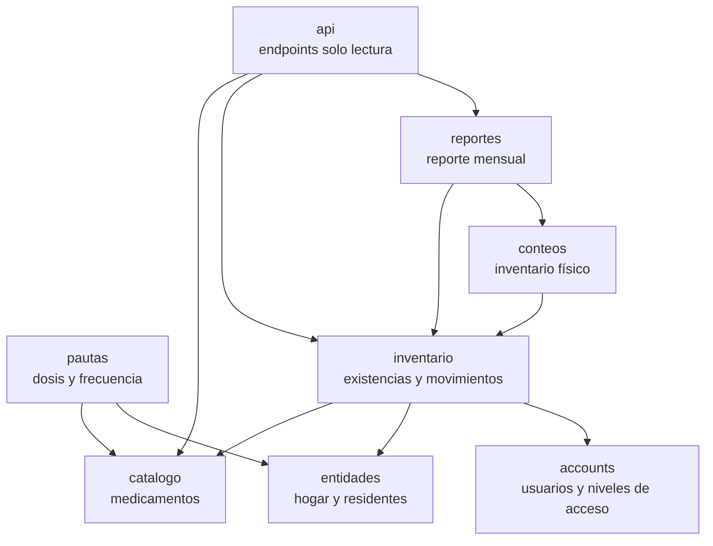

- **accounts:** inicio y cierre de sesión. Grupos `Solo lectura` y `Lectura y escritura`. El Administrador (superusuario) gestiona los usuarios desde el panel de administración de Django.
- **catalogo:** alta, baja y cambio de medicamentos (nombre comercial, principio activo, genérico u original, presentación, concentración) y búsqueda.
- **entidades:** el hogar y los residentes (nombre, fecha de nacimiento, estado). Cada uno es una *entidad* dueña de existencias.
- **pautas:** dosis y frecuencia de cada medicamento por residente (informativo).
- **inventario:** existencias por entidad y medicamento (en dosis) y registro de **movimientos** (entrada, transferencia, baja con motivo). Incluye `services.py` con las reglas de negocio.
- **conteos:** conteo físico a demanda por entidad y rango de fechas, y comparación contra lo registrado.
- **reportes:** reporte mensual en pantalla de existencias y movimientos.
- **api:** *serializers* y vistas de solo lectura de DRF, además del esquema OpenAPI.

### **2.3. Descripción de alto nivel del proyecto y estructura de ficheros**

> Representa la estructura del proyecto y explica brevemente el propósito de las carpetas principales, así como si obedece a algún patrón o arquitectura específica.

```
AI4Devs-finalproject-vmrr/
├── readme.md                  # documentación del proyecto
├── prompts.md                 # prompts utilizados con IA
├── docs/                      # documentación de apoyo y diagramas
├── docker-compose.yml         # servicios: nginx, web, db
├── .env.example               # variables de entorno de ejemplo (el .env real no se versiona)
├── .github/workflows/ci.yml   # integración continua: lint + tests
├── nginx/
│   ├── default.conf           # proxy inverso, HTTPS, cabeceras de seguridad
│   └── certs/                 # certificados locales (no versionados)
├── scripts/
│   ├── backup_db.sh           # respaldo con pg_dump
│   └── restore_db.sh          # restauración de un respaldo
└── app/                       # proyecto Django
    ├── Dockerfile
    ├── requirements.txt
    ├── manage.py
    ├── config/                # configuración global
    │   ├── settings/          # base.py, local.py, prod.py
    │   ├── urls.py
    │   └── wsgi.py
    ├── apps/                  # un módulo de negocio por app
    │   ├── accounts/
    │   ├── catalogo/
    │   ├── entidades/
    │   ├── pautas/
    │   ├── inventario/
    │   │   ├── models.py      # Existencia, Movimiento
    │   │   ├── services.py    # reglas: registrar_entrada, transferir, dar_de_baja
    │   │   ├── forms.py
    │   │   ├── views.py
    │   │   ├── urls.py
    │   │   ├── templates/inventario/
    │   │   └── tests/
    │   ├── conteos/
    │   ├── reportes/
    │   └── api/               # serializers.py, views.py, urls.py
    ├── templates/             # base.html y layout común (Bootstrap)
    ├── static/                # css, js (htmx), imágenes
    └── fixtures/              # datos de ejemplo y grupos de permisos
```

**Patrón:** estructura estándar de Django organizada **por dominio**: cada app contiene sus modelos, servicios, vistas, plantillas y tests. La configuración está separada por entorno (`local` / `prod`) y se controla con variables de entorno, siguiendo la metodología *12-factor*. La infraestructura (`nginx/`, `scripts/`, `docker-compose.yml`) queda fuera del código de la aplicación.

### **2.4. Infraestructura y despliegue**

> Detalla la infraestructura del proyecto, incluyendo un diagrama en el formato que creas conveniente, y explica el proceso de despliegue que se sigue

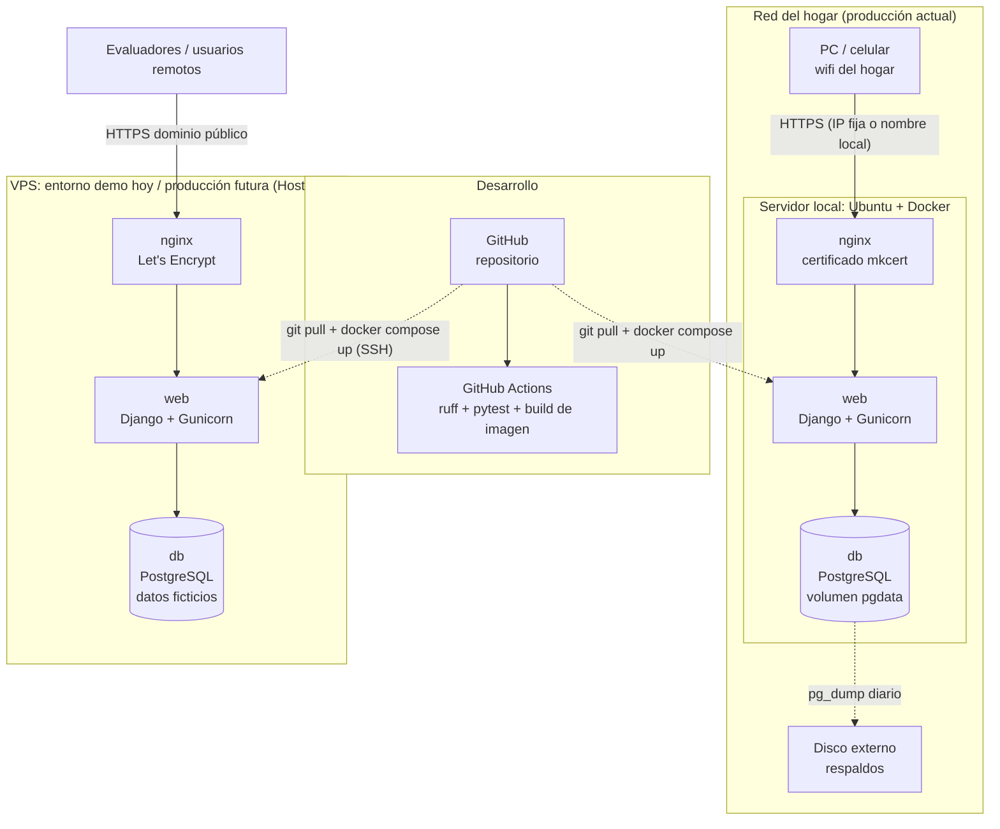

**Entornos:**

| Entorno | Ubicación | Acceso | Certificado | Datos |
|---|---|---|---|---|
| **Desarrollo** | Equipo del desarrollador | `localhost` | — | Semillas de ejemplo |
| **Producción local** | Servidor Ubuntu con Docker en el hogar | Solo red del hogar | `mkcert` (CA local instalada en los dispositivos) | Reales |
| **Demo** | VPS HostGator (alternativa: video grabado en el equipo de desarrollo si aún no hay VPS) | Internet | Let's Encrypt | Ficticios |
| **Producción futura** | VPS, cuando haya presupuesto | Internet | Let's Encrypt | Reales (migrados con `pg_dump` / `pg_restore`) |

#### **2.4.1. Diagrama de contenedores (C4 – Nivel 2)**

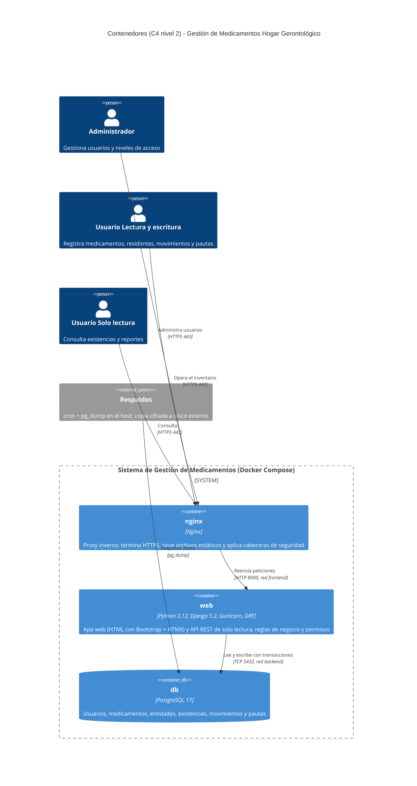

<!-- NOTA: la sintaxis C4Container de Mermaid es experimental. Si el diagrama no se renderiza correctamente en GitHub (etiquetas encimadas o error de render), se puede convertir a un diagrama de flujo (flowchart) con estilo C4, con los mismos elementos y relaciones, como los diagramas de las secciones 2.1 y 2.1.1. -->

> El **app** y la **API backend** viven en el mismo contenedor `web`: los ejecuta el mismo proceso Django y comparten la capa de servicios y los modelos. Así cumplen la misma lógica y los mismos permisos, con un contenedor menos que operar. Su separación interna (vistas HTML, API, servicios, ORM) se ve en el diagrama de la sección 2.1.

**Qué hace cada contenedor:**

| Contenedor | Imagen / tecnología | Responsabilidad | Puertos | Volúmenes | Redes |
|---|---|---|---|---|---|
| **`nginx`** — proxy inverso | `nginx:stable-alpine` | Único punto de entrada. Termina **HTTPS** (`mkcert` en la red local, Let's Encrypt en el VPS) y redirige 80 → 443. Sirve `/static/` sin pasar por Django. Aplica cabeceras de seguridad (HSTS, CSP, `X-Frame-Options`) y límites de tamaño de petición. Reenvía el resto a `web`. | **80 y 443 publicados** al host | `static` (solo lectura), `nginx/certs` | `frontend` |
| **`web`** — app + API backend | Imagen propia: Python 3.12 + Django 5.2 + Gunicorn | **App web:** renderiza las páginas HTML (Bootstrap + HTMX) de catálogo, entidades, movimientos, pautas, conteos y reportes. **API REST** (DRF): 3 endpoints JSON de solo lectura bajo `/api/`, con esquema OpenAPI. **Backend:** autenticación, sesiones, permisos por grupo, reglas de inventario (`services.py`) y panel `/admin/` para gestionar usuarios. | 8000 (solo interno, no publicado) | `static` (escribe con `collectstatic`) | `frontend` y `backend` |
| **`db`** — base de datos | `postgres:17-alpine` | Persistencia relacional de los almacenes D1 a D6. Garantiza transacciones atómicas y bloqueo de filas (`SELECT ... FOR UPDATE`) para que las existencias nunca queden negativas. | 5432 (solo interno, no publicado) | `pgdata` (datos persistentes) | `backend` |

**Flujos de comunicación entre contenedores:**

| # | Origen → destino | Protocolo / puerto | Contenido | Seguridad |
|---|---|---|---|---|
| 1 | Navegador → `nginx` | **HTTPS (TLS 1.2+) / 443** (80 solo redirige) | Peticiones de páginas, formularios (POST), fragmentos HTMX y llamadas `GET /api/...` | Certificado TLS, HSTS, cookie de sesión `Secure` + `HttpOnly` |
| 2 | `nginx` → navegador | HTTPS / 443 | HTML completo o fragmentos HTMX, JSON de la API, archivos estáticos (CSS, JS, imágenes) | Cabeceras CSP, `X-Frame-Options: DENY`, `X-Content-Type-Options` |
| 3 | `nginx` → `web` | **HTTP / 8000** (proxy inverso, red interna `frontend`) | La misma petición, con cabeceras `X-Forwarded-For` y `X-Forwarded-Proto` | No sale del host; Django confía en `X-Forwarded-Proto` solo desde `nginx` |
| 4 | `web` → `db` | **Protocolo PostgreSQL sobre TCP / 5432** (red interna `backend`) | Consultas SQL parametrizadas del ORM y transacciones de inventario | Usuario de base de datos con privilegios mínimos; credenciales en `.env`; `nginx` no tiene ruta a `db` |
| 5 | Host (cron) → `db` | `docker compose exec db pg_dump` | Respaldo diario comprimido y cifrado (GPG) | Se guarda fuera del contenedor, con retención de 14 días |

**Orden de arranque:** `db` declara un *healthcheck* (`pg_isready`). `web` arranca con `depends_on: condition: service_healthy` y `nginx` arranca después de `web`. Así `web` nunca intenta conectarse a una base de datos que todavía no responde.

**Proceso de despliegue:**
1. **Integración continua:** en cada *push* o *pull request* a `main`, GitHub Actions ejecuta `ruff` (lint), `pytest` contra un servicio PostgreSQL y el *build* de la imagen. Solo se integra a `main` con el pipeline en verde.
2. **Despliegue (local o VPS):** se hace manualmente por SSH, lo cual es suficiente para un solo mantenedor:
   ```bash
   git pull origin main
   docker compose up -d --build
   docker compose exec web python manage.py migrate
   docker compose exec web python manage.py collectstatic --noinput
   ```
3. **Primera instalación:** se copia `.env.example` a `.env` y se configuran los secretos, se generan los certificados (`mkcert` en local, `certbot` en el VPS), se crea el superusuario con `createsuperuser` y se cargan los grupos de permisos con `loaddata grupos`.
4. **Respaldos:** un cron diario ejecuta `scripts/backup_db.sh`, que genera un `pg_dump` comprimido y cifrado, con retención de 14 días y copia a un disco externo. Una vez al mes se prueba la restauración con `scripts/restore_db.sh`.
5. **Migración a hosting:** se aprovisiona el VPS con Ubuntu y Docker, se clona el repositorio, se restaura el último respaldo y se apunta el dominio. No hay cambios de código, solo variables de entorno.

### **2.5. Seguridad**

> Enumera y describe las prácticas de seguridad principales que se han implementado en el proyecto, añadiendo ejemplos si procede

| Práctica | Implementación |
|---|---|
| **Cifrado en tránsito** | HTTPS en todos los entornos. En producción: `SECURE_SSL_REDIRECT=True`, HSTS, `SESSION_COOKIE_SECURE` y `CSRF_COOKIE_SECURE`. |
| **Contraseñas** | Hash **Argon2** (`django[argon2]`) y validadores de longitud y complejidad de Django. |
| **Sesiones** | Expiran tras 30 min de inactividad (`SESSION_COOKIE_AGE=1800`, `SESSION_SAVE_EVERY_REQUEST=True`) y al cerrar el navegador. Cookies `HttpOnly` y `SameSite=Lax`. |
| **Fuerza bruta** | `django-axes`: bloquea temporalmente la cuenta tras 5 intentos fallidos. |
| **Autorización** | Grupos `Solo lectura` / `Lectura y escritura` con permisos de Django, validados **en el backend** (`PermissionRequiredMixin` en vistas y `DjangoModelPermissions` en la API). La interfaz oculta botones según el nivel, pero la autorización real ocurre en el servidor. Ejemplo: un usuario de solo lectura que envía un `POST` a `/inventario/bajas/` recibe `403`. |
| **API** | Solo lectura (`GET`), requiere sesión autenticada y no expone métodos de escritura. |
| **Vulnerabilidades web** | CSRF por defecto en formularios y peticiones HTMX. Protección contra XSS por el *autoescape* de plantillas. Protección contra inyección SQL al usar el ORM con consultas parametrizadas. `X-Frame-Options: DENY` y `Content-Security-Policy` en Nginx. |
| **Secretos y configuración** | `SECRET_KEY` y credenciales de base de datos en `.env` (no versionado). `DEBUG=False` y `ALLOWED_HOSTS` restringido en producción. |
| **Aislamiento de red** | PostgreSQL sin puertos expuestos, accesible solo desde el contenedor `web`. El usuario de base de datos de la aplicación tiene privilegios mínimos. |
| **Integridad y trazabilidad** | Cada movimiento guarda usuario y fecha/hora. Los movimientos **no se editan ni se borran**: los errores se corrigen con un movimiento inverso. Las operaciones de inventario corren en `transaction.atomic()` con `select_for_update()` para evitar saldos negativos. |
| **Privacidad (LFPDPPP)** | Minimización de datos (solo nombre y fecha de nacimiento del residente), aviso de privacidad visible y residentes egresados o fallecidos marcados como inactivos en lugar de borrados, para conservar el historial. |
| **Respaldos** | Diarios y cifrados (GPG), con retención limitada y prueba de restauración mensual. |
| **Dependencias** | Versiones fijadas en `requirements.txt` y revisión periódica con `pip-audit`. |

### **2.6. Tests**

> Describe brevemente algunos de los tests realizados

**Herramientas:** `pytest` + `pytest-django` + `factory_boy`, ejecutados en CI contra PostgreSQL real. Playwright (Python) para el flujo de extremo a extremo.

| Tipo | Caso | Resultado esperado |
|---|---|---|
| **Unitario (servicios)** | Registrar una entrada de 30 dosis para un residente | La existencia del residente aumenta en 30 y se crea un movimiento con usuario, fecha y quién entregó. |
| **Unitario (servicios)** | Dar de baja más dosis de las disponibles | Se lanza `ExistenciaInsuficiente` y el saldo no cambia. |
| **Unitario (servicios)** | Transferir del hogar a un residente cuando falla el abono al destino | La transacción se revierte y el saldo del hogar queda igual (atomicidad). |
| **Concurrencia** | Dos bajas simultáneas que juntas superan la existencia (`TransactionTestCase`) | Solo una se aplica y el saldo nunca es negativo. |
| **Unitario (conteos)** | Conteo físico de 18 dosis cuando el sistema registra 20 | La diferencia reportada es −2. |
| **Permisos** | Usuario `Solo lectura` envía un `POST` para registrar una baja | Responde `403` y no se crea el movimiento. |
| **Permisos** | Usuario sin sesión accede a cualquier pantalla | Redirige al login. |
| **API** | `GET /api/existencias/?entidad=<id>` sin autenticación / autenticado | `403` / `200` con solo las existencias de esa entidad. |
| **Extremo a extremo** | Login → alta de medicamento → entrada a residente → consulta filtrada por principio activo | El medicamento aparece con la existencia correcta. |

**Criterio:** cobertura ≥ 80 % en las capas de servicios y permisos, que concentran las reglas críticas del negocio.

---

## 3. Modelo de Datos

### **3.1. Diagrama del modelo de datos:**

> Recomendamos usar mermaid para el modelo de datos, y utilizar todos los parámetros que permite la sintaxis para dar el máximo detalle, por ejemplo las claves primarias y foráneas.

**Motor:** PostgreSQL 17. **Convenciones:**
- Claves primarias sustitutas `bigint GENERATED BY DEFAULT AS IDENTITY` (las tablas de catálogo pequeñas usan `smallint`).
- Las claves naturales se protegen con `UNIQUE`.
- Las fechas con hora son `timestamptz`.
- Las cantidades son `numeric(10,2)`, para admitir media tableta sin errores de redondeo.
- **Todas las claves foráneas son `ON DELETE RESTRICT`** (`PROTECT` en Django): no se puede borrar físicamente ningún registro con historial.


**Correspondencia con los almacenes del DFD (sección 2.1.1):**

| Almacén | Tablas |
|---|---|
| D1 Usuarios y grupos | `usuario`, `auth_group`, `usuario_groups`, `auth_permission`, `auth_group_permissions` |
| D2 Medicamentos | `medicamento`, `presentacion`, `principio_activo`, `medicamento_principio_activo` |
| D3 Entidades | `entidad` (supertipo), `residente` (subtipo) |
| D4 Existencias | `existencia` |
| D5 Movimientos | `movimiento`, `motivo_baja` |
| D6 Pautas | `pauta` |
| Conteos físicos | `conteo_fisico`, `detalle_conteo` |

**Restricciones avanzadas (DDL PostgreSQL).** Django genera la mayoría con `UniqueConstraint`, `CheckConstraint`, `ExclusionConstraint` y `GeneratedField`. Las demás se agregan en migraciones con `RunSQL`.

```sql
CREATE EXTENSION IF NOT EXISTS btree_gist;  -- para la restricción de exclusión de pautas
CREATE EXTENSION IF NOT EXISTS pg_trgm;     -- búsqueda por nombre / principio activo

-- D1: cada usuario pertenece a un solo grupo
ALTER TABLE usuario_groups ADD CONSTRAINT uq_usuario_un_grupo UNIQUE (usuario_id);

-- D2: sin duplicados de nombre comercial + presentación + concentración (sin distinguir mayúsculas)
CREATE UNIQUE INDEX uq_medicamento_nombre_pres_conc
    ON medicamento (lower(nombre_comercial), presentacion_id, lower(concentracion));
CREATE UNIQUE INDEX uq_principio_activo_nombre ON principio_activo (lower(nombre));
CREATE INDEX ix_medicamento_nombre_trgm ON medicamento USING gin (nombre_comercial gin_trgm_ops);
CREATE INDEX ix_principio_activo_nombre_trgm ON principio_activo USING gin (nombre gin_trgm_ops);

-- D3: un solo Hogar y subtipo coherente con el supertipo
CREATE UNIQUE INDEX uq_entidad_un_hogar ON entidad (tipo) WHERE tipo = 'HOGAR';
ALTER TABLE entidad
    ADD CONSTRAINT uq_entidad_id_tipo UNIQUE (id, tipo),
    ADD CONSTRAINT ck_entidad_nombre  CHECK ((tipo = 'HOGAR') = (nombre IS NOT NULL));
CREATE INDEX ix_residente_apellido_nombre
    ON residente (lower(primer_apellido), lower(segundo_apellido), lower(primer_nombre));
ALTER TABLE residente
    ADD CONSTRAINT ck_residente_tipo  CHECK (tipo = 'RESIDENTE'),
    ADD CONSTRAINT fk_residente_entidad FOREIGN KEY (entidad_id, tipo)
        REFERENCES entidad (id, tipo) ON DELETE RESTRICT,
    ADD CONSTRAINT ck_residente_baja  CHECK ((estado = 'ACTIVO') = (fecha_baja IS NULL)),
    ADD CONSTRAINT ck_residente_fechas CHECK (fecha_baja IS NULL OR fecha_baja >= fecha_ingreso);

-- D4: un saldo por entidad y medicamento, nunca negativo
ALTER TABLE existencia
    ADD CONSTRAINT uq_existencia UNIQUE (entidad_id, medicamento_id),
    ADD CONSTRAINT ck_existencia_saldo CHECK (saldo >= 0);

-- D5: columnas obligatorias y prohibidas según el tipo de movimiento
ALTER TABLE movimiento ADD CONSTRAINT ck_movimiento_por_tipo CHECK (
    (tipo = 'ENTRADA'
        AND entidad_origen_id IS NULL AND entidad_destino_id IS NOT NULL
        AND motivo_baja_id IS NULL
        AND (corrige_a_id IS NOT NULL OR (origen_entrada IS NOT NULL AND entregado_por IS NOT NULL)))
 OR (tipo = 'TRANSFERENCIA'
        AND entidad_origen_id IS NOT NULL AND entidad_destino_id IS NOT NULL
        AND entidad_origen_id <> entidad_destino_id
        AND motivo_baja_id IS NULL AND origen_entrada IS NULL AND entregado_por IS NULL)
 OR (tipo = 'BAJA'
        AND entidad_origen_id IS NOT NULL AND entidad_destino_id IS NULL
        AND motivo_baja_id IS NOT NULL AND origen_entrada IS NULL AND entregado_por IS NULL)
);
ALTER TABLE movimiento
    ADD CONSTRAINT ck_movimiento_cantidad CHECK (cantidad > 0),
    ADD CONSTRAINT uq_movimiento_corrige UNIQUE (corrige_a_id),
    ADD CONSTRAINT ck_movimiento_no_autocorrige CHECK (corrige_a_id <> id);
CREATE INDEX ix_movimiento_medicamento_fecha ON movimiento (medicamento_id, fecha_hora);
CREATE INDEX ix_movimiento_origen_fecha  ON movimiento (entidad_origen_id, fecha_hora);
CREATE INDEX ix_movimiento_destino_fecha ON movimiento (entidad_destino_id, fecha_hora);

-- D5: inmutabilidad (doble barrera: privilegios + trigger)
REVOKE UPDATE, DELETE ON movimiento FROM app_user;
CREATE FUNCTION fn_movimiento_inmutable() RETURNS trigger LANGUAGE plpgsql AS $$
BEGIN
    RAISE EXCEPTION 'Los movimientos son inmutables: registre un movimiento de corrección';
END $$;
CREATE TRIGGER tg_movimiento_inmutable BEFORE UPDATE OR DELETE ON movimiento
    FOR EACH ROW EXECUTE FUNCTION fn_movimiento_inmutable();

-- D6: sin pautas con vigencias traslapadas para el mismo residente y medicamento
ALTER TABLE pauta
    ADD CONSTRAINT ck_pauta_dosis      CHECK (dosis > 0),
    ADD CONSTRAINT ck_pauta_frecuencia CHECK (frecuencia_horas BETWEEN 1 AND 168),
    ADD CONSTRAINT ck_pauta_fechas     CHECK (fecha_fin IS NULL OR fecha_fin >= fecha_inicio),
    ADD CONSTRAINT ex_pauta_sin_traslape EXCLUDE USING gist (
        residente_id WITH =, medicamento_id WITH =,
        daterange(fecha_inicio, fecha_fin, '[]') WITH &&);

-- Conteos: un renglón por medicamento y diferencia calculada por la base de datos
ALTER TABLE conteo_fisico
    ADD CONSTRAINT ck_conteo_periodo CHECK (periodo_fin >= periodo_inicio),
    ADD CONSTRAINT ck_conteo_cierre  CHECK ((estado = 'CERRADO') = (cerrado_en IS NOT NULL));
ALTER TABLE detalle_conteo
    ADD CONSTRAINT uq_detalle_conteo UNIQUE (conteo_id, medicamento_id),
    ADD CONSTRAINT ck_detalle_fisica CHECK (cantidad_fisica >= 0);
-- diferencia: numeric(10,2) GENERATED ALWAYS AS (cantidad_fisica - cantidad_sistema) STORED
```

**Datos semilla (migración de datos):**
- La entidad `HOGAR`.
- Los grupos `Solo lectura` y `Lectura y escritura` con sus permisos.
- Los motivos de baja: `CONSUMO`, `CADUCIDAD`, `MERMA`, `ROTURA`, `DEVOLUCION_FAMILIA`, `DEFUNCION`, `EGRESO` y `CORRECCION`.
- Las presentaciones más comunes: tableta, cápsula, jarabe, gotas, ampolleta, parche, crema, inhalador.

### **3.2. Descripción de entidades principales:**

> Recuerda incluir el máximo detalle de cada entidad, como el nombre y tipo de cada atributo, descripción breve si procede, claves primarias y foráneas, relaciones y tipo de relación, restricciones (unique, not null…), etc.

#### D1 — Usuarios y grupos

**`usuario`**: modelo de usuario propio de Django (`AbstractUser`), definido desde el inicio del proyecto como recomienda Django. Representa a quienes usan el sistema.

| Atributo | Tipo | Restricciones | Descripción |
|---|---|---|---|
| `id` | bigint | PK, identity | Identificador |
| `username` | varchar(150) | NOT NULL, UNIQUE | Nombre de inicio de sesión |
| `password` | varchar(128) | NOT NULL | Hash Argon2; nunca la contraseña en claro |
| `first_name` / `last_name` | varchar(150) | NOT NULL, DEFAULT `''` | Nombre para mostrar |
| `email` | varchar(254) | NOT NULL, DEFAULT `''` | Opcional |
| `is_active` | boolean | NOT NULL, DEFAULT true | `false` = usuario dado de baja (no se borra) |
| `is_superuser` | boolean | NOT NULL, DEFAULT false | `true` = **Administrador** |
| `is_staff` | boolean | NOT NULL, DEFAULT false | Acceso al panel `/admin/` (solo el Administrador) |
| `last_login` | timestamptz | NULL | Último inicio de sesión |
| `date_joined` | timestamptz | NOT NULL, DEFAULT now() | Fecha de alta |

**Relaciones:**
- `usuario` 1 — 0..1 `usuario_groups` (**un solo grupo**, por el `UNIQUE (usuario_id)`).
- 1 — N con `movimiento`, `pauta` y `conteo_fisico` (quién registró).

**`auth_group` / `usuario_groups` / `auth_permission` / `auth_group_permissions`**: tablas del sistema de permisos de Django.
- `auth_group` contiene exactamente 2 filas: **Solo lectura** (permisos `view_*`) y **Lectura y escritura** (permisos `view_*`, `add_*` y `change_*` de los módulos de negocio).
- `usuario_groups` es la tabla puente usuario ↔ grupo. Django la define como N:M; el `UNIQUE (usuario_id)` la reduce a **N:1**.
- Un usuario que no es superusuario debe tener exactamente un grupo. El "a lo sumo uno" lo garantiza la base de datos y el "al menos uno" lo valida el formulario del panel de administración.

#### D2 — Medicamentos

**`presentacion`**: catálogo de formas farmacéuticas.

| Atributo | Tipo | Restricciones | Descripción |
|---|---|---|---|
| `id` | smallint | PK, identity | Identificador |
| `nombre` | varchar(60) | NOT NULL, UNIQUE | Tableta, cápsula, jarabe, gotas… |
| `activo` | boolean | NOT NULL, DEFAULT true | Permite retirar opciones sin borrarlas |

**`principio_activo`**: sustancia activa (ej. *paracetamol*, *losartán*).

| Atributo | Tipo | Restricciones | Descripción |
|---|---|---|---|
| `id` | bigint | PK, identity | Identificador |
| `nombre` | varchar(150) | NOT NULL, UNIQUE sobre `lower(nombre)` | Nombre de la sustancia; índice trigram para búsqueda |
| `creado_en` | timestamptz | NOT NULL, DEFAULT now() | Fecha de alta |

**`medicamento`**: producto del catálogo.

| Atributo | Tipo | Restricciones | Descripción |
|---|---|---|---|
| `id` | bigint | PK, identity | Identificador |
| `nombre_comercial` | varchar(150) | NOT NULL | Nombre del producto; índice trigram para búsqueda |
| `tipo` | varchar(10) | NOT NULL, CHECK (`GENERICO`, `ORIGINAL`) | Genérico u original |
| `presentacion_id` | smallint | FK → `presentacion.id`, NOT NULL | Forma farmacéutica |
| `concentracion` | varchar(60) | NOT NULL | Texto libre normalizado, ej. `500 mg`, `50 mg / 12.5 mg` |
| `activo` | boolean | NOT NULL, DEFAULT true | **Baja lógica**; se rechaza si existe saldo > 0 en alguna entidad |
| `creado_en` / `actualizado_en` | timestamptz | NOT NULL, DEFAULT now() | Control de cambios |

- **UNIQUE** (`lower(nombre_comercial)`, `presentacion_id`, `lower(concentracion)`). La unicidad aplica también a los inactivos: en lugar de duplicar, se reactiva.
- **Relaciones:**
  - N:1 con `presentacion`.
  - N:M con `principio_activo`, a través de `medicamento_principio_activo`.
  - 1:N con `existencia`, `movimiento`, `pauta` y `detalle_conteo`.

**`medicamento_principio_activo`**: tabla puente. Un medicamento tiene **uno o más** principios activos (por ejemplo, una combinación) y un principio activo aparece en muchos medicamentos.

| Atributo | Tipo | Restricciones | Descripción |
|---|---|---|---|
| `id` | bigint | PK, identity | Identificador |
| `medicamento_id` | bigint | FK → `medicamento.id`, NOT NULL | Medicamento |
| `principio_activo_id` | bigint | FK → `principio_activo.id`, NOT NULL | Principio activo |

- UNIQUE (`medicamento_id`, `principio_activo_id`). El "al menos uno" se valida en el formulario.

#### D3 — Entidades

**`entidad`**: **supertipo** de todo lo que puede poseer existencias: el Hogar y cada residente. Gracias a él, `existencia`, `movimiento` y `conteo_fisico` tienen una sola FK real hacia "la entidad".

| Atributo | Tipo | Restricciones | Descripción |
|---|---|---|---|
| `id` | bigint | PK, identity; UNIQUE (`id`, `tipo`) | Identificador |
| `tipo` | varchar(10) | NOT NULL, CHECK (`HOGAR`, `RESIDENTE`) | Discriminador del subtipo |
| `nombre` | varchar(150) | NULL; CHECK: obligatorio si y solo si `tipo = 'HOGAR'` | Nombre del Hogar. En los residentes queda nulo, porque su nombre vive desglosado en `residente` (sin duplicarlo) |
| `creado_en` / `actualizado_en` | timestamptz | NOT NULL, DEFAULT now() | Control de cambios |

- **Un solo Hogar:** índice único parcial `(tipo) WHERE tipo = 'HOGAR'`. Se crea con la semilla y la aplicación no permite modificar su tipo ni darlo de baja.

**`residente`**: **subtipo** de `entidad`, con los datos propios del residente (relación 1:0..1).

| Atributo | Tipo | Restricciones | Descripción |
|---|---|---|---|
| `entidad_id` | bigint | PK; FK compuesta (`entidad_id`, `tipo`) → `entidad (id, tipo)` | Misma clave que su entidad |
| `tipo` | varchar(10) | NOT NULL, CHECK = `RESIDENTE` | Garantiza que solo una entidad `RESIDENTE` tenga fila aquí |
| `primer_nombre` | varchar(60) | NOT NULL | Primer nombre (dato personal, LFPDPPP) |
| `segundo_nombre` | varchar(60) | NULL | Segundo nombre, si lo tiene |
| `primer_apellido` | varchar(60) | NOT NULL | Primer apellido |
| `segundo_apellido` | varchar(60) | NULL | Segundo apellido, si lo tiene |
| `fecha_nacimiento` | date | NOT NULL | Dato personal (LFPDPPP) |
| `fecha_ingreso` | date | NOT NULL | Ingreso al hogar |
| `estado` | varchar(10) | NOT NULL, DEFAULT `ACTIVO`, CHECK (`ACTIVO`, `EGRESADO`, `FALLECIDO`) | La baja es **lógica** |
| `fecha_baja` | date | NULL; CHECK: nula si y solo si `ACTIVO`, y ≥ `fecha_ingreso` | Fecha de egreso o defunción |

- **Nombre para mostrar:** se compone al vuelo (`primer_nombre segundo_nombre primer_apellido segundo_apellido`, omitiendo los nulos) y no se guarda. El índice `ix_residente_apellido_nombre` acelera el filtro por paciente.
- **Relaciones:** 1:N con `pauta`. Las existencias, movimientos y conteos del residente cuelgan de su `entidad`.

#### D4 — Existencias

**`existencia`**: saldo actual, en dosis, de un medicamento en una entidad.

| Atributo | Tipo | Restricciones | Descripción |
|---|---|---|---|
| `id` | bigint | PK, identity | Identificador |
| `entidad_id` | bigint | FK → `entidad.id`, NOT NULL | Dueño del saldo |
| `medicamento_id` | bigint | FK → `medicamento.id`, NOT NULL | Medicamento |
| `saldo` | numeric(10,2) | NOT NULL, DEFAULT 0, CHECK ≥ 0 | Dosis disponibles (admite 0.5) |
| `actualizado_en` | timestamptz | NOT NULL, DEFAULT now() | Último movimiento aplicado |

- UNIQUE (`entidad_id`, `medicamento_id`).
- **Dato derivado controlado:** el saldo es la suma de los movimientos de esa entidad y ese medicamento. Se guarda materializado porque el DFD lo exige como almacén (D4) y para no sumar todo el historial en cada consulta. Solo lo modifica `inventario/services.py`, dentro de la **misma transacción** que inserta el movimiento y con `SELECT ... FOR UPDATE`. Una consulta de conciliación verifica que `saldo` coincida con la suma de los movimientos; se ejecuta en los tests y como verificación periódica.

#### D5 — Movimientos

**`motivo_baja`**: catálogo de motivos de baja.

| Atributo | Tipo | Restricciones | Descripción |
|---|---|---|---|
| `id` | smallint | PK, identity | Identificador |
| `clave` | varchar(30) | NOT NULL, UNIQUE | `CONSUMO`, `CADUCIDAD`, `MERMA`, `ROTURA`, `DEVOLUCION_FAMILIA`, `DEFUNCION`, `EGRESO`, `CORRECCION` |
| `descripcion` | varchar(100) | NOT NULL | Texto para mostrar |
| `activo` | boolean | NOT NULL, DEFAULT true | Permite retirar motivos sin borrarlos |

**`movimiento`**: registro **inmutable** de cada entrada, transferencia o baja. Es la trazabilidad mínima del sistema.

| Atributo | Tipo | Restricciones | Descripción |
|---|---|---|---|
| `id` | bigint | PK, identity | Identificador |
| `tipo` | varchar(15) | NOT NULL, CHECK (`ENTRADA`, `TRANSFERENCIA`, `BAJA`) | Tipo de operación |
| `medicamento_id` | bigint | FK → `medicamento.id`, NOT NULL | Medicamento movido |
| `cantidad` | numeric(10,2) | NOT NULL, CHECK > 0 | Dosis; siempre positiva (el sentido lo dan origen y destino) |
| `entidad_origen_id` | bigint | FK → `entidad.id`, NULL | De dónde sale (transferencia y baja) |
| `entidad_destino_id` | bigint | FK → `entidad.id`, NULL | A dónde entra (entrada y transferencia) |
| `motivo_baja_id` | smallint | FK → `motivo_baja.id`, NULL | Obligatorio solo en `BAJA` |
| `origen_entrada` | varchar(10) | NULL, CHECK (`FAMILIAR`, `HOGAR`, `OTRO`) | Quién aporta, solo en `ENTRADA` |
| `entregado_por` | varchar(150) | NULL | Nombre de quien entregó, solo en `ENTRADA` |
| `corrige_a_id` | bigint | FK → `movimiento.id`, NULL, UNIQUE | Movimiento que este corrige (cada movimiento se corrige una sola vez) |
| `nota` | text | NULL | Observaciones |
| `usuario_id` | bigint | FK → `usuario.id`, NOT NULL | Quién registró |
| `fecha_hora` | timestamptz | NOT NULL, DEFAULT now() | Cuándo se registró |

**Reglas por tipo** (CHECK `ck_movimiento_por_tipo`):

| Tipo | Origen | Destino | Motivo | Origen de entrada / entregado por | Efecto en `existencia` |
|---|---|---|---|---|---|
| `ENTRADA` | NULL | obligatorio | NULL | obligatorios (salvo en una corrección) | + destino |
| `TRANSFERENCIA` | obligatorio | obligatorio, ≠ origen | NULL | NULL | − origen / + destino |
| `BAJA` | obligatorio | NULL | obligatorio | NULL | − origen |

- **Inmutabilidad:** el usuario de base de datos de la aplicación no tiene privilegios `UPDATE` ni `DELETE` sobre la tabla, y un *trigger* rechaza cualquier intento de modificación.
- **Corrección de errores:** se registra el movimiento inverso con `corrige_a_id`:
  - Una entrada se corrige con una baja de motivo `CORRECCION`.
  - Una baja se corrige con una entrada.
  - Una transferencia se corrige con la transferencia en sentido contrario.
- **Relaciones:**
  - N:1 con `medicamento`, `usuario` y `motivo_baja` (opcional).
  - N:0..1 con `entidad`, dos veces (origen y destino).
  - 0..1:0..1 consigo misma (corrección).

#### D6 — Pautas

**`pauta`**: dosis y frecuencia de un medicamento para un residente, con vigencia. Es informativa: no mueve existencias.

| Atributo | Tipo | Restricciones | Descripción |
|---|---|---|---|
| `id` | bigint | PK, identity | Identificador |
| `residente_id` | bigint | FK → `residente.entidad_id`, NOT NULL | Solo residentes, nunca el Hogar |
| `medicamento_id` | bigint | FK → `medicamento.id`, NOT NULL | Medicamento pautado |
| `dosis` | numeric(6,2) | NOT NULL, CHECK > 0 | Dosis por toma (ej. 0.5, 1, 2) |
| `frecuencia_horas` | smallint | NOT NULL, CHECK 1–168 | Cada cuántas horas (8, 12, 24; semanal = 168) |
| `si_necesario` | boolean | NOT NULL, DEFAULT false | Pauta "en caso necesario" (PRN); la frecuencia es el intervalo mínimo |
| `indicaciones` | text | NULL | Ej. "en ayunas", "con alimentos" |
| `fecha_inicio` | date | NOT NULL | Inicio de vigencia |
| `fecha_fin` | date | NULL, CHECK ≥ `fecha_inicio` | NULL = vigente |
| `registrado_por_id` | bigint | FK → `usuario.id`, NOT NULL | Quién registró |
| `creado_en` | timestamptz | NOT NULL, DEFAULT now() | Fecha de registro |

- **Vigencia sin traslapes:** una restricción de exclusión (`EXCLUDE USING gist`) impide dos pautas con vigencias superpuestas para el mismo residente y medicamento.
- **Cambio de pauta:** se cierra la vigente (`fecha_fin`) y se crea una nueva, así se conserva el historial.

#### Conteos físicos

**`conteo_fisico`**: encabezado de un inventario físico de una entidad para un período.

| Atributo | Tipo | Restricciones | Descripción |
|---|---|---|---|
| `id` | bigint | PK, identity | Identificador |
| `entidad_id` | bigint | FK → `entidad.id`, NOT NULL | Entidad inventariada (residente u Hogar) |
| `periodo_inicio` / `periodo_fin` | date | NOT NULL, CHECK fin ≥ inicio | Rango de fechas a demanda |
| `estado` | varchar(10) | NOT NULL, DEFAULT `EN_PROCESO`, CHECK (`EN_PROCESO`, `CERRADO`) | Permite contar en varias sesiones |
| `usuario_id` | bigint | FK → `usuario.id`, NOT NULL | Quién realiza el conteo |
| `creado_en` | timestamptz | NOT NULL, DEFAULT now() | Inicio del conteo |
| `cerrado_en` | timestamptz | NULL; CHECK: obligatoria si y solo si `CERRADO` | Cierre del conteo |
| `nota` | text | NULL | Observaciones |

**`detalle_conteo`**: un renglón por medicamento contado.

| Atributo | Tipo | Restricciones | Descripción |
|---|---|---|---|
| `id` | bigint | PK, identity | Identificador |
| `conteo_id` | bigint | FK → `conteo_fisico.id`, NOT NULL | Conteo al que pertenece |
| `medicamento_id` | bigint | FK → `medicamento.id`, NOT NULL | Medicamento contado |
| `cantidad_fisica` | numeric(10,2) | NOT NULL, CHECK ≥ 0 | Dosis contadas físicamente |
| `cantidad_sistema` | numeric(10,2) | NOT NULL | **Foto** del saldo registrado al momento de contar |
| `diferencia` | numeric(10,2) | GENERATED ALWAYS AS (`cantidad_fisica − cantidad_sistema`) STORED | Calculada por la base de datos; nunca se escribe a mano |

- UNIQUE (`conteo_id`, `medicamento_id`).
- `cantidad_sistema` no es redundante: es un hecho histórico (el saldo de ese momento), que cambia después con nuevos movimientos.
- El conteo **no ajusta existencias automáticamente**. Si hay diferencias, el usuario registra los movimientos que correspondan (por ejemplo, una baja por merma).

#### Normalización (3FN)

- **1FN:** todos los atributos son atómicos. No hay listas ni grupos repetidos: los principios activos de un medicamento van en una tabla puente, no en una columna separada por comas.
- **2FN:** todas las tablas usan una clave primaria sustituta de una sola columna, así que no hay dependencias parciales. En las tablas puente y de detalle, los atributos dependen de la combinación completa.
- **3FN:** ningún atributo no clave depende de otro atributo no clave:
  - La forma farmacéutica vive en `presentacion` y el motivo de baja en `motivo_baja`, en lugar de repetirse como texto.
  - Los datos del residente están en `residente` y no se repiten en `movimiento` ni en `pauta`.
  - El nombre del residente se guarda una sola vez, desglosado en 4 campos atómicos. `entidad.nombre` solo se usa para el Hogar, así el nombre completo no se repite en dos tablas.
  - El estado activo de una entidad no se duplica: se deriva de `residente.estado` (el Hogar siempre está activo).
- **Excepciones documentadas y controladas:**
  - `existencia.saldo`: dato derivado materializado, mantenido en la misma transacción que el movimiento y conciliable.
  - `detalle_conteo.cantidad_sistema`: foto histórica, no redundancia.
  - `detalle_conteo.diferencia`: columna generada por la base de datos.
  - El **reporte mensual no tiene tabla**: se calcula con consultas sobre `movimiento` y `existencia`.

#### Antipatrones evitados

| Antipatrón | Riesgo | Cómo se evita en este modelo |
|---|---|---|
| **Asociación polimórfica** (`entidad_tipo` + `entidad_id` sin FK) | Referencias huérfanas: la base de datos no puede validar la FK | Supertipo `entidad` con subtipo `residente`. Todas las FK son reales y la FK compuesta (`entidad_id`, `tipo`) impide subtipos incoherentes |
| **Listas separadas por comas** (*jaywalking*) en principio activo | No se puede filtrar ni indexar bien, y hay duplicados ocultos | Tabla puente `medicamento_principio_activo` |
| **EAV** (entidad-atributo-valor) | Sin tipos ni restricciones; consultas complejas | Columnas explícitas y tipadas en cada tabla |
| **ENUM/CHECK para listas que cambian** | Requiere migraciones para agregar valores | `presentacion` y `motivo_baja` son tablas de catálogo. CHECK solo para dominios fijos ligados a la lógica (`tipo` de movimiento, `estado`) |
| **Restricciones solo en la aplicación** | Un error o un acceso directo a la base de datos rompe las reglas | `UNIQUE`, `CHECK`, `EXCLUDE` y FK en PostgreSQL. La aplicación valida primero para dar mensajes claros |
| **Borrado físico de historial** | Se pierde la trazabilidad y quedan FK rotas | Baja lógica (`activo`, `estado`, `is_active`), `ON DELETE RESTRICT` y movimientos inmutables |
| **`FLOAT` para cantidades** | Errores de redondeo en saldos | `numeric(10,2)` |
| **Claves naturales mutables como PK** | Cambiar un nombre rompe las referencias | PK sustitutas e índices `UNIQUE` sobre las claves naturales |
| **Datos derivados sin control** | Saldos que no cuadran | Saldo actualizado solo en la transacción del movimiento, con `CHECK ≥ 0`, conciliación y diferencia generada por la base de datos |
| **Fechas sin zona horaria** | Horas ambiguas al migrar a un VPS | `timestamptz` para fecha y hora; `date` para fechas de calendario |
| **Columnas repetidas** (`dosis1`, `dosis2`…) | Esquema rígido | Una fila por pauta, con vigencia |
| **Contraseñas legibles** | Exposición de credenciales | Solo el hash Argon2 en `usuario.password` |

---

## 4. Especificación de la API

> Si tu backend se comunica a través de API, describe los endpoints principales (máximo 3) en formato OpenAPI. Opcionalmente puedes añadir un ejemplo de petición y de respuesta para mayor claridad

---

## 5. Historias de Usuario

> Documenta 3 de las historias de usuario principales utilizadas durante el desarrollo, teniendo en cuenta las buenas prácticas de producto al respecto.

**Historia de Usuario 1**

**Historia de Usuario 2**

**Historia de Usuario 3**

---

## 6. Tickets de Trabajo

> Documenta 3 de los tickets de trabajo principales del desarrollo, uno de backend, uno de frontend, y uno de bases de datos. Da todo el detalle requerido para desarrollar la tarea de inicio a fin teniendo en cuenta las buenas prácticas al respecto. 

**Ticket 1**

**Ticket 2**

**Ticket 3**

---

## 7. Pull Requests

> Documenta 3 de las Pull Requests realizadas durante la ejecución del proyecto

**Pull Request 1**

**Pull Request 2**

**Pull Request 3**

